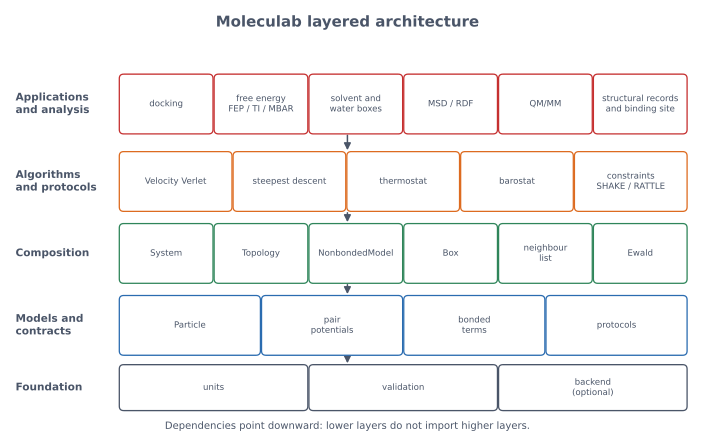

# Moleculab software architecture

> **Status.** This document describes the architecture **as implemented** in
> `src/moleculab/`. The long-term roadmap is in [`lib.md`](lib.md); when the
> two differ, the code and this document win. The validation strategy is in
> [`validation.md`](validation.md).

Moleculab is an educational molecular physics and simulation library. It is
small enough to read in an afternoon, but structured so that each new physical
model, numerical algorithm, or analysis tool can be added without rewriting the
rest.

The central architectural rule is:

> **Separate the physical model, the numerical algorithm, and the simulation
> protocol.**

A Lennard-Jones potential is a model. Velocity Verlet is an algorithm. A
Berendsen thermostat is a protocol. Mixing them makes a library that is hard to
test, hard to teach, and hard to extend.



*Dependencies point downward. Lower layers do not import higher layers.*

Regenerate this diagram with:

```bash
uv run python docs/generate_architecture_visuals.py
```

## 1. Design goals and constraints

The architecture is shaped by six goals.

| Goal | Consequence |
| --- | --- |
| scientific correctness | every model has energy and force, tested against finite differences and analytic results |
| inspectability | small modules, plain NumPy, explicit loops where they teach something |
| separation of concerns | models, algorithms, protocols, analysis, and applications are distinct |
| incremental growth | each milestone adds a module and a test, not a rewrite |
| reproducibility | examples and tutorials run from the repository, with documented expected output |
| performance later | CPU and NumPy first; PyTorch optional only where it pays; Rust later |

The main constraint is that this is a **teaching library**, not a production
molecular-dynamics package. Clarity is a feature. O(N²) pair loops, Python-level
iteration, and small default systems are acceptable because they make the
physics visible. Production concerns such as neighbour lists, particle-mesh
Ewald, triclinic boxes, and GPU kernels are deliberately deferred.

## 2. The big picture

Moleculab is organised into five layers.

| Layer | Responsibility | Representative modules |
| --- | --- | --- |
| applications and analysis | answer a scientific question using the engine | `docking`, `flexible_docking`, `fep`, `ti`, `mbar`, `solvent`, `water`, `analysis`, `qm_mm` |
| algorithms and protocols | advance, constrain, or sample a state | `integrators`, `minimization`, `constraints`, `thermostats`, `pressure` |
| composition | assemble particles, models, topology, box, and global terms | `system`, `topology`, `nonbonded`, `box`, `ewald` |
| physical models | define what the system is and how its energy is defined | `particles`, `potentials`, `bonded`, `units` |
| foundation | numerical and validation primitives | `units`, `_validation`, `backend` |

The public API re-exports the user-facing names from
[`src/moleculab/__init__.py`](../src/moleculab/__init__.py). Tutorials and
examples import from `moleculab`, not from internal modules.

## 3. Separation of concerns

The most important distinctions are summarised below.

| Concern | Question it answers | Examples | Must not do |
| --- | --- | --- | --- |
| physical model | what is the system and its energy? | Lennard-Jones, Coulomb, bonds, angles, torsions, Ewald | integrate time, rescale velocities, or score a pose |
| data structure | how is the state represented? | `Particle`, `System`, `Topology`, `Box`, `Trajectory` | contain a hidden integration loop |
| numerical algorithm | how are the equations solved? | Velocity Verlet, steepest descent, SHAKE/RATTLE | define a new force field |
| simulation protocol | how is the state prepared or sampled? | Berendsen thermostat, barostat | change the potential energy function |
| analysis | what does a trajectory mean? | MSD, RDF | modify the trajectory or the forces |
| application | what scientific question is being asked? | docking, FEP/TI/MBAR, solvation | duplicate core physics |
| backend | where does a numerical kernel run? | CPU, optional PyTorch Ewald | leak device details into models |

This separation is not cosmetic. It determines what can be tested independently
and what must be rewritten when a new model is added.

## 4. Module map and dependency rules

The dependency graph is deliberately shallow.

```text
units, _validation
    |
particles, box, bonded, potentials
    |
topology
    |
nonbonded, ewald
    |
physics
    |
system
    |
constraints, integrators, minimization, thermostats, pressure
    |
analysis, solvent, water, fep, ti, mbar, lj_alchemy, mc_alchemy
    |
docking, flexible_docking, solvated_alchemy, qm_mm
```

The actual imports are visible in the source. The important rules are:

| Module | May depend on | Must not depend on |
| --- | --- | --- |
| `units`, `_validation` | Python and NumPy only | any Moleculab model or algorithm |
| `particles`, `box`, `bonded`, `potentials` | foundation | `System`, integrators, thermostats |
| `topology` | `bonded` | coordinates, `System`, integrators |
| `nonbonded` | foundation, `ewald` | `System`, integrators |
| `ewald` | foundation, `backend`, `box`, `units` | `System`, integrators |
| `physics` | `particles`, `potentials` | `System`, integrators |
| `system` | models, topology, box, nonbonded, Ewald, physics | integrators, thermostats, docking |
| `integrators` | `system`, `physics`, `constraints`, `potentials` | docking, free energy, analysis |
| `minimization` | `system`, `constraints` | thermostats, docking |
| `thermostats`, `pressure` | `system`, `particles`, `box` | potentials directly |
| `analysis` | `box` only | `System`, integrators |
| `docking` | `system`, `particles`, nonbonded models | integrators, thermostats |
| `backend` | optional PyTorch | any model |

Two deliberate design choices are visible here:

- **`analysis` depends only on `Box`**, not on `System`. It can analyse arrays
  from any source, including an external trajectory file or a hand-built toy
  model.
- **`physics` depends on `particles` and `potentials`**, not on `System`. This
  keeps the basic equations usable with a single particle and prevents a
  circular dependency with `System`.

### 4.1 Allowed exceptions

`solvated_alchemy` is an experiment driver, not a core model. It imports
integrators, thermostats, and multi-particle Monte Carlo machinery because it
runs a complete alchemical experiment. This is acceptable for an application
module at the top of the graph.

`water` and `solvent` are **model builders**. They assemble a `System` from
particles, topology, boxes, and nonbonded models. They do not implement a new
integrator or thermostat.

`qm_mm` is a separate physical model. It solves a one-dimensional
finite-difference Schrödinger equation with fixed point charges. It is not a
classical potential and is deliberately isolated.

## 5. Core data structures and contracts

### 5.1 `Particle`

`Particle` stores the mechanical state and the chemical identity:

| Field | Meaning |
| --- | --- |
| `mass` | positive mass in Da |
| `position` | three components in nm |
| `velocity` | three components in nm/ps |
| `atom_type` | label used by typed nonbonded models |
| `charge` | partial charge in elementary-charge units |

It stores no acceleration. Acceleration is derived from force and mass. Speed
is derived from velocity. The constructor copies arrays so a particle owns its
state, and `copy()` returns an independent particle.

The design rationale is simple: **one source of truth**. If acceleration were
stored separately, a force change could make the stored acceleration stale.
Derived quantities are computed when needed. In a large production code they
may be cached, but the cache is still a derived value and must remain
consistent with the state.

`atom_type` and `charge` are not mechanical state, but they are part of the
model's identity. Every rebuild path must preserve them. This is enforced by
`tests/test_state_preservation.py`.

### 5.2 `System`

`System` is the composition layer. It contains:

| Field | Purpose |
| --- | --- |
| `particles` | the atoms or coarse-grained sites |
| `pair_potentials` | simple potentials summed over every unique pair |
| `topology` | bonds, angles, torsions |
| `box` | optional periodic box |
| `nonbonded_model` | typed Lennard-Jones plus optional electrostatics |
| `constraints` | SHAKE/RATTLE distance constraints |
| `indexed_pair_potentials` | potentials applied to selected atom pairs |

`System` computes:

- `nonbonded_energy()`, `bonded_energy()`, `potential_energy()`;
- `kinetic_energy()`, `total_energy()`;
- `forces()`;
- convenience arrays `positions`, `velocities`, `charges`, `atom_types`.

`System` is a facade and composition root. It does not define new physics; it
sums the models it is given. It is also the one place where global terms such as
Ewald reciprocal-space corrections and exclusions are applied once.

### 5.3 `Topology`

`Topology` stores a molecular graph indexed by atom number:

| Term | Shape | Meaning |
| --- | --- | --- |
| `Bond(i, j, potential)` | two atoms | bond stretch |
| `Angle(i, j, k, potential)` | three atoms | angle bend with vertex `j` |
| `Torsion(i, j, k, l, potential)` | four atoms | dihedral rotation |

The graph is separate from the coordinates. The same topology can be reused
with many conformations. `Topology.nonbonded_exclusions()` returns the 1-2 and
1-3 pairs that must not be double counted by the nonbonded model. Torsion 1-4
pairs are not excluded by default; force fields often scale them instead.

### 5.4 `Box`

`Box` implements orthorhombic periodic boundaries:

- `minimum_image(displacement)`;
- `minimum_image_array(displacements)`;
- `wrap(position)`;
- `distance(displacement)`;
- `volume`.

`System` applies the minimum image only to nonbonded separations. Bonded terms
use raw coordinates, because a bond should follow the molecular graph rather
than jump across a box face.

### 5.5 Potential protocols

The model interfaces are structural protocols, not a deep inheritance tree:

| Protocol | Required methods |
| --- | --- |
| `Potential` | `energy(position)`, `force(position)` |
| `PairPotential` | `energy(displacement)`, `force(displacement)` |
| `BondPotential` | `energy(displacement)`, `force(displacement)` |
| `AnglePotential` | `energy(r_ji, r_jk)`, `forces(r_ji, r_jk)` |
| `TorsionPotential` | `energy(r_ij, r_jk, r_kl)`, `forces(r_ij, r_jk, r_kl)` |

An algorithm accepts any object that satisfies the relevant interface. This
keeps Velocity Verlet independent of whether the potential is harmonic,
Lennard-Jones, or something added later.

The most important contract is:

**For every potential, the force must be the negative gradient of the same
energy model.**

This is checked by `tests/test_force_gradients.py` for every core potential.
The test differentiates the energy numerically and compares it with the
analytical force. It never calls the analytical force inside the numerical
derivative, so a sign error or missing factor cannot hide.

### 5.6 `Trajectory`

`Trajectory` and `SystemTrajectory` are frozen dataclasses containing time,
positions, velocities, kinetic energy, potential energy, and total energy. A
frozen snapshot is easy to analyse, compare, and plot. The integrator never
mutates a trajectory after creating it.

### 5.7 Validation at the boundary

`_validation.py` provides small helpers such as `as_positive_float`,
`as_vector3`, `as_displacement`, and `as_finite_float`. Invalid shapes,
non-finite values, zero distances, and negative masses fail at the boundary,
where the error is easy to understand. They do not propagate into a force
calculation and produce a mysterious `NaN` later.

## 6. Architectural decisions

The following decision records explain why the code looks the way it does.

### ADR-001: One coherent internal unit system

**Decision.** Use nm, ps, kJ/mol, Da, kJ/(mol nm), K, and e everywhere inside
the library.

**Context.** SI units produce awkward powers of ten at molecular scales.
Frequent conversions inside physics code invite errors.

**Consequences.** In this system, $a = F / m$ is numerically correct without a
conversion factor. The same cancellation makes $K = \frac12 m v^2$ direct.
Conversion constants live in `units.py`, not in potentials or integrators.

**Trade-off.** Readers must learn the unit system. The tutorials do that in
part 01, and `tests/test_units.py` checks the conversion factors.

### ADR-002: Energy and force in the same model

**Decision.** Every potential implements both `energy` and `force`, and the
force is tested as the negative gradient of the energy.

**Context.** Dynamics needs forces; thermodynamics, minimisation, and scoring
need energies. Implementing them separately invites inconsistency.

**Consequences.** A sign error, a missing factor, or a wrong displacement
convention is caught immediately. Energy conservation and minimisation become
meaningful diagnostics.

**Trade-off.** Some duplication between energy and force code. Automatic
differentiation could remove it later, but explicit derivatives are more
instructive for this library.

### ADR-003: Protocols rather than a class hierarchy

**Decision.** Use Python `Protocol` interfaces for potentials rather than a
base class with virtual methods.

**Context.** The set of models is small but grows. Inheriting from a common base
class would couple unrelated models and make experimentation heavier.

**Consequences.** Any object with the right methods is a potential. Tests can
use tiny stand-ins. New models do not need to modify existing code.

**Trade-off.** No shared implementation and weaker static guarantees. The
protocols are small and the validation tests compensate.

### ADR-004: Small value objects plus an explicit `System`

**Decision.** Keep `Particle`, `Topology`, `Box`, and models small; put
composition in `System`.

**Context.** A common failure mode is a monolithic `Molecule` or `Simulation`
class that owns forces, integrators, thermostats, and analysis.

**Consequences.** Each object has one job. A particle can be tested without a
system; a potential can be tested without particles; analysis can accept raw
arrays.

**Trade-off.** The user must assemble a `System`, which is a little more
verbose. The tutorials make that assembly explicit.

### ADR-005: Copy-on-write by convention

**Decision.** Integrators, thermostats, minimisers, and barostats return new
objects rather than mutating their input. `Particle.copy()` is explicit.

**Context.** Hidden mutation makes debugging difficult: a function may change a
state that another test or trajectory still references.

**Consequences.** Every step returns an explicit new state. Tests can compare
before and after. Trajectory snapshots are stable.

**Trade-off.** More allocation than an in-place production engine. For the small
educational systems here, clarity wins. A production engine could use in-place
buffers behind the same tests.

### ADR-006: Topology separate from coordinates

**Decision.** Store bonds, angles, and torsions as atom indices plus potentials
in `Topology`, not as attributes of `Particle`.

**Context.** Chemical connectivity is independent of conformation. The same
molecule can have many coordinate sets.

**Consequences.** Topology validation is explicit; exclusions are derived from
the graph; rebuilding positions does not rebuild chemistry.

**Trade-off.** Index-based references require validation, and a molecule split
across a periodic boundary needs care. Those costs are real and documented.

### ADR-007: Models, algorithms, and protocols are separate

**Decision.** Keep potentials in `potentials.py` and `bonded.py`, algorithms in
`integrators.py` and `minimization.py`, and protocols in `thermostats.py` and
`pressure.py`.

**Context.** A thermostat is not a force field. An integrator is not a model.
Confusing them makes it impossible to say what changing a parameter means.

**Consequences.** The same potential can be used with different integrators;
the same integrator can use different potentials; a thermostat can be replaced
without touching the energy function.

**Trade-off.** More modules and more imports. The dependency graph stays
shallow, which keeps the cost manageable.

### ADR-008: Three nonbonded routes

**Decision.** Support `pair_potentials`, `nonbonded_model`, and
`indexed_pair_potentials`.

**Context.** The library needs a simple teaching path, a typed force-field path,
and a way to apply a potential to selected pairs for alchemical experiments.

**Consequences.** Tutorials 05–06 use `pair_potentials`; water and typed force
fields use `nonbonded_model`; solvated alchemy and selected-pair experiments use
`indexed_pair_potentials`.

**Trade-off.** More than one way to express an interaction can confuse a
newcomer. The tutorials introduce them in order, and exclusions prevent double
counting.

### ADR-009: Ewald at the `System` level

**Decision.** Handle Ewald real-space terms in the pair loop and reciprocal,
self, net-charge, and exclusion corrections once in `System`.

**Context.** The reciprocal-space sum is global, not a pair interaction. It
cannot live inside a `PairPotential`.

**Consequences.** Pair potentials stay local and simple. `System` has a
localised Ewald branch, and `EwaldElectrostatics` remains a model object.

**Trade-off.** `System` knows about Ewald. The alternative — a global potential
protocol with a different call signature — would complicate every other model.

### ADR-010: Constraints are data, applied by algorithms

**Decision.** Store `DistanceConstraint` objects in `System`; apply SHAKE and
RATTLE inside the system integrator, minimiser, and barostat.

**Context.** A constraint is not a force. It is a projection onto a
configuration manifold.

**Consequences.** Constraints are reusable across algorithms and preserved
through rebuilds. All algorithms that change positions must remember to apply
them, which is tested.

**Trade-off.** The responsibility is distributed across algorithms. The
alternative — a constraint solver inside every step — would couple more code.

### ADR-011: Optional backend isolation

**Decision.** CPU is the default. `backend.py` lazily imports PyTorch and
provides `to_torch`/`to_numpy`. Only the Ewald reciprocal path is accelerated.

**Context.** PyTorch and ROCm are optional; the educational core should work
with NumPy alone. Device code should not leak into potentials.

**Consequences.** Installation is light. The backend can be selected with
`set_backend("auto")` or `MOLECULAB_BACKEND`. The CPU fallback is tested.

**Trade-off.** Two implementations of one path can drift. Validation includes
backend tests; the scope is deliberately narrow.

### ADR-012: Feature modules and a flat public API

**Decision.** Use one module per concept (`potentials`, `bonded`, `nonbonded`,
`system`, `integrators`, ...) and re-export user-facing names from
`moleculab/__init__.py`.

**Context.** A small library does not need a deep `models/`, `algorithms/`,
`protocols/` directory tree. Readers should find a concept by name.

**Consequences.** Imports are readable: `from moleculab import
HarmonicPotential, Particle, simulate_velocity_verlet`. Internal file layout
can change without breaking tutorials.

**Trade-off.** `__init__.py` is long and must be maintained. `__all__` keeps the
public surface explicit.

### ADR-013: Tests as executable specification

**Decision.** Test physical relationships, not just execution: gradients,
symmetries, analytic trajectories, conservation, state preservation, and
documented examples.

**Context.** A finite result can still be wrong. A tutorial claim is only
credible if the library reproduces it.

**Consequences.** `tests/test_force_gradients.py`, `test_harmonic_validation.py`,
`test_symmetry.py`, and `test_state_preservation.py` form an executable
specification. [`validation.md`](validation.md) maps the levels.

**Trade-off.** Tests and docs must be maintained together. The alternative is a
library that looks correct but cannot demonstrate it.

### ADR-014: NumPy first, Rust later

**Decision.** Implement in Python and NumPy; use optional PyTorch only for the
Ewald reciprocal kernel; defer Rust/PyO3.

**Context.** The primary product is understanding. Python is inspectable and
fast enough for the small systems used in the tutorials.

**Consequences.** The physics is visible line by line. Performance work is an
explicit later milestone rather than an upfront complexity.

**Trade-off.** O(N²) pair sums and Python loops are slow for large systems.
Neighbour lists, vectorisation, and compiled kernels are future work.

## 7. Control flow

### 7.1 Molecular dynamics

The MD loop is deliberately simple:

```python
system = initial_system()
for step in range(n_steps):
    system = velocity_verlet_step_system(system, dt)
    system = berendsen_thermostat(system, T, tau, dt)
    trajectory.append(system)
```

Mapping to modules:

1. `System.forces()` sums pair, bonded, typed nonbonded, indexed, and Ewald
   contributions.
2. `velocities` and `positions` are updated by `integrators`.
3. `constraints` are applied after the position update and after the velocity
   update.
4. `thermostats` rescale velocities; they do not change forces.
5. `pressure` scales positions and the box, then re-applies constraints.
6. `Trajectory` stores the snapshots; `analysis` reads them later.

### 7.2 Minimisation

1. `System.forces()` gives the downhill direction.
2. `minimization.steepest_descent_step` moves positions.
3. Backtracking accepts a move only if the energy decreases.
4. Convergence is based on the maximum force, not on a small energy change.

### 7.3 Free energy

1. A model defines an energy as a function of a coupling parameter.
2. A sampler generates configurations at each state.
3. `fep`, `ti`, or `mbar` estimates the free-energy difference.
4. `lj_alchemy`, `mc_alchemy`, and `solvated_alchemy` are complete experiments;
   `fep`, `ti`, and `mbar` are reusable estimators.

The estimators do not know whether the model is harmonic, Lennard-Jones, or a
solvated ligand. They depend on energies and sample labels.

### 7.4 Docking

1. A receptor and a rigid ligand are represented as `System` objects.
2. `docking` generates poses and scores receptor-ligand interactions with the
   receptor's nonbonded model.
3. `flexible_docking` adds explicit side-chain displacements with a harmonic
   strain penalty.
4. The score is an interaction energy, not a binding free energy. The tutorial
   and module docstring state this limitation.

### 7.5 Analysis

`analysis` accepts positions shaped `(n_frames, n_particles, 3)` and an optional
`Box`. It does not import `System`, so it can analyse simulations from any
source. MSD uses minimum-image displacements when a box is supplied; RDF
requires a box for volume normalisation.

## 8. How the architecture supports education and the tutorials

The ten individual tutorials are a guided tour of the architecture, one layer
at a time.

| Tutorial | Architecture layer | Code introduced | Invariant |
| --- | --- | --- | --- |
| 01 Units | foundation | `units`, `_validation` | dimensional consistency |
| 02 Particle and kinetic energy | physical models + physics | `Particle`, `kinetic_energy` | $K \ge 0$; derived state |
| 03 Potential and force | physical models + physics | `HarmonicPotential`, `acceleration` | $\mathbf F = -\nabla U$ |
| 04 Velocity Verlet | numerical algorithm | `velocity_verlet_step` | analytic trajectory, second order |
| checkpoint 04 | integration of 01–04 | whole one-particle path | reproduce the analytic oscillator |
| 05 Nonbonded | physical models | Lennard-Jones, Coulomb, `NonbondedModel` | pair force is the energy gradient |
| 06 Many particles | composition | `System`, pair sums | total internal force is zero |
| 07 Bonded | physical models + topology | `Topology`, bonds, angles, torsions | translation/rotation invariance |
| 08 Minimisation | numerical algorithm | `minimize_energy` | energy decreases, force converges |
| 09 Thermostats | simulation protocol | `kinetic_temperature`, Berendsen | target temperature behaviour |
| 10 Periodic boundaries | simulation convention | `Box` | wrapping preserves interactions |

This mapping is intentional. A reader who understands the tutorials understands
the architecture, and vice versa.

### 8.1 The tutorial structure mirrors the architecture

Every tutorial uses the same five-stage pattern:

1. physical meaning;
2. mathematical definition;
3. units and dimensions;
4. Python implementation;
5. numerical verification.

That is the architecture in miniature:

- the physical meaning identifies the model layer;
- the mathematics defines the contract;
- the units live in the foundation;
- the implementation points to the module;
- the verification is the test layer.

The **Core / Deeper insight / Looking ahead** labels separate what a reader
needs now from what belongs to a later architecture layer. This prevents a
tutorial from turning into a tour of the entire library.

### 8.2 Tests are part of the teaching material

The tutorials cite the tests that protect each claim:

- `tests/test_force_gradients.py` — every core potential;
- `tests/test_harmonic_validation.py` — analytic oscillator and convergence;
- `tests/test_symmetry.py` — translation, rotation, total force, wrapping;
- `tests/test_state_preservation.py` — chemical identity through rebuilds;
- `tests/test_units.py` — unit coherence.

An instructor can break a line of code, run the relevant test, and let the
failure teach the invariant. That is more instructive than a passing example.

### 8.3 Checkpoints and validation levels

The checkpoint after part 04 asks the reader to reproduce the analytic
oscillator before adding interactions. The validation document defines four
levels:

1. individual components;
2. combined systems;
3. numerical behaviour;
4. reproducibility.

These levels correspond directly to the architecture: models, composition,
algorithms, and the public workflow.

### 8.4 Using the architecture in a course

A useful teaching sequence is:

1. Read the layer diagram.
2. Read the module map.
3. Implement one potential and its force.
4. Break the force sign and watch the gradient test fail.
5. Replace the potential in an existing integrator without changing the
   integrator.
6. Add a thermostat and observe that the forces are unchanged.
7. Add a box and observe that only nonbonded separations change.

Each step changes one layer and leaves the others intact. That is the
architectural lesson.

## 9. Why this is a good basis for a drug discovery library

Drug discovery adds models and workflows, not a different kind of software.
The same composition path scales from a particle to a ligand-receptor system.

### 9.1 The composition path

```text
Particle + charge + atom type
        ↓
pair and bonded potentials
        ↓
Topology (molecular graph)
        ↓
NonbondedModel + Box + Ewald
        ↓
System (receptor, ligand, solvent, ions)
        ↓
docking, MD, free energy, analysis
```

Every stage is already represented by a module:

- `Particle` carries atom type and charge, the minimum identity a force field
  needs.
- `Topology` carries bonds, angles, and torsions, the molecular graph a ligand
  or protein needs.
- `NonbondedModel` carries typed Lennard-Jones parameters, charges, cutoffs, and
  exclusions, the core of a classical force field.
- `Box` and Ewald provide a periodic environment.
- `water` and `solvent` build explicit environments.
- `docking` and `flexible_docking` score receptor-ligand poses.
- `fep`, `ti`, `mbar`, and the alchemy modules estimate free-energy differences.
- `qm_mm` is a separate path for electronic effects.

### 9.2 Extension without rewriting

The architecture makes common drug-discovery extensions additive:

| Extension | Where it goes | What must not change |
| --- | --- | --- |
| new atom types and parameters | `NonbondedModel` data | pair loop, integrator |
| new bonded term | `bonded.py` + `Topology` | integrator, thermostat |
| new scoring function | a new application module using `System` | core potentials |
| new free-energy estimator | `fep`/`ti`/`mbar` style module | model definitions |
| new solvent model | `solvent.py` or `water.py` | integrator, analysis |
| new thermostat | `thermostats.py` | forces, potentials |
| new barostat | `pressure.py` | forces, potentials |
| new backend | `backend.py` | model APIs |
| new analysis | `analysis.py` | simulation state |

This is why the library can grow from one particle to a solvated ligand without
a rewrite: each addition attaches at the layer where it belongs.

### 9.3 What is deliberately missing

A good architecture is honest about its boundaries. Moleculab is not yet a
production drug-discovery engine. Missing pieces include:

- trained, validated force fields and parameter assignment;
- particle-mesh Ewald and neighbour lists;
- triclinic boxes and full pressure coupling;
- enhanced sampling and automated free-energy workflows;
- explicit protein preparation, protonation, and ion placement;
- entropy, desolvation, and trained binding-affinity scoring;
- real quantum chemistry, Hartree-Fock, or DFT;
- checkpointing, parallelism, and GPU kernels beyond the optional Ewald path;
- experimental validation against measured affinities.

These are roadmap items, not hidden assumptions. The current modules are a
correct foundation for them because the interfaces and invariants are already
in place.

### 9.4 What production would change

The educational architecture would survive a production transition, but several
layers would be replaced:

- pair loops would gain neighbour lists and vectorised kernels;
- Ewald would move to particle-mesh Ewald;
- `System` would gain in-place buffers and checkpointing;
- boxes would become triclinic;
- the thermostat would gain a rigorous canonical method;
- force-field parameters and protein preparation would become first-class data;
- scoring would be calibrated against experiment.

The **boundaries** would remain: a force field is still a model, an integrator
is still an algorithm, a thermostat is still a protocol, and analysis still
reads trajectories without changing them.

## 10. Extension recipes

### 10.1 Add a potential

1. Implement `energy` and `force` in `potentials.py` or `bonded.py`.
2. Ensure the force is $-\nabla U$ for the same model.
3. Add a finite-difference test in `tests/test_force_gradients.py` or a focused
   test file.
4. Add a runnable example under `examples/`.
5. Add a tutorial section or a new tutorial if the concept is new.

### 10.2 Add an integrator

1. Accept a `System` or a `Particle` and a `Potential`.
2. Return a new state; do not mutate the input.
3. Preserve `atom_type`, `charge`, topology, box, model, and constraints.
4. Add an analytic or conservation test.
5. Document the order, stability, and time-reversibility properties.

### 10.3 Add a thermostat or barostat

1. Accept a `System`.
2. Change velocities (thermostat) or positions and box (barostat), not forces.
3. Return a new `System` and preserve every interaction field.
4. Test heating, cooling, target behaviour, and state preservation.
5. State explicitly whether it is an equilibration method or an exact ensemble
   sampler.

### 10.4 Add a free-energy estimator

1. Define the reduced potentials or energy differences.
2. Keep the estimator independent of the model.
3. Validate against an analytic or high-accuracy reference.
4. Report a standard error and state the overlap assumptions.
5. Add a numerical experiment with a known answer.

### 10.5 Add a scoring function

1. Build a `System` for the receptor, ligand, or complex.
2. Use `NonbondedModel` and, if needed, explicit interactions.
3. Return an energy in kJ/mol, not an arbitrary score.
4. State what is omitted: desolvation, entropy, flexibility, training.
5. Validate against a manual pair sum and a finite-difference force if forces
   are used.

### 10.6 Add a backend

1. Keep device imports inside `backend.py`.
2. Provide a CPU fallback.
3. Accelerate one well-defined kernel first, not the whole library.
4. Test numerical agreement with the CPU path.
5. Never leak device types into model or `System` APIs.

## 11. Architectural invariants and tests

These are the rules that keep the layers honest.

| Invariant | Enforced by |
| --- | --- |
| every potential's force is its energy gradient | `tests/test_force_gradients.py` |
| every pair force is equal and opposite | `tests/test_pair_potentials.py`, `tests/test_symmetry.py` |
| total internal force is zero | `tests/test_symmetry.py` |
| translation and rotation preserve internal energy | `tests/test_symmetry.py` |
| wrapping preserves periodic interactions | `tests/test_symmetry.py`, `tests/test_box.py` |
| integrator matches the analytic oscillator | `tests/test_harmonic_validation.py` |
| minimisation lowers energy and converges on force | `tests/test_minimization.py` |
| thermostat heats and cools as intended | `tests/test_thermostats.py` |
| chemical identity survives every rebuild | `tests/test_state_preservation.py` |
| units and constants are coherent | `tests/test_units.py` |

If a change violates one of these, the architecture is no longer doing its job.

## 12. Reading guide

For a new contributor, the source is best read in this order:

1. `units.py`, `_validation.py` — the foundation.
2. `particles.py` — the smallest state object.
3. `potentials.py`, `bonded.py` — the model contracts.
4. `topology.py`, `box.py` — molecular graph and geometry.
5. `nonbonded.py`, `ewald.py` — typed interactions and long-range electrostatics.
6. `physics.py` — the general equations.
7. `system.py` — composition.
8. `constraints.py`, `integrators.py` — time stepping.
9. `minimization.py`, `thermostats.py`, `pressure.py` — other algorithms and
   protocols.
10. `analysis.py` — trajectory measurements.
11. `solvent.py`, `water.py` — environment builders.
12. `fep.py`, `ti.py`, `mbar.py`, `lj_alchemy.py`, `mc_alchemy.py`,
    `solvated_alchemy.py` — free energy.
13. `docking.py`, `flexible_docking.py`, `qm_mm.py` — applications and the
    quantum model.
14. `backend.py` — optional acceleration.

The tutorials follow the same order, which is not a coincidence.

## 13. Summary

- Moleculab separates physical models, numerical algorithms, simulation
  protocols, analysis, and applications.
- Dependencies point downward; lower layers do not import higher layers.
- Energy and force are two views of the same model, tested against each other.
- `System` composes interactions; it does not define new physics.
- `Topology` keeps chemistry separate from coordinates.
- `Box` is a convention for nonbonded separations, not a force.
- Constraints are data applied by algorithms.
- Tests are the executable specification of the architecture.
- The tutorials are a layer-by-layer tour of the same structure.
- The composition path from particle to force field to solvent to docking to
  free energy is already present, with explicit limitations.
- The design is a good basis for drug discovery because new physics and new
  workflows are additive modules, not rewrites.

**Related documents:** [`lib.md`](lib.md) for the roadmap,
[`validation.md`](validation.md) for the validation levels,
[`tutorials/tutorial.md`](tutorials/tutorial.md) for the guided path, and the
[individual tutorials](tutorials/individual/README.md) for the layer-by-layer
course.
