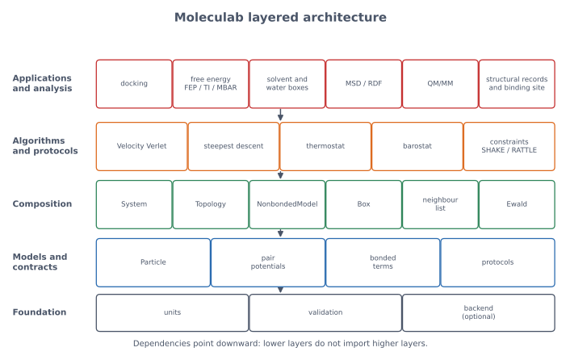

# Moleculab software architecture

> **Status.** This document describes the architecture **as implemented** in
> `src/moleculab/`. The long-term roadmap is in [`roadmap.md`](roadmap.md); when
> the two differ, the code and this document win. The validation strategy is in
> [`validation.md`](../reference/validation.md).

Moleculab is an educational molecular physics and simulation library. It is
small enough to read in an afternoon, but structured so that each new physical
model, numerical algorithm, or analysis tool can be added without rewriting the
rest.

The central architectural rule is:

> **Separate the physical model, the numerical algorithm, and the simulation
> protocol.**

A Lennard-Jones potential is a model. Velocity Verlet is an algorithm. A
Berendsen thermostat is a protocol. Mixing them makes a library that is hard to
test, hard to teach, and hard to extend.



*Dependencies point downward. Lower layers do not import higher layers.*

Regenerate this diagram with:

```bash
uv run python docs/generate_architecture_visuals.py
```

## 1. Design goals and constraints

The architecture is shaped by six goals.

| Goal | Consequence |
| --- | --- |
| scientific correctness | every model has energy and force, tested against finite differences and analytic results |
| inspectability | small modules, plain NumPy, explicit loops where they teach something |
| separation of concerns | models, algorithms, protocols, analysis, and applications are distinct |
| incremental growth | each milestone adds a module and a test, not a rewrite |
| reproducibility | examples and tutorials run from the repository, with documented expected output |
| performance later | CPU and NumPy first; PyTorch optional only where it pays; Rust later |

The main constraint is that this is a **teaching library**, not a production
molecular-dynamics package. Clarity is a feature. O(N²) pair loops, Python-level
iteration, and small default systems are acceptable because they make the
physics visible. Production concerns such as neighbour lists, particle-mesh
Ewald, triclinic boxes, and GPU kernels are deliberately deferred.

## 2. The big picture

Moleculab is organised into five layers, plus the optional backend module.

| Layer | Responsibility | Package |
| --- | --- | --- |
| applications and analysis | answer a scientific question using the engine, and record how the answer was obtained | `applications/`, `analysis/` |
| algorithms and protocols | advance, constrain, or sample a state | `algorithms/`, `protocols/` |
| composition | assemble particles, models, topology, box, and global terms | `composition/` |
| physical models | define what the system is and how its energy is defined | `models/`, `foundation/particles.py` |
| foundation | numerical and validation primitives | `foundation/`, `backend.py` |

The package tree is:

```text
src/moleculab/
├── foundation/       units, validation, particles, box
├── models/           potentials, bonded terms, topology, nonbonded, Ewald, physics
├── composition/      System, neighbour list, constraints
├── algorithms/       Velocity Verlet, minimisation
├── protocols/        thermostat, barostat
├── analysis/         MSD, RDF, contacts, binding/interaction geometry, SAR, ADME
├── applications/     docking, solvent, water, free energy, acid-base, QM/MM,
│                     structure provenance, ligand identity, ligand coordinates,
│                     binding-site reconciliation, interaction interpretation,
│                     evidence fingerprints, chemical-state preparation,
│                     protonation/tautomer enumeration, state-aware interactions,
│                     protein-pocket preparation, evidence-complete matrices
├── backend.py        optional CPU/ROCm/PyTorch dispatch
└── __init__.py       stable public API
```

The public API re-exports the user-facing names from
[`src/moleculab/__init__.py`](../../src/moleculab/__init__.py). Tutorials and
examples import from `moleculab`, not from internal modules.

## 3. Separation of concerns

The most important distinctions are summarised below.

| Concern | Question it answers | Examples | Must not do |
| --- | --- | --- | --- |
| physical model | what is the system and its energy? | Lennard-Jones, Coulomb, bonds, angles, torsions, Ewald | integrate time, rescale velocities, or score a pose |
| data structure | how is the state represented? | `Particle`, `System`, `Topology`, `Box`, `Trajectory` | contain a hidden integration loop |
| numerical algorithm | how are the equations solved? | Velocity Verlet, steepest descent, SHAKE/RATTLE | define a new force field |
| simulation protocol | how is the state prepared or sampled? | Berendsen thermostat, barostat | change the potential energy function |
| analysis | what does a trajectory or structure mean? | MSD, RDF, contacts, binding-site geometry, interaction records, fingerprints, pose RMSD, pose clustering, SAR comparison | modify the trajectory, forces, or structure |
| application | what scientific question is being asked? | docking, FEP/TI/MBAR, solvation, acid-base populations, structure manifests, ligand identity reconciliation | duplicate core physics or parse external files |
| backend | where does a numerical kernel run? | CPU, optional PyTorch Ewald | leak device details into models |

This separation is not cosmetic. It determines what can be tested independently
and what must be rewritten when a new model is added.

## 4. Module map and dependency rules

The dependency graph is deliberately shallow.

```text
foundation (units, validation, particles, box)
    |
models (potentials, bonded, topology, nonbonded, ewald, physics)
    |
composition (system, neighbour, constraints)
    |
algorithms (integrators, minimization) + protocols (thermostats, pressure)
    |
analysis (trajectory, binding sites)
    + applications (docking, solvent, water, free energy, acid-base, QM/MM,
                    structure provenance, ligand identity, hydrogen and water
                    evidence, interaction robustness, thermodynamic boundaries,
                    scientific audit)
```

The actual imports are visible in the source. The important rules are:

| Module | May depend on | Must not depend on |
| --- | --- | --- |
| `foundation.units`, `foundation.validation` | Python and NumPy only | any model or algorithm |
| `foundation.particles`, `foundation.box`, `models.potentials`, `models.bonded` | foundation | `System`, integrators, thermostats |
| `models.topology` | `models.bonded` | coordinates, `System`, integrators |
| `composition.neighbour` | foundation | `System`, integrators |
| `models.nonbonded` | foundation, `models.ewald` | `System`, integrators |
| `models.ewald` | `backend`, foundation | `System`, integrators |
| `models.physics` | `foundation.particles`, `models.potentials` | `System`, integrators |
| `composition.system` | foundation, models, `composition.neighbour`, `composition.constraints` | integrators, thermostats, docking |
| `algorithms.integrators` | `composition.system`, `models.physics`, `models.potentials`, `composition.constraints` | docking, free energy, analysis |
| `algorithms.minimization` | `composition.system`, `composition.constraints` | thermostats, docking |
| `protocols.thermostats`, `protocols.pressure` | `composition.system`, foundation | potentials directly |
| `analysis.trajectory` | `foundation.box` only | `System`, integrators |
| `analysis.trajectory_contacts` | Python and NumPy only | `System`, integrators, trajectory I/O |
| `analysis.binding_site` | Python and NumPy only | `System`, integrators, structure toolkits |
| `analysis.interactions` | Python and NumPy only | `System`, integrators, structure or chemistry toolkits |
| `analysis.fingerprints` | `analysis.interactions` | `System`, integrators, trajectory I/O, MD assumptions |
| `analysis.sar` | foundation units and NumPy only | structure or chemistry toolkits, activity prediction |
| `analysis.adme` | NumPy only | pKa prediction, ADME prediction |
| `analysis.docking` | Python and NumPy only | `System`, integrators, docking parsers or search engines |
| `analysis.evidence` | Python standard library only | `System`, integrators, structure parsers, chemistry toolkits |
| `applications.docking` | `composition.system`, foundation | integrators, thermostats |
| `applications.acid_base` | `foundation.units` | `System`, integrators, toolkits |
| `applications.structure_manifest` | Python standard library only | coordinate parsers, chemistry toolkits, `System`, integrators |
| `applications.ligand_identity` | `applications.structure_manifest` | coordinate parsers, chemistry toolkits, `System`, integrators |
| `applications.ligand_coordinates` | `applications.ligand_identity`, `applications.structure_manifest`, NumPy | coordinate parsers, chemistry toolkits, `System`, integrators |
| `applications.binding_site_reconciliation` | `analysis.binding_site`, `applications.ligand_coordinates`, `applications.structure_manifest` | coordinate parsers, chemistry toolkits, `System`, integrators |
| `applications.interaction_interpretation` | `analysis.interactions`, `applications.structure_manifest` | coordinate parsers, chemistry toolkits, `System`, integrators |
| `applications.interaction_evidence` | `analysis.evidence`, `applications.interaction_interpretation`, `applications.structure_manifest` | coordinate parsers, chemistry toolkits, `System`, integrators |
| `applications.chemical_preparation` | `applications.structure_manifest` | coordinate parsers, chemistry toolkits, `System`, integrators |
| `applications.chemical_state_enumeration` | `applications.chemical_preparation`, `applications.structure_manifest` | coordinate parsers, chemistry toolkits, `System`, integrators |
| `applications.state_interactions` | `analysis.evidence`, `applications.chemical_state_enumeration`, `applications.ligand_coordinates`, `applications.structure_manifest` | coordinate parsers, chemistry toolkits, `System`, integrators |
| `applications.protein_preparation` | `applications.chemical_preparation`, `applications.structure_manifest` | coordinate parsers, chemistry toolkits, `System`, integrators |
| `applications.combination_interactions` | `applications.interaction_interpretation`, `applications.chemical_state_enumeration`, `applications.protein_preparation`, `analysis.evidence` | coordinate parsers, chemistry toolkits, `System`, integrators |
| `applications.hydrogen_evidence` | `analysis.interactions`, `applications.structure_manifest` | coordinate parsers, chemistry toolkits, `System`, integrators |
| `applications.water_evidence` | `applications.structure_manifest` | coordinate parsers, chemistry toolkits, `System`, integrators |
| `applications.interaction_robustness` | `applications.combination_interactions`, `applications.hydrogen_evidence`, `applications.water_evidence`, `analysis.interactions` | coordinate parsers, chemistry toolkits, `System`, integrators |
| `applications.thermodynamic_interpretation` | `applications.structure_manifest` | coordinate parsers, chemistry toolkits, `System`, integrators, free-energy estimators |
| `applications.free_energy_study` | `applications.fep`, `models.potentials`, `foundation.units`, `applications.structure_manifest` | coordinate parsers, chemistry toolkits, `System`, integrators |
| `applications.scientific_audit` | `applications.free_energy_study`, `applications.structure_manifest`, `foundation.units`, `models.potentials`, NumPy | coordinate parsers, chemistry toolkits, `System`, integrators |
| `backend` | optional PyTorch | any model |

Two deliberate design choices are visible here:

- **`analysis` depends only on `Box`**, not on `System`. It can analyse arrays
  from any source, including an external trajectory file or a hand-built toy
  model.
- **`physics` depends on `particles` and `potentials`**, not on `System`. This
  keeps the basic equations usable with a single particle and prevents a
  circular dependency with `System`.

### 4.1 Allowed exceptions

`solvated_alchemy` is an experiment driver, not a core model. It imports
integrators, thermostats, and multi-particle Monte Carlo machinery because it
runs a complete alchemical experiment. This is acceptable for an application
module at the top of the graph.

`water` and `solvent` are **model builders**. They assemble a `System` from
particles, topology, boxes, and nonbonded models. They do not implement a new
integrator or thermostat.

`qm_mm` is a separate physical model. It solves a one-dimensional
finite-difference Schrödinger equation with fixed point charges. It is not a
classical potential and is deliberately isolated.

`structure_manifest`, `ligand_identity`, `ligand_coordinates`,
`binding_site_reconciliation`, `interaction_interpretation`,
`interaction_evidence`, `chemical_preparation`,
`chemical_state_enumeration`, `state_interactions`, `protein_preparation`,
`combination_interactions`, `hydrogen_evidence`, `water_evidence`,
`interaction_robustness`, `thermodynamic_interpretation`, and
`scientific_audit` are **record layers**. They accept plain,
already-parsed data and do not import `gemmi`, RDKit, or any coordinate reader.
The capstone adapters in `examples/drug_discovery/` own those optional
dependencies and pass explicit records, graphs, candidate mappings, coordinate
records, and protein/water records into the library. This keeps the core
installable with NumPy alone and keeps file-format decisions outside the physics
and analysis layers.

## 5. Core data structures and contracts

### 5.1 `Particle`

`Particle` stores the mechanical state and the chemical identity:

| Field | Meaning |
| --- | --- |
| `mass` | positive mass in Da |
| `position` | three components in nm |
| `velocity` | three components in nm/ps |
| `atom_type` | label used by typed nonbonded models |
| `charge` | partial charge in elementary-charge units |

It stores no acceleration. Acceleration is derived from force and mass. Speed
is derived from velocity. The constructor copies arrays so a particle owns its
state, and `copy()` returns an independent particle.

The design rationale is simple: **one source of truth**. If acceleration were
stored separately, a force change could make the stored acceleration stale.
Derived quantities are computed when needed. In a large production code they
may be cached, but the cache is still a derived value and must remain
consistent with the state.

`atom_type` and `charge` are not mechanical state, but they are part of the
model's identity. Every rebuild path must preserve them. This is enforced by
`tests/test_state_preservation.py`.

### 5.2 `System`

`System` is the composition layer. It contains:

| Field | Purpose |
| --- | --- |
| `particles` | the atoms or coarse-grained sites |
| `pair_potentials` | simple potentials summed over every unique pair |
| `topology` | bonds, angles, torsions |
| `box` | optional periodic box |
| `nonbonded_model` | typed Lennard-Jones plus optional electrostatics |
| `constraints` | SHAKE/RATTLE distance constraints |
| `indexed_pair_potentials` | potentials applied to selected atom pairs |

`System` computes:

- `nonbonded_energy()`, `bonded_energy()`, `potential_energy()`;
- `kinetic_energy()`, `total_energy()`;
- `forces()`;
- convenience arrays `positions`, `velocities`, `charges`, `atom_types`.

`System` is a facade and composition root. It does not define new physics; it
sums the models it is given. It is also the one place where global terms such as
Ewald reciprocal-space corrections and exclusions are applied once.

### 5.3 `Topology`

`Topology` stores a molecular graph indexed by atom number:

| Term | Shape | Meaning |
| --- | --- | --- |
| `Bond(i, j, potential)` | two atoms | bond stretch |
| `Angle(i, j, k, potential)` | three atoms | angle bend with vertex `j` |
| `Torsion(i, j, k, l, potential)` | four atoms | dihedral rotation |

The graph is separate from the coordinates. The same topology can be reused
with many conformations. `Topology.nonbonded_exclusions()` returns the 1-2 and
1-3 pairs that must not be double counted by the nonbonded model. Torsion 1-4
pairs are not excluded by default; force fields often scale them instead.

### 5.4 `Box`

`Box` implements orthorhombic periodic boundaries:

- `minimum_image(displacement)`;
- `minimum_image_array(displacements)`;
- `wrap(position)`;
- `distance(displacement)`;
- `volume`.

`System` applies the minimum image only to nonbonded separations. Bonded terms
use raw coordinates, because a bond should follow the molecular graph rather
than jump across a box face.

### 5.5 Potential protocols

The model interfaces are structural protocols, not a deep inheritance tree:

| Protocol | Required methods |
| --- | --- |
| `Potential` | `energy(position)`, `force(position)` |
| `PairPotential` | `energy(displacement)`, `force(displacement)` |
| `BondPotential` | `energy(displacement)`, `force(displacement)` |
| `AnglePotential` | `energy(r_ji, r_jk)`, `forces(r_ji, r_jk)` |
| `TorsionPotential` | `energy(r_ij, r_jk, r_kl)`, `forces(r_ij, r_jk, r_kl)` |

An algorithm accepts any object that satisfies the relevant interface. This
keeps Velocity Verlet independent of whether the potential is harmonic,
Lennard-Jones, or something added later.

The most important contract is:

**For every potential, the force must be the negative gradient of the same
energy model.**

This is checked by `tests/test_force_gradients.py` for every core potential.
The test differentiates the energy numerically and compares it with the
analytical force. It never calls the analytical force inside the numerical
derivative, so a sign error or missing factor cannot hide.

### 5.6 `Trajectory`

`Trajectory` and `SystemTrajectory` are frozen dataclasses containing time,
positions, velocities, kinetic energy, potential energy, and total energy. A
frozen snapshot is easy to analyse, compare, and plot. The integrator never
mutates a trajectory after creating it.

### 5.7 Validation at the boundary

`foundation/validation.py` provides small helpers such as `as_positive_float`,
`as_vector3`, `as_displacement`, and `as_finite_float`. Invalid shapes,
non-finite values, zero distances, and negative masses fail at the boundary,
where the error is easy to understand. They do not propagate into a force
calculation and produce a mysterious `NaN` later.

The provenance and identity records follow the same boundary principle.
`validate_manifest` and `validate_ligand_identity` check schema completeness,
identifier consistency, and internal structure. They do not decide whether the
science passed: a structurally valid record can contain a failed check or an
open discrepancy, and that distinction is intentional.

## 6. Architectural decisions

The following decision records explain why the code looks the way it does.

### ADR-001: One coherent internal unit system

**Decision.** Use nm, ps, kJ/mol, Da, kJ/(mol nm), K, and e everywhere inside
the library.

**Context.** SI units produce awkward powers of ten at molecular scales.
Frequent conversions inside physics code invite errors.

**Consequences.** In this system, $a = F / m$ is numerically correct without a
conversion factor. The same cancellation makes $K = \frac12 m v^2$ direct.
Conversion constants live in `foundation/units.py`, not in potentials or integrators.

**Trade-off.** Readers must learn the unit system. The tutorials do that in
part 01, and `tests/test_units.py` checks the conversion factors.

### ADR-002: Energy and force in the same model

**Decision.** Every potential implements both `energy` and `force`, and the
force is tested as the negative gradient of the energy.

**Context.** Dynamics needs forces; thermodynamics, minimisation, and scoring
need energies. Implementing them separately invites inconsistency.

**Consequences.** A sign error, a missing factor, or a wrong displacement
convention is caught immediately. Energy conservation and minimisation become
meaningful diagnostics.

**Trade-off.** Some duplication between energy and force code. Automatic
differentiation could remove it later, but explicit derivatives are more
instructive for this library.

### ADR-003: Protocols rather than a class hierarchy

**Decision.** Use Python `Protocol` interfaces for potentials rather than a
base class with virtual methods.

**Context.** The set of models is small but grows. Inheriting from a common base
class would couple unrelated models and make experimentation heavier.

**Consequences.** Any object with the right methods is a potential. Tests can
use tiny stand-ins. New models do not need to modify existing code.

**Trade-off.** No shared implementation and weaker static guarantees. The
protocols are small and the validation tests compensate.

### ADR-004: Small value objects plus an explicit `System`

**Decision.** Keep `Particle`, `Topology`, `Box`, and models small; put
composition in `System`.

**Context.** A common failure mode is a monolithic `Molecule` or `Simulation`
class that owns forces, integrators, thermostats, and analysis.

**Consequences.** Each object has one job. A particle can be tested without a
system; a potential can be tested without particles; analysis can accept raw
arrays.

**Trade-off.** The user must assemble a `System`, which is a little more
verbose. The tutorials make that assembly explicit.

### ADR-005: Copy-on-write by convention

**Decision.** Integrators, thermostats, minimisers, and barostats return new
objects rather than mutating their input. `Particle.copy()` is explicit.

**Context.** Hidden mutation makes debugging difficult: a function may change a
state that another test or trajectory still references.

**Consequences.** Every step returns an explicit new state. Tests can compare
before and after. Trajectory snapshots are stable.

**Trade-off.** More allocation than an in-place production engine. For the small
educational systems here, clarity wins. A production engine could use in-place
buffers behind the same tests.

### ADR-006: Topology separate from coordinates

**Decision.** Store bonds, angles, and torsions as atom indices plus potentials
in `Topology`, not as attributes of `Particle`.

**Context.** Chemical connectivity is independent of conformation. The same
molecule can have many coordinate sets.

**Consequences.** Topology validation is explicit; exclusions are derived from
the graph; rebuilding positions does not rebuild chemistry.

**Trade-off.** Index-based references require validation, and a molecule split
across a periodic boundary needs care. Those costs are real and documented.

### ADR-007: Models, algorithms, and protocols are separate

**Decision.** Keep potentials in `models/potentials.py` and `models/bonded.py`, algorithms in
`algorithms/integrators.py` and `algorithms/minimization.py`, and protocols in `protocols/thermostats.py` and
`protocols/pressure.py`.

**Context.** A thermostat is not a force field. An integrator is not a model.
Confusing them makes it impossible to say what changing a parameter means.

**Consequences.** The same potential can be used with different integrators;
the same integrator can use different potentials; a thermostat can be replaced
without touching the energy function.

**Trade-off.** More modules and more imports. The dependency graph stays
shallow, which keeps the cost manageable.

### ADR-008: Three nonbonded routes

**Decision.** Support `pair_potentials`, `nonbonded_model`, and
`indexed_pair_potentials`.

**Context.** The library needs a simple teaching path, a typed force-field path,
and a way to apply a potential to selected pairs for alchemical experiments.

**Consequences.** Tutorials 05–06 use `pair_potentials`; water and typed force
fields use `nonbonded_model`; solvated alchemy and selected-pair experiments use
`indexed_pair_potentials`.

**Trade-off.** More than one way to express an interaction can confuse a
newcomer. The tutorials introduce them in order, and exclusions prevent double
counting.

### ADR-009: Ewald at the `System` level

**Decision.** Handle Ewald real-space terms in the pair loop and reciprocal,
self, net-charge, and exclusion corrections once in `System`.

**Context.** The reciprocal-space sum is global, not a pair interaction. It
cannot live inside a `PairPotential`.

**Consequences.** Pair potentials stay local and simple. `System` has a
localised Ewald branch, and `EwaldElectrostatics` remains a model object.

**Trade-off.** `System` knows about Ewald. The alternative — a global potential
protocol with a different call signature — would complicate every other model.

### ADR-010: Constraints are data, applied by algorithms

**Decision.** Store `DistanceConstraint` objects in `System`; apply SHAKE and
RATTLE inside the system integrator, minimiser, and barostat.

**Context.** A constraint is not a force. It is a projection onto a
configuration manifold.

**Consequences.** Constraints are reusable across algorithms and preserved
through rebuilds. Every state-advancing path ends with
`assert_constraints_satisfied`, so a forgotten SHAKE or RATTLE projection
becomes an explicit `RuntimeError` instead of a slowly drifting trajectory.
`System.max_constraint_error()` exposes the same diagnostic for tests and
debugging.

**Trade-off.** The responsibility is still distributed across algorithms, and
the guard is a safety net rather than an automatic solver. The alternative — a
constraint solver inside every step — would couple more code. The guard makes
the cost of forgetting visible.

### ADR-011: Optional backend isolation

**Decision.** CPU is the default. `backend.py` lazily imports PyTorch and
provides `to_torch`/`to_numpy`. Only the Ewald reciprocal path is accelerated.

**Context.** PyTorch and ROCm are optional; the educational core should work
with NumPy alone. Device code should not leak into potentials.

**Consequences.** Installation is light. The backend can be selected with
`set_backend("auto")` or `MOLECULAB_BACKEND`. The CPU fallback is tested.

**Trade-off.** Two implementations of one path can drift. Validation includes
backend tests; the scope is deliberately narrow.

### ADR-012: Feature modules and a flat public API

**Decision.** Use one module per concept (`potentials`, `bonded`, `nonbonded`,
`system`, `integrators`, ...) and re-export user-facing names from
`moleculab/__init__.py`.

**Context.** A small library does not need a deep `models/`, `algorithms/`,
`protocols/` directory tree. Readers should find a concept by name.

**Consequences.** Imports are readable: `from moleculab import
HarmonicPotential, Particle, simulate_velocity_verlet`. Internal file layout
can change without breaking tutorials.

**Trade-off.** `__init__.py` is long and must be maintained. `__all__` keeps the
public surface explicit.

### ADR-013: Tests as executable specification

**Decision.** Test physical relationships, not just execution: gradients,
symmetries, analytic trajectories, conservation, state preservation, and
documented examples.

**Context.** A finite result can still be wrong. A tutorial claim is only
credible if the library reproduces it.

**Consequences.** `tests/test_force_gradients.py`, `test_harmonic_validation.py`,
`test_symmetry.py`, `test_state_preservation.py`, and
`test_physical_benchmarks.py` form an executable specification.
[`validation.md`](../reference/validation.md) maps the levels. Constants are checked against
independent golden values, closed-form geometries, sign invariants, and
order-of-magnitude bounds, not only against the implementation's own formula.

**Trade-off.** Tests and docs must be maintained together. The alternative is a
library that looks correct but cannot demonstrate it.

### ADR-014: NumPy first, Rust later

**Decision.** Implement in Python and NumPy; use optional PyTorch only for the
Ewald reciprocal kernel; defer Rust/PyO3.

**Context.** The primary product is understanding. Python is inspectable and
fast enough for the small systems used in the tutorials.

**Consequences.** The physics is visible line by line. Performance work is an
explicit later milestone rather than an upfront complexity.

**Trade-off.** O(N²) pair sums and Python loops are slow for large systems.
Neighbour lists, vectorisation, and compiled kernels remain future work for the
default path.

### ADR-015: Optional cell-list neighbour screening

**Decision.** Provide `composition/neighbour.py` as an opt-in composition-layer utility. The
default `System` pair loop stays O(N²) and fully readable.

**Context.** Explicit solvent boxes and larger solutes eventually need a
short-range pair screen. Making it mandatory too early would hide the pair
logic that the tutorials are designed to teach.

**Consequences.** `build_neighbour_list` returns a duplicate-free candidate set
of `(i, j)` pairs. Cell assignment is vectorized with NumPy; candidate
enumeration stays an explicit Python loop for inspectability. It guarantees that
every true pair within the cutoff is present, but it may include extra
candidates. `System.forces`, `nonbonded_energy`, `potential_energy`, and
`total_energy` accept `cutoff` and `use_neighbour_list`; with
`use_neighbour_list=True` they screen candidates and still compute the exact
minimum-image distance. Exclusions, indexed pairs, and global Ewald terms remain
outside the screen.

**Trade-off.** The cell list is a second code path and adds a set of candidate
pairs. It is validated against the default O(N²) path in
`tests/test_neighbour.py`. The default path remains the explicit teaching loop;
the opt-in path is for larger systems.

### ADR-016: Provenance and chemical identity are explicit records

**Decision.** Treat the experimental source record and the ligand identity
reconciliation as first-class application records, not as comments inside a
docking or analysis script.

**Context.** A result is only reproducible if the workflow records which
deposited file it used, which chain and ligand copy it selected, what
transformations it applied, and whether the deposited ligand actually
corresponds to the intended chemical identity. Those are separate questions
from energy evaluation and should be inspectable without rerunning an analysis.

**Consequences.** `applications/structure_manifest.py` records source checksums,
revision metadata, explicit selections, processing decisions, actors, and
machine-readable validation checks. `applications/ligand_identity.py` compares
supplied deposited and reference graphs, preserves mapping ambiguity, keeps raw
bond orders before any aromatic-normalized comparison, and reports unresolved
discrepancies. `applications/ligand_coordinates.py` attaches deposited
coordinates to that mapping and records occupancy, displacement parameters,
alternate locations, bond lengths, angles, ring planarity, and close contacts
against broad sanity bounds. `applications/binding_site_reconciliation.py`
selects a protein pocket with an explicit cutoff and records residue identities,
contacts, waters, hetero residues, and missing records without turning proximity
into an affinity claim. `applications/interaction_interpretation.py` classifies
interaction types only when explicit chemical features and geometry are supplied;
unknown chemistry remains unknown. `analysis/evidence.py` represents
present/absent/unknown states, and `applications/interaction_evidence.py` maps
interaction categories into an assessable fingerprint without encoding unknown
as zero. `applications/chemical_preparation.py` stores separate prepared states
with explicit protonation, tautomer, hydrogen, charge, feature, water-role,
toolkit, and assumption provenance; it never modifies the earlier records.
`applications/chemical_state_enumeration.py` holds protonation and tautomer
alternatives with state-specific graphs, proton counts, charges, and features;
it records pKa provenance where supplied and never estimates populations.
`applications/state_interactions.py` maps state atoms back to deposited ligand
atoms and assesses the same experimental contacts under each explicitly selected
state; it compares feature evidence without ranking states or claiming affinity.
`applications/protein_preparation.py` prepares explicit protein-pocket states
from residue templates, keeps multiple protonation hypotheses unselected, and
records no hydrogens or assigned water/hetero roles.
`applications/combination_interactions.py` crosses ligand and protein states on
the same contacts and summarizes hypothesis-conditioned classifications without
ranking combinations. `applications/hydrogen_evidence.py` records generated
hydrogen positions separately from deposited heavy atoms, validates
donor–hydrogen connectivity, and evaluates D–H···A geometry against explicit
criteria. `applications/water_evidence.py` preserves deposited water identity,
coordinates, occupancy, and B-factors, keeps orientation and roles unassigned,
and reports geometric bridge plausibility separately from a chemically
classified water-mediated interaction. `applications/interaction_robustness.py`
re-evaluates the existing conclusions under independent contact-cutoff,
angular, hydrogen-placement, state, and water-cutoff assumptions. It keeps
invariant, assumption-sensitive, unsupported, and unknown conclusions separate
and never collapses them into a confidence score.
`applications/thermodynamic_interpretation.py` separates structural counts from
thermodynamic claims, lists the interaction, desolvation, entropy, water,
strain, standard-state, sampling, and uncertainty requirements that are still
missing, and leaves the binding free energy explicitly `not_computed`.
`applications/scientific_audit.py` checks documentation links, constants,
derivatives, state provenance, the structural and thermodynamic boundaries,
artifact checksums, study seeds, and an end-to-end configuration → Boltzmann →
ensemble → exact/FEP demonstration. The capstone consumes these records rather
than hard-coding a residue lookup. The records are JSON-serialisable and
validated independently of the scientific success of the analysis.

**Trade-off.** The record schema is larger than a single result number, and
schema changes need migration or a version bump. The alternative is a workflow
whose inputs and assumptions disappear when the script exits.

## 7. Control flow

### 7.1 Molecular dynamics

The MD loop is deliberately simple:

```python
system = initial_system()
for step in range(n_steps):
    system = velocity_verlet_step_system(system, dt)
    system = berendsen_thermostat(system, T, tau, dt)
    trajectory.append(system)
```

Mapping to modules:

1. `System.forces()` sums pair, bonded, typed nonbonded, indexed, and Ewald
   contributions. The default path is the explicit O(N²) pair loop; a larger
   system can opt in with `cutoff=...` and `use_neighbour_list=True`.
2. `velocities` and `positions` are updated by `integrators`.
3. `constraints` are applied after the position update and after the velocity
   update.
4. `thermostats` rescale velocities; they do not change forces.
5. `pressure` scales positions and the box, then re-applies constraints.
6. `Trajectory` stores the snapshots; `analysis` reads them later.

### 7.2 Minimisation

1. `System.forces()` gives the downhill direction.
2. `minimization.steepest_descent_step` moves positions.
3. Backtracking accepts a move only if the energy decreases.
4. Convergence is based on the maximum force, not on a small energy change.

### 7.3 Free energy

1. A model defines an energy as a function of a coupling parameter.
2. A sampler generates configurations at each state.
3. `fep`, `ti`, or `mbar` estimates the free-energy difference.
4. `lj_alchemy`, `mc_alchemy`, and `solvated_alchemy` are complete experiments;
   `fep`, `ti`, and `mbar` are reusable estimators.
5. `free_energy_study` wraps the harmonic FEP path with exact partition
   functions, sample-size convergence, effective sample size, maximum weight
   fraction, and replicate uncertainty.

The estimators do not know whether the model is harmonic, Lennard-Jones, or a
solvated ligand. They depend on energies and sample labels. `free_energy_study`
is a controlled validation layer, not a protein-ligand affinity calculation:
it separates estimator error from model error and demonstrates why poor overlap
can defeat a formally correct exponential average. `scientific_audit` then
checks the record chain, documentation, constants, derivatives, provenance,
boundaries, checksums, seeds, and a controlled configuration → Boltzmann →
ensemble → free-energy demonstration.

### 7.4 Docking

1. A receptor and a rigid ligand are represented as `System` objects.
2. `docking` generates poses and scores receptor-ligand interactions with the
   receptor's nonbonded model.
3. `flexible_docking` adds explicit side-chain displacements with a harmonic
   strain penalty.
4. The score is an interaction energy, not a binding free energy. The tutorial
   and module docstring state this limitation.

### 7.5 Protonation

`acid_base` converts pH and pKa values into discrete-state populations. It does
not predict pKa or modify a force field. Independent sites factorise; coupled
sites use explicit microstate free energies. The module depends only on the
molar gas constant and NumPy, so it can be tested without a cheminformatics
toolkit.

### 7.6 Analysis

`analysis` accepts positions shaped `(n_frames, n_particles, 3)` and an optional
`Box`. It does not import `System`, so it can analyse simulations from any
source. MSD uses minimum-image displacements when a box is supplied; RDF
requires a box for volume normalisation.

`analysis.binding_site` operates on protein and ligand position arrays in nm.
It computes minimum protein–ligand distances, selects atoms by a documented
cutoff, groups selected atoms by residue label, and reports a pocket centre and
bounding box. It does not apply periodic minimum images or infer chemical
interactions; those decisions belong to the caller.

`analysis.trajectory_contacts` builds atom- and residue-level contact matrices
from coordinate frames, computes sampled-frame occupancy with explicit missing-
frame handling, and reports contact run lengths and lifetimes. It does not load
trajectories or infer chemical interaction types.

`analysis.sar` compares prepared compound records with measured activity,
calculated descriptors, and optional docking scores. It keeps those categories
separate and does not detect matched pairs or predict activity.

`analysis.adme` converts a neutral-form LogP to a pH-dependent LogD for a
monoprotic acid or base. It does not predict pKa, permeability, or oral
bioavailability.

`analysis.interactions` consumes prepared `InteractionAtom` features and
returns typed geometric interaction records. The first detector covers
hydrogen bonds; it requires donor/acceptor flags and hydrogen positions and
uses explicit distance and angle criteria. It does not parse structures or
infer donor/acceptor chemistry.

`analysis.fingerprints` converts interaction records into deterministic
residue-level fingerprints and computes occupancy over valid frames. It does
not read trajectory files or assume that frames came from MD; frames are
supplied by the caller.

`analysis.docking` records external ligand poses, validates explicit atom
mappings, computes RMSD, supports symmetry-equivalent mappings, reports
pose-recovery thresholds, clusters poses by explicit distance, compares
geometry with exact or residue-level interaction patterns, and summarizes
docking benchmarks with separate valid and invalid cases. It does not search
poses or parse docking-program files.

### 7.7 Structure ingestion, identity, coordinates, and interactions

The capstone adds a record-first control flow before any structural analysis:

```text
mmCIF file (adapter: gemmi)
    → StructureManifest
    → selected ligand atoms and bonds (adapter: gemmi)
    → reference graph and candidate mappings (adapter: RDKit)
    → LigandIdentityRecord
    → deposited coordinates (adapter: gemmi)
    → LigandCoordinateRecord
    → protein, water, and hetero records (adapter: gemmi)
    → BindingSiteRecord
    → explicit chemical features (adapter: chemistry toolkit)
    → InteractionInterpretationRecord
    → InteractionEvidenceRecord (present / absent / unknown)
    → fingerprint occupancy and comparison
    → ChemicalPreparationRecord (separate states and assumptions)
    → ChemicalStateEnumerationRecord (protonation/tautomer alternatives)
    → StateInteractionRecord (same contacts, selected states)
    → ProteinPreparationRecord (pocket template states)
    → CombinationInteractionRecord (state-pair matrix)
    → HydrogenEvidenceRecord (generated positions and D–H···A geometry)
    → WaterEvidenceRecord (deposited waters and geometric bridges)
    → InteractionRobustnessRecord (independent assumption axes)
    → ThermodynamicInterpretationRecord (missing terms and requirements)
    → ScientificAuditRecord (integration, checksums, and stop-line)
    → later population or free-energy pass
```

The adapter owns file parsing and chemistry-toolkit calls. The library receives
plain records and explicit candidate mappings. `structure_manifest` records the
source checksum, revision, exact chain and ligand-copy selection, processing
decisions, actors, and validation checks. `ligand_identity` selects a
representative mapping, records mapping ambiguity, compares raw bond orders
before a separate aromatic-normalized comparison, and reports formal-charge,
hydrogen, and stereochemistry limits as `not_run` or open discrepancies rather
than repairing them. `ligand_coordinates` attaches the deposited coordinates to
that mapping and records occupancy, displacement parameters, alternate
locations, bond lengths, angles, aromatic-ring planarity, and close contacts
against broad sanity bounds. `binding_site_reconciliation` selects the protein
pocket with an explicit cutoff and records residue identities, atom contacts,
waters, hetero residues, and missing records; proximity is not converted into an
interaction or affinity claim. `interaction_interpretation` classifies
hydrogen-bond, ionic, hydrophobic, aromatic, water-mediated, and metal
interactions only when the required features and geometry are explicit. Missing
chemistry remains `unknown` or `not_applicable`. `analysis/evidence.py` then
represents each feature as present, absent, or unknown; unknown is excluded from
assessable denominators and is never treated as zero. Schema and criteria
compatibility are checked before aggregation or comparison. `chemical_preparation`
creates separate prepared states with explicit assumptions instead of mutating
the deposited coordinates or prior records. `chemical_state_enumeration` keeps
protonation and tautomer alternatives separate from population estimation; the
record may contain several alternatives and no selected state.
`state_interactions` applies each explicitly selected state to the same
experimental contacts, preserving state-specific eligibility while leaving
interaction classification unknown where protein chemistry is missing.
`protein_preparation` supplies explicit pocket-side template chemistry without
generating hydrogens, assigning water roles, or selecting a protonation state.
`combination_interactions` crosses ligand and protein states on the same
experimental geometry and keeps hydrogen-bond/water evidence unknown where
provenance is missing. `hydrogen_evidence` distinguishes generated hydrogen
positions from deposited heavy atoms and assesses only the geometry supported by
those positions; protein-donor bonds remain unknown when no protein hydrogens
were prepared. `water_evidence` keeps water identity, occupancy, and B-factors
as experimental observations, leaves orientation and donor/acceptor roles
unassigned, and reports geometric bridge plausibility without claiming a
classified water-mediated interaction. `interaction_robustness` varies each
analysis assumption independently and records whether a conclusion is
invariant, assumption-sensitive, unsupported, or unknown. The statuses are
deliberately not combined into a composite score because cutoff effects,
angular criteria, hydrogen placement, state hypotheses, and missing water
chemistry carry different physical meanings. `thermodynamic_interpretation`
maps the structural counts and robustness statuses to explicit thermodynamic
boundaries and a requirements checklist. It does not import a free-energy
estimator or produce an affinity; `binding_free_energy_kj_per_mol` is null and
`free_energy_status` is `not_computed`.

The reference records live in [`data/structures/`](../../data/structures/README.md):
the manifest, identity record, and coordinate record are committed, while the
downloaded coordinate file is cached and ignored. A checksum mismatch stops the
workflow instead of replacing the provenance record silently.

This flow does not prepare a force-field-ready ligand, add hydrogens, assign
protonation states, or claim affinity. Those remain later decisions with their
own provenance.

## 8. How the architecture supports education and the tutorials

The ten physics deep dives are Track A's guided tour of the architecture, one
layer at a time. Track B and Track C build on the same layers without changing
the dependency direction.

| Tutorial | Architecture layer | Code introduced | Invariant |
| --- | --- | --- | --- |
| 01 Units | foundation | `units`, `_validation` | dimensional consistency |
| 02 Particle and kinetic energy | physical models + physics | `Particle`, `kinetic_energy` | $K \ge 0$; derived state |
| 03 Potential and force | physical models + physics | `HarmonicPotential`, `acceleration` | $\mathbf F = -\nabla U$ |
| 04 Velocity Verlet | numerical algorithm | `velocity_verlet_step` | analytic trajectory, second order |
| checkpoint 04 | integration of 01–04 | whole one-particle path | reproduce the analytic oscillator |
| 05 Nonbonded | physical models | Lennard-Jones, Coulomb, `NonbondedModel` | pair force is the energy gradient |
| 06 Many particles | composition | `System`, pair sums | total internal force is zero |
| 07 Bonded | physical models + topology | `Topology`, bonds, angles, torsions | translation/rotation invariance |
| 08 Minimisation | numerical algorithm | `minimize_energy` | energy decreases, force converges |
| 09 Thermostats | simulation protocol | `kinetic_temperature`, Berendsen | target temperature behaviour |
| 10 Periodic boundaries | simulation convention | `Box` | wrapping preserves interactions |

This mapping is intentional. A reader who understands the tutorials understands
the architecture, and vice versa.

### 8.1 The three tracks and the capstone

The tracks share one architecture; they emphasize different layers rather than
forking the codebase.

| Track | Architectural focus | Main modules | Capstone contribution |
| --- | --- | --- | --- |
| A — molecular physics | foundation → models → composition → algorithms/protocols → analysis | `Particle`, potentials, `System`, integrators, thermostats, `Box`, FEP/TI/MBAR, exact harmonic convergence study | supplies the physical model and the limits of energy calculations |
| B — chemistry | foundation and analysis, with chemistry adapters outside the core | `analysis.adme`, `analysis.electrostatics`, `applications.acid_base`; RDKit examples | establishes molecular identity, protonation, stereochemistry, polarity, hydrogen bonding, and ADME context |
| C — drug discovery | analysis and applications | binding sites, interactions, fingerprints, docking, pose comparison, SAR, trajectory contacts, structure manifests, ligand identity, ligand coordinates, binding-site reconciliation, interaction interpretation, evidence fingerprints, chemical-state preparation, protonation/tautomer enumeration, state-aware interactions, protein-pocket preparation, combination interaction matrices | turns structural observations into auditable records without claiming affinity |

The capstone is the integration point:

```text
experimental structure
    → structure manifest (source, selection, decisions, validation)
    → ligand identity record (reference graph, mapping, discrepancies)
    → ligand coordinate record (occupancy, alternate locations, geometry)
    → binding-site record (pocket, residues, waters, contacts)
    → interaction interpretation (only with explicit chemical evidence)
    → evidence fingerprint (present / absent / unknown)
    → fingerprint occupancy and comparison
    → separate chemical-state preparation (assumptions explicit)
    → protonation/tautomer enumeration (no population estimate)
    → state-aware interaction assessment (same contacts, selected states)
    → protein-pocket chemical preparation (template states)
    → combination interaction matrix (state-pair evidence)
    → generated-hydrogen evidence (D–H···A geometry)
    → deposited-water evidence (geometric bridge plausibility)
    → interaction robustness (invariant / sensitive / unsupported / unknown)
    → thermodynamic boundaries (missing terms and requirements; ΔG not computed)
    → scientific audit (checksums, documentation, and end-to-end stop-line)
    → explicit limitations; no affinity or free-energy claim
```

The provenance and identity steps are **not** a separate physics layer. They
record the inputs and chemical correspondence that any later analysis consumes.
This is why the capstone can use the same `analysis` and `applications` modules
as Track C while keeping its evidence categories explicit.

### 8.2 The tutorial structure mirrors the architecture

Every tutorial uses the same five-stage pattern:

1. physical meaning;
2. mathematical definition;
3. units and dimensions;
4. Python implementation;
5. numerical verification.

That is the architecture in miniature:

- the physical meaning identifies the model layer;
- the mathematics defines the contract;
- the units live in the foundation;
- the implementation points to the module;
- the verification is the test layer.

The **Core / Deeper insight / Looking ahead** labels separate what a reader
needs now from what belongs to a later architecture layer. This prevents a
tutorial from turning into a tour of the entire library.

### 8.3 Tests are part of the teaching material

The tutorials cite the tests that protect each claim:

- `tests/test_force_gradients.py` — every core potential;
- `tests/test_harmonic_validation.py` — analytic oscillator and convergence;
- `tests/test_symmetry.py` — translation, rotation, total force, wrapping;
- `tests/test_state_preservation.py` — chemical identity through rebuilds;
- `tests/test_units.py` — unit coherence.

An instructor can break a line of code, run the relevant test, and let the
failure teach the invariant. That is more instructive than a passing example.

### 8.4 Checkpoints and validation levels

The checkpoint after part 04 asks the reader to reproduce the analytic
oscillator before adding interactions. The validation document defines four
levels:

1. individual components;
2. combined systems;
3. numerical behaviour;
4. reproducibility.

These levels correspond directly to the architecture: models, composition,
algorithms, and the public workflow.

### 8.5 Using the architecture in a course

A useful teaching sequence is:

1. Read the layer diagram.
2. Read the module map.
3. Implement one potential and its force.
4. Break the force sign and watch the gradient test fail.
5. Replace the potential in an existing integrator without changing the
   integrator.
6. Add a thermostat and observe that the forces are unchanged.
7. Add a box and observe that only nonbonded separations change.

Each step changes one layer and leaves the others intact. That is the
architectural lesson.

## 9. Why this is a good basis for a drug discovery library

Drug discovery adds models and workflows, not a different kind of software.
The same composition path scales from a particle to a ligand-receptor system.

### 9.1 The composition path

```text
Particle + charge + atom type
        ↓
pair and bonded potentials
        ↓
Topology (molecular graph)
        ↓
NonbondedModel + Box + Ewald
        ↓
System (receptor, ligand, solvent, ions)
        ↓
docking, MD, free energy, analysis
```

The capstone adds a provenance and identity path alongside the physics path:

```text
deposited structure
        ↓
structure manifest (source, selection, decisions, checks)
        ↓
ligand identity record (reference graph, atom mapping, discrepancies)
        ↓
ligand coordinate record (occupancy, alternate locations, geometry)
        ↓
binding-site record (pocket, residues, waters, atom contacts)
        ↓
interaction interpretation (explicit features only)
        ↓
evidence fingerprint (present / absent / unknown)
        ↓
occupancy and compatible-schema comparison
        ↓
separate chemical-state preparation (multiple states preserved)
        ↓
protonation/tautomer alternatives (no population model)
        ↓
state-aware interaction assessment (same contacts, selected states)
        ↓
protein-pocket chemical preparation (template states)
        ↓
combination interaction matrix (state-pair evidence)
        ↓
generated-hydrogen evidence (generated positions, D–H···A geometry)
        ↓
deposited-water evidence (identity, occupancy, geometric bridge)
        ↓
interaction robustness (independent assumption axes, no composite score)
        ↓
thermodynamic interpretation (missing terms and requirements; ΔG not computed)
        ↓
scientific audit (checksums, documentation, end-to-end stop-line)
        ↓
later decision: System preparation and force-field parameters
```

Every stage is already represented by a module:

- `Particle` carries atom type and charge, the minimum identity a force field
  needs.
- `Topology` carries bonds, angles, and torsions, the molecular graph a ligand
  or protein needs.
- `NonbondedModel` carries typed Lennard-Jones parameters, charges, cutoffs, and
  exclusions, the core of a classical force field.
- `Box` and Ewald provide a periodic environment.
- `water` and `solvent` build explicit environments.
- `structure_manifest` records the experimental source and the selected chain
  and ligand copy.
- `ligand_identity` reconciles the deposited ligand graph with a reference and
  records mapping ambiguity and discrepancies.
- `ligand_coordinates` attaches deposited coordinates to the identity mapping
  and records occupancy, alternate locations, and geometry.
- `binding_site_reconciliation` selects the explicit protein pocket and records
  residues, waters, hetero residues, and atom-level contacts.
- `interaction_interpretation` classifies interactions only where explicit
  chemical features and geometry are supplied.
- `analysis.evidence` and `interaction_evidence` retain present, absent, and
  unknown states with assessable denominators.
- `chemical_preparation` records separate prepared states without mutating the
  experimental records.
- `chemical_state_enumeration` records protonation and tautomer alternatives
  without selecting one or estimating populations.
- `state_interactions` applies explicitly selected states to the same
  experimental contacts without ranking them.
- `protein_preparation` supplies explicit pocket-side template chemistry without
  selecting a protonation state or generating hydrogens.
- `combination_interactions` crosses every ligand and protein state on the same
  contacts without ranking combinations.
- `hydrogen_evidence` separates generated hydrogen positions from deposited
  heavy atoms and evaluates D–H···A geometry under explicit criteria.
- `water_evidence` preserves deposited waters and reports geometric bridge
  plausibility without assigning water roles or an interaction class.
- `interaction_robustness` varies analysis assumptions independently and keeps
  invariant, assumption-sensitive, unsupported, and unknown conclusions apart.
- `thermodynamic_interpretation` records missing thermodynamic terms and
  preparation/sampling requirements while leaving ΔG explicitly uncomputed.
- `scientific_audit` checks the record chain, documentation, constants,
  derivatives, boundaries, checksums, seeds, and the final stop-line.
- `docking` and `flexible_docking` score receptor-ligand poses.
- `fep`, `ti`, `mbar`, and the alchemy modules estimate free-energy differences.
- `qm_mm` is a separate path for electronic effects.

### 9.2 Extension without rewriting

The architecture makes common drug-discovery extensions additive:

| Extension | Where it goes | What must not change |
| --- | --- | --- |
| new atom types and parameters | `NonbondedModel` data | pair loop, integrator |
| new bonded term | `models/bonded.py` + `Topology` | integrator, thermostat |
| new scoring function | a new application module using `System` | core potentials |
| new free-energy estimator | `fep`/`ti`/`mbar` style module | model definitions |
| new solvent model | `applications/solvent.py` or `applications/water.py` | integrator, analysis |
| new thermostat | `protocols/thermostats.py` | forces, potentials |
| new barostat | `protocols/pressure.py` | forces, potentials |
| new backend | `backend.py` | model APIs |
| new structure format | an example/adapter plus `structure_manifest` | record schema, core physics |
| new identity comparison | `applications/ligand_identity.py` | core physics, coordinate parsing |
| new coordinate geometry check | `applications/ligand_coordinates.py` | core physics, identity schema |
| new analysis | `analysis/trajectory.py` | simulation state |
| larger short-range pair screen | `composition/neighbour.py` | default pair-loop semantics |

This is why the library can grow from one particle to a solvated ligand without
a rewrite: each addition attaches at the layer where it belongs.

### 9.3 What is deliberately missing

A good architecture is honest about its boundaries. Moleculab is not yet a
production drug-discovery engine. Missing pieces include:

- trained, validated force fields and parameter assignment;
- particle-mesh Ewald and neighbour lists;
- triclinic boxes and full pressure coupling;
- enhanced sampling and automated free-energy workflows;
- explicit protein preparation, protonation, and ion placement;
- force-field-ready ligand parameterization, including hydrogen and protonation
  assignment;
- entropy, desolvation, and trained binding-affinity scoring;
- real quantum chemistry, Hartree-Fock, or DFT;
- checkpointing, parallelism, and GPU kernels beyond the optional Ewald path;
- experimental validation against measured affinities.

These are roadmap items, not hidden assumptions. The current modules are a
correct foundation for them because the interfaces and invariants are already
in place. The capstone deliberately stops at provenance and chemical-identity
records; it does not claim to produce a force-field-ready ligand, a docking
score, or a binding free energy.

### 9.4 What production would change

The educational architecture would survive a production transition, but several
layers would be replaced:

- pair loops would gain neighbour lists and vectorised kernels;
- Ewald would move to particle-mesh Ewald;
- `System` would gain in-place buffers and checkpointing;
- boxes would become triclinic;
- the thermostat would gain a rigorous canonical method;
- force-field parameters and protein preparation would become first-class data;
- scoring would be calibrated against experiment.

The **boundaries** would remain: a force field is still a model, an integrator
is still an algorithm, a thermostat is still a protocol, and analysis still
reads trajectories without changing them.

## 10. Extension recipes

### 10.1 Add a potential

1. Implement `energy` and `force` in `models/potentials.py` or `models/bonded.py`.
2. Ensure the force is $-\nabla U$ for the same model.
3. Add a finite-difference test in `tests/test_force_gradients.py` or a focused
   test file.
4. Add a runnable example under `examples/`.
5. Add a tutorial section or a new tutorial if the concept is new.

### 10.2 Add an integrator

1. Accept a `System` or a `Particle` and a `Potential`.
2. Return a new state; do not mutate the input.
3. Preserve `atom_type`, `charge`, topology, box, model, and constraints.
4. Add an analytic or conservation test.
5. Document the order, stability, and time-reversibility properties.

### 10.3 Add a thermostat or barostat

1. Accept a `System`.
2. Change velocities (thermostat) or positions and box (barostat), not forces.
3. Return a new `System` and preserve every interaction field.
4. Test heating, cooling, target behaviour, and state preservation.
5. State explicitly whether it is an equilibration method or an exact ensemble
   sampler.

### 10.4 Add a free-energy estimator

1. Define the reduced potentials or energy differences.
2. Keep the estimator independent of the model.
3. Validate against an analytic or high-accuracy reference.
4. Report a standard error and state the overlap assumptions.
5. Add a numerical experiment with a known answer.

### 10.5 Add a scoring function

1. Build a `System` for the receptor, ligand, or complex.
2. Use `NonbondedModel` and, if needed, explicit interactions.
3. Return an energy in kJ/mol, not an arbitrary score.
4. State what is omitted: desolvation, entropy, flexibility, training.
5. Validate against a manual pair sum and a finite-difference force if forces
   are used.

### 10.6 Add a backend

1. Keep device imports inside `backend.py`.
2. Provide a CPU fallback.
3. Accelerate one well-defined kernel first, not the whole library.
4. Test numerical agreement with the CPU path.
5. Never leak device types into model or `System` APIs.

## 11. Architectural invariants and tests

These are the rules that keep the layers honest.

| Invariant | Enforced by |
| --- | --- |
| every potential's force is its energy gradient | `tests/test_force_gradients.py` |
| every pair force is equal and opposite | `tests/test_pair_potentials.py`, `tests/test_symmetry.py` |
| total internal force is zero | `tests/test_symmetry.py` |
| translation and rotation preserve internal energy | `tests/test_symmetry.py` |
| wrapping preserves periodic interactions | `tests/test_symmetry.py`, `tests/test_box.py` |
| integrator matches the analytic oscillator | `tests/test_harmonic_validation.py` |
| minimisation lowers energy and converges on force | `tests/test_minimization.py` |
| thermostat heats and cools as intended | `tests/test_thermostats.py` |
| chemical identity survives every rebuild | `tests/test_state_preservation.py` |
| constraints remain satisfied after every state-advancing algorithm | `tests/test_constraints.py` |
| cell-list candidates contain every true pair within the cutoff | `tests/test_neighbour.py` |
| opt-in neighbour-list energies and forces match the default path | `tests/test_neighbour.py` |
| structure manifests require a checksum, explicit selection, decisions, and labelled checks | `tests/test_structure_manifest.py` |
| ligand identity records preserve ambiguity, raw bond orders, mapping completeness, and unresolved discrepancies | `tests/test_ligand_identity.py` |
| coordinate records preserve occupancy, alternate locations, missing atoms, and geometry sanity checks | `tests/test_ligand_coordinates.py` |
| binding-site records preserve cutoff policy, residue namespaces, waters, contacts, and the proximity/affinity boundary | `tests/test_binding_site_reconciliation.py` |
| interaction interpretation preserves missing chemistry as unknown and does not claim affinity | `tests/test_interaction_interpretation.py` |
| evidence fingerprints keep unknown distinct from absent, use assessable denominators, and reject incompatible schemas | `tests/test_evidence_fingerprint.py` |
| prepared states preserve generated-vs-deposited provenance, assumptions, and unselected alternatives | `tests/test_chemical_preparation.py` |
| protonation/tautomer enumeration keeps alternatives unselected and does not estimate populations | `tests/test_chemical_state_enumeration.py` |
| state-aware assessment maps state atoms to contacts, preserves feature differences, and does not rank states | `tests/test_state_interactions.py` |
| protein-pocket preparation keeps template states unselected and water/hetero roles unassigned | `tests/test_protein_preparation.py` |
| ligand/protein state matrices are complete, preserve missing hydrogen/water evidence, and do not rank combinations | `tests/test_combination_interactions.py` |
| hydrogen evidence separates generated positions from deposited atoms and checks connectivity before geometry | `tests/test_hydrogen_evidence.py` |
| water evidence preserves deposited observations, leaves roles unassigned, and reports geometry without chemical classification | `tests/test_water_evidence.py` |
| robustness conclusions keep consistent support sets and no composite confidence score | `tests/test_interaction_robustness.py` |
| thermodynamic boundaries keep structural counts separate from a null free energy and report unmet requirements | `tests/test_thermodynamic_interpretation.py` |
| exact harmonic partition functions reproduce free-energy differences and FEP convergence reports overlap and replicate uncertainty | `tests/test_free_energy_study.py` |
| the final audit checks documentation, constants, derivatives, provenance, boundaries, checksums, seeds, and the end-to-end stop-line | `tests/test_scientific_audit.py` |
| units and constants are coherent | `tests/test_units.py` |

If a change violates one of these, the architecture is no longer doing its job.

## 12. Reading guide

For a new contributor, the source is best read in this order:

1. `foundation/units.py`, `foundation/validation.py` — the foundation.
2. `foundation/particles.py` — the smallest state object.
3. `models/potentials.py`, `models/bonded.py` — the model contracts.
4. `models/topology.py`, `foundation/box.py`, `composition/neighbour.py` — molecular graph, geometry, and
   optional pair screening.
5. `models/nonbonded.py`, `models/ewald.py` — typed interactions and long-range electrostatics.
6. `models/physics.py` — the general equations.
7. `composition/system.py` — composition.
8. `composition/constraints.py`, `algorithms/integrators.py` — time stepping.
9. `algorithms/minimization.py`, `protocols/thermostats.py`, `protocols/pressure.py` — other algorithms and
   protocols.
10. `analysis/trajectory.py`, `analysis/trajectory_contacts.py`,
    `analysis/binding_site.py`, `analysis/interactions.py`,
    `analysis/fingerprints.py`, `analysis/sar.py`, `analysis/adme.py`,
    `analysis/docking/` — trajectory, contact, binding-site, interaction,
    fingerprint, SAR, ADME, and pose measurements.
11. `applications/structure_manifest.py`, `applications/ligand_identity.py`,
    `applications/ligand_coordinates.py`,
    `applications/binding_site_reconciliation.py`,
    `applications/interaction_interpretation.py`,
    `applications/interaction_evidence.py`, `analysis/evidence.py`,
    `applications/chemical_preparation.py`,
    `applications/chemical_state_enumeration.py`,
    `applications/state_interactions.py`,
    `applications/protein_preparation.py`,
    `applications/combination_interactions.py`,
    `applications/hydrogen_evidence.py`,
    `applications/water_evidence.py`,
    `applications/interaction_robustness.py`,
    `applications/thermodynamic_interpretation.py`,
    `applications/scientific_audit.py` — provenance, explicit selection,
    atom mapping, chemical-identity discrepancies, occupancy, alternate
    locations, coordinate geometry, pocket selection, contacts, evidence-gated
    interaction classification, three-state fingerprints, separate prepared
    chemical states, protonation/tautomer alternatives, state-aware contact
    assessment, protein-pocket template chemistry, state-pair interaction
    matrices, generated-hydrogen geometry, deposited-water evidence,
    assumption-sensitivity records, structural-to-thermodynamic boundaries, and
    the final scientific audit.
12. `applications/solvent.py`, `applications/water.py` — environment builders.
13. `applications/fep.py`, `applications/ti.py`, `applications/mbar.py`, `applications/lj_alchemy.py`, `applications/mc_alchemy.py`,
    `applications/solvated_alchemy.py`, `applications/free_energy_study.py` — free energy and exact-reference convergence diagnostics.
14. `applications/docking.py`, `applications/flexible_docking.py`, `applications/qm_mm.py` — applications and the
    quantum model.
15. `backend.py` — optional acceleration.

The tutorials follow the same order, which is not a coincidence.

## 13. Summary

- Moleculab separates physical models, numerical algorithms, simulation
  protocols, analysis, and applications.
- Dependencies point downward; lower layers do not import higher layers.
- Energy and force are two views of the same model, tested against each other.
- `System` composes interactions; it does not define new physics.
- `Topology` keeps chemistry separate from coordinates.
- `Box` is a convention for nonbonded separations, not a force.
- Constraints are data applied by algorithms.
- Tests are the executable specification of the architecture.
- The tutorials are a layer-by-layer tour of the same structure.
- Experimental provenance, ligand identity, coordinate geometry, binding-site
  context, evidence-gated interaction interpretation, three-state evidence
  fingerprints, separate chemical-state preparation, protonation/tautomer
  enumeration, state-aware contact assessment, protein-pocket preparation, and
  ligand/protein state-pair interaction matrices are first-class records,
  separate from the physics and from any affinity claim.
- The composition path from particle to force field to solvent to docking to
  free energy is already present, with explicit limitations.
- The design is a good basis for drug discovery because new physics and new
  workflows are additive modules, not rewrites.

**Related documents:** [`roadmap.md`](roadmap.md) for the roadmap,
[`validation.md`](../reference/validation.md) for the validation levels,
[`tutorials/README.md`](../tutorials/README.md) for the three-track tutorial map,
[`tutorials/overview.md`](../tutorials/overview.md) for the CADD-focused
overview, [`tutorials/curriculum.md`](../tutorials/curriculum.md) for the curriculum and
prerequisites, [`tutorials/physics/tutorial.md`](../tutorials/physics/tutorial.md) for the Track A
main path, the
[Track A physics deep dives](../tutorials/physics/README.md) for the
layer-by-layer course, and the
[imatinib–BCR-ABL1 capstone](../tutorials/capstone_imatinib.md) for the
integration project that consumes the provenance and identity records.
