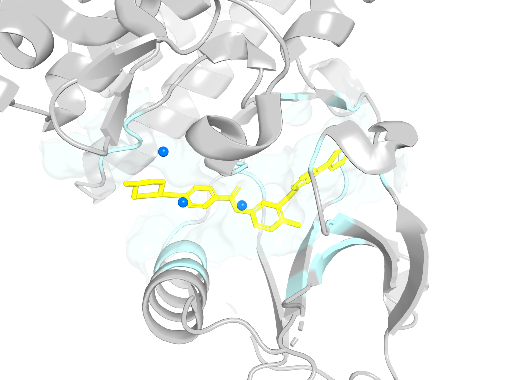
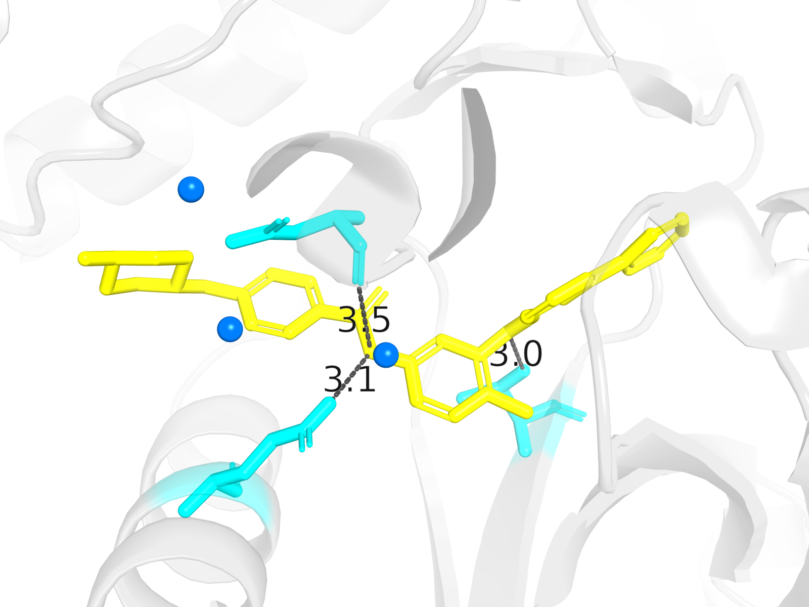
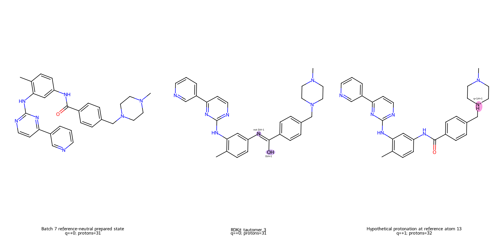
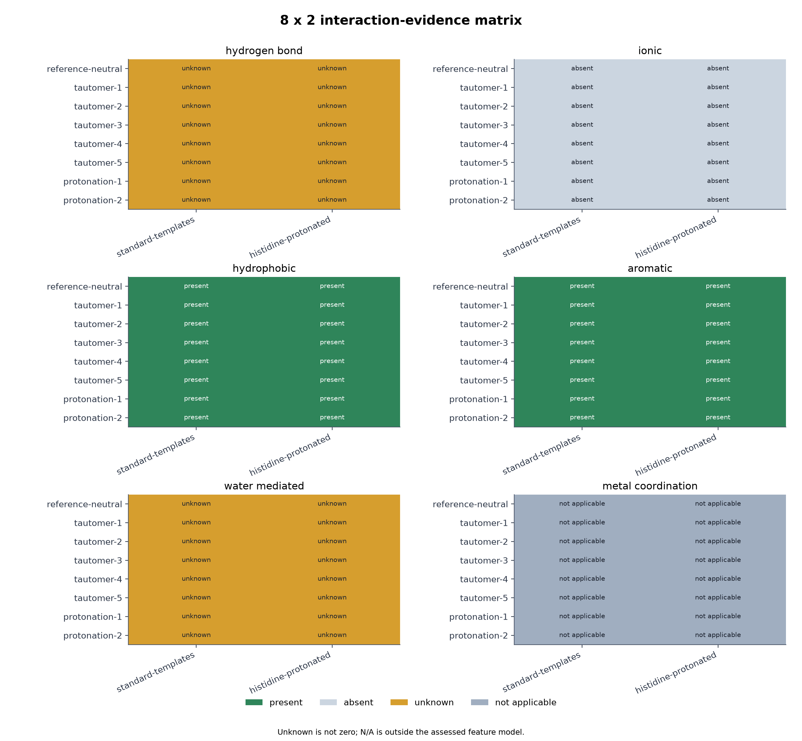
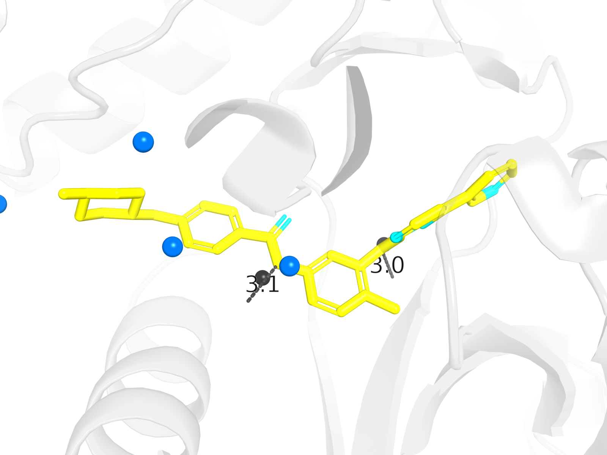
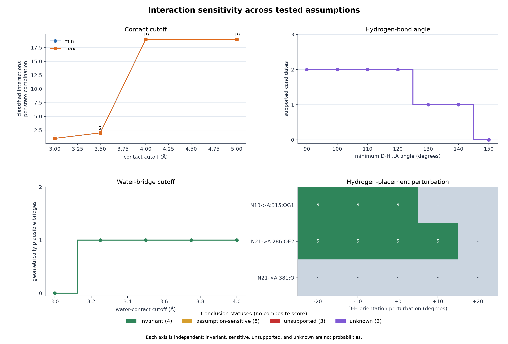
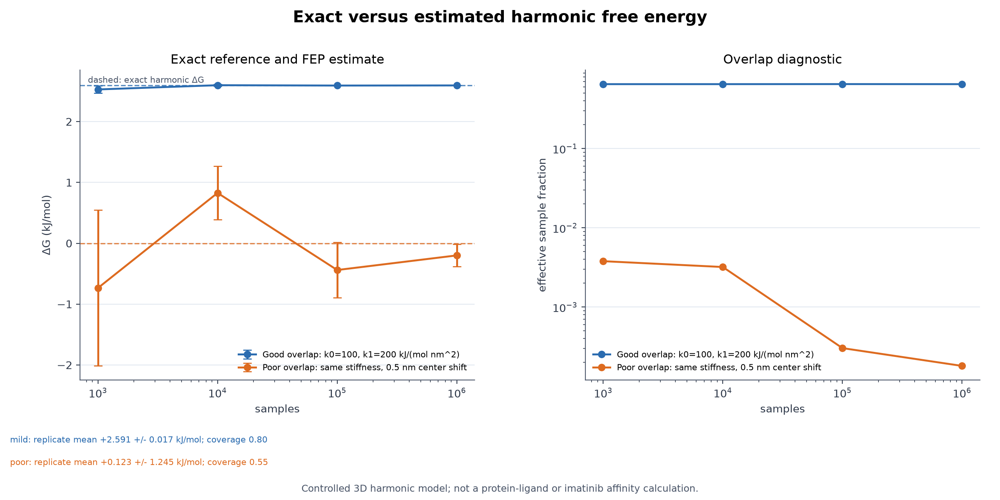
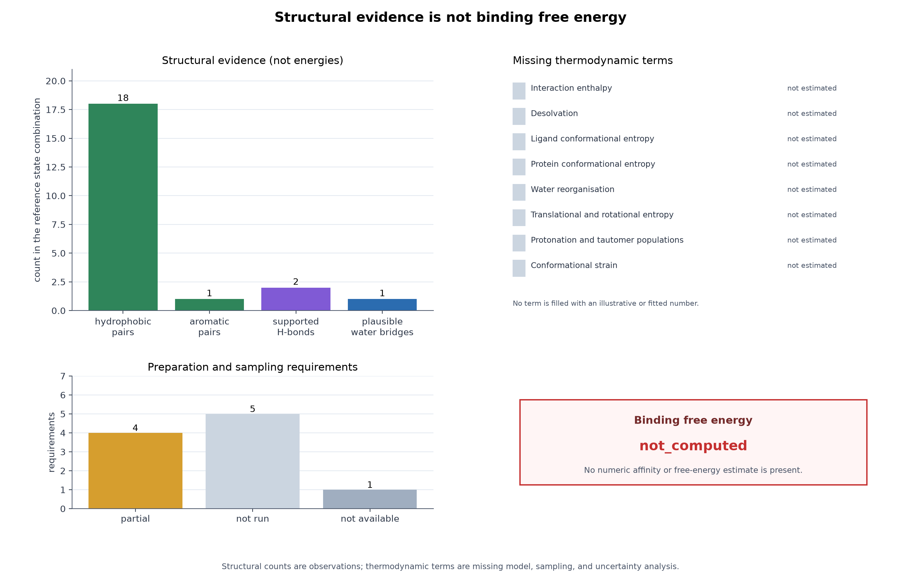

# Capstone visualization gallery

This gallery is generated from the figure registry and metadata. It is
the authoritative index of the nine capstone figures, their sources,
captions, and scientific limitations.

| Figure | Title |
| --- | --- |
| 1 | [Imatinib chemical identity](#figure-1) |
| 2 | [Imatinib in the ABL1 binding site](#figure-2) |
| 3 | [Imatinib binding-pocket contacts](#figure-3) |
| 4 | [Selected imatinib chemical-state alternatives](#figure-4) |
| 5 | [8 × 2 interaction-evidence matrix](#figure-5) |
| 6 | [Generated hydrogens and deposited water evidence](#figure-6) |
| 7 | [Interaction sensitivity across tested assumptions](#figure-7) |
| 8 | [Exact versus estimated harmonic free energy](#figure-8) |
| 9 | [Structural evidence is not binding free energy](#figure-9) |

## Figure 1

**Imatinib reference-neutral chemical state**

Reference-neutral imatinib graph. Blue atoms are hydrogen-bond donors, orange atoms are acceptors, and purple atoms are both. Atom labels are reference indices; hydrogens are omitted.

**Teaches:** molecular graph, functional groups, and reference-neutral donor/acceptor features

**Scientific limitations:**

- 2D depiction of the selected chemical state, not a conformer.
- Generated hydrogen positions and state populations are not shown.
- Atom labels are reference-graph indices, not deposited atom names.
- The drawing is not an interaction, energy, or affinity diagram.
- Selected state donors/acceptors: 4/4 atoms highlighted.

**Source records:**

- `data/structures/2HYY.ligand-identity.json`
- `data/structures/2HYY.chemical-states.json`

**Tool:** RDKit `2026.09.1`; rendering fingerprint `2b4d2a799777cca0b4e910937af57ba638f753e31c2939c20e69fb5fc3be1d24`.

[Read the teaching narrative](../README.md#420-visual-learning-layer-molecular-identity-and-structure).

## Figure 2

**Imatinib in the ABL1 binding site**

Imatinib (yellow sticks) in the ABL1 binding site, chain A. The pale surface marks protein residues within 4 Å of the ligand. This is one crystallographic observation, not an ensemble or an affinity estimate.

**Teaches:** protein–ligand context, selected chain and ligand copy, and pocket location

**Scientific limitations:**

- One crystallographic structure and one selected ligand copy.
- Cartoon and surface are representations of the deposited coordinates, not new data.
- The ligand orientation is from the crystal structure, not a predicted pose.
- No binding free energy or interaction favourability is shown.

**Source records:**

- `data/structures/2HYY.manifest.json`
- `data/structures/2HYY.binding-site.json`

**Tool:** PyMOL `3.1.0`; rendering fingerprint `9f41ee9c83d4bcd0903592506bcfa12b7849aa2db448b1f40c8d380561541a8f`.

[Read the teaching narrative](../README.md#420-visual-learning-layer-molecular-identity-and-structure).

## Figure 3

**Imatinib binding-pocket contacts**

Binding-pocket close-up. Cyan residues are contact residues, yellow sticks are the ligand, and blue spheres are nearby waters. Gray dashed lines are measured donor-acceptor distances for three polar contacts; they are not classified hydrogen bonds. No energetic interpretation is implied.

**Teaches:** measured contact distances and the difference between proximity and classification

**Scientific limitations:**

- Dashed lines are measured atom-atom contacts, not classified hydrogen bonds.
- The figure does not show hydrogen positions or angular criteria.
- Nearby waters are geometric observations; water roles remain unassigned.
- The figure does not imply energetic favourability or binding affinity.

**Source records:**

- `data/structures/2HYY.manifest.json`
- `data/structures/2HYY.binding-site.json`
- `data/structures/2HYY.hydrogen-evidence.json`

**Tool:** PyMOL `3.1.0`; rendering fingerprint `1bfd91f3f480a414bf2941116f1bc8c41976b33e9e69e88eceba97411838f565`.

[Read the teaching narrative](../README.md#420-visual-learning-layer-molecular-identity-and-structure).

## Figure 4

**Selected imatinib chemical-state alternatives**

Reference-neutral, tautomer-3, and protonation-1 states shown side by side. Magenta marks formal-charge changes, purple marks donor/acceptor changes, and green marks per-atom attached-hydrogen count changes. No state is selected as dominant and no populations are shown.

**Teaches:** charge, donor/acceptor, and per-atom attached-hydrogen changes between states

**Scientific limitations:**

- States are compared side by side; no state is selected as dominant.
- No populations or free energies are shown.
- Atom notes mark changes relative to the reference-neutral state.
- Hydrogen-count changes are attached hydrogens per atom, not total molecular hydrogen count.
- Generated 3D hydrogen positions are not drawn in this 2D comparison.
- The figure does not classify interactions or imply affinity.

**Source records:**

- `data/structures/2HYY.ligand-identity.json`
- `data/structures/2HYY.chemical-states.json`

**Tool:** RDKit `2026.09.1`; rendering fingerprint `a32fa9c7df8a8ee3ad7608e3042933d3deb1d1494a964c9cb3ffcb02acd99678`.

[Read the teaching narrative](../README.md#421-visual-learning-layer-chemical-states-and-evidence).

## Figure 5

**8 x 2 interaction-evidence matrix**

Six interaction categories for eight ligand states and two protein preparation states. Present, absent, unknown, and not-applicable statuses remain distinct; unknown is not zero.

**Teaches:** present, absent, unknown, and not-applicable evidence across state combinations

**Scientific limitations:**

- The matrix plots an existing evidence record; it does not reclassify interactions.
- Unknown is not zero and is not treated as an absent interaction.
- N/A means outside the assessed feature model, not a negative result.
- No state ranking, population, energy, or affinity is implied.

**Source records:**

- `data/structures/2HYY.combination-interactions.json`

**Tool:** Matplotlib `3.11.2`; rendering fingerprint `6f1dcf20dc5eff9f88d8f607368169a9133b24010b6a79efa2fb3d55fdc37d4c`.

[Read the teaching narrative](../README.md#421-visual-learning-layer-chemical-states-and-evidence).

## Figure 6

**Generated hydrogens and deposited water evidence**

Dark gray spheres are generated ligand hydrogens, cyan sticks are acceptor residues, and blue spheres are deposited waters with unassigned orientation and roles. Only the two supported candidates are drawn; the third recorded contact fails the default angle criterion. D-H...A angles from the record: N13-H...A:315:OG1 123.6 deg; N21-H...A:286:OE2 142.4 deg; N21-H...A:381:O 68.1 deg. Distances and angles are geometric evidence, not classified interactions.

**Teaches:** generated versus deposited positions and unassigned water chemistry

**Scientific limitations:**

- Ligand hydrogens are generated positions, not experimental observations.
- Water orientation and donor/acceptor roles remain unassigned.
- Distances and angles are geometric evidence, not energies or affinities.
- The figure does not classify hydrogen bonds or water-mediated interactions.

**Source records:**

- `data/structures/2HYY.manifest.json`
- `data/structures/2HYY.binding-site.json`
- `data/structures/2HYY.hydrogen-evidence.json`
- `data/structures/2HYY.water-evidence.json`

**Tool:** PyMOL `3.1.0`; rendering fingerprint `50513e737f8abbd71504a244c7e63eb2ade540534dc2a4119bc37d1ca78fe42a`.

[Read the teaching narrative](../README.md#421-visual-learning-layer-chemical-states-and-evidence).

## Figure 7

**Interaction sensitivity across tested assumptions**

Separate sensitivity axes for contact cutoff, hydrogen-bond angle, water cutoff, and hydrogen-placement perturbation. Conclusion colors distinguish invariant, assumption-sensitive, unsupported, and unknown statuses. No composite score is produced.

**Teaches:** independent sensitivity axes and invariant/sensitive/unsupported/unknown statuses

**Scientific limitations:**

- Each sensitivity axis is independent; the axes are not combined into a score.
- Invariant means stable only across the tested assumptions.
- Unsupported means no tested condition supports the positive claim.
- Unknown means the necessary evidence is unavailable.
- No state ranking, population, energy, or affinity is implied.

**Source records:**

- `data/structures/2HYY.interaction-robustness.json`

**Tool:** Matplotlib `3.11.2`; rendering fingerprint `3a869d6a06a1cb3e90638a1479bc4f34e130cfcc533e8e4fae86893680d7397c`.

[Read the teaching narrative](../README.md#422-visual-learning-layer-sensitivity-and-thermodynamics).

## Figure 8

**Exact versus estimated harmonic free energy**

Controlled three-dimensional harmonic model. Dashed lines are the exact free-energy differences; points are forward-FEP estimates with standard errors as sample count grows. The right panel shows effective sample fraction for the good- and poor-overlap cases.

**Teaches:** exact reference, finite-sample FEP, and effective-sample-fraction overlap

**Scientific limitations:**

- The model is a three-dimensional harmonic oscillator, not a protein-ligand system.
- Only forward FEP is shown; no bidirectional estimator or MBAR overlap correction is applied.
- Finite-sample bias under poor overlap can remain even when the standard error is small.
- Effective sample size is an observed-weight diagnostic, not proof of complete phase-space coverage.
- No imatinib binding free energy is computed.

**Source records:**

- `data/free_energy/harmonic-fep-study.json`

**Tool:** Matplotlib `3.11.2`; rendering fingerprint `14b4229bd5522e255718c3fd1d2fc47adf61d11ffa365008a19d1f6b0ca071ec`.

[Read the teaching narrative](../README.md#422-visual-learning-layer-sensitivity-and-thermodynamics).

## Figure 9

**Structural evidence is not binding free energy**

Structural counts are shown separately from the missing thermodynamic terms and preparation requirements. Every term is unestimated and the binding free energy is not computed.

**Teaches:** structural counts versus unestimated thermodynamic terms and requirements

**Scientific limitations:**

- Structural counts are not interaction energies or free energies.
- Every listed thermodynamic term is unestimated in this record.
- No binding affinity, population, or state ranking is implied.
- The figure does not supply force-field, solvent, sampling, or uncertainty analysis.

**Source records:**

- `data/structures/2HYY.thermodynamic-interpretation.json`

**Tool:** Matplotlib `3.11.2`; rendering fingerprint `c565c280040bf37e8991fdc93f77e49624a6d1dcc61d8ef8e020068bd9bbc61e`.

[Read the teaching narrative](../README.md#422-visual-learning-layer-sensitivity-and-thermodynamics).
