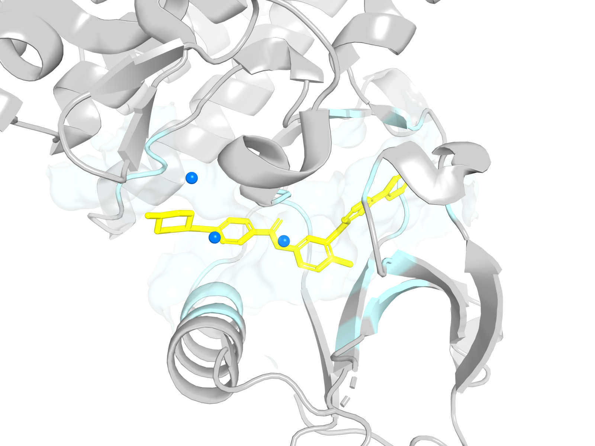
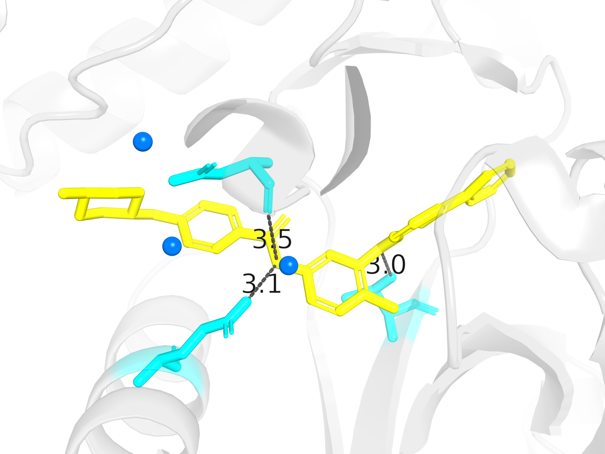

# Capstone: imatinib and BCR-ABL1

> **Where this fits.** This is the integration exercise at the end of all three
> tracks. It does not introduce a new module. It asks you to connect the
> physics, chemical state, protein structure, docking, dynamics, and
> free-energy ideas to one real drug-discovery story.
>
> **What you need.** The core Track A tutorials, especially 05–10 and the
> sections on solvent, water, docking, Ewald, and free energy; Track B modules
> 01–08 for chemical identity, protonation, stereochemistry, polarity,
> hydrogen bonding, and ADME context; and Track C modules 01–10 for protein
> structure, binding sites, interactions, docking, validation, trajectory
> contacts, SAR, and the structure–thermodynamics bridge.

The capstone is the point where the tracks meet:

| Track | Contribution to the case study |
| --- | --- |
| [A — molecular physics](physics/tutorial.md) | force field, water, MD, docking score, free energy |
| [B — chemical structure and properties](chemistry/README.md) | molecular identity, tautomer and protonation state, descriptors |
| [C — structure-based drug discovery](drug_discovery/README.md) | protein structure, binding site, interactions, pose interpretation |

For the three-track overview, see the [tutorial map](README.md); for the full
curriculum, see [the learning tracks](curriculum.md).

## Project contract: provenance and reproducibility

This capstone is an integration project, not a new feature module. Every result
must carry one of four labels:

| Label | Meaning | Example |
| --- | --- | --- |
| experimental | measured or deposited by an external source | PDB coordinates, assay IC50 |
| calculated | computed deterministically from a defined representation | molecular weight, TPSA, pIC50 from IC50 |
| predicted | produced by a model with assumptions | docking pose, MD-derived estimate, ADME prediction |
| hypothesised | a mechanistic interpretation | “this hydrogen bond explains the potency” |

The label identifies the **origin of the evidence**, not its certainty:

- experimental coordinates are not exact atomic truth; they carry resolution,
  uncertainty, refinement assumptions, and sometimes missing information;
- a calculated result can be perfectly reproducible while still depending on an
  imperfect physical model;
- a predicted result is only as good as its assumptions and validation;
- a hypothesis is not evidence until it is tested.

The project must also record:

- the source and access date of every experimental structure;
- the exact molecular representation, including stereochemistry and
  protonation/tautomer state;
- the force field, charge model, and software version;
- interaction criteria, atom mappings, and symmetry conventions;
- the difference between a docking score, a pose RMSD, an occupancy, and a
  binding free energy.

The repository does not bundle the experimental coordinates. Downloading a
structure is an explicit provenance step.

The reproducible anchors are:

```bash
uv run --with rdkit python examples/drug_discovery/capstone_imatinib.py
uv run --with gemmi python examples/drug_discovery/capstone_structure.py
uv run --with gemmi --with rdkit python examples/drug_discovery/capstone_ligand_identity.py
uv run --with gemmi python examples/drug_discovery/capstone_ligand_coordinates.py
uv run --with gemmi python examples/drug_discovery/capstone_binding_site.py
uv run --with gemmi python examples/drug_discovery/capstone_interactions.py
uv run python examples/drug_discovery/capstone_evidence_fingerprint.py
uv run --with rdkit --with gemmi python examples/drug_discovery/capstone_chemical_preparation.py
uv run --with rdkit --with gemmi python examples/drug_discovery/capstone_chemical_states.py
uv run python examples/drug_discovery/capstone_state_interactions.py
uv run --with gemmi python examples/drug_discovery/capstone_protein_preparation.py
uv run --with gemmi python examples/drug_discovery/capstone_combination_interactions.py
uv run python examples/drug_discovery/capstone_hydrogen_evidence.py
uv run --with gemmi python examples/drug_discovery/capstone_water_evidence.py
uv run python examples/drug_discovery/capstone_interaction_robustness.py
uv run python examples/drug_discovery/capstone_thermodynamic_interpretation.py
uv run python examples/advanced/free_energy_convergence.py
uv run python examples/drug_discovery/capstone_final_audit.py
uv run --with rdkit python examples/drug_discovery/capstone_visualizations.py
```

The first calculates the imatinib chemical record and prints a provenance
ledger. The second retrieves the deposited 2HYY mmCIF, keeps it unchanged, and
writes `data/structures/2HYY.manifest.json` with the exact source, checksum,
protein chain, and ligand instance. The third reconciles the selected `STI`
ligand with the imatinib reference and writes
`data/structures/2HYY.ligand-identity.json`. The fourth connects that atom
mapping to the deposited coordinates and writes
`data/structures/2HYY.ligand-coordinates.json`. The fifth selects the protein
pocket and atom-level contacts and writes
`data/structures/2HYY.binding-site.json`. The sixth classifies interactions
only where explicit chemical evidence is available and writes
`data/structures/2HYY.interactions.json`. The seventh builds a three-state
interaction-evidence fingerprint and writes
`data/structures/2HYY.evidence-fingerprint.json`. The eighth prepares separate
chemical states and writes
`data/structures/2HYY.chemical-preparation.json`. The ninth enumerates
protonation and tautomer alternatives and writes
`data/structures/2HYY.chemical-states.json`. The tenth interprets the same
experimental contacts under each selected state and writes
`data/structures/2HYY.state-interactions.json`. The eleventh prepares explicit
protein-pocket chemistry and writes
`data/structures/2HYY.protein-preparation.json`. The twelfth crosses ligand and
protein states and writes
`data/structures/2HYY.combination-interactions.json`. The thirteenth separates
generated ligand hydrogens from deposited heavy atoms and writes
`data/structures/2HYY.hydrogen-evidence.json`. The fourteenth preserves
deposited waters and reports geometric bridge plausibility in
`data/structures/2HYY.water-evidence.json`. The fifteenth varies analysis
assumptions and writes
`data/structures/2HYY.interaction-robustness.json`. The sixteenth relates the
structural evidence to the requirements for a binding free-energy calculation
and writes `data/structures/2HYY.thermodynamic-interpretation.json`. The
seventeenth runs the controlled harmonic free-energy study and writes
`data/free_energy/harmonic-fep-study.json`; it is not an imatinib calculation.
The eighteenth runs the final scientific audit and writes
`data/free_energy/capstone-scientific-audit.json`. The nineteenth generates the
three visual-learning figures and their metadata. None of the structural
commands docks a ligand, predicts affinity, or estimates a binding free energy.

## 1. Why imatinib?

Imatinib (Gleevec/Glivec) is a small-molecule tyrosine kinase inhibitor used to
treat chronic myeloid leukemia (CML). It is an excellent teaching case because:

- the disease has a clear molecular cause;
- the drug target and binding site are structurally characterized;
- the mechanism is understood at the molecular level;
- experimental protein-ligand structures are public;
- resistance mutations connect structure, binding, and clinical outcome;
- the example touches nearly every layer of a CADD workflow.

The capstone is not a claim that Moleculab is a validated imatinib design tool.
It is a guided map from the tutorial foundations to a realistic problem.

## 2. Disease and target

CML is associated with the Philadelphia chromosome, produced by a reciprocal
translocation between chromosomes 9 and 22. The translocation creates the
BCR-ABL1 fusion gene.

The ABL1 side contributes a tyrosine kinase domain. In the fusion protein, the
kinase activity is abnormally persistent, driving uncontrolled proliferation.

The relevant drug-binding region is the ATP-binding pocket of the ABL1 kinase
domain. The full BCR-ABL1 fusion protein is larger and more complicated than
the kinase domain alone, so structural work usually starts from the kinase
domain and treats it as the relevant model system.

## 3. What imatinib does

Imatinib is an ATP-competitive inhibitor. It occupies the ATP-binding region and
stabilizes an inactive kinase conformation. That reduces the kinase activity of
the fusion protein.

Two distinctions matter:

- imatinib does not simply destroy the protein; it changes its catalytic
  behaviour by binding a particular conformation;
- inhibiting the fusion protein is not the same as being absolutely selective
  for the fusion over normal ABL1.

The structural question is therefore not only “does it fit?” but “which
conformation does it stabilize, and how does that change the free energy?”

## 4. Structural starting points

Useful public structures include:

| Structure | Contents | Caveat |
| --- | --- | --- |
| PDB 2HYY | human ABL1 kinase domain with imatinib | kinase domain, not the full BCR-ABL1 fusion |
| PDB 1IEP | mouse c-Abl with imatinib | mouse proxy; used in the classic Vina tutorial |

The PDB chemical component identifier for imatinib is `STI`.

In 2HYY, protein chains A–D each have an associated imatinib copy. The copies
use mmCIF label asymmetry identifiers E–H, while their author chain identifiers
remain A–D. The capstone selects protein chain A and ligand instance E
explicitly; it does not merge the four copies into one binding site.

Possible retrieval sources:

- `https://files.rcsb.org/download/2HYY.cif`
- `https://files.rcsb.org/download/1IEP.cif`

These URLs are references, not bundled data. The batch 1 workflow caches the
deposited mmCIF under `data/structures/`, never rewrites it, and records the
manifest alongside it. The coordinate file itself is ignored by Git; the
checksum makes a re-download verifiable.

Record:

- the URL and exact downloaded file identifier;
- the access date;
- the format (PDB or mmCIF);
- the file name and a SHA-256 checksum;
- whether the file is the deposited asymmetric unit or a biological assembly;
- any coordinate transformations, symmetry expansion, or chain renaming;
- the chain and ligand copy selected;
- any waters, ions, or cofactors removed.

### 4.1 Manifest schema

The implemented schema is `schema_version: "1.0"`. The reference record for
2HYY is [`data/structures/2HYY.manifest.json`](../../data/structures/2HYY.manifest.json);
it is generated by the retrieval command above. The local cache policy is in
[`data/structures/README.md`](../../data/structures/README.md).

```text
schema_version: "1.0"
source:
  database, accession, record_url, download_url
  retrieval_date, revision, revision_date
  experimental_method, resolution_angstrom
  coordinate_format, file_name, sha256, file_size_bytes
  deposited_asymmetric_unit, biological_assembly
selection:
  model_number
  protein: label_asym_id, auth_asym_id
  ligand: component_id, label_asym_id, auth_asym_id,
          instance, auth_seq_id, label_seq_id, insertion_code,
          alternate_location, available_instances
processing:
  coordinate_transforms, removed_waters, removed_ions,
  removed_cofactors, alternate_location_policy, hydrogen_addition,
  waters, ions_cofactors, missing_atoms_or_residues,
  assembly_id, assembly_transformations_applied,
  original_coordinate_frame_preserved,
  translation_applied, rotation_applied
decisions:
  [{decision, actor, rationale}, ...]
chemical_identity:
  reference, component_id, name, formula, formal_charge,
  stereochemistry, atom_mapping, notes
analysis:
  coordinate_unit, internal_distance_unit, force_field,
  charge_model, interaction_criteria
provenance:
  records: [{label, subject, detail, actor}, ...]
validation:
  checks: [{check_id, category, status, subject, criterion,
            observed, expected, detail}, ...]
```

The label and author asymmetry identifiers are separate fields. In 2HYY the
selected ligand has `label_asym_id: "E"` and `auth_asym_id: "A"`; the manifest
also lists the other deposited instances `F`, `G`, and `H` so the selection is
auditable. Model number, sequence identifiers, insertion code, and alternate
location are recorded where the deposited file provides them, and remain null
where it does not.

Source evidence and workflow decisions are separate. A provenance record
carries an evidence label and an `actor`; a decision record carries the
decision, the actor or workflow step, and the rationale. Selecting chain A and
ligand E is therefore not presented as an experimental observation.

Validation checks use stable `check_id` values and record the subject,
criterion, observed value, and expected value. A check can be `pass`, `fail`,
or `not_run`; an unperformed check is never converted into a pass.

Null fields are intentional. The workflow leaves a value null when the
deposited file does not provide it or when a decision belongs to a later batch.
It never silently substitutes a convenient assumption.

A checksum is not ceremony. It detects a changed download, a different file
version, or an accidental substitution.

### 4.2 Ligand identity reconciliation

The ligand coordinates in a structure do not by themselves establish the full
chemical identity. Record how the deposited ligand was matched to the intended
chemical record:

- PDB chemical component identifier;
- atom names and atom mapping to the input SMILES;
- bond orders and aromaticity;
- formal charge and protonation state;
- stereochemistry;
- missing atoms or modified residues;
- any differences between the deposited ligand and the intended molecule.

A ligand can have the right shape but the wrong bond orders, formal charge, or
stereochemistry. Treat ligand reconciliation as a chemical-identity problem,
not just a coordinate-matching problem.

### 4.3 Batch 1 acceptance

The retrieval batch is complete when a user can reproduce the exact deposited
file and the exact chain/ligand selection without rerunning any later analysis.
The 2HYY record establishes:

- the source accession, download URL, access date, format, and SHA-256;
- the entry revision and resolution;
- protein chain A and ligand component `STI`, instance E;
- the other deposited ligand instances and the fact that they were not merged;
- the actor and rationale for each selection or processing decision;
- which checks passed and which decisions are deferred.

The manifest reports validation as `pass`, `fail`, or `not_run`. Formal charge,
stereochemistry, atom mapping, and interaction criteria are deliberately
`not_run` in this batch; they are not silently inferred.

### 4.4 Batch 2: ligand identity reconciliation

Batch 2 answers one question: does the selected deposited ligand correspond to
the intended imatinib identity, and can that correspondence be shown atom by
atom?

```bash
uv run --with gemmi --with rdkit python examples/drug_discovery/capstone_ligand_identity.py
```

The workflow reads the ligand selection from the Batch 1 manifest, rather than
looking up a hard-coded residue. It preserves the deposited atom and heavy-atom
bond records, builds an explicit imatinib reference graph with RDKit, and writes
`data/structures/2HYY.ligand-identity.json`.

For 2HYY the record establishes:

| Result | Value |
| --- | --- |
| Deposited graph | 37 heavy atoms, 41 heavy-atom bonds |
| Component bond records omitted | 31 `_chem_comp_bond` records involve hydrogen atoms absent from the coordinate file |
| Reference | imatinib, `C29H31N7O`, formal charge 0, 31 hydrogens |
| Mapping candidates | 4 symmetry-equivalent graph isomorphisms |
| Selected mapping | representative chosen by a recorded lexicographic rule over `deposited.atoms` order |
| Normalisation | raw Kekulé comparison first; RDKit aromaticity comparison recorded with toolkit version |
| Validation | 11 pass, 0 fail, 2 not run |

The two `not_run` checks are formal charge and hydrogen count. The deposited
`_chem_comp` record does not include formal charges, and the coordinates contain
no hydrogen atoms. Neither fact is repaired by copying values from the
reference.

The bond-order comparison preserves a useful distinction:

- **raw Kekulé orders** differ on 18 bonds because the deposited and reference
  aromatic rings use different resonance assignments;
- after a separate, documented aromatic-perception comparison, **0 unresolved
  bond-order differences** remain.

The raw difference is retained in the record and reported as a resolved
discrepancy. The deposited bond orders are not rewritten. Formal charge remains
an open discrepancy, and the absence of hydrogens is recorded as not applicable
to the heavy-atom identity mapping.

“Component bond records omitted” counts `_chem_comp_bond` rows, not hydrogen
bonds. In 2HYY those rows involve hydrogen atoms that are present in the
component dictionary but absent from the coordinate file.

### 4.5 Batch 3: ligand coordinate reconciliation

Batch 3 connects the validated chemical graph to the deposited coordinates. It
does not prepare the ligand for simulation.

```bash
uv run --with gemmi python examples/drug_discovery/capstone_ligand_coordinates.py
```

The workflow reads the atom mapping from the Batch 2 identity record, preserves
the deposited coordinates, occupancy, B-factors, and alternate locations, and
writes `data/structures/2HYY.ligand-coordinates.json`.

For 2HYY the record establishes:

| Result | Value |
| --- | --- |
| Coordinates | 37 atoms; 41 bonds; 56 angles |
| Aromatic ring systems | 3 |
| Bond lengths | 1.232–1.576 Å, inside the broad 0.5–2.5 Å sanity range |
| Bond angles | 106.8–127.7°, inside the broad 30–180° sanity range |
| Ring planarity | maximum RMSD 0.097 Å; threshold 0.2 Å |
| Close contacts | 0 below 1.5 Å, excluding bonded and 1–3 pairs |
| Missing component atoms | 31, all hydrogen; 0 missing heavy atoms |
| Alternate locations | 0 |
| Validation | 10 pass, 0 fail, 2 not applicable |

The two `not_applicable` checks are hydrogen coordinates and coordinate-derived
stereochemistry. The component dictionary has hydrogens but the coordinate file
does not, and the imatinib reference has no stereocentres. Neither condition is
converted into a pass by inventing data.

The geometry criteria are deliberately broad sanity bounds, not force-field
target values. They detect gross inconsistencies in bond lengths, angles, ring
planarity, and close contacts without pretending to validate a parameterised
force field. The record preserves per-atom occupancy and displacement
parameters; it does not choose or average alternate conformers.

Batch 3 still does not add hydrogens, assign protonation states, type force-field
atoms, minimise, dock, or estimate affinity.

The geometry conventions are recorded explicitly:

- aromatic ring systems are connected components of aromatic bonds;
- planes are least-squares planes from SVD of the centred ring coordinates;
- planarity is the RMSD of perpendicular distances to that plane;
- fused or overlapping aromatic components are treated as one ring system;
- close contacts exclude bonded and 1–3 pairs and are a severe-overlap screen,
  not a full steric or interaction analysis;
- occupancy and B-factors are crystallographic observations, not binding-site
  populations or probabilities of correct placement.

### 4.6 Batch 4: binding-site reconciliation

Batch 4 connects the validated ligand to its protein environment.

```bash
uv run --with gemmi python examples/drug_discovery/capstone_binding_site.py
```

The workflow uses the Batch 1 protein-chain selection, checks the model and
coordinate frame, selects pocket atoms within an explicit cutoff, preserves
label and author residue identifiers, and writes
`data/structures/2HYY.binding-site.json`.

For 2HYY the record establishes:

| Result | Value |
| --- | --- |
| Protein selection | author chain A / label chain A, model 1 |
| Protein atoms parsed | 2,073 polymer atoms across 263 residues |
| Pocket cutoff | 4.0 Å, strict |
| Contact cutoff | 4.0 Å, recorded independently of the pocket cutoff |
| Pocket | 53 protein atoms in 23 residues |
| Ligand–protein contacts | 112 atom pairs; closest 2.723 Å |
| Waters | 51 in the selected chain, 4 within 6.0 Å of the ligand |
| Other hetero residues | 0 |
| Residue-number gaps | 275; reported, not rebuilt |
| Alternate-location atoms | 0 |
| Validation | 10 pass, 0 fail, 1 not applicable |

The one `not_applicable` check is the residue-number gap: the missing residue is
reported, not reconstructed. Waters, ions, and cofactors are recorded separately
from the polymer pocket rather than silently discarded or folded into it.

Proximity is not an interaction assignment. A 2.7 Å contact is a geometric
observation; it is not automatically a hydrogen bond, a favourable hydrophobic
contact, or a contribution to binding affinity. The binding-site record therefore
stops at structural context. Hydrogen-bond detection, interaction fingerprints,
and free-energy interpretation remain later, separately labelled analyses.

### 4.7 Batch 5: interaction interpretation

Batch 5 classifies an interaction only when the required chemical evidence is
explicitly supplied.

```bash
uv run --with gemmi python examples/drug_discovery/capstone_interactions.py
```

The workflow consumes the Batch 4 contacts and the preceding identity,
coordinate, and binding-site records. It writes
`data/structures/2HYY.interactions.json`.

For 2HYY the result is deliberately conservative:

| Result | Value |
| --- | --- |
| Input contacts | 112 |
| Feature records | 53 protein, 34 ligand, 4 water |
| Classified interactions | 0 |
| Unknown interactions | 5 |
| Not applicable | 1 (metal coordination) |
| Affinity estimate | none |

The unknown categories are hydrogen bonding, ionic, hydrophobic, aromatic, and
water-mediated interactions. The deposited structure does not provide the
required donor/acceptor assignments, hydrogen positions, formal charges,
hydrophobic classifications, aromatic ring definitions, or water interaction
roles. Those facts are reported as missing rather than inferred from element
symbols or proximity.

The hydrogen-bond path reuses the existing `detect_hydrogen_bonds` API. It is
only called when donor/acceptor flags and donor hydrogen positions are available.
Ionic classification requires explicit formal charges. Aromatic classification
requires explicit ring centroids and normals. Metal coordination does not claim
a geometry that was not supplied.

This is the intended outcome: a smaller, defensible interaction record rather
than an overconfident diagram. No interaction is converted into an affinity
estimate.

### 4.8 Batch 6: evidence-aware interaction fingerprints

Batch 6 turns the interaction record into a three-state evidence fingerprint.

```bash
uv run python examples/drug_discovery/capstone_evidence_fingerprint.py
```

The record is written to `data/structures/2HYY.evidence-fingerprint.json`.

For 2HYY the result is:

| Result | Value |
| --- | --- |
| Category features | 6 |
| Present | 0 |
| Absent | 0 |
| Unknown | 5 |
| Not applicable | 1 |
| Assessable denominator | 0 of 6 |

The five unknown chemistry categories and the not-applicable metal category all
remain **unknown** in the fingerprint. The category-level status is preserved
separately: hydrogen bonding, ionic, hydrophobic, aromatic, and water-mediated
are `unknown`; metal coordination is `not_applicable`. Neither state is converted
into a confirmed absence.

This 2HYY record is deliberately category-level because no interaction pair has
enough evidence to be classified. The analysis API also supports atom-pair
features with the protein residue/atom, ligand atom, and water identity. A later
chemistry-aware run can therefore produce pair-level fingerprints without
changing the three-state semantics.

The fingerprint uses three evidence states:

$$ f_i \in \{1,0,?\} $$

where `?` means the available evidence cannot establish presence or absence.
Unknown features are excluded from assessable denominators. Occupancy and
comparison therefore report how many observations could actually be assessed,
not how many files were processed.

Schema compatibility is explicit: the schema identifier, canonical criteria,
criteria fingerprint, and ordered feature identities must match before
comparison or aggregation. This prevents records with different distance,
angle, or chemical-feature rules from being compared as if they were the same
measurement. The canonical criteria are retained alongside their hash so two
incompatible records can be compared to explain why they differ. Water-mediated
features retain the water identifier and are not merged with direct
protein–ligand features. Applicability is carried separately, so a
not-applicable category is not confused with an assessable absence.

The fingerprint is a structural representation, not a similarity score or a
binding free energy.

### 4.9 Batch 7: chemical-state preparation

Batch 7 supplies separate, explicitly prepared chemical states without changing
the experimental records.

```bash
uv run --with rdkit --with gemmi python examples/drug_discovery/capstone_chemical_preparation.py
```

The record is written to `data/structures/2HYY.chemical-preparation.json`. It
contains two coexisting states and selects neither automatically:

| State | Contents |
| --- | --- |
| `deposited-only` | 37 heavy atoms, no protonation, tautomer, charge, hydrogen, or feature assignment |
| `reference-neutral` | 37 heavy atoms, neutral reference formal charges, 31 generated hydrogens, 4 aromatic rings, 4 donors, 4 acceptors |

The prepared state is built on the deposited heavy-atom conformer. Formal
charges are transferred from the validated imatinib reference graph. Hydrogens
are generated with `RDKit AddHs(addCoords=True)`. Donor, acceptor, and
hydrophobic features come from `RDKit BaseFeatures.fdef`. Aromatic rings come
from RDKit aromaticity perception; their centroids and normals are computed from
the prepared heavy-atom coordinates. The toolkit version and all parameters are
recorded.

The four experimental waters are preserved and their roles are explicitly
`unassigned`. No water is automatically labelled a donor, acceptor, or bridge.

The original deposited coordinates, identity record, coordinate record, and
binding-site record are untouched. Generated hydrogens are labelled as
generated, not as experimental observations. The record also preserves the
`deposited-only` state, so the difference between experimental evidence and
computational preparation remains visible.

This is still not a force-field-ready ligand: atom typing, parameters, and
gradient-ready topology remain later decisions. It supplies the chemistry that a
future interaction pass can consume without silently rewriting the experimental
evidence.

### 4.10 Batch 8: protonation and tautomer state enumeration

Batch 8 enumerates chemically plausible alternatives without selecting or
weighting one.

```bash
uv run --with rdkit --with gemmi python examples/drug_discovery/capstone_chemical_states.py
```

The record is written to `data/structures/2HYY.chemical-states.json`.

For 2HYY the enumeration contains:

| Kind | Count | Proton count | Formal charge |
| --- | --- | --- | --- |
| Reference | 1 | 31 | 0 |
| Tautomer | 5 | 31 | 0 |
| Protonation | 2 | 32 | +1 |

All eight states coexist. `selected_state_id` is `null`; no population model is
supplied.

Tautomers are generated with the RDKit `TautomerEnumerator`. Hypothetical
protonation alternatives are generated at explicit RDKit `PosIonizable` sites.
Each state records its molecular graph, formula, proton count, formal charge,
state-specific donor/acceptor/hydrophobic features, aromatic rings, generated
conformer, and assumptions.

No pKa value is supplied for the protonation sites. The record says so
explicitly, gives no pH assumption, and makes no population estimate. This keeps
enumeration separate from thermodynamic weighting: protonation states have
different proton counts and cannot be ranked without a defensible pH-dependent
model. Tautomers share composition, but they are still not ranked in this
batch.

The experimental records and the Batch 7 preparation states are unchanged.

### 4.11 Batch 9: state-aware interaction assessment

Batch 9 interprets the same experimental binding site under every explicitly
selected chemical state.

```bash
uv run python examples/drug_discovery/capstone_state_interactions.py
```

The record is written to `data/structures/2HYY.state-interactions.json`.

Each of the eight states is mapped back to the deposited ligand atoms through
the identified reference indices. The same 34 contact ligand atoms are used for
every state; only the chemical-state features change.

For 2HYY:

| Observation | Reference state | Tautomers | Protonation states |
| --- | --- | --- | --- |
| Ligand donor/acceptor features | present | some counts differ | some counts differ |
| Ligand ionic feature | absent | absent | present |
| Ligand hydrophobic feature | present | counts differ | counts differ |
| Ligand aromatic feature | present | counts differ | counts differ |
| Geometric contact | present | present | present |
| Interaction classification | unknown | unknown | unknown |

The last row is essential. The states change which ligand chemistry is
available, but the protein donor/acceptor, charge, hydrophobic, ring, and aligned
hydrogen evidence is still not supplied. Chemical eligibility therefore does not
become a demonstrated interaction.

Tautomer comparisons show feature-count changes even where the category-level
fingerprint is unchanged. Protonation states differ in the `ligand_ionic`
category and in charged-atom counts. The record preserves these differences
without ranking the states or estimating populations.

No state is selected as dominant, and no affinity is computed. The same
experimental geometry is simply interpreted under different explicitly chosen
chemical hypotheses.

### 4.12 Batch 10: protein-pocket chemical preparation

Batch 10 supplies the missing protein-side chemistry for the selected pocket.

```bash
uv run --with gemmi python examples/drug_discovery/capstone_protein_preparation.py
```

The record is written to `data/structures/2HYY.protein-preparation.json`.

It prepares all atoms of the 23 pocket residues selected by the binding-site
record, under two explicit residue-template states:

| State | Atoms | Residues | Rings | Donors | Acceptors | Hydrophobic | Charged atoms |
| --- | --- | --- | --- | --- | --- | --- | --- |
| `standard-templates` | 186 | 23 | 4 | 30 | 30 | 61 | 4 |
| `histidine-protonated` | 186 | 23 | 4 | 31 | 29 | 61 | 5 |

`selected_state_id` is `null`. The two states differ in the histidine 361
protonation hypothesis; no state is chosen as correct.

The record preserves:

- protein atom identities in label and author chain/residue namespaces;
- explicit residue protonation states and localized formal charges;
- donor, acceptor, hydrophobic, and aromatic features from a documented
  residue/atom template table;
- four aromatic ring definitions built from experimental coordinates;
- experimental waters with `unassigned` roles;
- hetero residues with `unknown` roles;
- no generated protein hydrogens.

The template assignments are preparation hypotheses, not experimental facts.
No protein hydrogens were generated, so angular hydrogen-bond geometry is still
unavailable. No pH-dependent population model was supplied, and no affinity is
computed. The original experimental and earlier preparation records are
unchanged.

### 4.13 Batch 11: evidence-complete interaction matrix

Batch 11 crosses every ligand state with every protein state against the same
experimental contacts.

```bash
uv run --with gemmi python examples/drug_discovery/capstone_combination_interactions.py
```

The record is written to
`data/structures/2HYY.combination-interactions.json`.

The matrix contains:

```text
8 ligand states × 2 protein states = 16 combinations
```

Each combination is a separate evidence result. The same 34 contact ligand atoms
and the same protein contact atoms are used everywhere; only the chemical-state
features change.

For 2HYY, every combination currently classifies:

| Category | Result |
| --- | --- |
| Hydrophobic | 18 classified atom pairs |
| Aromatic | 1 classified ring pair |
| Ionic | absent at the contact set |
| Hydrogen bond | unknown |
| Water-mediated | unknown |
| Metal coordination | not applicable |

The categories are stable across the 16 combinations at this contact set, while
the feature inventories differ between ligand and protein states. This is a
useful negative result: changing the chemical hypothesis changes the available
chemistry, but it does not automatically change which geometrically supported
interactions are classified.

At Batch 11, hydrogen bonds remain unknown because that matrix does not yet
consume hydrogen positions. Batch 12A adds generated ligand hydrogens, but
protein-donor bonds remain unknown because no protein hydrogens were prepared.
Water-mediated interactions remain unknown because water roles are unassigned.
Template ionic, hydrophobic, and aromatic classifications are explicitly
hypothesis-conditioned.

The matrix does not rank the 16 combinations, estimate populations, or treat a
larger interaction count as stronger binding. It is a set of alternative
chemical descriptions of one experimental structure.

### 4.14 Batch 12A: generated-hydrogen evidence

Batch 12A adds hydrogen positions without pretending they were observed.

```bash
uv run python examples/drug_discovery/capstone_hydrogen_evidence.py
```

The record is written to `data/structures/2HYY.hydrogen-evidence.json`.

For the `reference-neutral` ligand state, the two hydrogens already generated in
Batch 7 are carried into a separate record. Their parent heavy atoms keep
deposited coordinates, while every hydrogen is labelled `generated`. The record
validates each donor–hydrogen distance before using it, then evaluates
ligand-donor to protein-acceptor geometry with the default criteria:

```text
D–A distance ≤ 0.35 nm
D–H···A angle ≥ 120°
```

For 2HYY this gives:

| Evidence | Result |
| --- | --- |
| Generated ligand hydrogens | 2 |
| Protein hydrogens | `not_run` (none were generated in Batch 10) |
| Donor–acceptor candidates | 3 |
| Supported geometry | 2 |
| Not supported | 1 |

Because protein hydrogens were not prepared, protein-donor hydrogen bonds
remain unknown rather than absent. A supported geometry is a structural
criterion conditioned on a generated hydrogen position; it is not an
experimental hydrogen position, an energy, or an affinity estimate.

### 4.15 Batch 12B: deposited-water evidence

Batch 12B treats crystallographic waters as experimental observations, not as
automatically assigned hydrogen-bond partners.

```bash
uv run --with gemmi python examples/drug_discovery/capstone_water_evidence.py
```

The record is written to `data/structures/2HYY.water-evidence.json`.

The four waters near the ligand keep their deposited identities, coordinates,
occupancies, and B-factors. Water orientation remains unknown, and donor and
acceptor roles remain unassigned. A bridge is reported as
`geometrically_plausible` only when the water lies within 3.5 Å of both a polar
ligand atom and a polar protein contact atom:

| Evidence | Result |
| --- | --- |
| Deposited waters | 4 |
| Geometric bridge cutoff | 3.5 Å |
| `geometrically_plausible` | 1 |
| `not_supported` | 3 |
| `unknown` | 0 |

Every bridge has `chemical_status = "not_assigned"`. A geometrically plausible
bridge is not a classified water-mediated interaction: the water's chemical
roles, orientation, and the complementarity of its partners have not been
established. The record therefore adds traceable geometric evidence without
resolving the missing chemistry, and it computes no affinity.

### 4.16 Batch 13: interaction sensitivity and robustness

Batch 13 asks whether the current interaction conclusions survive reasonable
changes in analysis assumptions. It does not add interaction categories and it
does not collapse the answers into a confidence score.

```bash
uv run python examples/drug_discovery/capstone_interaction_robustness.py
```

The record is written to
`data/structures/2HYY.interaction-robustness.json`.

The tested axes are independent:

| Axis | Tested conditions |
| --- | --- |
| Contact cutoff | 3.0, 3.5, 4.0, 5.0 Å |
| Hydrogen-bond angle | 90, 100, 110, 120, 130, 140, 150° |
| Hydrogen placement | D–H orientation perturbed by ±20°, with a ±10° modest band |
| Protein chemical state | Both histidine-protonation hypotheses |
| Ligand chemical state | All eight enumerated states |
| Water bridge cutoff | 3.0, 3.25, 3.5, 3.75, 4.0 Å |

For 2HYY the sensitivity record finds:

| Conclusion | Result |
| --- | --- |
| Classified interactions per state combination | 1 at 3.0 Å, 2 at 3.5 Å, 19 at 4.0–5.0 Å |
| Hydrophobic classification | Absent at 3.0 Å; present in all 16 combinations at 3.5–5.0 Å |
| Aromatic ring-pair classification | One pair at every tested cutoff |
| Ionic classification | Unsupported at every tested cutoff |
| Hydrogen-bond candidates | 2 at 90–120°, 1 at 130–140°, 0 at 150° |
| Protein-state pattern | Invariant across both histidine hypotheses |
| Ligand-state category counts | Invariant at 19 interactions (18 hydrophobic, 1 aromatic) |
| Ligand-state specific participants | Assumption-sensitive; the non-reference states share a different pair set |
| Water bridge geometry | 0 plausible at 3.0 Å; 1 at 3.25–4.0 Å |
| Water chemical classification | Unknown under every tested cutoff |
| Protein-donor hydrogen bonds | Unknown because protein hydrogens were not prepared |

The record separates conclusions into four statuses:

- `invariant`: supported under every tested condition on that axis;
- `assumption_sensitive`: supported under some conditions and not others;
- `unsupported`: no tested condition supports the positive claim;
- `unknown`: the evidence needed for the claim is missing.

It contains 17 conclusions: 4 invariant, 8 assumption-sensitive, 3 unsupported,
and 2 unknown. These are not combined into a single score. A hydrophobic count
that changes with the contact cutoff, an angular criterion that changes a
hydrogen-bond candidate, and an unassigned water chemistry are different kinds
of uncertainty and remain separate.

The hydrogen-placement axis is a perturbation probe, not a new toolkit
preparation: the D–H vector is rotated in the D–H/D–A plane while the D–H bond
length is preserved. The resulting positions are not experimental coordinates
and are not presented as alternative chemical states. The record therefore
keeps generated-hydrogen conclusions conditioned on the original preparation
and reports where a modest orientation change would alter the classification.

### 4.17 Batch 14: thermodynamic interpretation

Batch 14 connects the structural record to the thermodynamics that would be
needed for an affinity claim. It is deliberately non-quantitative.

```bash
uv run python examples/drug_discovery/capstone_thermodynamic_interpretation.py
```

The record is written to
`data/structures/2HYY.thermodynamic-interpretation.json`.

It summarizes the structural evidence:

| Evidence | Count |
| --- | --- |
| Ligand/protein state combinations | 16 |
| Classified hydrophobic pairs | 18 |
| Classified aromatic ring pairs | 1 |
| Supported ligand-donor hydrogen bonds | 2 |
| Geometrically plausible water bridges | 1 |
| Robustness conclusions | 4 invariant, 8 sensitive, 3 unsupported, 2 unknown |

Those numbers are then separated from thermodynamic claims. The record contains
eight explicit boundaries, including:

- 18 hydrophobic pairs do not supply 18 interaction energies;
- one aromatic pair does not supply a ring-stacking free energy;
- two hydrogen-bond candidates do not supply a hydrogen-bond energy;
- one plausible water bridge does not supply a water-displacement free energy;
- 19 classified interactions do not rank the 16 state combinations;
- one crystal structure is not an equilibrium Boltzmann ensemble;
- an invariant classification is not experimental validation;
- eight ligand states and two protein states are not populations.

It also lists the missing free-energy terms:

```text
interaction enthalpy
desolvation
ligand conformational entropy
protein conformational entropy
water reorganisation
translational/rotational entropy
protonation/tautomer populations
conformational strain
```

and the preparation and sampling requirements:

| Requirement | Status |
| --- | --- |
| Molecular model | partial |
| Protein preparation | partial |
| Ligand preparation | partial |
| Thermodynamic states | partial |
| Water/ion preparation | not run |
| Force-field parameters | not run |
| Conformational sampling | not run |
| Standard state | not run |
| Convergence and uncertainty | not run |
| Experimental affinity validation | not available |

The central thermodynamic fields are explicit:

```text
free_energy_status = "not_computed"
binding_free_energy_kj_per_mol = null
ensemble_status = "not_available"
```

The record therefore answers the question “what would be required to calculate
binding free energy?” without pretending that the current structural evidence
already answers it. The relationship between interaction energy, entropy, and
free energy is

$$ \Delta G = \Delta H - T\Delta S, $$

and the equilibrium population of a configuration is

$$ p(\mathbf R)=\frac{e^{-\beta U(\mathbf R)}}{Z}. $$

Neither quantity is obtained by counting contacts. The existing
`structural_observations_thermodynamics.py` example and Track C module 10
provide the broader conceptual background.

### 4.18 Batch 15: educational free-energy calculation

Batch 15 leaves the imatinib structure behind deliberately. It starts with an
exactly solvable harmonic model so that estimator error can be separated from
model error.

```bash
uv run python examples/advanced/free_energy_convergence.py
```

The study is written to `data/free_energy/harmonic-fep-study.json`.

It starts with an exact two-state example: state 0 has energy 0 and degeneracy 1;
state 1 has energy 5 kJ/mol and degeneracy 100. At 300 K,

$$ Z=1+100e^{-5/RT}=14.472, \qquad p_1=0.931, $$

and the free-energy difference is

$$ \Delta G=G_1-G_0=5-RT\ln(100)=-6.487\ \mathrm{kJ/mol}. $$

A higher-energy state is therefore lower in free energy when its degeneracy is
large enough. This is the discrete statistical-mechanics reference before any
sampling is introduced.

The numerical part is a three-dimensional harmonic oscillator. Its configurational
partition function is

$$ Z=\left(\frac{2\pi RT}{k}\right)^{3/2}, $$

and the exact free-energy difference between two stiffnesses is

$$ \Delta G_{\mathrm{exact}}=\frac{3}{2}RT\ln\left(\frac{k_1}{k_0}\right). $$

FEP samples state 0 and reweights to state 1:

$$ \Delta G_{\mathrm{FEP}}=-RT\ln\left\langle e^{-\Delta U/RT}\right\rangle_0. $$

Two transformations are compared:

| Case | Exact ΔG | Largest-sample FEP | Effective sample fraction | Maximum weight fraction |
| --- | --- | --- | --- | --- |
| Mild stiffness change, `k0=100 → k1=200` | 2.593 kJ/mol | 2.595 ± 0.002 kJ/mol | 0.649 | 0.000003 |
| Pure 0.5 nm center shift, `k0=k1=100` | 0.000 kJ/mol | −0.199 ± 0.186 kJ/mol | 0.00018 | 0.044 |

The center-shift case has zero exact ΔG because moving a harmonic well does not
change its partition function. Forward FEP nevertheless has poor overlap: at one
million samples the effective sample size is only about 180, and the estimate
remains noisy. This is the central lesson: a zero free-energy difference does
not make a transformation easy to sample.

The record also reports:

- sample-size convergence;
- effective sample size and maximum weight fraction;
- replicate means, standard deviations, and ranges;
- confidence-interval coverage.

The replicate coverage values (0.80 for the mild case and 0.55 for the poor
case) are empirical observations from 20 finite replicates, not guaranteed
coverage rates. They illustrate how uncertainty statements depend on overlap
and sample size.

This harmonic study is not an imatinib affinity calculation. It contains no
protein, ligand, solvent, force field, or experimental binding data. It is the
first controlled demonstration that the free-energy machinery produces the
right answer when the reference is known, and that poor overlap can defeat a
formally correct estimator.

### 4.19 Batch 16: integration and scientific audit

Batch 16 is the final planned milestone. It does not add another physical model;
it audits the chain and demonstrates the statistical-mechanics path end to end.

```bash
uv run python examples/drug_discovery/capstone_final_audit.py
```

The audit record is written to
`data/free_energy/capstone-scientific-audit.json`.

The demonstration follows one controlled chain:

```text
configuration
  -> potential energy
  -> Boltzmann weight
  -> ensemble average
  -> exact partition function
  -> FEP estimate
  -> overlap and uncertainty diagnostics
```

For the harmonic model at 300 K, the sampled mean potential energy is compared
with equipartition, the exact free-energy difference is compared with FEP, and
the two-state degeneracy example is rechecked. The chain then stops at an
explicit boundary:

- the harmonic model has an exact Hamiltonian, partition function, and
  Boltzmann sampler;
- the protein-ligand record has no force-field-ready model, explicit solvent,
  ion environment, or protonation population;
- no conformational or alchemical sampling has been run for the complex;
- structural evidence is not converted into a binding free energy.

The audit covers:

| Area | Check |
| --- | --- |
| Learning paths | Track A, B, C, capstone, validation, examples, and data documentation exist; relative links resolve |
| Physics | units and constants, harmonic partition function, analytic free energy, force-gradient sign |
| Chemistry | unselected state hypotheses, no implied protein hydrogens, generated/deposited hydrogen provenance, unassigned water roles |
| Drug discovery | contact and water observations, complete 8×2 matrix, four distinct robustness statuses, structural thermodynamic boundary |
| Thermodynamics | exact two-state reference, good- and poor-overlap cases, FEP reference agreement, ensemble average |
| Reproducibility | source checksum, manifest chain, inter-record checksum chain, study seeds, artifact existence |
| Documentation | milestone chain and relative-link integrity |

The audit record is not a claim that the project is a validated drug-discovery
platform. It is a machine-readable statement of which invariants were checked
and which limitations remain. In particular:

- effective sample size and maximum weight fraction diagnose observed weights;
  they do not prove that every important region of configuration space was
  sampled;
- confidence-interval coverage is empirical, and exponential estimators can
  have strongly skewed finite-sample distributions;
- a passed audit does not establish experimental affinity, population accuracy,
  or transferability;
- the capstone still lacks force-field parameters, explicit solvent, and
  alchemical sampling for imatinib.

The final educational claim is therefore narrow and explicit: Moleculab can
build an auditable structural argument, explain why it is not a binding free
energy, and demonstrate free-energy estimation on a model with a known exact
answer. It cannot yet calculate the imatinib binding free energy.

### 4.20 Visual learning layer: molecular identity and structure

The first visualization batch adds three reproducible figures generated from
the existing records:

```bash
uv run --with rdkit python examples/drug_discovery/capstone_visualizations.py
```

The companion metadata is
`data/figures/capstone-visualizations.json`. It records the source checksum,
protein chain, ligand instance, model number, tool versions, camera view,
generated-from records, alt text, and scientific limitations. The detailed
visual legend and regeneration notes are in
[`drug_discovery/visualizations/README.md`](drug_discovery/visualizations/README.md).


The RDKit diagram shows the reference-neutral chemical state. Blue atoms are
hydrogen-bond donors, orange atoms are acceptors, and purple atoms are both.
Atom labels are reference graph indices. Hydrogens are omitted. This figure
teaches molecular identity and functional features; it does not assign a
conformer, a protonation population, or an interaction.



The PyMOL overview shows the selected protein cartoon, imatinib as yellow
sticks, a restrained surface over residues within 4 Å of the ligand, and nearby
waters as blue spheres. This figure teaches binding-site location and molecular
recognition context; it does not establish affinity, a unique binding mode, or
an equilibrium ensemble.



The close-up shows selected contact residues, the ligand, nearby waters, and
gray dashed lines for three measured donor–acceptor distances. The dashed lines
are geometric distances, not classified hydrogen bonds. The figure does not show
generated hydrogens, angular criteria, interaction energies, or water roles.

The visual language is deliberately restrained:

| Visual cue | Meaning |
| --- | --- |
| gray cartoon and pale surface | deposited protein structure |
| yellow sticks | deposited ligand geometry |
| cyan sticks | selected contact residues |
| blue spheres | deposited nearby waters |
| gray dashed lines | measured atom–atom distances |
| blue/orange/purple atom highlights | donor/acceptor/both features in the selected state |

No color means “energetically favourable.” No nearby contact is drawn as a
hydrogen bond merely because it is close. The figures are static documentation
first; interactive 3D exploration remains optional future work.

This is Visualization Batch 1. Later batches can add chemical-state
comparisons, evidence matrices, robustness plots, exact-versus-sampled
free-energy figures, and a browser-based structure viewer. They should follow
the same rule: consume validated records, teach one scientific idea, distinguish
observation from hypothesis, and state what the figure does not establish.

If network access is unavailable, the capstone can still be completed with the
synthetic examples for structure inspection, binding-site geometry, interaction
detection, pose analysis, and benchmarking. State clearly that the synthetic
data are teaching stand-ins.

Before simulating anything:

1. inspect the chains, ligands, waters, ions, and missing atoms;
2. decide which chain and which ligand copy match each other;
3. check protonation and hydrogen placement;
4. keep the experimental pose separate from an ideal ligand conformer.

Production preparation is a project in itself. Moleculab provides the physical
concepts and some of the scoring machinery, not a complete protein-preparation
pipeline.

## 5. Map the case study onto the tutorials

| Case-study concept | Tutorial foundation |
| --- | --- |
| atoms, positions, charges | `Particle`, units |
| chemical identity, stereochemistry, protonation | Track B modules 02, 04, 05 |
| polarity, partial charge, hydrogen bonding | Track B modules 06, 07 |
| bond, angle, torsion terms | `Topology`, bonded potentials |
| Lennard-Jones and electrostatics | nonbonded interactions, `NonbondedModel` |
| protein-ligand complex | `System` composition |
| energy minimisation | steepest descent |
| MD equilibration | Velocity Verlet, thermostats, barostats |
| periodic environment | `Box`, minimum image |
| solvent and ions | water and solvent models |
| long-range electrostatics | reaction field, Ewald |
| binding pose | rigid and flexible docking |
| binding affinity | FEP, TI, MBAR, alchemical decoupling |
| controlled free-energy validation | exact harmonic partition function, FEP convergence, overlap, and replicate uncertainty |
| thermodynamic interpretation | Track C module 10; ΔG = ΔH − TΔS, partition function, missing-term checklist |
| assumption sensitivity | interaction-robustness record; invariant, sensitive, unsupported, and unknown stay separate |
| SAR and ADME context | Track B module 08; Track C module 09 |
| electronic effects | QM/MM concepts |

### 5.1 Reproducible teaching workflow

Run these commands from the repository root. They exercise the workflow on
synthetic teaching data; they do not run an imatinib pipeline.

```bash
uv run --with rdkit python examples/drug_discovery/capstone_imatinib.py
uv run --with gemmi python examples/drug_discovery/capstone_structure.py
uv run --with gemmi --with rdkit python examples/drug_discovery/capstone_ligand_identity.py
uv run --with gemmi python examples/drug_discovery/capstone_ligand_coordinates.py
uv run --with gemmi python examples/drug_discovery/capstone_binding_site.py
uv run --with gemmi python examples/drug_discovery/capstone_interactions.py
uv run python examples/drug_discovery/capstone_evidence_fingerprint.py
uv run --with rdkit --with gemmi python examples/drug_discovery/capstone_chemical_preparation.py
uv run --with rdkit --with gemmi python examples/drug_discovery/capstone_chemical_states.py
uv run python examples/drug_discovery/capstone_state_interactions.py
uv run --with gemmi python examples/drug_discovery/capstone_protein_preparation.py
uv run --with gemmi python examples/drug_discovery/capstone_combination_interactions.py
uv run --with rdkit python examples/chemistry/molecular_properties.py
uv run python examples/chemistry/protonation.py
uv run --with gemmi python examples/drug_discovery/protein_structure.py
uv run python examples/drug_discovery/binding_site.py
uv run python examples/drug_discovery/interactions.py
uv run python examples/drug_discovery/interaction_fingerprints.py
uv run python examples/drug_discovery/docking_pose_analysis.py
uv run python examples/drug_discovery/docking_benchmark.py
uv run python examples/drug_discovery/matched_molecular_pairs.py
uv run --with rdkit python examples/chemistry/adme_tradeoffs.py
uv run python examples/drug_discovery/structural_observations_thermodynamics.py
```

| Step | Example | Result category |
| --- | --- | --- |
| chemical identity and descriptors | `capstone_imatinib.py` | calculated |
| structure retrieval and selection manifest | `capstone_structure.py` | experimental + calculated |
| ligand identity reconciliation | `capstone_ligand_identity.py` | experimental + calculated |
| ligand coordinate reconciliation | `capstone_ligand_coordinates.py` | experimental + calculated |
| binding-site reconciliation | `capstone_binding_site.py` | experimental + calculated |
| interaction interpretation | `capstone_interactions.py` | calculated, with explicit evidence |
| evidence-aware fingerprint | `capstone_evidence_fingerprint.py` | calculated, with unknown states preserved |
| chemical-state preparation | `capstone_chemical_preparation.py` | prepared: calculated assumptions kept separate |
| protonation and tautomer enumeration | `capstone_chemical_states.py` | enumerated alternatives; no population estimate |
| state-aware interaction assessment | `capstone_state_interactions.py` | calculated, state-specific eligibility only |
| protein-pocket chemical preparation | `capstone_protein_preparation.py` | prepared: template hypotheses kept separate |
| evidence-complete interaction matrix | `capstone_combination_interactions.py` | calculated, hypothesis-conditioned |
| descriptors and similarity | `molecular_properties.py` | calculated |
| protonation populations | `protonation.py` | calculated from pKa inputs |
| structure inspection | `protein_structure.py` | experimental or synthetic, depending on input |
| pocket geometry | `binding_site.py` | calculated |
| hydrogen-bond geometry | `interactions.py` | calculated |
| interaction fingerprints | `interaction_fingerprints.py` | calculated |
| pose RMSD and recovery | `docking_pose_analysis.py` | predicted/calculated |
| docking benchmark | `docking_benchmark.py` | predicted/calculated |
| matched-pair SAR | `matched_molecular_pairs.py` | measured + calculated + hypothesis |
| ADME trade-offs | `adme_tradeoffs.py` | calculated, with pKa inputs |
| structure versus thermodynamics | `structural_observations_thermodynamics.py` | illustrative |

The examples are intentionally small. Their purpose is to show the data
contract and the analysis boundaries, not to replace production workflows.

## 6. A realistic workflow

The following is a conceptual workflow. External tools are needed for
protein-scale preparation and production MD; the Moleculab tutorials explain the
underlying models.

### Step 1 — inspect the structure

Use a molecular viewer to identify:

- the kinase domain;
- imatinib in the ATP pocket;
- the hinge region and gatekeeper residue;
- the DFG motif and activation loop;
- crystallographic waters and ions;
- missing loops or atoms.

Do not skip this step. A simulation of a badly prepared structure is a
simulation of the wrong system.

### Step 2 — prepare the model

Protein and ligand parameters usually come from different force fields. A
typical production workflow combines:

- a protein force field such as AMBER14SB;
- a small-molecule force field such as OpenFF Sage;
- a water model such as TIP3P or SPC/E;
- counterions and a periodic box.

Moleculab's `NonbondedModel`, `Topology`, `applications/water.py`, and `Box` show how those
pieces enter the energy function.

### Step 3 — minimise and equilibrate

Start from a prepared structure and remove severe strain:

1. minimise the solvated complex;
2. heat gradually;
3. equilibrate density and temperature;
4. check energy, temperature, pressure, and structural stability.

The minimisation, thermostat, and barostat tutorials explain the algorithms.
Production MD adds constraints, multiple stages, and much longer timescales.

### Step 4 — redock and compare with the crystal pose

A useful validation exercise is **redocking**:

1. remove imatinib from the prepared receptor;
2. generate poses with a docking program;
3. compare the best pose with the experimental pose using RMSD;
4. ask whether the scoring function ranks the crystal-like pose well.

A pose RMSD around 2 Å is often used as a practical redocking benchmark, but
symmetry, atom mapping, and alignment choices matter.

Moleculab's `applications/docking.py` and `applications/flexible_docking.py` show how interaction-energy
scoring is constructed. They do not replace a production docking engine.

### Step 5 — run MD and analyse

A protein-ligand MD trajectory can be used to study:

- ligand stability in the pocket;
- hydrogen-bond persistence;
- protein flexibility;
- water occupancy;
- conformational changes;
- RMSD and RMSF;
- interactions with resistance mutations.

Moleculab's `analysis/trajectory.py` provides MSD and RDF; RMSD/RMSF and hydrogen-bond
analysis are natural extensions.

### Step 6 — estimate a binding free energy

Docking gives a pose and an interaction score. A binding free energy requires
statistical mechanics:

- FEP for an alchemical transformation;
- TI for a thermodynamic path;
- MBAR for combining multiple sampled states;
- careful treatment of ligand-water and protein-water interactions.

The free-energy tutorials show the estimators on small, analytically controlled
systems. A production calculation needs many windows, replicates, and a
convergence analysis.

### Step 7 — include electronic effects where needed

Classical force fields use fixed charges and bonded parameters. For chemistry
that depends on electronic structure, a QM/MM treatment may be needed.

Moleculab's `applications/qm_mm.py` is a one-dimensional finite-difference model, not a
production QM/MM engine. It teaches the coupling idea: a quantum region
embedded in a classical environment.

## 7. Water is part of the mechanism

Water is not background. In the imatinib–ABL1 story, water matters because:

- the binding pocket is solvated before the ligand arrives;
- some waters are displaced on binding;
- water can mediate hydrogen bonds between ligand and protein;
- water screens electrostatic interactions;
- released water changes the entropy and enthalpy of binding;
- water occupancy can change the preferred pose or the apparent affinity.

This is why a gas-phase interaction energy is not a binding free energy. The
same lesson appears in the docking tutorial: a score is not a measured
affinity.

Moleculab represents water in several ways:

| Model | Role |
| --- | --- |
| `applications/solvent.py` | coarse-grained solvent box |
| `applications/water.py` | three-site atomistic water with constraints |
| `models/ewald.py` | long-range periodic electrostatics |
| `applications/solvated_alchemy.py` | ligand-water decoupling |
| `applications/fep.py`, `applications/ti.py`, `applications/mbar.py` | free-energy estimators |

The library's default water model is SPC/E. TIP3P is another common choice.
Both are models; neither is “the true water.”

## 8. Resistance mutations

The T315I gatekeeper mutation is a famous example of resistance to imatinib.
It illustrates the connection between structure, binding, and free energy:

- a mutation can change the shape or chemistry of the pocket;
- that can weaken ligand binding;
- a weaker binding free energy can reduce clinical effectiveness;
- a different inhibitor may be needed.

The educational point is not to memorize one mutation. It is to see why a
binding free energy, not a single docking score, is the relevant quantity.

## 9. Exercises

### Structural reasoning

1. Identify the ATP-binding pocket and the hinge region in PDB 2HYY.
2. List the crystallographic waters near imatinib. Which could mediate
   hydrogen bonds?
3. Compare the experimental imatinib pose with an ideal ligand conformer.

### Docking

1. Redock imatinib and compute pose RMSD to the crystal structure.
2. Compare rigid and flexible-receptor docking.
3. Explain why a good docking score does not prove a strong binding affinity.

### Dynamics

1. Run a small solvated system and track a hydrogen bond over time.
2. Compute RDF for water around a charged group.
3. Explain how water displacement could change the binding entropy.

### Free energy

1. Explain the difference between an interaction energy and a binding free
   energy.
2. Describe an alchemical path for decoupling imatinib from the pocket.
3. Explain why multiple windows and replicates are needed.

### Water

1. Why can a binding pocket water be favourable before binding and unfavourable
   after ligand displacement?
2. How does electrostatic screening change the apparent interaction strength?
3. Why does a vacuum docking score overstate electrostatic interactions?

## 10. What Moleculab can and cannot do here

Moleculab can:

- explain and demonstrate the physical models;
- build small solvated systems;
- run MD, minimisation, docking, and free-energy estimators on controlled
  examples;
- test how interaction conclusions depend on explicit analysis assumptions;
- show how water, Ewald, and alchemical decoupling enter the calculation.

Moleculab cannot yet:

- prepare a full protein-ligand system automatically;
- assign production protein and ligand force-field parameters;
- run a publication-scale imatinib MD campaign;
- provide a validated imatinib binding free energy;
- replace OpenMM, GROMACS, AutoDock Vina, OpenFF, or ORCA.

The capstone is successful when you can explain **why** each production step
exists and **which physical model** it is using.

## 11. Capstone deliverables and acceptance criteria

A complete capstone produces a small, inspectable record rather than a single
number:

| Deliverable | Must contain |
| --- | --- |
| chemical record | input SMILES, formula, stereochemistry, protonation/tautomer assumptions, descriptor provenance |
| structure manifest | PDB ID or synthetic source, URL/access date, format, SHA-256, asymmetric unit versus assembly, chains, ligand copy, waters/ions, missing atoms, coordinate transformations |
| ligand reconciliation | component ID, atom mapping, bond orders, formal charge, stereochemistry, modifications, missing atoms |
| binding-site record | selection method, cutoff, residues, geometry, alternate-location policy |
| interaction record | donor/acceptor assignments, distance/angle criteria, fingerprints, occupancy |
| hydrogen record | generated-versus-deposited provenance, generation method and toolkit, donor–hydrogen validation, D–H···A geometry |
| water record | deposited identity, coordinates, occupancy, B-factor, unassigned roles, bridge geometry versus chemical classification |
| robustness record | separate assumption axes, invariant/sensitive/unsupported/unknown conclusions, no composite confidence score |
| thermodynamic boundary record | structural counts kept separate from energies, missing terms and requirements, explicit null free energy |
| scientific audit record | documentation, constants, derivatives, provenance chain, boundaries, checksums, seeds, and end-to-end stop-line |
| pose record | atom mapping, symmetry handling, RMSD, threshold, score provenance |
| SAR record | measured activity type, descriptor changes, docking scores, separated hypothesis |
| thermodynamics note | method, standard state, uncertainty, sampling limitations |
| limitations note | what the data and models cannot establish |

Acceptance criteria:

- every result is labelled experimental, calculated, predicted, or hypothesised;
- the source and access date of every experimental structure are recorded;
- the file format, checksum, and asymmetric-unit/assembly choice are recorded;
- the ligand is reconciled to the intended chemical identity, including atom
  mapping, bond orders, formal charge, and stereochemistry;
- the molecular representation includes stereochemistry and protonation state;
- interaction criteria and atom mappings are explicit;
- a docking score is never labelled a binding free energy;
- generated hydrogen positions are never presented as experimentally observed;
- a geometrically plausible water bridge is never presented as a classified
  water-mediated interaction;
- sensitivity conclusions retain separate invariant, sensitive, unsupported, and
  unknown statuses rather than a composite confidence score;
- a structural count is never converted into a binding free energy without an
  explicit model, sampling, and uncertainty analysis;
- the final audit states which invariants were checked and which limitations
  remain;
- a geometric contact is never presented as a thermodynamic contribution;
- a failed or invalid benchmark case is reported, not hidden;
- the capstone states what further experiments or calculations would establish.

## 12. Further tools

To go beyond the educational engine:

- **PDB / RCSB** for experimental structures;
- **OpenMM** and **GROMACS** for production MD;
- **OpenFF** and **AMBER** for force-field parameters;
- **AutoDock Vina** for docking;
- **ChimeraX** or **PyMOL** for structure inspection;
- **ORCA**, **Psi4**, or **PySCF** for quantum chemistry.

The goal is not to replace these tools. The goal is to understand what they are
doing.

**Related:** [tutorial map](README.md), [introduction](overview.md),
[Track A main path](physics/tutorial.md), [Track A physics deep dives](physics/README.md),
[Track B](chemistry/README.md), [Track C](drug_discovery/README.md),
[learning tracks](curriculum.md), [architecture](../development/architecture.md), and
[validation](../reference/validation.md).
