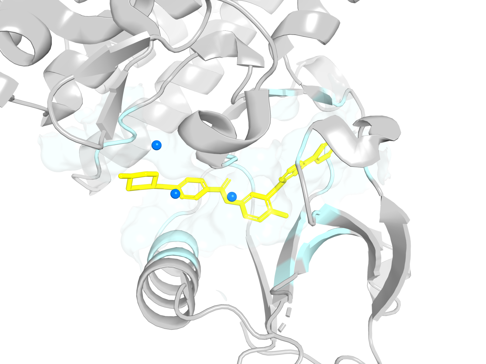
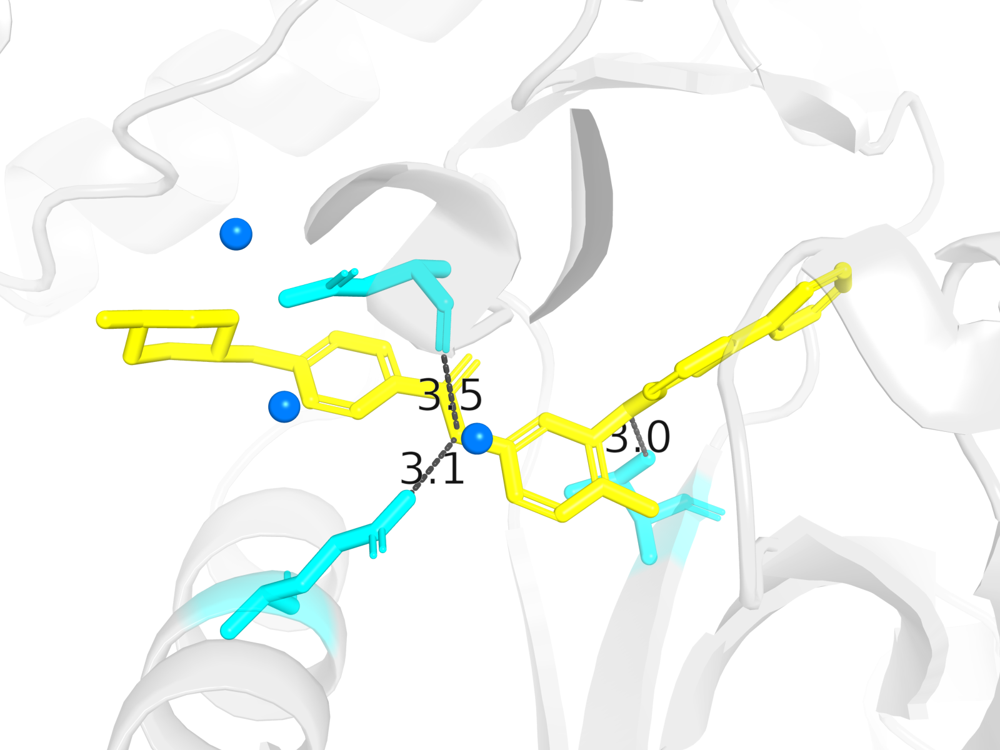
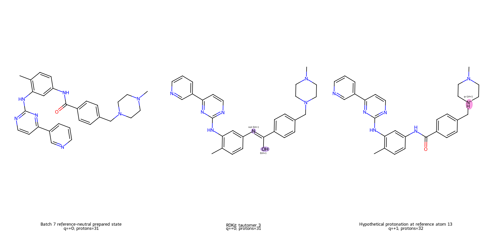
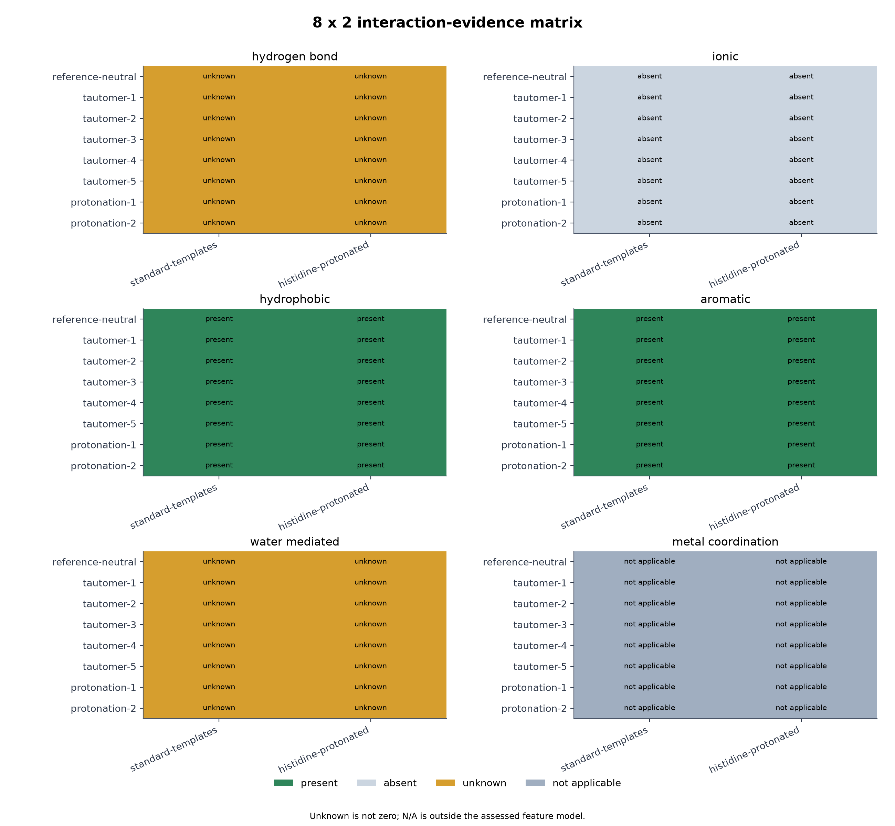
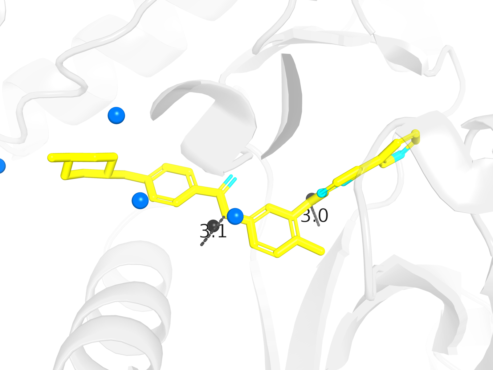
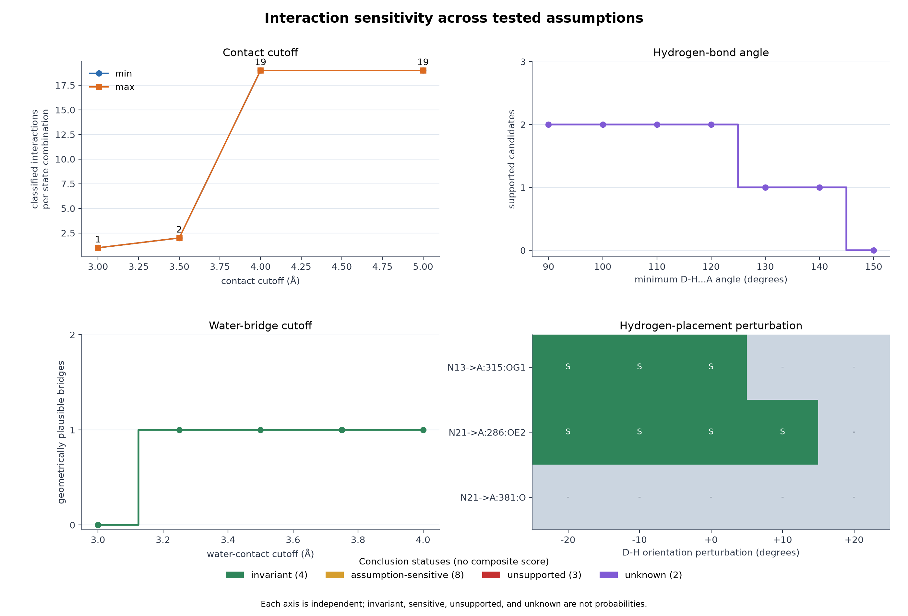
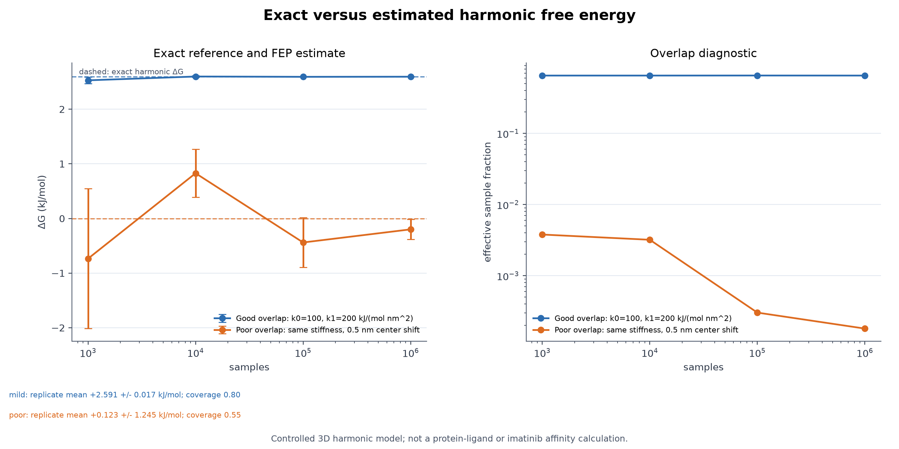
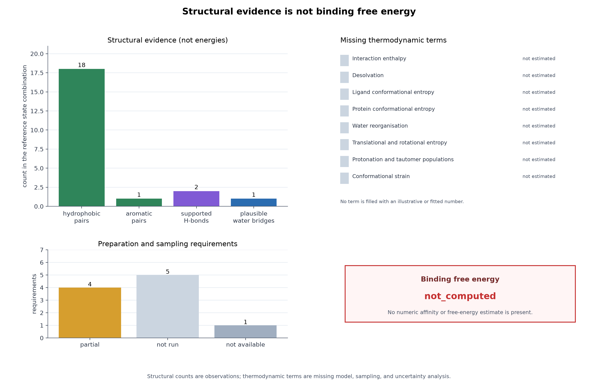

# Capstone visualizations

These figures are generated directly from the 2HYY provenance chain and the
validated chemical-state records. They are not AI-generated molecular images
and they do not perform new chemical interpretation.

The companion metadata is
[`data/figures/capstone-visualizations.json`](../../../../data/figures/capstone-visualizations.json).
Each figure records the source structure checksum, protein chain, ligand
instance, model number, tool and version, per-record source checksums, the
rendering configuration and its fingerprint, the PyMOL camera view, alt text,
caption, and scientific limitations. Scientific reproducibility means the same
atoms, coordinates, and measurements are represented. Pixel identity is not
guaranteed across rendering environments.

## Figure 1 — Imatinib chemical identity


The RDKit diagram shows the reference-neutral imatinib graph:

- blue: hydrogen-bond donor atoms;
- orange: hydrogen-bond acceptor atoms;
- purple: atoms that are both;
- atom labels: reference-graph indices;
- hydrogens: omitted.

**Teaches:** molecular graph, functional groups, donor/acceptor features, and
chemical-state identity.

**Does not establish:** a conformer, a protonation population, an interaction
pattern, an energy, or an affinity. The deposited atom names are different from
the reference indices shown here.

## Figure 2 — Imatinib in the ABL1 binding site



The PyMOL overview shows the selected protein chain as a cartoon, imatinib as
yellow sticks, protein residues within 4 Å of the ligand as a pale surface, and
nearby waters as blue spheres.

**Teaches:** protein structure, binding-site location, and the relationship
between ligand and pocket.

**Does not establish:** binding affinity, binding-mode uniqueness, an
equilibrium ensemble, or a validated pose. The figure uses one crystallographic
model and one selected ligand copy.

## Figure 3 — Binding-pocket contacts



The close-up shows cyan contact residues, the yellow ligand, nearby waters, and
gray dashed lines for three measured donor–acceptor distances. The selected
contacts correspond to the N13···THR315, N21···GLU286, and N21···ASP381
geometries used in the hydrogen-evidence record.

**Teaches:** measured geometry, contact pairs, and the difference between
proximity and a classified interaction.

**Does not establish:** a hydrogen bond, a favourable interaction energy, a
water-mediated interaction, or an affinity. Dashed lines are distances, not
interaction classifications. Generated hydrogens and angular criteria are not
shown in this figure.

## Figure 4 — Chemical-state alternatives



The RDKit comparison shows the reference-neutral state, `tautomer-3`, and
`protonation-1` side by side. Atom notes mark changes relative to the
reference-neutral state:

- magenta: formal charge;
- purple: donor/acceptor assignment;
- green: hydrogen count.

Each panel reports formal charge and proton count.

**Teaches:** protonation and tautomerism change the available chemistry.

**Does not establish:** a dominant state, a population, or a free energy. All
states remain unselected. Generated 3D hydrogen positions are not drawn in this
2D comparison.

## Figure 5 — 8 × 2 interaction-evidence matrix



The Matplotlib matrix shows six interaction categories for eight ligand states
and two protein preparation states. Present, absent, unknown, and
not-applicable statuses are distinct.

**Teaches:** conclusions depend on chemical-state assumptions, and unknown is
not zero.

**Does not establish:** a ranking, population, energy, or affinity. N/A means
outside the assessed feature model, not a negative result.

## Figure 6 — Hydrogen and water evidence



The PyMOL close-up shows:

- yellow: deposited ligand heavy atoms;
- dark gray spheres: generated ligand hydrogens;
- cyan: acceptor residues;
- blue spheres: deposited waters with unassigned orientation and roles;
- gray dashed lines: measured donor–acceptor distances for the two supported
  hydrogen-bond candidates.

The third recorded contact fails the default angular criterion and is not drawn.
The recorded D–H···A angles are listed in the caption and metadata.

**Teaches:** generated and measured positions are different evidence levels;
water proximity is not a water-mediated interaction.

**Does not establish:** experimental hydrogen positions, classified hydrogen
bonds, water roles, interaction energies, or affinity.

## Figure 7 — Interaction sensitivity



Four independent panels show how contact cutoff, hydrogen-bond angle,
water-bridge cutoff, and generated-hydrogen orientation affect the recorded
classifications. The conclusion legend distinguishes invariant,
assumption-sensitive, unsupported, and unknown statuses.

**Teaches:** “robust under tested assumptions” is not the same as “validated”.

**Does not establish:** a probability, confidence score, state ranking, energy,
or affinity.

## Figure 8 — Exact versus estimated harmonic free energy



The left panel compares exact harmonic free-energy differences with forward-FEP
estimates and standard errors as sample count grows. The right panel shows the
effective sample fraction. Good-overlap and poor-overlap transformations are
shown separately.

**Teaches:** sampling error, overlap, and finite-sample bias in a model with a
known exact answer.

**Does not establish:** an imatinib or protein–ligand binding free energy. The
model is a controlled three-dimensional harmonic oscillator.

## Figure 9 — Structural evidence versus thermodynamics



The figure separates structural counts from the unestimated thermodynamic terms
and preparation requirements. The binding free energy is explicitly
`not_computed`.

**Teaches:** structural observations do not add up to a free energy, and the
missing terms must remain visible.

**Does not establish:** an energy, population, affinity, or ranking.

## Shared visual language

`src/moleculab/visualization/styles.py` centralises evidence, robustness,
requirement, and thermodynamic-term colors and labels. The semantic mappings are
tested, so unknown evidence always receives the unknown style regardless of its
position in a matrix.

The visual semantics are:

| Visual cue | Meaning |
| --- | --- |
| green | present / invariant / met |
| light gray | absent / not run |
| amber | unknown / assumption-sensitive / partial |
| dark gray | outside the applicable model |
| red | unsupported |
| magenta/purple/green highlights | charge/role/hydrogen-count changes between states |

## Molecular and structural cues

The figures use a restrained molecular legend:

| Visual cue | Meaning |
| --- | --- |
| gray cartoon and pale surface | deposited protein structure |
| yellow sticks | deposited ligand geometry |
| cyan sticks | selected contact residues |
| blue spheres | deposited nearby waters |
| dark gray spheres | generated ligand hydrogens |
| gray dashed lines | measured atom–atom distances |
| blue/orange/purple highlights | donor/acceptor/both features in the selected state |
| magenta/purple/green highlights | charge/role/hydrogen-count changes between states |
| green/light gray/amber/dark gray cells | present/absent/unknown/N/A evidence |

No color means “energetically favourable.” No nearby contact is drawn as a
hydrogen bond merely because it is close. Unknown evidence is never rendered as
zero or as an absent interaction.

## Regeneration

Run from the repository root:

```bash
uv run --with rdkit python examples/drug_discovery/capstone_visualizations.py
```

RDKit produces the molecular diagrams, PyMOL produces the 3D renders, and
Matplotlib produces the evidence, sensitivity, free-energy, and thermodynamic
panels. The script is deterministic: when metadata for the same structure
checksum already exists, the stored PyMOL camera view is reused. The metadata
file is rewritten with the tool versions, source checksums,
rendering-configuration fingerprints, and camera views actually used.

If PyMOL is unavailable, the example stops with a clear error rather than
silently producing a different kind of figure.

## Scope

Visualization Batches 1–3 cover molecular identity, structure, chemical-state
alternatives, interaction evidence, hydrogen/water evidence, sensitivity,
harmonic FEP convergence, and the structural-to-thermodynamic boundary. Optional
interactive 3D exploration remains future work.

All figures follow the same rule: consume validated records, state what the
figure teaches, and disclose what it does not establish.
