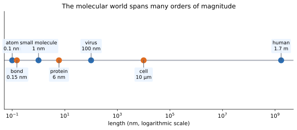
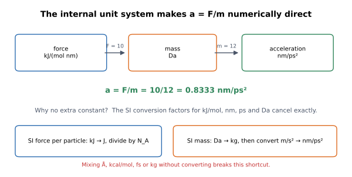
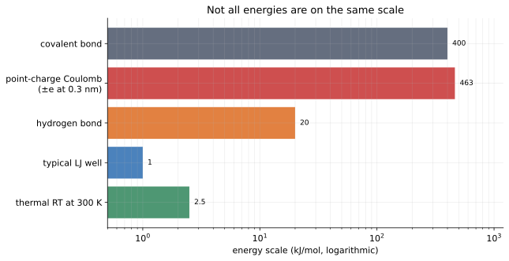

# 01 — Units, scales, and why $a=F/m$ just works

> **Where we are.** This is the first tutorial in the Moleculab sequence. We
> have not built a force field or run a simulation yet. We are agreeing on the
> physical language that every later equation will use.
>
> **What you should already know.** Basic algebra, vectors as arrows, and the
> idea that a physical quantity has both a number and a unit.
>
> **What you will be able to do afterwards.** Read any Moleculab equation and
> know what units every symbol has; convert between common molecular units;
> explain why $a=F/m$ needs no hidden constant; and catch unit errors before
> they become fake physics.

## 1. Why start with units?

Computational drug discovery is built from questions such as:

- How strongly does a ligand bind to a protein?
- How long does a hydrogen bond survive?
- How much energy does it cost to move a drug into a binding pocket?
- How fast does a protein loop move?

Every answer is a physical quantity. A quantity is not a bare number. It is a
number together with a unit. “The distance is 2” is meaningless until we know
whether that means 2 Å, 2 nm, or 2 µm.

At molecular scales, the numbers are awkward in SI units:

- a typical bond length is about $1.5\times10^{-10}$ m;
- a molecular dynamics timestep is about $2\times10^{-15}$ s;
- one mole contains $6.022\times10^{23}$ particles.

Writing those powers of ten in every equation makes code noisy and mistakes
easy. Moleculab therefore chooses a **coherent internal unit system** designed
for molecular simulation.

## 2. The scale of the molecular world



*The same physical world spans many orders of magnitude. A simulation box is
usually nanometres across even when the biological system is micrometres
across.*

A useful mental map:

| Object | Approximate size |
| --- | --- |
| atom | 0.1 nm |
| chemical bond | 0.1–0.2 nm |
| small drug molecule | 1–2 nm |
| small protein | 3–10 nm |
| virus | about 100 nm |
| cell | about 10 µm |
| human | about 1.7 m |

A molecular simulation usually focuses on a small box: perhaps 5 nm on a side,
containing a protein fragment, a ligand, water, and ions. The box is tiny by
human standards but enormous by atomic standards.

This is why we need a unit system that makes nanometres and picoseconds
natural.

## 3. The seven quantities Moleculab tracks

Moleculab's internal system is:

| Quantity | Unit | Symbol |
| --- | --- | --- |
| distance | nanometre | nm |
| time | picosecond | ps |
| energy | kilojoule per mole | kJ/mol |
| mass | dalton | Da |
| force | kilojoule per mole per nanometre | kJ/(mol nm) |
| temperature | kelvin | K |
| charge | elementary charge | e |

Do not memorize the table as a list of trivia. Think of it as a contract:

- if a function is documented as returning a force, the number is in
  kJ/(mol nm);
- if a position array is passed in, its components are in nm;
- if a velocity is updated, the result is in nm/ps.

The contract is implemented in
[`src/moleculab/units.py`](../../../src/moleculab/units.py):

```python
DISTANCE_UNIT = "nm"
TIME_UNIT = "ps"
ENERGY_UNIT = "kJ/mol"
MASS_UNIT = "Da"
FORCE_UNIT = "kJ/(mol nm)"
TEMPERATURE_UNIT = "K"
CHARGE_UNIT = "e"
```

These constants are documentation and code in the same place. When a later
module writes a force, it can refer to the same unit definitions instead of
inventing a new convention.

## 4. SI intuition versus simulation units

SI units are wonderful for fundamental physics. They are not always convenient
for molecular simulation.

Compare:

| Quantity | SI expression | Moleculab expression |
| --- | --- | --- |
| bond length | $1.5\times10^{-10}$ m | 0.15 nm |
| timestep | $2\times10^{-15}$ s | 0.002 ps |
| kinetic energy | $10^{-21}$ J | about 0.6 kJ/mol |
| force | $10^{-11}$ N | about 10 kJ/(mol nm) |

The simulation units keep the numbers close to human-scale values: 0.15,
0.002, 0.6, 10. That makes patterns easier to see.

This is not a claim that simulation units are “more correct.” They are a
convenient coordinate system for the same physics.

## 5. The central convenience: acceleration needs no constant

Newton's second law is

$$
\mathbf F = m\mathbf a.
$$

If force is in newtons and mass in kilograms, acceleration is in m/s². But
Moleculab stores force in **kJ/(mol nm)**, mass in **Da**, and acceleration in
**nm/ps²**. At first glance, those units look incompatible.

The surprising fact is that the conversion factors cancel exactly. Let us
verify this carefully, because it is the foundation of the whole unit system.

### 5.1 Convert force to a per-particle force

A force of $1\ \mathrm{kJ/(mol\,nm)}$ means that moving one mole of particles
by one nanometre changes the energy by one kilojoule.

For a single particle, the energy change is divided by Avogadro's number, and
the distance is converted from nm to m:

$$
F_{\text{particle}}
=
F_{\text{molar}}
\frac{1000}{N_A}
\frac{1}{10^{-9}}\ \mathrm{N}.
$$

### 5.2 Convert mass to kilograms

$$
m_{\mathrm{kg}}
=
m_{\mathrm{Da}}
\times1.66054\times10^{-27}\ \mathrm{kg}.
$$

### 5.3 Convert acceleration back to nm/ps²

One nm/ps² is

$$
\frac{10^{-9}\ \mathrm{m}}{(10^{-12}\ \mathrm{s})^2}
=
10^{15}\ \mathrm{m/s^2}.
$$

So

$$
a_{\mathrm{nm/ps^2}}
=
a_{\mathrm{m/s^2}}\times10^{-15}.
$$

### 5.4 Put the factors together

The conversion factor between the numerical value of $F/m$ in internal units
and the numerical value of acceleration in nm/ps² is

$$
\frac{1000}{N_A}
\frac{1}{10^{-9}}
\frac{1}{1.66054\times10^{-27}}
10^{-15}.
$$

Using $N_A=6.02214076\times10^{23}$, this factor is one. Therefore

$$
\boxed{
a_{\mathrm{nm/ps^2}}
=
\frac{F_{\mathrm{kJ/(mol\,nm)}}}{m_{\mathrm{Da}}}
}
$$

numerically.



*The conversion factors for kJ/mol, nm, ps, and Da cancel. This is why the code
can write `force / mass` directly.*

### 5.5 Worked example

Take

$$
F=10\ \mathrm{kJ/(mol\,nm)},
\qquad
m=12\ \mathrm{Da}.
$$

The shortcut gives

$$
a=\frac{10}{12}=0.8333\ \mathrm{nm/ps^2}.
$$

Let us check in SI. The force per particle is

$$
F_{\text{particle}}
=10\frac{1000}{6.022\times10^{23}}\frac{1}{10^{-9}}
\approx1.6605\times10^{-11}\ \mathrm{N}.
$$

The mass is

$$
m=12\times1.66054\times10^{-27}
\approx1.9926\times10^{-26}\ \mathrm{kg}.
$$

Thus

$$
a=\frac{1.6605\times10^{-11}}{1.9926\times10^{-26}}
\approx8.333\times10^{14}\ \mathrm{m/s^2}.
$$

Convert:

$$
8.333\times10^{14}\times10^{-15}
=0.8333\ \mathrm{nm/ps^2}.
$$

The two routes agree. The shortcut is not an approximation; it is an exact
consequence of the chosen units.

## 6. Energy scales you should internalize



*Thermal energy at room temperature is only a few kJ/mol. Hydrogen bonds and
Lennard-Jones wells are larger but still on the same order. Covalent bonds and
strong point-charge interactions are much larger.*

Approximate room-temperature scales:

- thermal energy $RT$ at 300 K: about 2.5 kJ/mol;
- a typical Lennard-Jones well: about 0.1–2 kJ/mol;
- a hydrogen bond: about 5–40 kJ/mol;
- a covalent bond: about 300–500 kJ/mol;
- a point-charge Coulomb interaction can be hundreds of kJ/mol at short
  distances.

These numbers matter for intuition. A force or energy that is thousands of
kJ/mol is usually a sign of an atomic clash or a unit mistake, not normal
thermal motion.

## 7. Molar energy and the gas constant

Moleculab expresses energy per mole. This is why the gas constant is

$$
R=0.008314462618\ \mathrm{kJ/(mol\,K)}.
$$

At temperature $T$,

$$
RT
=
0.008314462618\,T\ \mathrm{kJ/mol}.
$$

At 300 K,

$$
RT=2.4943387854\ \mathrm{kJ/mol}.
$$

The single-particle Boltzmann constant is

$$
k_B=1.380649\times10^{-23}\ \mathrm{J/K}.
$$

The relation is

$$
R=N_Ak_B.
$$

Use $R$ when your energy is per mole. Use $k_B$ when your energy is per
particle. Mixing them is a common source of factors of $N_A$.

## 8. Charge and the Coulomb constant

Coulomb's law in SI is

$$
U(r)=\frac{1}{4\pi\epsilon_0}\frac{q_iq_j}{r}.
$$

In Moleculab, charges are in units of the elementary charge $e$ and distance is
in nm. The conversion is collected into one constant:

$$
k_e
=
\frac{1}{4\pi\epsilon_0}
e^2
\frac{1}{10^{-9}}
\frac{N_A}{1000}
\approx138.935456\ \mathrm{kJ\,nm/(mol\,e^2)}.
$$

Then the internal-unit equation is simply

$$
U(r)=k_e\frac{q_iq_j}{r}.
$$

For example, two unit charges at $r=1$ nm have

$$
U\approx138.935\ \mathrm{kJ/mol}.
$$

At $r=0.3$ nm the interaction is roughly $463$ kJ/mol. That is much larger
than thermal energy, which is why electrostatics can dominate molecular
recognition and why water screening matters so much.

## 9. How the code protects the unit contract

The unit constants are used by the rest of the library. For example:

```python
from moleculab import units

print(units.DISTANCE_UNIT)          # nm
print(units.BOLTZMANN_CONSTANT)     # kJ/(mol K)
print(units.COULOMB_CONSTANT)       # kJ nm/(mol e^2)
```

The real code also validates vector shapes. A `Particle` refuses a position
with two components, because a two-component position would silently break
every later 3D force calculation.

A typical numerical check:

```bash
uv run python - <<'PY'
from moleculab import units
print("RT at 300 K:", units.BOLTZMANN_CONSTANT * 300)
print("Coulomb constant:", units.COULOMB_CONSTANT)
PY
```

Expected:

```text
RT at 300 K: 2.4943387854
Coulomb constant: 138.93545764438198
```

Run the unit tests:

```bash
uv run pytest tests/test_units.py -q
```

## 10. Dimensional analysis as a debugging tool

Dimensional analysis means checking that both sides of an equation have the
same units. It catches many errors before running a simulation.

Examples:

- $U=\tfrac12kx^2$: $k$ is kJ/(mol nm²), $x²$ is nm², so $U$ is kJ/mol.
- $F=kx$: kJ/(mol nm²) × nm = kJ/(mol nm).
- $a=F/m$: kJ/(mol nm) / Da gives nm/ps² numerically in this unit system.
- $K=\tfrac12mv²$: Da × (nm/ps)² gives kJ/mol numerically.

If you derive a new equation, write the units next to every symbol before
coding. If the units do not match, the equation is wrong even if it looks
plausible.

## 11. Numerical experiments

### Experiment 1: thermal energy

Compute $RT$ for 300 K, 310 K, and 600 K. Notice that doubling the temperature
doubles $RT$, while molecular speeds only increase by $\sqrt{2}$.

### Experiment 2: unit conversion

Convert a bond length of 1.5 Å to nm, a timestep of 2 fs to ps, and an energy
of 5 kcal/mol to kJ/mol.

### Experiment 3: Coulomb scale

Compute the Coulomb energy of two unit charges at 0.3 nm, 0.5 nm, and 1.0 nm.
Compare each result with $RT$ at 300 K. What does the comparison suggest about
electrostatic interactions in molecular recognition?

## 12. Common mistakes

1. **Using Å in a nm equation.** Convert by multiplying by 0.1.
2. **Using kcal/mol in a kJ/mol equation.** Multiply by 4.184.
3. **Using fs in a ps equation.** Multiply by 0.001.
4. **Forgetting the per-mole convention.** Use $R$, not $k_B$, when energies
   are per mole.
5. **Dropping the 1/4πε₀ factor in SI Coulomb calculations.** In Moleculab,
   that factor is already inside `COULOMB_CONSTANT`.
6. **Assuming the acceleration shortcut is universal.** It is specific to the
   chosen internal units.
7. **Trusting a number because it is finite.** A finite number can still have
   the wrong units.

## 13. Connections to later tutorials

Units are not an isolated preliminary. They appear in every later layer:

- **Particle energy:** kinetic energy uses Da and nm/ps.
- **Force:** the harmonic force uses kJ/(mol nm).
- **Time integration:** acceleration is nm/ps², so timesteps must be in ps.
- **Statistical mechanics:** temperature uses the molar gas constant.
- **Free energy:** energy differences are kJ/mol.
- **Docking:** interaction energies are kJ/mol, not arbitrary scores.
- **QM/MM:** quantum energies are converted to kJ/mol before mixing with MM.

When a later result looks strange, first check its units. Many “physics bugs”
are unit bugs.

## 14. Self-check with answers

1. **How many nm are in 1 Å?**
   0.1 nm.

2. **How many ps are in 1 fs?**
   0.001 ps.

3. **Convert 2 kcal/mol to kJ/mol.**
   $2\times4.184=8.368$ kJ/mol.

4. **What is $RT$ at 310 K?**
   $0.008314462618\times310=2.577$ kJ/mol.

5. **A 4 Da particle experiences 24 kJ/(mol nm). What is its acceleration?**
   $a=24/4=6$ nm/ps².

6. **Why does $a=F/m$ not need a constant here?**
   Because the conversion factors for kJ/mol, nm, ps, and Da cancel exactly.

7. **Why is a point-charge Coulomb energy often much larger than $RT$?**
   Because the Coulomb interaction has no screening in vacuum and grows as
   $1/r$; at molecular contact distances it can be hundreds of kJ/mol.

8. **Which constant would you use for a single particle's thermal energy?**
   $k_B$, not $R$.

## 15. Exercises

1. Write a short Python function that converts Å to nm and kcal/mol to kJ/mol.
   Add a test for each conversion.
2. Derive the units of the harmonic stiffness $k$ from $U=\tfrac12kx²$.
3. Compute the Coulomb energy of charges $+1e$ and $-1e$ at 0.25 nm and compare
   with $RT$ at 298 K. Is the interaction “strong” on a thermal scale?
4. Read `src/moleculab/units.py` and list every constant with its units.
5. Explain in one paragraph why unit systems are part of the model rather than
   mere notation.

## 16. Summary

- Moleculab uses nm, ps, kJ/mol, Da, kJ/(mol nm), K, and e.
- The acceleration equation is numerically $a=F/m$ in these units because
  the conversion factors cancel.
- Energy is molar; use $R$, not $k_B$, unless you explicitly convert.
- Coulomb interactions use a single precomputed constant.
- Dimensional analysis and unit tests catch errors before they contaminate a
  simulation.

**Next:** [02 — Particles, velocity, and kinetic energy](02_particle_energy.md).
