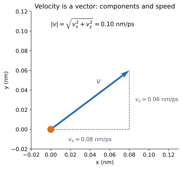
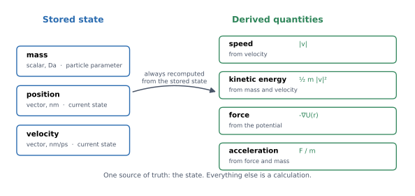
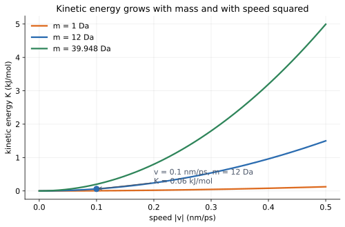
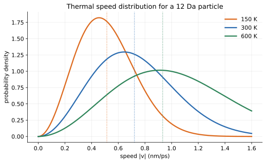
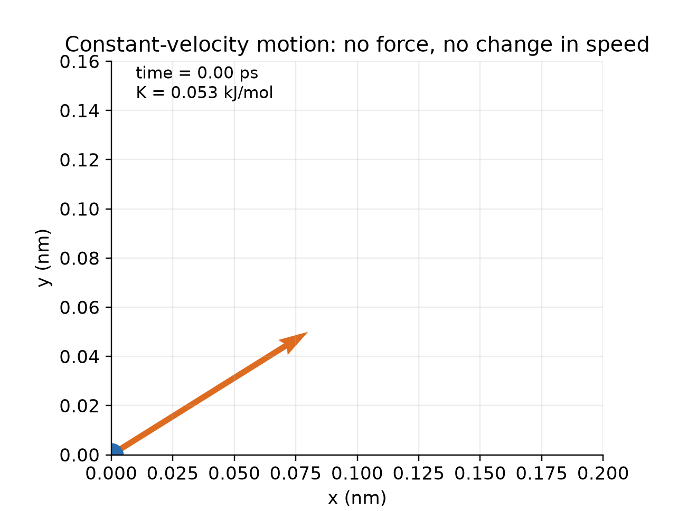

# 02 — Particles, velocity, and kinetic energy

> **Where we are.** Tutorial 01 established the unit system and introduced the
> running particle $P$. We now use those units to describe the simplest
> possible physical object: one classical point particle.
>
> **What you should already know.** Vectors, components, and the unit
> conventions from tutorial 01.
>
> **What you will be able to do afterwards.** Describe a particle's state,
> distinguish position from displacement, convert between velocity and speed,
> derive and compute kinetic energy, explain which quantities are stored and
> which are derived, and say why one particle does not have a meaningful
> temperature.

## 1. Learning objectives

**Core**

- Explain what a classical point particle represents and what it leaves out.
- Read and write a particle state $(\mathbf r,\mathbf v;m)$.
- Compute speed from velocity and kinetic energy from mass and speed.
- Distinguish stored state from derived quantities.

**Deeper insight**

- Explain why kinetic energy is frame-dependent.
- Explain why acceleration is derived rather than stored.
- Describe how temperature is inferred from many degrees of freedom.

**Looking ahead**

- The Maxwell–Boltzmann distribution is previewed here and developed properly
  in the statistical-mechanics tutorial.
- Center-of-mass motion and constraints will matter for thermostats.

## 2. The running example

We continue with the same particle from tutorial 01.

| Property | Value | Unit |
| --- | --- | --- |
| mass $m$ | 12 | Da |
| position $\mathbf r$ | $(0.1, 0, 0)$ | nm |
| velocity $\mathbf v$ | $(0.1, 0, 0)$ | nm/ps |
| speed $|\mathbf v|$ | 0.10 | nm/ps |
| kinetic energy $K$ | 0.06 | kJ/mol |

The velocity is an **arbitrary arithmetic choice**, not a typical
room-temperature velocity. Section 7.3 quantifies the difference. Keep that
distinction in mind: the example is designed to make the arithmetic clean, not
to represent a thermal particle.

## 3. Physical intuition: from a molecule to a point particle

A real molecule is complicated. It has nuclei, electrons, bonds, vibrations,
and quantum behavior. A classical molecular simulation replaces each atom with
a **point particle** carrying only:

- mass;
- position;
- velocity.

This is an approximation. More precisely:

- the particle represents an atom's **nucleus** (its mass and position) in a
  classical model;
- it does **not** represent the electrons or electronic structure;
- it has no internal structure, no bond-making, and no quantum states;
- it cannot describe chemical reactions, electronic excitation, or proton
  transfer.

Those omissions are acceptable for questions about molecular motion, structure,
and nonbonded interactions at ordinary temperatures. They are not acceptable for
reactions or spectroscopy. The modelling choice is deliberate: start with the
smallest object whose motion we can describe exactly, then add chemistry later.

## 4. Mathematical description

### 4.1 Position is a vector

A position tells us where a particle is relative to an origin. In three
dimensions:

$$
\mathbf r=
\begin{pmatrix}
x\\y\\z
\end{pmatrix}.
$$

In Moleculab, `position` is a NumPy array with shape `(3,)`, and every
component is in nm.

The origin is a choice. Moving the origin changes the coordinate numbers but
not the physics. What matters for interactions is usually a **displacement**:

$$
\Delta\mathbf r=\mathbf r_i-\mathbf r_j.
$$

The distance between the particles is the norm:

$$
r_{ij}=|\mathbf r_i-\mathbf r_j|.
$$

This distinction between a position and a displacement will matter repeatedly:
a bond or a force depends on the relative position, not on where the pair is in
the box.

### 4.2 Velocity is the rate of change of position

Velocity is

$$
\mathbf v=\frac{d\mathbf r}{dt}.
$$

In a simulation with a small time step $\Delta t$, a finite-difference
approximation is

$$
\mathbf v\approx\frac{\Delta\mathbf r}{\Delta t}.
$$

Velocity has direction. If a particle moves 0.1 nm in 1 ps to the right, its
velocity is $(0.1,0,0)$ nm/ps. If it moves to the left, the velocity is
$(-0.1,0,0)$ nm/ps.

Speed is the magnitude:

$$
|\mathbf v|=\sqrt{v_x^2+v_y^2+v_z^2}.
$$

Speed has no direction and is never negative.



*Velocity is built from components. The dashed lines show the component
vectors; the arrow is the full velocity. Here $v_x=0.08$ nm/ps,
$v_y=0.06$ nm/ps, and $|\mathbf v|=0.10$ nm/ps.*

#### Average versus instantaneous velocity

If a particle moves from A to B over a finite time, the average velocity is

$$
\mathbf v_{\text{avg}}
=
\frac{\mathbf r_B-\mathbf r_A}{t_B-t_A}.
$$

Instantaneous velocity is the limit as the time interval becomes very small.
MD works with instantaneous velocities at each step.

### 4.3 Kinetic energy

Kinetic energy is the energy associated with motion:

$$
K=\frac12m|\mathbf v|^2.
$$

In three dimensions,

$$
K=\frac12m(v_x^2+v_y^2+v_z^2)
=\frac12m\mathbf v\cdot\mathbf v.
$$

#### Where does the factor $1/2$ come from?

Imagine a particle starting from rest and accelerating under a constant force
$F$. Its acceleration is $a=F/m$. After time $t$, its speed is

$$
v=at.
$$

The distance travelled is

$$
d=\frac12at^2.
$$

The work done by the force is

$$
W=Fd=ma\cdot\frac12at^2=\frac12m(at)^2=\frac12mv^2.
$$

So the work done becomes exactly the kinetic energy. The factor $1/2$ is not an
arbitrary convention; it follows from the geometry of constant acceleration.

#### A second derivation: work and integration

For a force that changes with position,

$$
W=\int F\,dx.
$$

Using $F=m\,dv/dt$ and $dx=v\,dt$,

$$
W=\int m\frac{dv}{dt}v\,dt
=\int mv\,dv
=\frac12mv^2\bigg|_{\text{start}}^{\text{end}}.
$$

If the particle starts from rest, $W=\tfrac12mv^2$.

### 4.4 Kinetic energy is a scalar

Even though velocity is a vector, kinetic energy is a scalar. Direction matters
through the dot product, but the result has no direction. A particle moving
north at 100 m/s has the same kinetic energy as one moving east at 100 m/s.

### 4.5 Kinetic energy is frame-dependent

**Deeper insight.** If you observe the particle from a moving train, its
velocity changes, so its kinetic energy changes. This is not a paradox. Energy
is conserved within a chosen inertial frame. Later, when we discuss temperature,
we will often remove the center-of-mass motion to avoid counting the same bulk
motion twice.

## 5. Units and dimensions

The kinetic-energy equation uses the unit cancellation from tutorial 01:

$$
[K]
=
\mathrm{Da}\left(\frac{\mathrm{nm}}{\mathrm{ps}}\right)^2
=
\mathrm{Da\,nm^2/ps^2}
=
\mathrm{kJ/mol}.
$$

Numerically, $K=\tfrac12m|\mathbf v|^2$ needs no conversion factor.

### 5.1 Stored state versus derived quantities

A particle in Moleculab stores only the **state**:

$$
(\mathbf r,\mathbf v;m).
$$

Everything else is calculated. The figure and table make the boundary explicit.



*The stored state is the single source of truth. Derived quantities are
recomputed when needed.*

| Quantity | Stored? | Why |
| --- | --- | --- |
| mass $m$ | yes | particle parameter |
| position $\mathbf r$ | yes | current state |
| velocity $\mathbf v$ | yes | current state |
| atom type | yes | chemical identity, not mechanical state |
| charge | yes | electrostatic parameter, not mechanical state |
| speed $|\mathbf v|$ | no | derived from velocity |
| kinetic energy $K$ | no | derived from mass and velocity |
| force $\mathbf F$ | no | derived from the potential and position |
| acceleration $\mathbf a$ | no | derived from force and mass |

**Deeper insight.** In a large simulation, forces or accelerations may be
*cached* for computational efficiency. That does not change the design
principle: a cached value is still a derived quantity and must remain
consistent with the current state. The question is not “is it ever stored?” but
“is there one source of truth?”

## 6. Worked example: the running particle

For

$$
m=12\ \mathrm{Da},
\qquad
\mathbf v=(0.1,0,0)\ \mathrm{nm/ps},
$$

we have

$$
K=\frac12(12)(0.1)^2=0.06\ \mathrm{kJ/mol}.
$$

Notice that no conversion constant appears. This is the payoff of the unit
system.

### 6.1 Convert to SI for intuition

A speed of $0.1$ nm/ps is

$$
0.1\frac{10^{-9}\ \mathrm{m}}{10^{-12}\ \mathrm{s}}
=100\ \mathrm{m/s}.
$$

That is fast by everyday standards, but not necessarily a thermal speed. The
next subsection makes the difference precise.

### 6.2 Doubling speed

If speed doubles from 0.1 to 0.2 nm/ps, kinetic energy increases by a factor of
four:

$$
K_{\text{new}}
=\frac12(12)(0.2)^2
=0.24\ \mathrm{kJ/mol}.
$$

This quadratic dependence is important in thermostats and in collision
analysis.



*Kinetic energy grows as the square of speed and linearly with mass. The blue
point marks the running particle: 12 Da at 0.1 nm/ps gives 0.06 kJ/mol.*

### 6.3 Is 0.1 nm/ps a thermal speed?

For a classical gas, the most probable speed of a particle of molar mass $M$ is

$$
v_{\text{most probable}}
=
\sqrt{\frac{2RT}{M}}.
$$

For $M=12$ Da at $T=300$ K,

$$
v_{\text{most probable}}
=
\sqrt{\frac{2(0.008314462618)(300)}{12}}
\approx0.645\ \mathrm{nm/ps}.
$$

The mean speed is about $0.728$ nm/ps, and the root-mean-square speed is about
$0.790$ nm/ps. The example speed of $0.1$ nm/ps is roughly **six times slower**
than the most probable thermal speed.



*At higher temperature, the distribution shifts to higher speeds and becomes
broader. The dashed line marks the running particle's 0.1 nm/ps, which is far
below the thermal peak at 300 K. Dotted lines mark the mean speeds.*

**Looking ahead.** The Maxwell–Boltzmann distribution is the bridge from single
particles to statistical mechanics. Later, temperature, thermostats, and free
energy will all depend on averages over distributions like this one.

If you formally applied the equipartition formula to the three velocity
components of the example particle, you would get

$$
T_{\text{formal}}
=
\frac{2K}{3R}
=
\frac{2(0.06)}{3(0.008314462618)}
\approx4.8\ \mathrm{K}.
$$

That is not a real thermodynamic temperature for one particle; it is a sign
that the example is deliberately slow.

### 6.4 Temperature is a property of many degrees of freedom

**Deeper insight.** In a system of $N$ particles, the instantaneous kinetic
temperature is defined from the total kinetic energy and the number of thermal
degrees of freedom:

$$
T=\frac{2K}{N_{\mathrm{dof}}R}.
$$

For an isolated system with no constraints, removing the three center-of-mass
translation modes gives

$$
N_{\mathrm{dof}}=3N-3
\qquad(N>1).
$$

Constraints physically remove further degrees of freedom. A rigid water
molecule, for example, has fewer internal degrees of freedom than three
independent atoms. The current `kinetic_temperature` helper removes
center-of-mass motion but does not automatically subtract constraint degrees of
freedom, so constrained systems need care.

For a single particle there is no meaningful relative motion, so this formula
does not define a thermodynamic temperature. The library's
`kinetic_temperature(system)` function is intended for many-particle systems.
This is why tutorial 02 can compute a particle's kinetic energy but should not
claim that one particle has a temperature.

## 7. Python implementation

The particle representation is in
[`src/moleculab/particles.py`](../../../src/moleculab/particles.py).

A simplified version:

```python
from dataclasses import dataclass, field
import numpy as np

@dataclass
class Particle:
    mass: float
    position: np.ndarray = field(default_factory=lambda: np.zeros(3))
    velocity: np.ndarray = field(default_factory=lambda: np.zeros(3))

    def __post_init__(self):
        self.mass = float(self.mass)
        self.position = np.asarray(self.position, dtype=float)
        self.velocity = np.asarray(self.velocity, dtype=float)
```

The real implementation adds validation, chemical identity, and copy semantics.

### 7.1 Why position and velocity are arrays

A position has three components, and a velocity has three components. A NumPy
array of shape `(3,)` lets the same code handle x, y, and z without writing
three versions of every equation. It also lets `np.dot` express the vector
equation directly.

### 7.2 Why mass is a scalar

Mass is a property of the particle, not a direction-dependent quantity. A
scalar is the correct model.

### 7.3 Positive mass

A zero or negative mass would make acceleration undefined or unphysical.
`Particle` raises an error immediately.

### 7.4 Exactly three components

A position with two components would silently broadcast against a 3D vector in
later calculations, producing a confusing result. Shape validation catches the
error at construction.

### 7.5 Copies, not references

If `Particle` stored the input list directly, then changing that list later
would change the particle without any explicit assignment. The constructor
copies the arrays so the particle owns its state. `copy()` goes further and
returns an independent particle, including `atom_type` and `charge`.

### 7.6 Speed as a property

```python
@property
def speed(self):
    return float(np.linalg.norm(self.velocity))
```

The speed is computed from the velocity. It is not stored, for the same reason
acceleration is not stored: derived quantities should not get out of sync.

### 7.7 Kinetic energy function

```python
def kinetic_energy(particle):
    velocity_squared = float(
        np.dot(particle.velocity, particle.velocity)
    )
    return 0.5 * particle.mass * velocity_squared
```

`np.dot` is the dot product. It is equivalent to summing the squares of the
components, but it expresses the vector equation directly.

### 7.8 Chemical identity is stored too

The real `Particle` also stores `atom_type` and `charge`:

```python
atom_type: str = "default"
charge: float = 0.0
```

These are not part of the mechanical state, but they are part of the chemical
identity. Nonbonded models read them to choose Lennard-Jones parameters and
electrostatic charges. Every `System` rebuild must preserve them; otherwise a
typed calculation silently changes.

## 8. Tests and verification

Try the code:

```bash
uv run python - <<'PY'
from moleculab import Particle, kinetic_energy

particle = Particle(
    mass=12.0,
    position=[0.1, 0.0, 0.0],
    velocity=[0.1, 0.0, 0.0],
)
print("speed:", particle.speed)
print("kinetic energy:", round(kinetic_energy(particle), 12))
PY
```

Expected:

```text
speed: 0.1
kinetic energy: 0.06
```

Run the tests:

```bash
uv run pytest tests/test_particles.py tests/test_physics.py -q
```

What the tests protect:

- the kinetic-energy formula matches $\tfrac12m|\mathbf v|^2$;
- speed is the norm of velocity;
- zero and negative masses are rejected;
- positions and velocities with the wrong shape are rejected;
- the constructor copies its inputs;
- `copy()` produces an independent particle;
- `atom_type` and `charge` survive copying.

## 9. Animated example: constant velocity



*A particle with constant velocity moves in a straight line. No force acts, so
the velocity arrow is constant and kinetic energy stays constant.*

This animation separates two ideas that are easy to conflate:

- position changes with time;
- velocity can stay constant while position changes.

A force is what changes velocity. In this animation there is no force, so the
velocity arrow never changes.

## 10. Experiments

### Experiment 1: mass and energy

For a fixed speed of 0.1 nm/ps, compute kinetic energy for masses 1, 12, and
39.948 Da. Confirm the ratio is the same as the mass ratio.

### Experiment 2: speed and energy

For a fixed mass of 12 Da, compute kinetic energy for speeds 0.05, 0.1, 0.2,
and 0.4 nm/ps. Confirm that doubling speed quadruples energy.

### Experiment 3: thermal speed scale

Compute the most probable, mean, and root-mean-square speeds for 12 Da at 300 K.
Compare them with 0.1 nm/ps. What does this tell you about the running example?

### Experiment 4: reference frames

Take a particle with velocity $(0.1,0,0)$ nm/ps. Add a bulk velocity
$(0.1,0,0)$ to every particle in a two-particle system. How does the total
kinetic energy change? How does the internal kinetic energy change? Why does
this matter for temperature?

### Experiment 5: the equipartition value

For a 12 Da particle at 300 K, compute $\tfrac32RT$. Then compute the kinetic
energy at the root-mean-square speed and compare. They should agree.

## 11. Common misconceptions

1. **“A particle is a tiny ball.”** It is a point with mass, position, and
   velocity. It has no size, rotation, or internal structure.
2. **“The particle represents the whole atom, including electrons.”** It
   represents the nucleus in a classical model. Electronic structure is absent.
3. **Using speed where a vector is needed.** A force calculation needs
   direction.
4. **Adding speeds like scalars.** Use vector addition.
5. **Using mass in the wrong unit.** The kinetic-energy shortcut assumes Da.
6. **Forgetting the square.** Kinetic energy is quadratic in speed.
7. **Treating kinetic energy as conserved by itself.** It can convert to
   potential energy.
8. **Confusing one particle's kinetic energy with temperature.** Temperature is
   a statistical property of many degrees of freedom.
9. **Believing acceleration is never stored anywhere.** It may be cached in a
   large code, but it is still derived and must stay consistent.
10. **Assuming 0.1 nm/ps is a thermal speed.** It is an arithmetic example.

## 12. Connections and what comes next

- **Potential energy and force:** kinetic energy will exchange with potential
  energy.
- **Velocity Verlet:** velocity is the quantity the integrator updates.
- **Temperature:** average kinetic energy per degree of freedom defines
  temperature.
- **Thermostats:** thermostats rescale velocities, not positions.
- **Free energy:** kinetic contributions are often integrated out, but they
  matter for the partition function.
- **Docking:** scoring functions usually ignore explicit velocities, but the
  same particle representation underlies the molecular model.

**Looking ahead.** Tutorial 03 puts $P$ in a harmonic potential. The same
position $(0.1,0,0)$ nm will produce an energy and a force, and the same mass
will turn that force into an acceleration.

## 13. Self-check with answers

1. **A 1 Da particle moves at 0.2 nm/ps. What is $K$?**
   $0.5\times1\times0.2^2=0.02$ kJ/mol.

2. **A 12 Da particle has $K=0.54$ kJ/mol. What is its speed?**
   $v=\sqrt{2K/m}=\sqrt{1.08/12}=0.3$ nm/ps.

3. **Does changing position change kinetic energy?**
   No. Kinetic energy depends on mass and velocity only.

4. **Two particles have equal speeds but opposite velocities. Do they have the
   same kinetic energy?**
   Yes. Kinetic energy depends on speed, not direction.

5. **Why is acceleration not stored in `Particle`?**
   It is determined by force and mass; storing it would create a second source
   of truth.

6. **What is the difference between velocity and speed?**
   Velocity is a vector; speed is its magnitude.

7. **Why is kinetic energy frame-dependent?**
   Because velocity depends on the reference frame.

8. **What does the $v^2$ factor in the Maxwell–Boltzmann distribution mean?**
   It counts the number of velocity vectors with a given magnitude in three
   dimensions.

9. **Does one particle have a temperature?**
   Not in the thermodynamic sense. Temperature is inferred from the statistical
   kinetic energy of many degrees of freedom.

## 14. Exercises

### Calculation

1. Compute the kinetic energy of a 1 Da particle at 0.2 nm/ps.
2. A 12 Da particle has $K=0.54$ kJ/mol. Find its speed.
3. At 300 K, compute the most probable speed of a 12 Da particle.
4. Compute the kinetic energy at that speed and compare it with $\tfrac32RT$.

### Reasoning

1. Can a particle have zero velocity but nonzero acceleration? Give an example.
2. Can a particle move while its kinetic energy remains constant? Explain.
3. Can two particles have the same kinetic energy but different velocities?
   Give two different ways this can happen.
4. Does doubling mass while keeping velocity fixed double kinetic energy?
5. Can a particle's kinetic energy increase while total mechanical energy stays
   constant? What must happen to the potential energy?
6. Why does one particle not have a meaningful temperature?
7. Why is kinetic energy frame-dependent, and why is that not a contradiction?

### Implementation

1. Write a function `kinetic_energy_from_speed(mass, speed)` and compare it
   with the vector version.
2. Compute the kinetic energy of a 1 Da particle at the mean thermal speed at
   300 K.
3. Modify the animation idea: what would the velocity arrow look like if a
   constant force acted? Sketch it before coding.
4. Read `tests/test_particles.py` and list the invalid states it rejects.
5. Extend the particle example with a `momentum()` property returning
   $m\mathbf v$, and test it.

## 15. Summary

- A classical particle is described by mass, position, and velocity.
- It represents an atomic nucleus in a classical model, not electrons.
- Position and velocity are 3D vectors; speed is the magnitude of velocity.
- Kinetic energy is $K=\tfrac12m\mathbf v\cdot\mathbf v$.
- It is a scalar, non-negative, and frame-dependent.
- The code stores the mechanical state and the chemical identity, and derives
  everything else.
- Speed, force, acceleration, and kinetic energy are calculations, not stored
  state. Caching them is an optimisation, not a change of principle.
- One particle has kinetic energy, but temperature is a statistical property of
  many degrees of freedom.
- The example speed 0.1 nm/ps is deliberately slow; a 12 Da particle at 300 K
  moves at roughly 0.6–0.8 nm/ps.

**Previous:** [01 — Units and scales](01_units.md).  
**Next:** [03 — Potential energy and force](03_potential_force.md).
