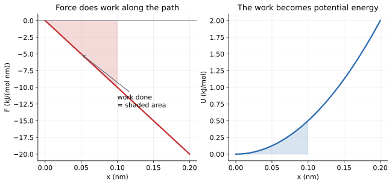
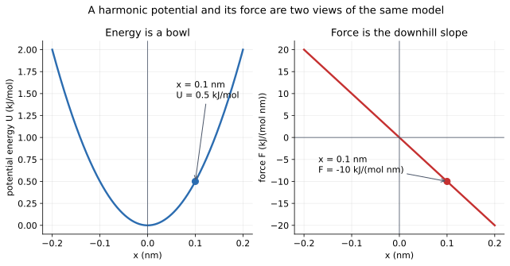
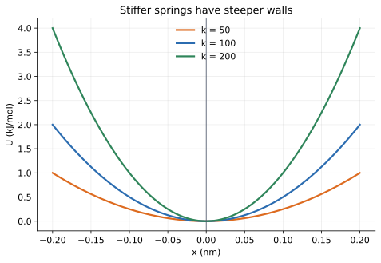
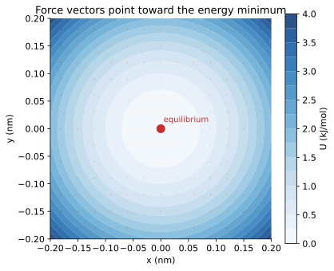
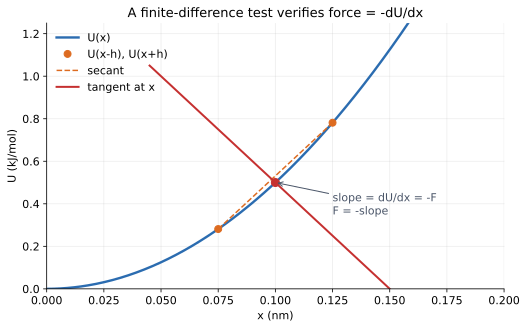
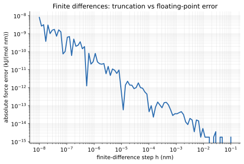

# 03 — Potential energy, force, and the energy landscape

> **Where we are.** Tutorial 02 described the state of the running particle $P$
> and its kinetic energy. Now we ask where motion comes from: a potential
> energy function and the force that points downhill on it.
>
> **What you should already know.** Vectors, kinetic energy, and the unit
> conventions from tutorials 01–02.
>
> **What you will be able to do afterwards.** Read a potential energy curve,
> derive the force from it, explain why force points downhill, verify energy and
> force consistency numerically, and recognise the harmonic model as the local
> approximation behind many molecular interactions.

## 1. Learning objectives

**Core**

- Explain what a potential energy landscape is.
- Derive $\mathbf F=-\nabla U$ from work and energy.
- Compute the energy and force of a harmonic potential.
- Verify numerically that a force is the negative gradient of its energy.

**Deeper insight**

- Explain why every smooth minimum looks harmonic nearby.
- Explain why the zero of energy is arbitrary.
- Recognise the difference between an external potential and a chemical bond.

**Looking ahead**

- Force fields sum many potential terms; docking scores are interaction
  energies; minimisation walks downhill on this landscape.
- The harmonic oscillator becomes the exactly solvable test case for the
  integrator in tutorial 04.

## 2. The running example

We keep the same particle $P$ and place it in a harmonic potential.

| Property | Value | Unit |
| --- | --- | --- |
| mass $m$ | 12 | Da |
| position $\mathbf r$ | $(0.1, 0, 0)$ | nm |
| velocity $\mathbf v$ | $(0.1, 0, 0)$ | nm/ps |
| kinetic energy $K$ | 0.06 | kJ/mol |
| stiffness $k$ | 100 | kJ/(mol nm²) |
| potential centre $\mathbf r_0$ | $(0, 0, 0)$ | nm |
| potential energy $U$ | 0.5 | kJ/mol |
| force $\mathbf F$ | $(-10, 0, 0)$ | kJ/(mol nm) |
| acceleration $\mathbf a$ | $(-0.8333, 0, 0)$ | nm/ps² |
| total energy $E=K+U$ | 0.56 | kJ/mol |

The total energy $0.56$ kJ/mol is the number used in the library's opening
docstring. It is not a coincidence: the same particle, potential, and units are
used there.

## 3. Physical intuition: a landscape of energy

A potential energy function assigns an energy to every possible configuration
of the system:

$$ U=U(\mathbf r_1,\mathbf r_2,\dots). $$

For one particle in one dimension, we can draw $U(x)$ as a curve. For one
particle in two dimensions, it is a surface. For many particles, it is a
high-dimensional surface that we cannot draw, but the same intuition applies.

A ball on a hilly landscape is the standard analogy:

- at a valley bottom, the ball is stable;
- on a slope, it accelerates downhill;
- the steeper the slope, the stronger the acceleration;
- a hilltop is an unstable equilibrium.

The force is the downhill direction of the landscape. This is the single most
important idea in molecular mechanics.

## 4. Mathematical description

### 4.1 Conservative forces and work

A force is **conservative** if the work it does depends only on the endpoints,
not on the path. Gravity and spring forces are conservative. Friction is not.

For a conservative force, we can define a potential energy $U$ such that

$$ W=-\Delta U. $$

If the particle moves from $A$ to $B$,

$$ W_{A\to B}=U(A)-U(B). $$

The force does positive work when the potential energy decreases. A ball
falling downward loses potential energy and gains kinetic energy.

In one dimension,

$$ W=\int_{x_A}^{x_B}F(x)\ dx. $$

Comparing with $W=U(A)-U(B)$ gives

$$ F(x)=-\frac{dU}{dx}. $$

In three dimensions,

$$ \mathbf F=-\nabla U. $$

The gradient points uphill. The negative gradient points downhill. Force points
toward lower potential energy.



*The shaded area under the force curve is the work done. The same area appears
as the change in potential energy. Force and energy are two views of one
landscape.*

### 4.2 The harmonic potential

The simplest landscape is a parabola:

$$ U(\mathbf r)=\frac12k|\mathbf r-\mathbf r_0|^2. $$

Here:

- $k$ is the stiffness, in kJ/(mol nm²);
- $\mathbf r_0$ is the equilibrium position;
- $|\mathbf r-\mathbf r_0|$ is the distance from equilibrium.

The force is

$$ \mathbf F = -\nabla U = -k(\mathbf r-\mathbf r_0). $$

This is Hooke's law in three dimensions. The force is:

- zero at equilibrium;
- proportional to displacement;
- directed back toward equilibrium.

The potential energy is a bowl. The force always points toward the bottom of the
bowl.



Left: the energy bowl. Right: the force, which is the negative slope of the
bowl. At $x=0.1$ nm, $U=0.5$ kJ/mol and $F=-10$ kJ/(mol nm).

#### Why the stiffness controls the shape



A larger $k$ gives a narrower, steeper bowl. For the same displacement, the
force and the curvature are larger.

The second derivative of $U$ is

$$ \frac{d^2U}{dx^2}=k. $$

So the stiffness is literally the curvature of the energy landscape.

### 4.3 Why a parabola is more than a toy

Real molecular potentials are not exactly harmonic. But near a stable minimum,
every smooth potential looks approximately parabolic.

Expand $U(x)$ around a minimum $x_0$:

$$ U(x)=U(x_0) +U'(x_0)(x-x_0) +\frac12U''(x_0)(x-x_0)^2 +\cdots. $$

At a minimum, $U'(x_0)=0$, so

$$ U(x)\approx U(x_0) +\frac12k(x-x_0)^2, \qquad k=U''(x_0). $$

The constant $U(x_0)$ does not affect force. The quadratic term does. This is
why harmonic potentials describe:

- bond vibrations near equilibrium;
- angle bending near the preferred angle;
- the bottom of a ligand binding pocket;
- small oscillations of a protein around a stable conformation.

The harmonic model breaks down far from the minimum. Real bonds dissociate, and
real nonbonded interactions have a finite well depth and a long-range tail.
But locally, the parabola is the right first approximation.

### 4.4 The zero of energy is arbitrary

You can add a constant to $U$:

$$ U'(x)=U(x)+C. $$

Then

$$ \frac{dU'}{dx}=\frac{dU}{dx}, $$

so the force is unchanged. Only energy differences matter for force and
dynamics.

**Looking ahead.** This is an early glimpse of a deep idea in thermodynamics:
absolute energies are often meaningless, while energy differences and
free-energy differences are physical. Binding free energy is a difference, not
an absolute energy.

## 5. Units and dimensions

Every symbol in the harmonic model has a unit:

| Quantity | Unit | Check |
| --- | --- | --- |
| $k$ | kJ/(mol nm²) | stiffness |
| $x$ | nm | displacement |
| $\tfrac12kx^2$ | kJ/(mol nm²) × nm² = kJ/mol | energy |
| $kx$ | kJ/(mol nm²) × nm = kJ/(mol nm) | force |
| $F/m$ | kJ/(mol nm) / Da = nm/ps² | acceleration |

The dimensional check is not decorative. If you accidentally use $k$ in
kJ/(mol Ų), the force is too large by a factor of 100 and the acceleration is
wrong.

## 6. Worked example: the running particle

Take

$$ k=100\ \mathrm{kJ/(mol\ nm^2)}, \qquad \mathbf r=(0.1,0,0)\ \mathrm{nm}, \qquad \mathbf r_0=(0,0,0). $$

Potential energy:

$$ U=\frac12(100)(0.1)^2=0.5\ \mathrm{kJ/mol}. $$

Force:

$$ \mathbf F=-100(0.1,0,0) =(-10,0,0)\ \mathrm{kJ/(mol\ nm)}. $$

For the particle of mass 12 Da,

$$ \mathbf a=\frac{\mathbf F}{m} =\frac{(-10,0,0)}{12} =(-0.8333,0,0)\ \mathrm{nm/ps^2}. $$

The acceleration points back toward the origin. If the particle is displaced to
the right, it accelerates left; if displaced left, it accelerates right.

### 6.1 The energy budget

At this instant the particle has

$$ K=0.06\ \mathrm{kJ/mol}, \qquad U=0.5\ \mathrm{kJ/mol}, \qquad E=K+U=0.56\ \mathrm{kJ/mol}. $$

If the particle is later released, the total energy should stay near 0.56
kJ/mol while $K$ and $U$ trade places. Tutorial 04 tests exactly that.

## 7. Energy landscapes in two dimensions



*Contours of constant energy in two dimensions. The force arrows point
perpendicular to the contours, toward the center. The center is the minimum.*

The two-dimensional picture makes the gradient intuitive. The force is
perpendicular to the level curves and points from high energy to low energy.
At the center, the gradient is zero and the force vanishes.

This is the geometry behind energy minimisation: to find a stable structure,
walk downhill until the gradient is zero.

## 8. Python implementation

The harmonic model is in
[`src/moleculab/models/potentials.py`](../../../src/moleculab/models/potentials.py):

```python
from dataclasses import dataclass, field
import numpy as np

@dataclass
class HarmonicPotential:
    stiffness: float
    center: np.ndarray = field(default_factory=lambda: np.zeros(3))

    def energy(self, position):
        displacement = np.asarray(position) - self.center
        return 0.5 * self.stiffness * np.dot(
            displacement, displacement
        )

    def force(self, position):
        displacement = np.asarray(position) - self.center
        return -self.stiffness * displacement
```

The real implementation validates that the stiffness is finite and positive and
that the centre has three components. It also copies the centre, so later
mutation of the input array cannot silently move the equilibrium.

The general physics functions are in
[`src/moleculab/models/physics.py`](../../../src/moleculab/models/physics.py):

```python
def potential_energy(particle, potential):
    return potential.energy(particle.position)

def acceleration(particle, force):
    return force / particle.mass
```

### 8.1 Why the layers are separate

| Component | Responsibility |
| --- | --- |
| `Particle` | stores state |
| `HarmonicPotential` | defines the landscape |
| `potential_energy()` | evaluates the landscape |
| `acceleration()` | applies Newton's second law |

A potential does not need to know about time integration. An integrator does
not need to know whether the landscape is harmonic or Lennard-Jones. This makes
it possible to add new physical models without rewriting the dynamics.

**Core architectural rule.** A physical model defines energy and force. A
numerical algorithm uses them. Do not hide a model inside an integrator.

### 8.2 External versus bonded

The harmonic potential in this tutorial is an **external** potential: it
describes one particle in a specified energy landscape.

Later, Moleculab will use several different kinds of interaction:

- **bonded:** a spring between two specific atoms;
- **angle:** a harmonic penalty for bending an angle;
- **torsion:** a periodic energy for rotation around a bond;
- **nonbonded:** Lennard-Jones and Coulomb interactions between many pairs.

They all follow the same principle: energy defines force, and force is the
negative gradient. But their inputs and scopes differ. Keeping them separate is
an architectural choice, not a mathematical one. A `HarmonicPotential` is not a
chemical bond.

## 9. Tests and verification

Try the code:

```bash
uv run python - <<'PY'
import numpy as np
from moleculab import (
    HarmonicPotential, Particle,
    kinetic_energy, potential_energy, total_energy, acceleration,
)

np.set_printoptions(precision=4, suppress=True)
particle = Particle(12.0, [0.1, 0.0, 0.0], [0.1, 0.0, 0.0])
potential = HarmonicPotential(100.0, [0.0, 0.0, 0.0])
force = potential.force(particle.position)
accel = acceleration(particle, force)
force = np.where(np.abs(force) < 1e-12, 0.0, force)
accel = np.where(np.abs(accel) < 1e-12, 0.0, accel)
print("K =", round(kinetic_energy(particle), 4))
print("U =", round(potential_energy(particle, potential), 4))
print("E =", round(total_energy(particle, potential), 4))
print("F =", force)
print("a =", accel)
PY
```

Expected:

```text
K = 0.06
U = 0.5
E = 0.56
F = [-10.  0.  0.]
a = [-0.8333  0.     0.   ]
```

### 9.1 The finite-difference test

We can test whether a force implementation agrees with its energy
implementation by finite differences:

$$ F(x)\approx-\frac{U(x+h)-U(x-h)}{2h}. $$

The central difference cancels the first-order error, leaving an error that
scales as $h^2$ for smooth functions.



*The tangent at a point is the derivative of the energy. A central difference
uses two nearby points to estimate that tangent.*

There is a tradeoff in choosing $h$:

- too large: truncation error;
- too small: floating-point cancellation.



For this harmonic potential, the error is minimised around $h\sim10^{-5}$ nm.
Making $h$ smaller than that makes the result worse because of roundoff.

The tests use a small step such as $h=10^{-6}$ nm and a tolerance such as
$10^{-6}$. This is not a formality: a sign error or a missing factor in the
force would be caught immediately.

### 9.2 What the tests protect

```bash
uv run pytest tests/test_potentials.py tests/test_physics.py -q
```

- energy is zero at the equilibrium centre;
- energy matches $\tfrac12k|\mathbf r-\mathbf r_0|^2$;
- force points toward equilibrium;
- force uses the displacement from the centre, not the absolute position;
- force is the negative gradient of energy;
- stiffness must be finite and positive;
- the centre is copied;
- acceleration is force divided by mass.

### 9.3 Physical invariants

- Force is the negative gradient of the same energy: $\mathbf F=-\nabla U$.
- Adding a constant to $U$ changes neither force nor dynamics.
- Force vanishes at a smooth minimum.
- An isotropic harmonic potential is invariant under rotation about its
  centre.
- A central difference converges as $h^2$ for smooth potentials.

**Recurring question:** does the force still point downhill after the code
changes? It must.

## 10. Experiments

### Experiment 1: slope and force

Pick $x=0.1$ nm and compute $U(x-h)$, $U(x)$, $U(x+h)$ for $h=10^{-4}$ nm.
Estimate the slope and compare with the analytical force.

### Experiment 2: stiffness

For $k=50$, $100$, and $200$, compute the force at the same displacement. What
is the ratio? What happens to the curvature?

### Experiment 3: energy zero

Add 100 kJ/mol to the potential energy at every position. Does the force
change? Does the trajectory change? Why?

### Experiment 4: finite-difference step

Vary $h$ from $10^{-8}$ to $10^{-1}$ nm and plot the error in the numerical
force. Can you reproduce the U-shaped curve in the figure?

### Experiment 5: total energy

Using the running particle, compute $K+U$. Then change the velocity to zero and
recompute. Which part changed? What does that suggest about the dynamics?

## 11. Common misconceptions

1. **Using $+\nabla U$ instead of $-\nabla U$.** Force points downhill.
2. **Forgetting the equilibrium centre.** Use $\mathbf r-\mathbf r_0$.
3. **Mixing stiffness units.** $k$ must be kJ/(mol nm²) for this equation.
4. **Assuming the harmonic model is valid everywhere.** It is a local
   approximation.
5. **Confusing an external potential with a chemical bond.** A bond involves
   two atoms and a relative coordinate.
6. **Testing only the energy.** Always test the force derivative too.
7. **Thinking the absolute energy matters.** Only differences affect force.
8. **Treating the force as a property of the particle alone.** It depends on
   the landscape and the position.

## 12. Connections and what comes next

Potential energy is the heart of molecular mechanics:

- a force field is a sum of potential energy terms;
- docking scores are interaction energies;
- energy minimisation finds low-energy structures;
- MD integrates the forces from these potentials;
- free-energy methods compare the thermodynamics of different potentials.

When a docking score or a binding energy seems implausible, ask:

- what potential terms were included?
- what units were used?
- is the force consistent with the energy?
- is the model valid in this configuration?

**Looking ahead.** Tutorial 04 takes the running particle, releases it in this
harmonic well, and integrates its motion. The total energy $0.56$ kJ/mol
becomes the benchmark that the integrator must preserve.

## 13. Self-check with answers

1. **For $k=200$ and displacement 0.05 nm, what are $U$ and $|F|$?**
   $U=\tfrac12(200)(0.05)^2=0.25$ kJ/mol; $|F|=200(0.05)=10$ kJ/(mol nm).

2. **In which direction does the force point when $x>0$?**
   Toward equilibrium, so in the $-x$ direction.

3. **Why does adding a constant to $U$ not change the force?**
   The derivative of a constant is zero.

4. **What happens to curvature and force if $k$ doubles?**
   Both double for the same displacement.

5. **Why is a parabola a reasonable local bond model?**
   Near a smooth minimum, the first derivative vanishes and the leading
   non-constant term is quadratic.

6. **What does a nonzero force at equilibrium indicate?**
   Either the chosen point is not the true minimum, or the force implementation
   is inconsistent with the energy.

7. **Why is the finite-difference test important?**
   It independently checks the derivative relationship between energy and
   force.

8. **What is the total energy of the running particle?**
   $K+U=0.06+0.5=0.56$ kJ/mol.

## 14. Exercises

### Calculation

1. Derive the force for $U(x)=\tfrac12k(x-x_0)^2$ by hand.
2. For $k=100$ and $x=0.25$ nm, compute $U$, $F$, and $a$ for a 12 Da particle.
3. For the running particle, compute $U$ at $x=0.05$, $0.1$, and $0.2$ nm.
   How does the energy scale with displacement?
4. Estimate the force at $x=0.1$ nm using a central difference with
   $h=0.01$ nm. Compare with the analytic value.

### Reasoning

1. Why does a conservative force define a potential energy, while friction does
   not?
2. Why is the harmonic model a good local approximation but a bad global one?
3. Why is a `HarmonicPotential` not a chemical bond?
4. What does a nonzero force at the supposed equilibrium tell you?
5. Why can two potentials that differ by a constant produce the same dynamics?
6. If the force is the negative gradient, why does the potential energy still
   matter for thermodynamics?

### Implementation

1. Write a small Python script that verifies the harmonic force with a central
   difference for several positions.
2. Plot $U(x)$ and $F(x)$ for two different values of $k$.
3. Add a `LennardJonesPotential` check: find its minimum and compare the
   numerical gradient with the analytic force.
4. Read `HarmonicPotential` and list every place where a unit or a sign
   convention is encoded.
5. Extend the running example to two dimensions and plot the force field.

## 15. Summary

- Potential energy is a landscape; force is its negative gradient.
- Work and potential energy are two views of the same conservative interaction.
- The harmonic potential is the universal local model near a stable minimum.
- Stiffness is curvature.
- Energy and force must be derived from the same model and tested together.
- The zero of energy is arbitrary; differences matter.
- An external potential is not a chemical bond.
- The running particle has $K=0.06$, $U=0.5$, and $E=0.56$ kJ/mol at the
  starting configuration.
- These ideas will become force fields, minimisation, dynamics, and docking.

**Previous:** [02 — Particles and kinetic energy](02_particle_energy.md).

**Next:** [04 — Velocity Verlet and energy conservation](04_velocity_verlet.md).
