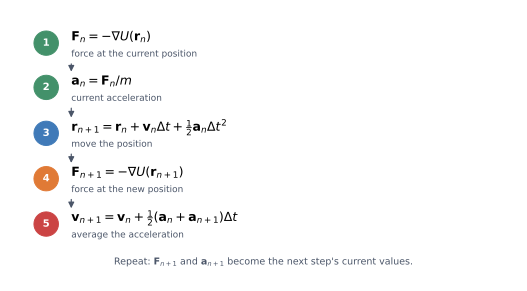
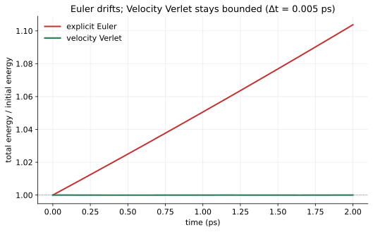
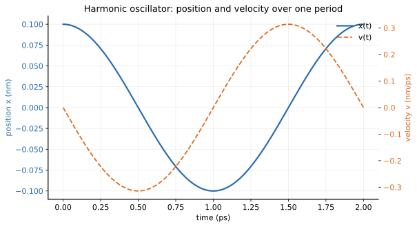
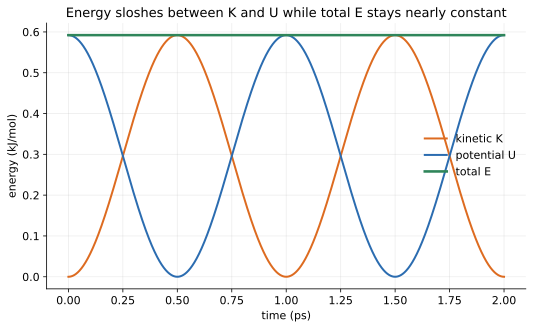
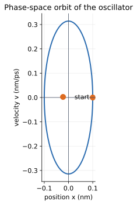
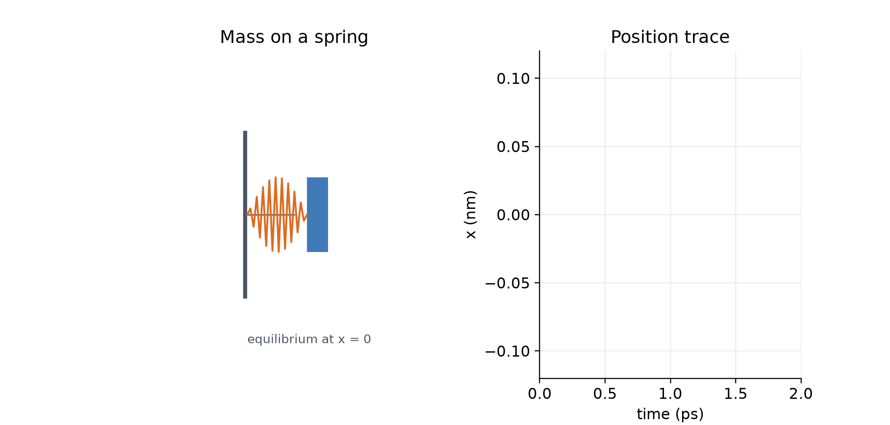
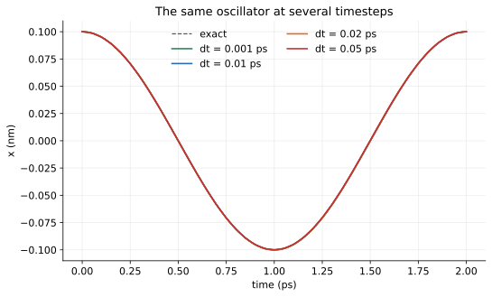
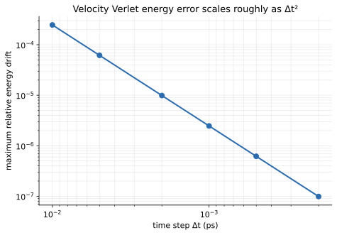

# 04 — Velocity Verlet and the conservation of energy

> **Where we are.** Tutorial 03 gave us a potential landscape and a force. Now
> we let the running particle move through time and watch kinetic and potential
> energy trade places.
>
> **What you should already know.** Kinetic energy, potential energy, force as
> the negative gradient, and the unit system.
>
> **What you will be able to do afterwards.** Explain why a numerical
> integrator is needed, derive Velocity Verlet, implement one step, analyse a
> trajectory, choose a timestep, and diagnose energy drift.

## 1. Learning objectives

**Core**

- Explain why the equations of motion must be integrated numerically.
- Derive the Velocity Verlet position and velocity updates.
- Implement one step and a trajectory loop.
- Check energy conservation and the analytic period.

**Deeper insight**

- Explain why explicit Euler gains energy for an oscillator.
- Explain what “symplectic” and “time-reversible” mean in practice.
- Distinguish stability from accuracy when choosing a timestep.

**Looking ahead**

- Production MD adds thermostats, barostats, constraints, and many particles.
- SHAKE/RATTLE remove the fastest bond vibrations so a larger timestep is safe.

## 2. The running example

We keep the same mass and the same starting position. Two closely related
experiments are useful.

| Quantity | Tutorial 03 well | Exact benchmark |
| --- | --- | --- |
| mass $m$ | 12 Da | 12 Da |
| initial position $x_0$ | 0.1 nm | 0.1 nm |
| initial velocity $v_0$ | 0.1 nm/ps | 0 nm/ps |
| stiffness $k$ | 100 kJ/(mol nm²) | $12\pi^2$ kJ/(mol nm²) |
| angular frequency $\omega=\sqrt{k/m}$ | 2.8868 rad/ps | $\pi$ rad/ps |
| period $T=2\pi/\omega$ | 2.1766 ps | 2 ps |
| initial energy $E$ | 0.56 kJ/mol | 0.5922 kJ/mol |

The second column is a deliberate benchmark, not a different physical model.
Choosing $k=12\pi^2$ and releasing the particle from rest gives the exact
solution

$$
x(t)=0.1\cos(\pi t)\ \mathrm{nm},
$$

with period exactly 2 ps. That lets us compare the integrator against a known
answer rather than against another simulation.

## 3. Physical intuition: force to motion

Newton's second law is

$$
\mathbf F=m\mathbf a
=m\frac{d^2\mathbf r}{dt^2}.
$$

For a potential,

$$
m\frac{d^2\mathbf r}{dt^2}=-\nabla U.
$$

This is a second-order differential equation. Given an initial position and
velocity, the equation determines the future trajectory.

For a real molecular system, the right-hand side is a complicated function of
many coordinates. There is no useful closed-form solution. We must integrate
numerically.

The computational loop is:

1. Start with positions and velocities.
2. Compute forces from the potential.
3. Update positions and velocities by a small time step.
4. Repeat.

The quality of step 3 determines whether the simulation is physically
trustworthy.



*One step: force, acceleration, position update, new force, velocity update.
The new force is reused as the current force in the next step.*

## 4. Mathematical description

### 4.1 The simplest attempt: explicit Euler

The most direct update is

$$
\mathbf r_{n+1}
=
\mathbf r_n+\mathbf v_n\Delta t,
$$

$$
\mathbf v_{n+1}
=
\mathbf v_n+\mathbf a_n\Delta t.
$$

This is explicit Euler. It uses the current force for the entire step.

It is easy to implement and easy to understand. It is also a poor choice for
oscillatory systems. The reason is that it treats the acceleration as constant
over the step, while in reality the force changes as the particle moves.

For a harmonic oscillator, explicit Euler systematically gains energy. The
particle spirals outward instead of staying on a closed orbit.



*For the same timestep, explicit Euler gains energy while Velocity Verlet keeps
the total energy bounded. A method can look stable for a short time and still
be physically wrong.*

### 4.2 A better update: Taylor expansion

Expand position in a Taylor series:

$$
\mathbf r(t+\Delta t)
=
\mathbf r(t)
+\mathbf v(t)\Delta t
+\frac12\mathbf a(t)\Delta t^2
+\frac16\mathbf j(t)\Delta t^3
+\cdots,
$$

where $\mathbf j=d\mathbf a/dt$ is the jerk. Truncating after the quadratic term
gives

$$
\mathbf r_{n+1}
=
\mathbf r_n
+\mathbf v_n\Delta t
+\frac12\mathbf a_n\Delta t^2.
$$

The position update is now second-order accurate. The neglected term is
proportional to $\Delta t^3$, so the local error is smaller than Euler's.

For velocity, we can use the average acceleration over the step:

$$
\mathbf v_{n+1}
=
\mathbf v_n
+\frac12(\mathbf a_n+\mathbf a_{n+1})\Delta t.
$$

This is the **Velocity Verlet** algorithm.

### 4.3 The algorithm in detail

One step:

1. Compute the force at the current position.
2. Compute the current acceleration:

$$
\mathbf a_n=\frac{\mathbf F_n}{m}.
$$

3. Update the position:

$$
\mathbf r_{n+1}
=
\mathbf r_n+\mathbf v_n\Delta t
+\frac12\mathbf a_n\Delta t^2.
$$

4. Compute the force at the **new** position.
5. Compute the new acceleration $\mathbf a_{n+1}$.
6. Update the velocity:

$$
\mathbf v_{n+1}
=
\mathbf v_n
+\frac12(\mathbf a_n+\mathbf a_{n+1})\Delta t.
$$

The extra force evaluation at the new position is the key difference from
Euler. It is also why Velocity Verlet is stable for oscillatory systems.

### 4.4 Why Velocity Verlet is special

Velocity Verlet has several properties that matter for MD:

- It is **second-order accurate** in the timestep.
- It is **time-reversible** in exact arithmetic.
- It is **symplectic**: it preserves the geometric structure of Hamiltonian
  mechanics.
- It has excellent long-term energy behavior for conservative systems.
- It does not require storing acceleration between steps.

“Symplectic” is a technical term, but the intuition is simpler: the method does
not systematically pump energy into or out of an oscillator. The numerical
trajectory stays near the true energy surface instead of spiraling away.

This is why Velocity Verlet, or closely related Verlet-family methods, are
standard in molecular dynamics.

## 5. Units and dimensions

The oscillator equations are dimensionally consistent in the internal system:

| Quantity | Relation | Unit |
| --- | --- | --- |
| $k/m$ | kJ/(mol nm²) / Da | 1/ps² |
| $\omega=\sqrt{k/m}$ | square root of the above | 1/ps |
| $\omega\Delta t$ | dimensionless | — |
| $a\Delta t^2$ | (nm/ps²)(ps²) | nm |
| $v\Delta t$ | (nm/ps)(ps) | nm |

The frequency unit is often written rad/ps, but the radian is dimensionless.
This is why $\omega\Delta t$ can be compared with a pure number in the
stability condition.

## 6. Worked example: one step by hand

Use the exact benchmark: $m=12$ Da, $k=12\pi^2$, $x_0=0.1$ nm, $v_0=0$, and
choose $\Delta t=0.1$ ps.

**Step 1. Current acceleration.**

$$
a_0=-\frac{kx_0}{m}
=-\frac{(12\pi^2)(0.1)}{12}
\approx-0.98696\ \mathrm{nm/ps^2}.
$$

**Step 2. New position.**

$$
x_1
=
0.1+0+\frac12(-0.98696)(0.1)^2
\approx0.0950652\ \mathrm{nm}.
$$

**Step 3. New acceleration.**

$$
a_1=-\frac{(12\pi^2)(0.0950652)}{12}
\approx-0.938256\ \mathrm{nm/ps^2}.
$$

**Step 4. New velocity.**

$$
v_1
=
0+\frac12(-0.98696-0.938256)(0.1)
\approx-0.0962608\ \mathrm{nm/ps}.
$$

Compare with the exact solution at $t=0.1$ ps:

$$
x_{\text{exact}}=0.1\cos(0.1\pi)\approx0.0951057\ \mathrm{nm},
$$

$$
v_{\text{exact}}=-0.1\pi\sin(0.1\pi)\approx-0.0970806\ \mathrm{nm/ps}.
$$

The position error is about $4\times10^{-5}$ nm; the velocity error is about
$8\times10^{-4}$ nm/ps. This is a single step with a relatively large timestep.
The error is small because the method is second-order, but it is not zero.

## 7. The harmonic oscillator as an exact benchmark

For a one-dimensional harmonic oscillator,

$$
m\frac{d^2x}{dt^2}=-kx.
$$

The exact solution is

$$
x(t)=A\cos(\omega t+\phi),
\qquad
\omega=\sqrt{\frac{k}{m}}.
$$

The period is

$$
T=\frac{2\pi}{\omega}
=
2\pi\sqrt{\frac{m}{k}}.
$$

With

$$
m=12\ \mathrm{Da},
\qquad
k=12\pi^2\ \mathrm{kJ/(mol\,nm^2)},
$$

we get

$$
\omega=\sqrt{\frac{12\pi^2}{12}}=\pi\ \mathrm{rad/ps},
\qquad
T=2\ \mathrm{ps}.
$$

Starting at $x=0.1$ nm with zero velocity:

$$
x(t)=0.1\cos(\pi t)\ \mathrm{nm}.
$$

After 2 ps, the particle should be back at $x=0.1$ nm. This gives us an exact
test for both the period and the trajectory.

## 8. Position, velocity, and energy



*Position is a cosine; velocity is a sine. At the turning points, velocity is
zero. At equilibrium, speed is maximal.*

The quarter-period phase difference is important:

- maximum displacement → maximum potential energy, zero kinetic energy;
- equilibrium → zero potential energy, maximum kinetic energy;
- the particle does not stop at equilibrium; inertia carries it through.



*Kinetic and potential energy oscillate out of phase. Their sum remains nearly
constant.*

For the exact oscillator,

$$
K=\frac12mv^2,
\qquad
U=\frac12kx^2,
\qquad
E=K+U=\text{constant}.
$$

The simulation does not enforce constant energy explicitly. Velocity Verlet
approximately conserves it because of its geometric properties. Small bounded
oscillations in the total energy are normal. A systematic drift is a warning
sign.

## 9. Phase space



*Plotting velocity against position gives a closed ellipse. The shape encodes
the conserved energy and the oscillation frequency.*

Phase space is a useful diagnostic:

- a closed orbit indicates stable conservative motion;
- an outward spiral means energy gain;
- an inward spiral means numerical damping;
- a sudden jump means a bad step or a force discontinuity.

In many dimensions, phase space is high-dimensional, but projections onto
important coordinates can still reveal instabilities.

## 10. Animated oscillator



*A mass on a spring. The force points toward equilibrium; position, velocity,
and energy evolve together.*

Watch the feedback loop:

1. Position determines the spring force.
2. Force determines acceleration.
3. Acceleration changes velocity.
4. Velocity changes position.

The animation is not just decorative. It is a visual representation of the
integration algorithm.

## 11. Python implementation

The integrator is in
[`src/moleculab/integrators.py`](../../../src/moleculab/integrators.py):

```python
def velocity_verlet_step(particle, potential, dt):
    force_now = potential.force(particle.position)
    acceleration_now = acceleration(particle, force_now)

    new_position = (
        particle.position
        + particle.velocity * dt
        + 0.5 * acceleration_now * dt**2
    )

    force_next = potential.force(new_position)
    acceleration_next = acceleration(particle, force_next)

    new_velocity = (
        particle.velocity
        + 0.5 * (acceleration_now + acceleration_next) * dt
    )

    return Particle(
        mass=particle.mass,
        position=new_position,
        velocity=new_velocity,
        atom_type=particle.atom_type,
        charge=particle.charge,
    )
```

The trajectory loop is:

```python
def simulate_velocity_verlet(particle, potential, dt, steps):
    current = particle.copy()
    positions = np.empty((steps + 1, 3))
    velocities = np.empty((steps + 1, 3))
    energies = np.empty(steps + 1)

    for index in range(steps + 1):
        positions[index] = current.position
        velocities[index] = current.velocity
        energies[index] = total_energy(current, potential)
        if index < steps:
            current = velocity_verlet_step(current, potential, dt)

    return Trajectory(...)
```

Four design choices are worth noticing:

1. **The input particle is not mutated.** The function returns a new particle.
   This makes reasoning and testing easier.
2. **The force is evaluated at the new position.** That is the defining feature
   of Velocity Verlet.
3. **The trajectory stores every state.** You can analyse the step where
   something went wrong instead of seeing only the final result.
4. **Chemical identity is preserved.** The new particle keeps `atom_type` and
   `charge`, so an integrator step does not silently change a later nonbonded
   calculation.

Run the example:

```bash
uv run python examples/harmonic_oscillator.py
```

A compact check:

```bash
uv run python - <<'PY'
import numpy as np
from moleculab import (
    HarmonicPotential, Particle,
    simulate_velocity_verlet,
)

particle = Particle(12.0, [0.1, 0.0, 0.0], [0.0, 0.0, 0.0])
potential = HarmonicPotential(12.0 * np.pi**2, [0.0, 0.0, 0.0])
trajectory = simulate_velocity_verlet(particle, potential, dt=0.001, steps=2000)

print("start x    =", trajectory.position[0, 0])
print("after 2 ps =", trajectory.position[-1, 0])
print("max |E-E0| =", np.max(np.abs(trajectory.total_energy - trajectory.total_energy[0])))
PY
```

Expected, up to small numerical differences:

```text
start x    = 0.1
after 2 ps = 0.1000...
max |E-E0| = small (on the order of 1e-6)
```

## 12. Tests and verification

```bash
uv run pytest tests/test_integrators.py -q
```

What the tests protect:

- one step matches the Velocity Verlet equations exactly;
- the input particle is not mutated;
- a step preserves `atom_type` and `charge`;
- the trajectory has one snapshot per state, including the initial one;
- the total energy of a harmonic oscillator stays bounded;
- the numerical trajectory matches the analytic solution, including a general
  initial phase;
- position, velocity, and energy errors are second order in the timestep;
- the oscillator returns near its starting position after one period;
- zero steps returns only the initial snapshot;
- invalid timesteps and step counts are rejected.

**Core idea.** Testing against an exact solution is stronger than testing that
“the code runs.” The period and the energy are physical predictions.

### 12.1 Independent analytic validation

For the benchmark, the exact solution is

$$
x(t)=x_0\cos(\omega t)+\frac{v_0}{\omega}\sin(\omega t),
$$

which reduces to $0.1\cos(\pi t)$ when $v_0=0$. We can compare every numerical
snapshot with this formula, not just the final energy.

Running `examples/harmonic_validation.py` over two periods gives:

| $\Delta t$ (ps) | steps/period | max $\lvert x-x_{\text{exact}}\rvert$ | max $\lvert v-v_{\text{exact}}\rvert$ | max $\lvert E-E_0\rvert$ | observed order |
| --- | --- | --- | --- | --- | --- |
| 0.02 | 100 | $1.816\times10^{-4}$ | $6.575\times10^{-4}$ | $5.845\times10^{-4}$ | — |
| 0.01 | 200 | $4.541\times10^{-5}$ | $1.644\times10^{-4}$ | $1.461\times10^{-4}$ | 2.00 |
| 0.005 | 400 | $1.135\times10^{-5}$ | $4.110\times10^{-5}$ | $3.653\times10^{-5}$ | 2.00 |
| 0.0025 | 800 | $2.838\times10^{-6}$ | $1.028\times10^{-5}$ | $9.132\times10^{-6}$ | 2.00 |
| 0.00125 | 1600 | $7.094\times10^{-7}$ | $2.569\times10^{-6}$ | $2.283\times10^{-6}$ | 2.00 |

Every time the timestep is halved, the errors fall by about four. That is the
signature of a second-order method. At $\Delta t=0.001$ ps, the measured period
from zero crossings is 1.99999918 ps, a relative error of about
$4\times10^{-7}$.

This comparison is stronger than energy conservation alone. A symplectic method
can keep the energy bounded while still accumulating a phase error. Comparing
the trajectory with the analytic solution checks the motion itself.

The permanent tests are in
[`tests/test_harmonic_validation.py`](../../../tests/test_harmonic_validation.py).
They cover a general initial phase, a multidimensional oscillator, second-order
convergence of position, velocity, and energy, numerical period measurement, and
the small-timestep limit.

## 13. Timestep, stability, and accuracy



*Small timesteps track the exact solution closely. Large timesteps distort the
period and amplitude; very large timesteps can destabilise the trajectory.*

For the harmonic oscillator, Velocity Verlet is stable only when

$$
\omega\Delta t<2.
$$

For the benchmark $\omega=\pi$, this gives $\Delta t<0.637$ ps. But stability is
not the same as accuracy. At $\Delta t=0.1$ ps the method is stable, but the
period and amplitude already carry measurable error. A useful practical rule is
to resolve the fastest period with many steps, not just enough steps to avoid
blowing up.

In atomistic MD, the fastest motions are often bond vibrations involving
hydrogen. Their periods are on the order of 10 fs, which is why typical
timesteps are around 1–2 fs ($0.001$–$0.002$ ps).



*The maximum relative energy drift decreases roughly as $\Delta t^2$ for
Velocity Verlet. Smaller timesteps improve conservation but cost more CPU time.*

This is the central practical tradeoff of MD:

- larger timestep → fewer force evaluations → faster simulation;
- larger timestep → larger integration error → distorted physics;
- too large a timestep → instability or a blown-up trajectory.

A production MD code often uses constraints (SHAKE/RATTLE) to remove the
fastest bond vibrations and allow a larger timestep. Moleculab introduces rigid
water constraints later for the same reason.

## 14. Why Euler is not enough

Explicit Euler is first-order and does not preserve the symplectic structure.
For an oscillator, it tends to gain energy. A simple intuitive picture:

- the particle moves in a straight line for the whole step;
- then the force is applied as if it had been constant;
- the force is strongest at the turning points, so the correction is applied
  too late.

Velocity Verlet uses the force at both ends of the step. The averaged
acceleration is a much better approximation to the true motion.

## 15. What the trajectory contains

A `Trajectory` stores:

- time;
- position at every step;
- velocity at every step;
- kinetic energy;
- potential energy;
- total energy.

This is enough for:

- plotting motion;
- checking energy conservation;
- computing period and frequency;
- computing phase-space orbits;
- diagnosing instabilities;
- later, analysing diffusion or structural fluctuations.

## 16. Experiments

### Experiment 1: timestep scan

For the benchmark oscillator, run 2 ps with timesteps 0.01, 0.005, 0.002,
0.001, and 0.0005 ps. Record the maximum relative energy drift and plot it
against $\Delta t$ on a log-log axis. Estimate the slope.

### Experiment 2: measure the period

Use the trajectory to find the times at which $x$ crosses zero. Estimate the
period and compare with 2 ps. How does the error change with $\Delta t$?

### Experiment 3: Euler comparison

Implement explicit Euler for the same oscillator. Plot the total energy against
time for Euler and for Velocity Verlet. Which one drifts? Which one stays
bounded?

### Experiment 4: initial conditions

Start at $x=0$ with nonzero velocity. How do the cosine and sine roles swap?
Does the energy still stay bounded?

### Experiment 5: the tutorial-03 well

Repeat the energy check with $k=100$ and initial velocity 0.1 nm/ps. What is the
period? Why is it not exactly 2 ps?

## 17. Common misconceptions

1. **Using the old acceleration for the entire velocity update.** Velocity
   Verlet averages old and new acceleration.
2. **Forgetting to recompute force at the new position.** This reduces the
   method toward Euler.
3. **Choosing a timestep that is too large.** The trajectory may look plausible
   for a few steps and then explode.
4. **Judging a simulation only by its final snapshot.** Check energy drift and
   conservation over time.
5. **Confusing period with timestep.** The benchmark period is 2 ps; the
   timestep is usually a small fraction of that.
6. **Expecting exact energy conservation.** Floating-point roundoff and finite
   timesteps produce small bounded oscillations.
7. **Using the wrong mass or stiffness units.** The period formula assumes
   consistent units.
8. **Believing stability implies accuracy.** A stable trajectory can still have
   the wrong period and amplitude.
9. **Thinking the integrator changes the physical model.** It only approximates
   the same equations of motion.

## 18. Connections and what comes next

This small oscillator is the core of MD:

- a force field supplies the potential;
- the integrator advances positions and velocities;
- a thermostat controls temperature;
- a barostat controls pressure;
- analysis extracts structural and thermodynamic information.

In a protein-ligand simulation, the same loop runs for millions of steps with
thousands of atoms. The physics is more complex, but the numerical principle is
identical: compute forces, update positions, update velocities, repeat.

Understanding this tiny system makes it much easier to interpret:

- why timesteps are measured in femtoseconds;
- why energy conservation is a diagnostic;
- why constraints are used for water and hydrogen bonds;
- why a trajectory can look “stable” but still be numerically wrong.

**Looking ahead.** The multi-particle integrator in `System` uses the same
Velocity Verlet update, plus constraints and periodic boundaries. The
bookkeeping grows; the algorithm does not.

### 18.1 What you have built so far

The four tutorials follow the library's own construction:

| Layer | Code | Tutorial |
| --- | --- | --- |
| unit contract | `units.py` | 01 |
| particle state | `Particle` | 02 |
| kinetic energy | `kinetic_energy` | 02 |
| potential model | `HarmonicPotential` | 03 |
| force and acceleration | `potential_energy`, `acceleration` | 03 |
| time step | `velocity_verlet_step` | 04 |
| trajectory | `simulate_velocity_verlet` | 04 |

That is a complete, testable molecular-dynamics core for one particle. The rest
of Moleculab extends it: more particles, more potential terms, boundaries,
constraints, thermostats, and analysis.

## 19. Self-check with answers

1. **Why does Velocity Verlet evaluate the force twice per step?**
   The new force gives the new acceleration used in the averaged velocity
   update.

2. **For $m=12$ and $k=12\pi^2$, what is the period?**
   $T=2\pi\sqrt{12/(12\pi^2)}=2$ ps.

3. **What happens to the energy drift if the timestep is halved?**
   The error generally drops by about a factor of four for a second-order
   method.

4. **Why does an Euler oscillator gain energy?**
   It uses only the old acceleration, so it consistently overshoots.

5. **At the turning point, what are $K$ and $U$?**
   Kinetic energy is zero; potential energy is maximal.

6. **Why is 1–2 fs a typical MD timestep?**
   It resolves fast bond vibrations while remaining computationally practical.

7. **What does a closed phase-space orbit indicate?**
   Stable, approximately conservative motion.

8. **Why is the trajectory stored at every step?**
   To support analysis and debugging of the integration.

9. **What is the stability condition for the harmonic oscillator?**
   $\omega\Delta t<2$. Accuracy requires a considerably smaller timestep.

## 20. Exercises

### Calculation

1. Derive the period of a harmonic oscillator from $m\,d^2x/dt^2=-kx$.
2. For the benchmark, compute the exact position and velocity at $t=0.25$ ps.
3. Repeat the one-step worked example with $\Delta t=0.01$ ps. Compare the
   errors with the $\Delta t=0.1$ ps results.
4. Compute the stability limit $\Delta t=2/\omega$ for $k=100$ and $k=12\pi^2$.

### Reasoning

1. Why does Velocity Verlet need the force at the new position?
2. Why is a symplectic method preferable to a method with smaller short-term
   error but systematic energy drift?
3. Why is energy conservation a useful diagnostic even in a simulation with a
   thermostat?
4. Why can a trajectory look smooth and still be numerically wrong?
5. Why is a smaller timestep not always better in a real simulation? Consider
   wall-clock time and accumulated roundoff.
6. Why does removing fast bond vibrations allow a larger timestep?

### Implementation

1. Modify the example to start with zero position and nonzero velocity. How do
   the cosine and sine roles swap?
2. Compute the maximum relative energy drift for timesteps 0.01, 0.001, and
   0.0001 ps. Plot the result on a log-log axis.
3. Implement explicit Euler for the same oscillator and compare its energy
   drift with Velocity Verlet.
4. Add a function that measures the period from zero crossings of the
   trajectory and compare it with the analytic value.
5. Extend `simulate_velocity_verlet` to record `atom_type` and `charge` in the
   trajectory metadata, or explain why the current design does not need to.

## 21. Summary

- Velocity Verlet updates position with old velocity and old acceleration, then
  updates velocity with the average of old and new acceleration.
- It is second-order, time-reversible, and symplectic.
- It keeps the total energy of a conservative oscillator bounded.
- The timestep must resolve the fastest motion in the system.
- Stability ($\omega\Delta t<2$) is necessary but not sufficient; accuracy
  requires a much smaller step.
- Energy drift is a diagnostic, not a decoration.
- The running particle's tutorial-03 well and the exact 2 ps benchmark are the
  same physical model with different parameters, chosen to make the physics
  visible.
- This small integrator is the engine that will later drive many-particle
  molecular dynamics.

**Previous:** [03 — Potential energy and force](03_potential_force.md).  
**Return to the tutorial index:** [Moleculab tutorial](../tutorial.md).
