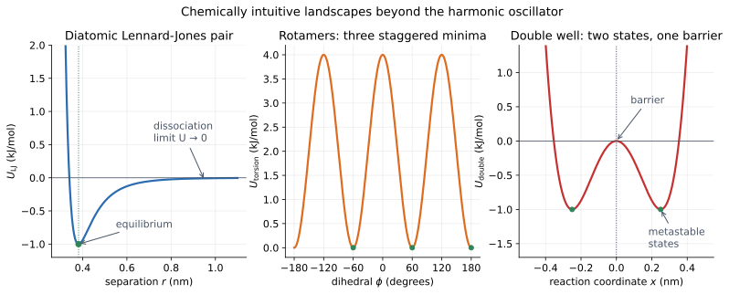

# 04b — From springs to chemistry: Lennard-Jones, rotamers, and double wells

> **Where we are.** Tutorials 01–04 used the harmonic oscillator as a
> mathematical instrument. It is the cleanest way to validate an integrator, but
> a spring is not a molecule. This bridge tutorial keeps the oscillator as a
> validation tool and introduces three chemically intuitive landscapes before
> the nonbonded tutorial.
>
> **What you should already know.** Potential energy, force, Velocity Verlet,
> units, and the harmonic oscillator checkpoint.
>
> **What you will be able to do afterwards.** Explain the difference between a
> validation model and a chemical model, read a Lennard-Jones dissociation
> curve, recognise rotamer minima and barriers, and reason about transitions
> between two states.

## 1. Learning objectives

**Core**

- Explain why the harmonic oscillator is a validation model, not a chemistry
  model.
- Read the Lennard-Jones pair curve and its dissociation limit.
- Read a periodic torsion curve with multiple minima.
- Read a double-well curve with two stable states and a barrier.

**Deeper insight**

- Expand a smooth potential around its minimum to recover a local harmonic
  model.
- Explain why a Lennard-Jones bond can break while a harmonic bond cannot.
- Explain why a double well introduces transition states and dwell times.

**Looking ahead**

- Tutorial 05 develops Lennard-Jones and Coulomb interactions in detail.
- Tutorial 07 develops bonds, angles, and torsions.
- Tutorial 08 shows why minimisation can get trapped in a local minimum.
- Free-energy methods later estimate barrier crossing and state populations.



*Left: a Lennard-Jones pair has a finite well and a dissociation limit. Middle:
a threefold torsion has three staggered minima and eclipsed barriers. Right: a
double well has two stable states separated by a barrier.*

## 2. The harmonic oscillator is a ruler, not a molecule

The harmonic potential

$$ U(x)=\frac12 k(x-x_0)^2 $$

is invaluable because:

- its analytic solution is known;
- its period is exact;
- its energy is conserved by a good integrator;
- its partition function is Gaussian.

Those properties make it the right tool for testing an integrator and a
free-energy estimator. They do not make it a realistic chemical bond.

A real bond:

- has a steep repulsive wall from electron-cloud overlap;
- has a finite attractive well;
- can dissociate when enough energy is supplied;
- is anharmonic away from the minimum.

A parabola has none of the first three properties. It stretches forever and
pulls harder the farther you pull.

The right lesson is:

> Use the harmonic oscillator to validate the code. Use chemical landscapes to
> build intuition.

## 3. A diatomic Lennard-Jones pair

### 3.1 The energy and force

For two atoms separated by $r$,

$$ U_{\mathrm{LJ}}(r)=4\epsilon\left[\left(\frac{\sigma}{r}\right)^{12}-\left(\frac{\sigma}{r}\right)^{6}\right]. $$

The minimum is at

$$ r_{\min}=2^{1/6}\sigma\approx1.12246\sigma, $$

with well depth $-\epsilon$. At $r=\sigma$ the energy is zero. As $r\to\infty$,
the energy approaches zero from below.

The force on particle $i$ is the negative radial gradient. It is repulsive for
$r<r_{\min}$ and attractive for $r>r_{\min}$.

### 3.2 A numerical example

Take $\epsilon=1$ kJ/mol and $\sigma=0.34$ nm:

| Separation | Energy (kJ/mol) | Interpretation |
| --- | --- | --- |
| 0.34 nm | 0 | zero-energy separation |
| 0.3816 nm | $-1$ | equilibrium, force zero |
| 0.45 nm | $-0.6057$ | attractive |
| 0.60 nm | $-0.1281$ | weak attraction |
| 1.00 nm | $-0.0062$ | nearly dissociated |

Unlike a harmonic bond, the attraction weakens with distance. If the relative
kinetic energy exceeds the well depth, the pair can separate.

### 3.3 Simulation: bound and unbound

Start two 12 Da particles at 0.45 nm with a relative radial velocity of
0.5 nm/ps.

The kinetic energy is

$$ K=\frac12(12)(0.5)^2=1.5\ \mathrm{kJ/mol}, $$

the potential energy is about $-0.606$ kJ/mol, so the total is about
$0.894$ kJ/mol. That is positive: the pair is unbound and separates.

In the example, the final separation is about 1.43 nm. The pair did not “break a
spring”; it moved out of a finite well.

### 3.4 The harmonic expansion near the minimum

Near the minimum, every smooth potential looks harmonic. The effective
stiffness is the second derivative:

$$ k_{\mathrm{eff}}=\left.\frac{d^2U}{dr^2}\right|_{r_{\min}}. $$

For this Lennard-Jones pair, $k_{\mathrm{eff}}\approx494.3$ kJ/(mol nm²). The
reduced mass of two equal masses is $\mu=m/2=6$ Da, so the small-oscillation
period is

$$ T=2\pi\sqrt{\frac{\mu}{k_{\mathrm{eff}}}}\approx0.69\ \mathrm{ps}. $$

This is the bridge between the two models: the harmonic oscillator is the local
approximation of the chemical well, not a global replacement for it.

## 4. Torsional rotamers

### 4.1 The potential

A periodic torsion is often written as

$$ U(\phi)=k\left[1+\cos(n\phi-\delta)\right]. $$

The energy ranges from $0$ to $2k$. For $n=3$ and $\delta=0$, there are three
equivalent minima per full rotation and three barriers.

### 4.2 A numerical example

Take $k=2$ kJ/mol and $n=3$:

| Dihedral | Energy (kJ/mol) | Interpretation |
| --- | --- | --- |
| 0° | 4 | barrier |
| 60° | 0 | staggered minimum |
| 120° | 4 | barrier |
| 180° | 0 | staggered minimum |
| 300° | 0 | staggered minimum |

A molecule can sit in one of several conformers. Crossing a barrier requires
enough energy or a conformational change. This is the simplest model of
molecular flexibility.

### 4.3 Why multiple minima matter

A single parabola has one minimum. A torsion has several. That changes the
questions you can ask:

- Which conformer is most populated?
- How long does the molecule stay in one rotamer?
- What is the barrier between states?
- How does a ligand adapt its shape in a binding pocket?

These are conformational questions, not single-oscillator questions.

## 5. A double well and a transition state

### 5.1 The potential

A simple double well is

$$ U(x)=B\left[\left(\frac{x}{w}\right)^4-2\left(\frac{x}{w}\right)^2\right]. $$

The minima are at $x=\pm w$, each with energy $-B$. The point $x=0$ is a local
maximum with energy $0$. The barrier height from a minimum to the top is $B$.

### 5.2 What the model teaches

The double well introduces ideas that a single well cannot:

- two stable states;
- a transition state between them;
- a barrier height;
- a dwell time in one state;
- rare crossings when the barrier is large compared with thermal energy.

A particle with enough energy crosses back and forth. A particle with too
little energy stays in one well. In a real molecular system, barrier crossing is
the language of conformational change, unbinding, and chemical reaction.

### 5.3 Simulation

Start a 12 Da particle at $x=w$ with velocity 0.5 nm/ps. The barrier is
$B=1$ kJ/mol, so the kinetic energy is 1.5 kJ/mol and the particle has enough
energy to cross. The trajectory crosses the barrier several times.

Starting at rest in one well gives a different result: the particle oscillates
in that well and never crosses.

## 6. Code walkthrough

The pair potential and torsion are described in tutorials 05 and 07. The new
external model is `DoubleWellPotential`:

```python
from dataclasses import dataclass, field
import numpy as np

@dataclass
class DoubleWellPotential:
    barrier: float
    width: float
    center: np.ndarray = field(default_factory=lambda: np.zeros(3))

    def energy(self, position):
        x = (position[0] - self.center[0]) / self.width
        return self.barrier * (x**4 - 2.0 * x**2)

    def force(self, position):
        x = (position[0] - self.center[0]) / self.width
        gradient = self.barrier * (4.0 * x**3 - 4.0 * x) / self.width
        return np.array([-gradient, 0.0, 0.0])
```

The force is the negative gradient of the same energy. The model is flat in y
and z: it is a one-dimensional reaction-coordinate model, not a full molecular
force field.

### 6.1 Run the example

```bash
uv run python examples/chemical_examples.py
```

It demonstrates:

- a Lennard-Jones pair that dissociates;
- a threefold torsion with staggered minima;
- a double-well trajectory that crosses its barrier.

## 7. Tests and verification

```bash
uv run pytest tests/test_potentials.py tests/test_force_gradients.py -q
```

The tests check:

- the Lennard-Jones minimum is at $2^{1/6}\sigma$;
- the double well has minima at $\pm w$ and a barrier at the centre;
- the double-well force is zero at the minima and at the barrier;
- the double-well force matches a central finite difference;
- invalid barrier and width parameters are rejected.

The force-gradient test is the important one: a double well has a sign change in
the force between the barrier and a minimum, which is exactly where a sign error
would show up.

## 8. Experiments

### Experiment 1: bound versus unbound

Vary the initial radial velocity of the Lennard-Jones pair. Find the approximate
escape velocity. Compare with the well depth.

### Experiment 2: local harmonic model

Expand the Lennard-Jones well at several displacements. At what displacement
does the harmonic approximation noticeably fail?

### Experiment 3: rotamer populations

For a torsion with barrier $2k$, estimate which minima are populated at 300 K.
What happens when the barrier is much larger than $RT$?

### Experiment 4: double-well dwell time

Run the double well at several energies. How does the crossing frequency change
with energy? What happens below the barrier?

### Experiment 5: minimisation and local minima

Start a double-well particle on each side of the barrier and minimise. Which
minimum do you reach? This is the simplest example of a local minimum.

## 9. Common misconceptions

1. **“The harmonic oscillator is a chemical bond.”** It is a local
   approximation and a validation model.
2. **“A Lennard-Jones bond cannot break.”** It can. The well is finite.
3. **“A torsion has one preferred angle.”** It can have several minima.
4. **“A double well has one stable state.”** It has two, separated by a barrier.
5. **“Crossing a barrier is just a large oscillation.”** It is a transition
   between states; at low temperature it is rare.
6. **“The double well is a full molecular potential.”** It is a
   one-dimensional reaction-coordinate model.

## 10. Connections

- **Tutorial 05** develops Lennard-Jones and Coulomb interactions.
- **Tutorial 07** develops bonds, angles, and torsions in a molecular graph.
- **Tutorial 08** shows minimisation reaching a local minimum.
- **Tutorial 09** shows temperature controlling barrier crossings.
- **Free energy** later estimates populations and barrier heights.
- **Docking** and **conformational search** depend on multiple minima.

## 11. Self-check with answers

1. **Why is the harmonic oscillator useful if it is not chemical?**
   It has an exact analytic solution, so it validates integrators and
   estimators independently of chemistry.

2. **Where is the Lennard-Jones minimum?**
   $r_{\min}=2^{1/6}\sigma$.

3. **What is the energy at the minimum?**
   $-\epsilon$.

4. **Why can a Lennard-Jones pair dissociate?**
   The well depth is finite; enough kinetic energy takes the pair to $r\to\infty$.

5. **How many minima does a threefold torsion have per rotation?**
   Three.

6. **What is the barrier height of the double well?**
   $B$ from a minimum to the central maximum.

7. **What does a double well add to the harmonic model?**
   Two states, a transition state, and barrier crossing.

8. **Why is the double well called a reaction-coordinate model?**
   It follows one coordinate through a barrier, not the full molecular geometry.

## 12. Exercises

### Calculation

1. Compute the Lennard-Jones energy at $r=1.5\sigma$ for $\epsilon=2$.
2. Compute the harmonic stiffness at the Lennard-Jones minimum for
   $\epsilon=1$, $\sigma=0.34$.
3. Compute the torsion energy at 30° for $k=1$, $n=3$, $\delta=0$.
4. Compute the double-well energies at $x=0$, $x=w$, and $x=2w$.

### Reasoning

1. Why is a harmonic bond a bad model for dissociation?
2. Why does a torsion have multiple minima?
3. Why does a double well make “state” a useful concept?
4. Why is the harmonic approximation still useful locally?
5. Why is barrier crossing rare at low temperature?

### Implementation

1. Run `examples/chemical_examples.py` and change the Lennard-Jones velocity.
2. Scan the torsion energy and plot it.
3. Simulate the double well below and above the barrier.
4. Add a small damping term and observe the double-well relaxation.
5. Compare a harmonic fit with the Lennard-Jones well near its minimum.

## 13. Summary

- The harmonic oscillator is a validation instrument, not a chemical model.
- Lennard-Jones adds a finite well and a dissociation limit.
- A torsion adds multiple minima and conformational barriers.
- A double well adds two states and a transition state.
- The harmonic model is the local approximation near any smooth minimum.
- These landscapes are the bridge from numerical mechanics to molecular
  behaviour.

**Previous:** [Checkpoint after part 4](checkpoint_04.md).  
**Next:** [05 — Nonbonded interactions](05_nonbonded.md).
