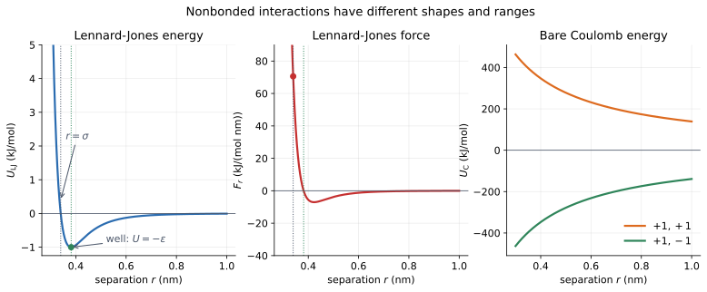

# 05 — Nonbonded interactions: Lennard-Jones and Coulomb

> **Where we are.** Tutorials 01–04 followed one particle in a fixed external
> potential. Real molecules interact with each other. This tutorial introduces
> the two pair interactions that carry most of molecular mechanics: Lennard-Jones
> dispersion and Coulomb electrostatics.
>
> **What you should already know.** Potential energy, force as the negative
> gradient, units, and the harmonic model.
>
> **What you will be able to do afterwards.** Read a Lennard-Jones curve,
> identify $\sigma$, $\epsilon$, and the well minimum, compute Lennard-Jones and
> Coulomb energies and forces, explain why a cutoff is needed, and describe how
> atom types and exclusions enter a nonbonded model.

## 1. Learning objectives

**Core**

- Write and interpret the Lennard-Jones 12-6 potential.
- Identify $r=\sigma$, the minimum $r=2^{1/6}\sigma$, and the well depth
  $-\epsilon$.
- Compute Lennard-Jones and Coulomb pair energies and forces.
- Explain why nonbonded interactions need a cutoff.

**Deeper insight**

- Explain the physical origin of the $r^{-12}$ and $r^{-6}$ terms.
- Explain Lorentz-Berthelot combining rules.
- Explain 1-2 and 1-3 exclusions.
- Recognise what reaction-field electrostatics approximates.

**Looking ahead**

- Ewald summation replaces the simple cutoff for long-range electrostatics.
- Typed nonbonded models combine these pair potentials with atom types and
  charges.

## 2. The running pair

From here on, the recurring object is a **pair** of particles, because a
nonbonded interaction is a property of two atoms.

| Property | Value | Unit |
| --- | --- | --- |
| mass of each particle | 12 | Da |
| Lennard-Jones $\epsilon$ | 1.0 | kJ/mol |
| Lennard-Jones $\sigma$ | 0.34 | nm |
| charges (for the Coulomb example) | $+1$, $-1$ | e |
| separation $r$ | 0.45 | nm |
| Lennard-Jones energy | $-0.605708$ | kJ/mol |
| Lennard-Jones force on $i$ | $+6.230260$ | kJ/(mol nm) |
| Coulomb energy | $-308.745$ | kJ/mol |
| Coulomb force on $i$ | $+686.101$ | kJ/(mol nm) |

Particle $i$ sits at the origin and particle $j$ at $(0.45,0,0)$ nm, so the
displacement is $\mathbf r_i-\mathbf r_j=(-0.45,0,0)$ nm. Positive force means
particle $i$ is pulled toward $+x$, which is toward $j$.



*Left: the Lennard-Jones energy has a repulsive wall, a zero at $r=\sigma$, and
a well of depth $\epsilon$. Middle: the force is zero at the well minimum.
Right: the bare Coulomb energy for like and opposite charges.*

## 3. Physical intuition: two different kinds of interaction

### 3.1 Lennard-Jones: size and dispersion

Two neutral atoms are not hard spheres.

- At very short range, their electron clouds overlap and the energy rises
  steeply. This is **Pauli repulsion**.
- At longer range, fluctuating electron distributions induce correlated
  dipoles, producing a weak attraction called **dispersion** or van der Waals
  attraction.

The Lennard-Jones potential is a simple model that captures both:

- a steep repulsive wall at short range;
- a finite attractive well at contact distance;
- a weak tail that decays at long range.

It is not derived from quantum mechanics. It is a fitted, physically motivated
shape. Its two parameters have clear meanings:

- $\sigma$ is the separation at which the energy is zero;
- $\epsilon$ is the depth of the attractive well.

### 3.2 Coulomb: charge and screening

Charges interact through the electric field. Like charges repel; opposite
charges attract. In vacuum the interaction decays as $1/r$.

In a molecular system, other charges and solvent molecules sit between the pair.
The bare $1/r$ interaction is therefore not the whole story. A simulation
either:

- truncates electrostatics and adds a **reaction field** correction, or
- uses **Ewald summation** to include long-range contributions.

This tutorial introduces the pair interaction and the cutoff idea. Ewald
summation is a later tutorial.

## 4. Mathematical description

### 4.1 Lennard-Jones energy

$$
U_{\mathrm{LJ}}(r)
=
4\epsilon
\left[
\left(\frac{\sigma}{r}\right)^{12}
-
\left(\frac{\sigma}{r}\right)^{6}
\right].
$$

The $r^{-12}$ term is the repulsive wall. The $r^{-6}$ term is the attractive
dispersion tail. The powers are chosen for computational convenience, not from
a fundamental law.

At $r=\sigma$,

$$
U_{\mathrm{LJ}}(\sigma)=4\epsilon(1-1)=0.
$$

The minimum is found from $dU/dr=0$:

$$
r_{\min}=2^{1/6}\sigma\approx1.12246\,\sigma.
$$

At that separation,

$$
U_{\mathrm{LJ}}(r_{\min})=-\epsilon.
$$

### 4.2 Lennard-Jones force

For a displacement vector $\mathbf r=\mathbf r_i-\mathbf r_j$,

$$
\mathbf F_{i\leftarrow j}
=
\frac{24\epsilon}{r^2}
\left[
2\left(\frac{\sigma}{r}\right)^{12}
-
\left(\frac{\sigma}{r}\right)^{6}
\right]\mathbf r.
$$

The force on particle $j$ is $-\mathbf F_{i\leftarrow j}$.

Useful values:

- at $r=\sigma$, the force is repulsive with magnitude $24\epsilon/\sigma$;
- at $r=r_{\min}$, the force is zero;
- just outside $r_{\min}$, the force is attractive.

### 4.3 Coulomb energy and force

$$
U_{\mathrm{C}}(r)=k_e\frac{q_iq_j}{r},
\qquad
k_e=138.935456\ \mathrm{kJ\,nm/(mol\,e^2)}.
$$

For a displacement vector $\mathbf r$,

$$
\mathbf F_{i\leftarrow j}
=
k_e\frac{q_iq_j}{r^3}\mathbf r.
$$

Like charges give a positive product and a repulsive force. Opposite charges
give a negative product and an attractive force.

### 4.4 Cutoffs

Evaluating every pair at every step is expensive. A cutoff $R_c$ ignores pairs
with $r\ge R_c$.

Two details matter:

1. **The cutoff must fit the box.** In a periodic box, it must not exceed half
   the shortest box edge.
2. **Truncation is not the same as shifting.** The Lennard-Jones energy is set
   to zero beyond the cutoff but is not shifted to zero at the cutoff. That
   leaves a small discontinuity in the energy. Reaction-field electrostatics is
   constructed to vanish at the cutoff.

## 5. Units and dimensions

| Quantity | Unit |
| --- | --- |
| $r$, $\sigma$ | nm |
| $\epsilon$ | kJ/mol |
| $U_{\mathrm{LJ}}$, $U_{\mathrm{C}}$ | kJ/mol |
| $k_e$ | kJ nm/(mol e²) |
| force | kJ/(mol nm) |

Check the Lennard-Jones force:

$$
\frac{\epsilon}{r^2}\cdot r
=
\frac{\mathrm{kJ/mol}}{\mathrm{nm}^2}\cdot\mathrm{nm}
=
\mathrm{kJ/(mol\,nm)}.
$$

The Coulomb force:

$$
k_e\frac{q_iq_j}{r^3}\mathbf r
=
\frac{\mathrm{kJ\,nm}}{\mathrm{mol\,e^2}}
\frac{\mathrm{e^2}}{\mathrm{nm^3}}
\mathrm{nm}
=
\mathrm{kJ/(mol\,nm)}.
$$

## 6. Worked example: the running pair

### 6.1 Lennard-Jones at 0.45 nm

With $\epsilon=1.0$ kJ/mol and $\sigma=0.34$ nm,

$$
\frac{\sigma}{r}=\frac{0.34}{0.45}=0.75556.
$$

Then

$$
U_{\mathrm{LJ}}
=
4(1.0)\left[(0.75556)^{12}-(0.75556)^6\right]
\approx-0.605708\ \mathrm{kJ/mol}.
$$

The force on $i$ is

$$
\mathbf F_{i\leftarrow j}
\approx(+6.230260,0,0)\ \mathrm{kJ/(mol\,nm)}.
$$

It points toward $j$: the pair is attracted at this separation.

### 6.2 Coulomb at 0.45 nm

For $q_i=+1$ and $q_j=-1$,

$$
U_{\mathrm{C}}
=
138.935456\frac{(+1)(-1)}{0.45}
\approx-308.745\ \mathrm{kJ/mol}.
$$

The force on $i$ is

$$
\mathbf F_{i\leftarrow j}
\approx(+686.101,0,0)\ \mathrm{kJ/(mol\,nm)}.
$$

It also points toward $j$, but it is much stronger than the Lennard-Jones
attraction at this separation.

### 6.3 Comparing the scales

At $r=0.45$ nm:

$$
\frac{|U_{\mathrm{C}}|}{|U_{\mathrm{LJ}}|}
\approx\frac{308.745}{0.605708}
\approx510.
$$

The force ratio is smaller, about 110, because the Coulomb force falls as
$1/r^2$ while the Lennard-Jones force near the well is shallower. The message
is not “electrostatics always wins”; it is that charges can dominate
nonbonded interactions at contact distances, and screening is essential.

### 6.4 Key reference points

| Separation | Lennard-Jones energy | Lennard-Jones force |
| --- | --- | --- |
| $r=\sigma=0.34$ nm | 0 | repulsive, $24\epsilon/\sigma\approx70.588$ |
| $r=r_{\min}=0.3816$ nm | $-\epsilon=-1.0$ | 0 |
| $r=0.45$ nm | $-0.605708$ | attractive, $6.230260$ |

## 7. Python implementation

The pair potentials are in
[`src/moleculab/potentials.py`](../../../src/moleculab/potentials.py):

```python
@dataclass
class LennardJonesPotential:
    epsilon: float
    sigma: float

    def energy(self, displacement):
        _, distance = _pair_geometry(displacement)
        sigma_over_r_sixth = (self.sigma / distance) ** 6
        return 4.0 * self.epsilon * (
            sigma_over_r_sixth**2 - sigma_over_r_sixth
        )

    def force(self, displacement):
        vector, distance = _pair_geometry(displacement)
        sigma_over_r_sixth = (self.sigma / distance) ** 6
        return (
            24.0 * self.epsilon
            * (2.0 * sigma_over_r_sixth**2 - sigma_over_r_sixth)
            / distance**2
            * vector
        )
```

The Coulomb potential follows the same interface:

```python
@dataclass
class CoulombPotential:
    charge_i: float
    charge_j: float

    def energy(self, displacement):
        _, distance = _pair_geometry(displacement)
        return COULOMB_CONSTANT * self.charge_i * self.charge_j / distance

    def force(self, displacement):
        vector, distance = _pair_geometry(displacement)
        return (
            COULOMB_CONSTANT * self.charge_i * self.charge_j
            / distance**3 * vector
        )
```

### 7.1 Typed nonbonded parameters

A force field needs different parameters for different atom types. The typed
path is in [`src/moleculab/nonbonded.py`](../../../src/moleculab/nonbonded.py):

```python
parameters = {
    "C": LennardJonesParameters(epsilon=0.5, sigma=0.34),
    "H": LennardJonesParameters(epsilon=0.1, sigma=0.25),
}
model = NonbondedModel(
    parameters=parameters,
    cutoff=0.9,
    electrostatics=ReactionFieldElectrostatics(dielectric=78.3),
)
```

For a pair of different types, the default combining rules are
Lorentz-Berthelot:

$$
\sigma_{ij}=\frac{\sigma_i+\sigma_j}{2},
\qquad
\epsilon_{ij}=\sqrt{\epsilon_i\epsilon_j}.
$$

### 7.2 Exclusions

Bonded atoms are already governed by bond and angle terms. Applying the
nonbonded model to the same pair would double count the interaction. The
topology therefore supplies 1-2 exclusions (bonded pairs) and 1-3 exclusions
(the two outer atoms of an angle).

Torsion 1-4 pairs are *not* automatically excluded. Many force fields scale
them instead.

## 8. Tests and verification

Run the example and tests:

```bash
uv run python examples/nonbonded_interactions.py
uv run pytest tests/test_pair_potentials.py tests/test_nonbonded.py -q
```

The tests check, among other things:

- Lennard-Jones energy is zero at $r=\sigma$;
- the minimum has depth $-\epsilon$;
- the force is zero at the minimum;
- the force at $r=\sigma$ is repulsive;
- Lennard-Jones and Coulomb forces match central finite differences;
- swapping the particles reverses the force;
- the typed model combines parameters correctly;
- 1-2 and 1-3 pairs are excluded;
- the cutoff cannot exceed half the shortest box edge.

**Why finite differences matter.** A pair potential can return a plausible
number with the wrong sign or a missing factor. The central-difference test
checks that the force is the derivative of the same energy model.

## 9. Experiments

### Experiment 1: locate the minimum

Compute the Lennard-Jones energy at $0.9\sigma$, $2^{1/6}\sigma$, and
$1.3\sigma$. Confirm that the middle value is the minimum and that the force is
zero there.

### Experiment 2: vary $\epsilon$ and $\sigma$

Double $\epsilon$ and halve $\sigma$. How do the well depth and minimum position
change? Does the force scale the way you expect?

### Experiment 3: Coulomb scale

Compute the Coulomb energy for $+1,-1$ at 0.3, 0.45, and 1.0 nm. Compare each
with $RT$ at 300 K. Why does the interaction remain large even at 1 nm in
vacuum?

### Experiment 4: cutoff

Evaluate a Lennard-Jones pair energy just inside and just outside a cutoff.
Is the energy continuous? What happens to the force?

### Experiment 5: combining rules

Combine two atom types with very different $\sigma$ and $\epsilon$. Compare the
Lorentz-Berthelot result with the arithmetic mean of the well depths. They are
not the same operation.

## 10. Common misconceptions

1. **“Lennard-Jones is a chemical bond.”** It is a nonbonded pair interaction.
   It has no preferred orientation and no bond order.
2. **“$\sigma$ is the particle diameter.”** It is the zero-energy separation.
   The minimum sits at $1.12246\sigma$.
3. **“$\epsilon$ is the minimum separation.”** It is the well depth in kJ/mol.
4. **“The force is zero at $r=\sigma$.”** The energy is zero there; the force
   is strongly repulsive.
5. **“Coulomb is always stronger.”** It depends on charges, separation, and
   screening. At contact, bare charges can dominate; in water they are screened.
6. **“A cutoff changes the physics without consequence.”** Truncation changes
   the energy and can introduce a discontinuity. The cutoff must be chosen and
   documented.
7. **“Bonded pairs should also use the nonbonded terms.”** That double counts
   the interaction. Exclusions prevent it.
8. **“The cutoff can be larger than half the box.”** A pair could then interact
   with more than one periodic image.

## 11. Connections and what comes next

- **Tutorial 06** sums these pair potentials over many particles in `System`.
- **Tutorial 07** adds bonded terms, which are excluded from the nonbonded sum.
- **Tutorial 10** adds periodic boundaries, which change the separation used by
  the nonbonded terms.
- **Ewald summation** replaces the simple electrostatic cutoff for periodic
  charged systems.
- **Docking** scores receptor-ligand interactions with these nonbonded terms.

## 12. Self-check with answers

1. **What is the Lennard-Jones energy at $r=\sigma$?**
   Zero.

2. **Where is the minimum?**
   $r_{\min}=2^{1/6}\sigma\approx1.12246\sigma$.

3. **What is the energy at the minimum?**
   $-\epsilon$.

4. **What is the force at the minimum?**
   Zero.

5. **What is the force at $r=\sigma$?**
   Repulsive, with magnitude $24\epsilon/\sigma$.

6. **Why is the $r^{-12}$ term repulsive?**
   It is a steep positive term that dominates at short range in the
   Lennard-Jones model.

7. **Why are 1-2 and 1-3 pairs excluded?**
   Their interactions are already represented by bond and angle terms;
   including them nonbonded would double count.

8. **Why does a periodic cutoff have to be at most half the box edge?**
   Otherwise the minimum-image definition can become ambiguous and a pair can
   interact with multiple images.

## 13. Exercises

### Calculation

1. Compute the Lennard-Jones energy at $r=1.5\sigma$ for $\epsilon=2$ kJ/mol.
2. Compute the force at $r=\sigma$ for $\epsilon=1$ and $\sigma=0.34$.
3. Compute the Coulomb energy of $+0.5e$ and $-0.5e$ at 0.4 nm.
4. For the running pair, find the separation where the Lennard-Jones force is
   zero, then evaluate the Coulomb energy there.

### Reasoning

1. Why does the Lennard-Jones force change sign at the minimum?
2. Why is a cutoff necessary in a large system?
3. Why is a reaction-field correction preferable to a bare electrostatic
   cutoff?
4. Why can a 1-4 torsion pair be treated differently from a 1-3 pair?
5. Why is $\sigma$ not the same as the distance of closest approach?

### Implementation

1. Plot Lennard-Jones energy and force on the same distance axis.
2. Write a finite-difference check for the Lennard-Jones force at $r=0.45$.
3. Build a typed two-particle system with one carbon and one hydrogen and print
   the combined parameters.
4. Add one exclusion to the model and verify that the pair energy changes.
5. Compute the ratio of Coulomb to Lennard-Jones energy across a range of
   separations and find where the ratio is about 1.

## 14. Summary

- Nonbonded interactions act between pairs, not through the molecular graph.
- Lennard-Jones combines a steep repulsive wall with a dispersion well.
- $\sigma$ is the zero-energy separation; the minimum is $2^{1/6}\sigma$;
  the well depth is $-\epsilon$.
- Coulomb interactions are long-ranged and depend on atom charges.
- A cutoff is an approximation; reaction fields and Ewald summation improve the
  electrostatic treatment.
- Typed models add per-atom-type parameters, combining rules, and exclusions.
- Energy and force must be tested together.

**Previous:** [04 — Velocity Verlet](04_velocity_verlet.md).  
**Next:** [06 — Many particles and the System](06_system.md).
