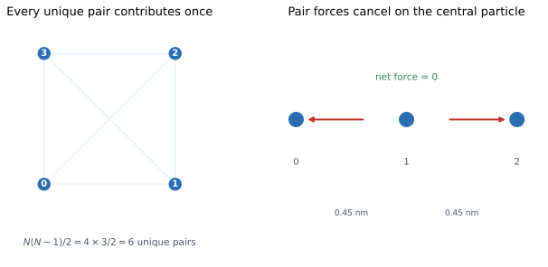

# 06 — Many particles and the `System` object

> **Where we are.** Tutorial 05 introduced a pair interaction. A real system
> contains many particles, so we now sum pair interactions over every unique
> pair and add the forces correctly.
>
> **What you should already know.** Lennard-Jones and Coulomb pair potentials,
> force as the negative gradient, and the unit system.
>
> **What you will be able to do afterwards.** Build a `System`, compute its
> total nonbonded energy and forces, explain why every pair is counted once,
> verify Newton's third law, and estimate the cost of a pair sum.

## 1. Learning objectives

**Core**

- Write the pair-sum energy for $N$ particles.
- Count unique pairs as $N(N-1)/2$.
- Explain how a pair force is applied to both particles.
- Build a `System` and read its energy and forces.

**Deeper insight**

- Explain why the total internal force vanishes.
- Distinguish `pair_potentials`, `nonbonded_model`, and
  `indexed_pair_potentials`.
- Understand why pair sums scale as $O(N^2)$.

**Looking ahead**

- Periodic boundaries change the pair separation to the minimum image.
- Cutoffs and neighbour lists reduce the cost in large systems.
- The same `System` drives integration, minimisation, thermostats, and analysis.

## 2. The running system

We extend the running pair to three particles.

| Property | Value | Unit |
| --- | --- | --- |
| particles | 3 | — |
| mass of each | 12 | Da |
| positions $x$ | 0, 0.45, 0.90 | nm |
| Lennard-Jones $\epsilon$ | 1.0 | kJ/mol |
| Lennard-Jones $\sigma$ | 0.34 | nm |
| pair distances | 0.45, 0.45, 0.90 | nm |
| total potential energy | $-1.223009$ | kJ/mol |
| net force on particle 0 | $+6.307324$ | kJ/(mol nm) |
| net force on particle 1 | 0 | kJ/(mol nm) |
| net force on particle 2 | $-6.307324$ | kJ/(mol nm) |

The three particles lie on the x-axis. The two short pairs are identical, and
the middle particle is pulled equally in both directions.



*Left: four particles have six unique pairs. Right: in a symmetric three-particle
chain, the forces on the central particle cancel.*

## 3. Physical intuition: from pairs to a system

A pair potential answers: “What is the energy of these two particles at this
separation?”

A many-particle system answers: “What is the energy of all pairs at once?”

The two ideas connect through a sum. Each pair contributes independently:

$$
U_{\mathrm{nonbonded}}
=
u_{01}+u_{02}+u_{12}.
$$

Each pair also contributes a force to each of its two particles. Forces are
vectors, so they add by vector addition. A particle in the middle of two
neighbours feels both pulls.

The key bookkeeping rule is: **count each pair once**. Pair $(0,1)$ is the same
as pair $(1,0)$. If you loop over all ordered pairs, you double count the
energy.

## 4. Mathematical description

### 4.1 Energy

For $N$ particles,

$$
U_{\mathrm{nonbonded}}
=
\sum_{i=1}^{N}\sum_{j=i+1}^{N}u(r_{ij}),
\qquad
r_{ij}=|\mathbf r_i-\mathbf r_j|.
$$

The restriction $j>i$ enforces one contribution per pair. The number of terms is

$$
\binom{N}{2}=\frac{N(N-1)}{2}.
$$

For $N=3$, there are three pairs. For $N=1000$, there are 499,500 pairs.

### 4.2 Forces

Let $\mathbf f_{ij}$ be the force on particle $i$ due to particle $j$. Then

$$
\mathbf F_i=\sum_{j\ne i}\mathbf f_{ij}.
$$

For a conservative pair potential,

$$
\mathbf f_{ij}=-\nabla_{\mathbf r_i}u(r_{ij}),
\qquad
\mathbf f_{ji}=-\mathbf f_{ij}.
$$

The second relation is Newton's third law. If the pair potential is the only
interaction, the total force on the whole system is

$$
\sum_i\mathbf F_i
=
\sum_{i<j}(\mathbf f_{ij}+\mathbf f_{ji})
=
0.
$$

This is why an isolated system conserves total momentum.

### 4.3 Kinetic and total energy

For particles with masses $m_i$ and velocities $\mathbf v_i$,

$$
K=\sum_i\frac12m_i|\mathbf v_i|^2,
\qquad
E=K+U.
$$

A `System` stores particles and interactions, and exposes these sums directly.

### 4.4 What a `System` contains

| Field | Meaning |
| --- | --- |
| `particles` | positions, velocities, masses, types, charges |
| `pair_potentials` | potentials summed over every unique pair |
| `topology` | bonds, angles, torsions |
| `box` | optional periodic box |
| `nonbonded_model` | typed Lennard-Jones plus electrostatics |
| `constraints` | optional SHAKE/RATTLE distance constraints |
| `indexed_pair_potentials` | pair-specific potentials for selected atom pairs |

`pair_potentials` and `nonbonded_model` are different routes to a nonbonded
interaction. A simple educational model uses `pair_potentials`; a typed force
field uses `nonbonded_model`.

## 5. Units and dimensions

The pair-sum equations add energies and forces, so every term must use the same
units:

| Quantity | Unit |
| --- | --- |
| pair energy | kJ/mol |
| total energy | kJ/mol |
| force | kJ/(mol nm) |
| position | nm |
| mass | Da |

Adding a Lennard-Jones energy in kJ/mol to a Coulomb energy in J would be a unit
error, not a physical effect.

## 6. Worked example: the three-particle chain

The pair distances are:

| Pair | Separation (nm) | Lennard-Jones energy (kJ/mol) | Force on lower-index particle |
| --- | --- | --- | --- |
| 0–1 | 0.45 | $-0.605708$ | $+6.230260$ |
| 0–2 | 0.90 | $-0.011593$ | $+0.077065$ |
| 1–2 | 0.45 | $-0.605708$ | $+6.230260$ |

The total energy is

$$
U
=
(-0.605708)+(-0.011593)+(-0.605708)
\approx-1.223009\ \mathrm{kJ/mol}.
$$

For particle 0, both pair forces point toward $+x$:

$$
F_0=6.230260+0.077065\approx6.307324.
$$

For particle 1, the pull from particle 0 points toward $-x$ and the pull from
particle 2 points toward $+x$. They have equal magnitude, so

$$
F_1=-6.230260+6.230260=0.
$$

For particle 2, both pair forces point toward $-x$:

$$
F_2=-6.230260-0.077065\approx-6.307324.
$$

The three net forces sum to zero:

$$
6.307324+0-6.307324=0.
$$

This is Newton's third law at the level of the whole system.

## 7. Python implementation

The pair sums are in [`src/moleculab/system.py`](../../../src/moleculab/system.py):

```python
def nonbonded_energy(self):
    total = 0.0
    for i in range(self.n_particles):
        for j in range(i + 1, self.n_particles):
            displacement = self.particles[i].position - self.particles[j].position
            if self.box is not None:
                displacement = self.box.minimum_image(displacement)
            for potential in self.pair_potentials:
                total += potential.energy(displacement)
            if self.nonbonded_model is not None and (i, j) not in self._excluded_pairs:
                total += self.nonbonded_model.energy(
                    self.particles[i].atom_type,
                    self.particles[j].atom_type,
                    self.particles[i].charge,
                    self.particles[j].charge,
                    displacement,
                )
    return float(total)
```

The force loop uses the same pair structure:

```python
forces = np.zeros((self.n_particles, 3), dtype=float)
for i in range(self.n_particles):
    for j in range(i + 1, self.n_particles):
        displacement = self.particles[i].position - self.particles[j].position
        if self.box is not None:
            displacement = self.box.minimum_image(displacement)
        for potential in self.pair_potentials:
            pair_force = potential.force(displacement)
            forces[i] += pair_force
            forces[j] -= pair_force
```

The crucial lines are `forces[i] += pair_force` and `forces[j] -= pair_force`.
One pair calculation produces two opposite forces.

### 7.1 Build the running system

```python
from moleculab import LennardJonesPotential, Particle, System

system = System(
    particles=[
        Particle(12.0, [0.0, 0.0, 0.0]),
        Particle(12.0, [0.45, 0.0, 0.0]),
        Particle(12.0, [0.90, 0.0, 0.0]),
    ],
    pair_potentials=[LennardJonesPotential(epsilon=1.0, sigma=0.34)],
)

print("potential energy:", system.potential_energy())
print("forces:\n", system.forces())
```

Expected:

```text
potential energy: -1.2230094130302485
forces:
 [[ 6.30732433  0.          0.        ]
  [ 0.          0.          0.        ]
  [-6.30732433  0.          0.        ]]
```

### 7.2 Why the loop starts at `j = i + 1`

If the inner loop started at zero, pair $(0,1)$ would be counted once as
$i=0,j=1$ and again as $i=1,j=0$. The energy would be doubled. Starting at
`i + 1` is the simplest way to enforce the unique-pair rule.

### 7.3 Cost

The double loop has

$$
\frac{N(N-1)}{2}
$$

iterations. For large $N$, this grows as $N^2$. Doubling the particle count
roughly quadruples the number of pair evaluations. This is why production MD
uses cutoffs, cell lists, and neighbour lists.

**Looking ahead.** A cutoff skips pairs beyond $R_c$. A cell list only checks
particles in nearby cells. The physics stays the same; the bookkeeping gets
faster.

## 8. Tests and verification

Run:

```bash
uv run pytest tests/test_system.py tests/test_system_integrator.py -q
```

The tests check:

- total energy is the sum of pair energies;
- forces are equal and opposite for an isolated pair;
- the total force of an isolated system is zero;
- changing particle order does not change the energy;
- typed nonbonded interactions contribute correctly;
- integrating a `System` preserves its state and interactions.

A useful manual check is to compute every pair by hand for $N=3$ and compare
with `system.potential_energy()`. If the manual sum is exactly twice the code
value, the unique-pair rule is broken.

## 9. Experiments

### Experiment 1: add a fourth particle

Place a fourth particle at $x=1.35$ nm. Count the pairs and predict the new
energy before running the code. How many terms are there?

### Experiment 2: break the symmetry

Move the middle particle slightly off centre. Which net force is no longer
zero? Does the total force remain zero?

### Experiment 3: manual pair sum

Write a loop over all ordered pairs `(i, j)` with `i != j` and divide the energy
by two. Compare with the `System` result. Explain the factor of two.

### Experiment 4: cost scaling

Time the force calculation for 10, 20, and 40 particles. Plot the time against
$N^2$. Is the trend approximately quadratic?

### Experiment 5: Newton's third law

For a random configuration, compute the total force vector. It should be
numerically zero. Then add an external harmonic potential and explain why the
total force no longer vanishes.

## 10. Common misconceptions

1. **“Sum over all ordered pairs.”** That double counts. Use $i<j$.
2. **“The force on both particles has the same sign.”** The forces are equal in
   magnitude and opposite in direction.
3. **“A particle's net force is its own property.”** It is the sum of forces
   from all other particles and any external potential.
4. **“Mass affects the static energy.”** It does not. Mass affects acceleration
   and kinetic energy, not $U$ or $\mathbf F$.
5. **“Adding a box changes bonded terms.”** Bonded terms use raw coordinates;
   only nonbonded separations use the minimum image.
6. **“The `System` stores only positions.”** It also stores velocities, masses,
   types, charges, topology, and interaction models.
7. **“Pair sums are cheap because the loop is short.”** The cost grows
   quadratically with particle count.

## 11. Connections and what comes next

- **Tutorial 07** adds bonds, angles, and torsions as topology terms.
- **Tutorial 08** minimises the same `System` energy.
- **Tutorial 09** integrates a `System` and controls its temperature.
- **Tutorial 10** adds periodic boundaries to the nonbonded separation.
- **Analysis** reads trajectories of `System` positions.

## 12. Self-check with answers

1. **How many unique pairs are there for 5 particles?**
   $5\times4/2=10$.

2. **Why does the inner loop start at $i+1$?**
   To count each unordered pair once.

3. **What is the total force of an isolated system?**
   Zero, by Newton's third law.

4. **Does mass enter the pair energy?**
   No. It enters the kinetic energy and acceleration.

5. **What is the force on the middle particle in the symmetric chain?**
   Zero, because the two equal pulls cancel.

6. **Why is the pair-sum cost called $O(N^2)$?**
   The number of pairs grows as $N(N-1)/2\propto N^2$.

7. **What is the difference between `pair_potentials` and `nonbonded_model`?**
   `pair_potentials` applies a simple potential to every pair;
   `nonbonded_model` applies typed Lennard-Jones and electrostatic terms with
   exclusions and a cutoff.

## 13. Exercises

### Calculation

1. Count the unique pairs for $N=4$, $N=10$, and $N=100$.
2. For the running system, compute the total energy from the three pair terms.
3. Show that the three net forces sum to zero.
4. Compute the acceleration of each particle using $m=12$ Da.

### Reasoning

1. Why does counting ordered pairs double the energy but not the force
   direction?
2. Why is total momentum conserved for an isolated system?
3. Why can an external potential break the zero-total-force rule?
4. Why does a larger cutoff reduce the number of pair evaluations?
5. Why is the pair-sum formulation “embarrassingly parallel” in principle?

### Implementation

1. Build the running system and print its energy and forces.
2. Add a fourth particle and recompute.
3. Write a manual pair-sum function and compare with `System`.
4. Time the force calculation for several particle counts.
5. Add a harmonic external potential to one particle and verify that the total
   force is no longer zero.

## 14. Summary

- A `System` sums pair interactions over every unique pair.
- There are $N(N-1)/2$ pairs, so the cost grows quadratically.
- Each pair contributes one energy and two opposite forces.
- Newton's third law makes the total internal force zero.
- Mass affects dynamics, not the static pair energy.
- Periodic boundaries and cutoffs modify the nonbonded pair sum, not the
  conceptual structure.
- The same `System` is the foundation for integration, minimisation,
  thermostats, and analysis.

**Previous:** [05 — Nonbonded interactions](05_nonbonded.md).  
**Next:** [07 — Bonds, angles, and torsions](07_bonded.md).
