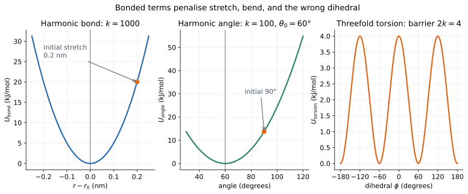

# 07 — Bonds, angles, and torsions

> **Where we are.** Tutorial 06 summed nonbonded interactions over all pairs.
> Molecules also have a graph: specific atoms are bonded, angles have a
> preferred value, and torsions control rotation around bonds. This tutorial
> adds those terms through `Topology`.
>
> **What you should already know.** Potential energy, force as the negative
> gradient, vectors, and radians.
>
> **What you will be able to do afterwards.** Build a bonded topology, compute
> bond, angle, and torsion energies, explain the displacement conventions, and
> verify bonded forces with finite differences.

## 1. Learning objectives

**Core**

- Distinguish bonded terms from nonbonded pair terms.
- Write the harmonic bond and angle potentials.
- Convert angles between degrees and radians.
- Build a `Topology` from bonds, angles, and torsions.

**Deeper insight**

- Explain why angle forces must sum to zero.
- Explain the sign convention of a dihedral angle.
- Explain why 1-2 and 1-3 pairs are excluded from the nonbonded sum.
- Recognise why a torsion barrier is $2k$, not $k$.

**Looking ahead**

- Minimisation and dynamics act on the total bonded plus nonbonded energy.
- Real force fields add improper torsions, cross terms, and 1-4 scaling.

## 2. The running molecule

We use the distorted triatomic molecule from the minimization example.

| Atom | Position (nm) | Mass (Da) |
| --- | --- | --- |
| 0 | $(1.20, 0, 0)$ | 12 |
| 1 | $(0, 0, 0)$ | 12 |
| 2 | $(0, 1.20, 0)$ | 12 |

| Term | Parameters | Actual value |
| --- | --- | --- |
| bond 0–1 | $k=1000$, $r_0=1.0$ nm | $r=1.2$ nm |
| bond 1–2 | $k=1000$, $r_0=1.0$ nm | $r=1.2$ nm |
| angle 0–1–2 | $k=100$, $\theta_0=60^\circ$ | $\theta=90^\circ$ |
| total bonded energy | — | $53.707784$ kJ/mol |
| maximum force | — | $221.136005$ kJ/(mol nm) |

The molecule is deliberately distorted. Tutorial 08 will let it relax.



Left: a harmonic bond penalises stretch. Middle: a harmonic angle penalises
bending away from $\theta_0$. Right: a threefold torsion has three equivalent
minima and a barrier of $2k$.

## 3. Physical intuition: a molecular graph with springs

A molecule is not just a cloud of particles. It has connectivity:

- two atoms share a bond;
- three atoms define an angle;
- four atoms define a torsion.

Each bonded term is a local constraint on the molecular geometry:

- a bond prefers a length $r_0$;
- an angle prefers a value $\theta_0$;
- a torsion prefers certain dihedral angles, depending on the chemistry.

The molecular graph is separate from the coordinates. The same topology can be
used with many conformations. That is why Moleculab stores bonds, angles, and
torsions in a `Topology` indexed by atom numbers, not in the particles
themselves.

**Model versus algorithm.** The topology and its potentials are the physical
model. `Topology.energy` and `Topology.forces` evaluate that model.

## 4. Mathematical description

### 4.1 Harmonic bond

For two bonded atoms $i$ and $j$,

$$ U_{\mathrm{bond}}(r)=\frac12k(r-r_0)^2, \qquad r=|\mathbf r_i-\mathbf r_j|. $$

The force on atom $i$ is

$$ \mathbf F_i = -k(r-r_0)\frac{\mathbf r_i-\mathbf r_j}{r}. $$

If the bond is stretched ($r>r_0$), the force on $i$ points toward $j$. If it is
compressed, the force points away.

The bond displacement convention in Moleculab is
$\mathbf r=\mathbf r_i-\mathbf r_j$.

### 4.2 Harmonic angle

For three atoms $i$, $j$, and $k$ with vertex $j$,

$$ U_{\mathrm{angle}}(\theta) = \frac12k(\theta-\theta_0)^2. $$

The angle is computed from the two vectors

$$ \mathbf r_{ji}=\mathbf r_i-\mathbf r_j, \qquad \mathbf r_{jk}=\mathbf r_k-\mathbf r_j, $$

as

$$ \cos\theta = \frac{\mathbf r_{ji}\cdot\mathbf r_{jk}} {|\mathbf r_{ji}|\ |\mathbf r_{jk}|}. $$

The force on each atom follows from the chain rule. The code computes the
derivatives of $\cos\theta$ with respect to the two bond vectors and applies
$-\nabla U$. A useful check is that the three forces sum to zero:

$$ \mathbf F_i+\mathbf F_j+\mathbf F_k=0. $$

That must hold because an angle term has no external force.

**Units.** `angle0` and all angle differences are in radians. If you have
degrees, use `np.deg2rad`.

### 4.3 Periodic torsion

For four atoms $i$, $j$, $k$, and $l$,

$$ U_{\mathrm{torsion}}(\phi) = k\left[1+\cos(n\phi-\delta)\right]. $$

Here:

- $\phi$ is the signed dihedral angle;
- $n$ is the periodicity;
- $\delta$ is the phase;
- $k$ is the barrier parameter.

The energy ranges from $0$ to $2k$, so the **full barrier height is $2k$**.
For $n=3$, the potential has three equivalent minima per full rotation. That is
the typical shape for rotation about a single bond in ethane-like molecules.

The dihedral angle is defined by the bond vectors

$$ \mathbf r_{ij}=\mathbf r_j-\mathbf r_i,\qquad \mathbf r_{jk}=\mathbf r_k-\mathbf r_j,\qquad \mathbf r_{kl}=\mathbf r_l-\mathbf r_k. $$

Moleculab returns a signed angle in $(-\pi,\pi]$.

### 4.4 Exclusions

Bonded and nonbonded terms describe different physics, but they must not double
count the same interaction.

- A **1-2 pair** is directly bonded. Its interaction is the bond term.
- A **1-3 pair** is separated by two bonds. Its interaction is captured by the
  angle term.
- A **1-4 pair** is separated by three bonds. Many force fields include a
  scaled nonbonded interaction rather than excluding it completely.

`Topology.nonbonded_exclusions()` therefore returns the 1-2 and 1-3 pairs.

## 5. Units and dimensions

| Quantity | Unit |
| --- | --- |
| bond stiffness $k$ | kJ/(mol nm²) |
| bond length $r_0$ | nm |
| angle stiffness $k$ | kJ/(mol rad²) |
| angle $\theta_0$ | radians |
| torsion barrier $k$ | kJ/mol |
| torsion angle $\phi$ | radians |
| force | kJ/(mol nm) |

Check the bond energy:

$$ \mathrm{kJ/(mol\ nm^2)}\times\mathrm{nm^2} = \mathrm{kJ/mol}. $$

The angle energy uses radians, which are dimensionless:

$$ \mathrm{kJ/(mol\ rad^2)}\times\mathrm{rad^2} = \mathrm{kJ/mol}. $$

## 6. Worked example: the distorted triatomic

### 6.1 Bond energy

Each bond has $r=1.2$ nm and $r_0=1.0$ nm, so the stretch is 0.2 nm:

$$ U_{\mathrm{bond}} = \frac12(1000)(0.2)^2 = 20\ \mathrm{kJ/mol}. $$

There are two bonds, so the bond contribution is

$$ U_{\mathrm{bonds}}=40\ \mathrm{kJ/mol}. $$

### 6.2 Angle energy

The actual angle is 90°, or $\pi/2$ radians. The target is 60°, or $\pi/3$
radians. The difference is

$$ \Delta\theta=\frac{\pi}{2}-\frac{\pi}{3}=\frac{\pi}{6}. $$

Thus

$$ U_{\mathrm{angle}} = \frac12(100)\left(\frac{\pi}{6}\right)^2 = 50\frac{\pi^2}{36} \approx13.707784\ \mathrm{kJ/mol}. $$

### 6.3 Total

$$ U_{\mathrm{bonded}} = 40+13.707784 = 53.707784\ \mathrm{kJ/mol}. $$

This matches the example and the `System.potential_energy()` value.

### 6.4 Torsion example

Take four atoms with bond vectors

$$ \mathbf r_{ij}=(0.15,0,0),\quad \mathbf r_{jk}=(0,0.15,0),\quad \mathbf r_{kl}=(0,0,0.15). $$

The dihedral is $\phi=90^\circ$. With $k=2$ kJ/mol, $n=3$, and $\delta=0$,

$$ U = 2\left[1+\cos(3\cdot90^\circ)\right] = 2\left[1+\cos270^\circ\right] = 2\ \mathrm{kJ/mol}. $$

At $\phi=60^\circ$, $\cos180^\circ=-1$ and the energy is zero. At $\phi=0$,
$\cos0=1$ and the energy is $4$ kJ/mol, the top of the barrier.

## 7. Python implementation

The bonded potentials are in
[`src/moleculab/bonded.py`](../../../src/moleculab/bonded.py):

```python
@dataclass
class HarmonicBondPotential:
    stiffness: float
    length0: float

    def energy(self, displacement):
        _, distance = as_displacement(displacement)
        stretch = distance - self.length0
        return 0.5 * self.stiffness * stretch**2

    def force(self, displacement):
        vector, distance = as_displacement(displacement)
        return -(self.stiffness * (distance - self.length0) / distance) * vector
```

The angle potential uses the dot product and the chain rule:

```python
@dataclass
class HarmonicAnglePotential:
    stiffness: float
    angle0: float

    def energy(self, r_ji, r_jk):
        _, _, _, angle, _ = self._geometry(r_ji, r_jk)
        return 0.5 * self.stiffness * (angle - self.angle0) ** 2

    def forces(self, r_ji, r_jk):
        # Chain rule for cos(theta) = a . b / (|a||b|)
        ...
        force_j = -(force_i + force_k)
        return force_i, force_j, force_k
```

The torsion uses the signed dihedral and a periodic energy:

```python
@dataclass
class PeriodicTorsionPotential:
    barrier: float
    periodicity: int
    phase: float = 0.0

    def energy(self, r_ij, r_jk, r_kl):
        angle = dihedral_angle(...)
        return self.barrier * (
            1.0 + np.cos(self.periodicity * angle - self.phase)
        )
```

### 7.1 Build the running topology

```python
import numpy as np

from moleculab import (
    Angle, Bond, HarmonicAnglePotential, HarmonicBondPotential,
    Particle, System, Topology,
)

particles = [
    Particle(12.0, [1.20, 0.0, 0.0]),
    Particle(12.0, [0.0, 0.0, 0.0]),
    Particle(12.0, [0.0, 1.20, 0.0]),
]

topology = Topology(
    bonds=[
        Bond(0, 1, HarmonicBondPotential(stiffness=1000.0, length0=1.0)),
        Bond(1, 2, HarmonicBondPotential(stiffness=1000.0, length0=1.0)),
    ],
    angles=[
        Angle(
            0, 1, 2,
            HarmonicAnglePotential(stiffness=100.0, angle0=np.pi / 3.0),
        )
    ],
)

system = System(particles=particles, topology=topology)
print("bonded energy:", system.bonded_energy())
print("forces:\n", system.forces())
```

Expected bonded energy:

```text
bonded energy: 53.707784...
```

### 7.2 Why the topology stores indices

A bond is not a property of a particle in isolation. It is a relationship
between two particles. Storing `(i, j, potential)` keeps the graph separate
from the coordinates, so the same topology can be reused after moving the
atoms.

### 7.3 Force accumulation

`Topology.forces()` starts with a zero array and adds each term's contribution
to the atoms it touches. For a bond:

```python
forces[bond.i] += pair_force
forces[bond.j] -= pair_force
```

For an angle, all three atoms receive a contribution. For a torsion, all four
do.

## 8. Tests and verification

Run:

```bash
uv run python examples/bonded_molecule.py
uv run python examples/torsion_scan.py
uv run pytest tests/test_bonded.py tests/test_topology.py tests/test_torsion.py -q
```

The tests check:

- bond energy matches $\tfrac12k(r-r_0)^2$;
- a stretched bond pulls the atoms together;
- a compressed bond pushes them apart;
- bond forces match central finite differences;
- angle forces sum to zero;
- angle forces match finite differences;
- `angle0` is interpreted in radians;
- torsion energy is periodic;
- torsion forces match finite differences;
- 1-2 and 1-3 exclusions are generated correctly;
- topology validation rejects bad atom indices.

The finite-difference checks are especially important for angles and torsions,
where the chain-rule expressions are easy to get subtly wrong.

### 8.1 Physical invariants

- Each bonded force is the negative gradient of its energy.
- The forces of a single bond, angle, or torsion sum to zero.
- Translating the molecule does not change its internal energy.
- Rotating the molecule does not change its internal energy.
- The torsion energy is periodic:
  $U(\phi+2\pi/n)=U(\phi)$.
- The angle is defined only for $0<\theta<\pi$.

**Recurring question:** does a rigid translation or rotation change the bonded
energy? It must not.

## 9. Experiments

### Experiment 1: bond stiffness

Double the bond stiffness. How does the energy of the same 0.2 nm stretch
change? Does the force double?

### Experiment 2: angle target

Change the target angle from 60° to 90°. What happens to the angle energy of the
initial geometry?

### Experiment 3: torsion scan

Plot $U(\phi)$ for $n=1$, $n=2$, and $n=3$. How many minima are there in each
full rotation?

### Experiment 4: force balance

For a single angle term, compute the three forces and verify that their vector
sum is zero. Try several geometries.

### Experiment 5: exclusions

Build a triatomic topology and print `nonbonded_exclusions()`. Which pairs are
excluded? Why is the 1-4 pair in a four-atom chain not in the list?

## 10. Common misconceptions

1. **“Bonded terms are just nonbonded terms with a different name.”** They act
   on specific atom indices and model different physics.
2. **“Angles are in degrees.”** The library stores radians. Convert explicitly.
3. **“A torsion barrier is $k$.”** The energy ranges from 0 to $2k$.
4. **“A periodic torsion has one minimum.”** It has $n$ minima per rotation.
5. **“1-4 pairs are always excluded.”** Moleculab excludes 1-2 and 1-3;
   force fields often scale 1-4 instead.
6. **“Bonded forces do not need to sum to zero.”** An internal bonded term has
   no external force, so its forces must sum to zero.
7. **“The topology changes when atoms move.”** The graph is fixed; only the
   coordinates change.
8. **“A harmonic bond can break.”** It cannot. A real bond dissociates; the
   harmonic model is a local approximation.

## 11. Connections and what comes next

- **Tutorial 08** minimises this bonded energy to find a relaxed geometry.
- **Tutorial 09** integrates bonded and nonbonded forces together.
- **Tutorial 10** notes that bonded terms use raw coordinates even when a
  periodic box is present.
- **Water models** use two O–H bonds and one H–O–H angle per molecule.
- **Docking** and **free energy** inherit the same topology conventions.

## 12. Self-check with answers

1. **What is the bond energy for $k=1000$, $r=1.2$, $r_0=1.0$?**
   $0.5\times1000\times0.2^2=20$ kJ/mol.

2. **What is the angle energy for $k=100$, $\theta=90^\circ$, $\theta_0=60^\circ$?**
   $0.5\times100\times(\pi/6)^2\approx13.7078$ kJ/mol.

3. **What is the total bonded energy of the running molecule?**
   $40+13.7078=53.7078$ kJ/mol.

4. **What is the force on atom $i$ for a stretched bond?**
   It points toward atom $j$.

5. **Why do angle forces sum to zero?**
   The angle term has no external force; internal forces must cancel.

6. **What is the full barrier of a periodic torsion with parameter $k$?**
   $2k$.

7. **Which pairs are excluded from the nonbonded sum?**
   1-2 and 1-3 pairs.

8. **Where is the torsion minimum for $n=3$, $\delta=0$?**
   At $\phi=60^\circ$, $180^\circ$, and $300^\circ$ (equivalently $-60^\circ$).

## 13. Exercises

### Calculation

1. Compute the bond energy for a 0.05 nm compression with $k=2000$.
2. Compute the angle energy for a 10° deviation from 109.5° with $k=500$.
3. Compute the torsion energy at $\phi=30^\circ$ for $k=1$, $n=3$, $\delta=0$.
4. For the running molecule, compute the force magnitude on each atom from the
   bond terms alone.

### Reasoning

1. Why is the topology separate from the coordinates?
2. Why must angle forces sum to zero?
3. Why is 1-4 scaling common in force fields?
4. Why can a harmonic bond not describe bond breaking?
5. Why is a torsion potential periodic?

### Implementation

1. Build the running topology and print each term's energy separately.
2. Write a finite-difference check for a single angle force.
3. Scan a torsion angle and plot the energy.
4. Add a torsion to a four-atom chain and verify the forces.
5. Print `nonbonded_exclusions()` for a four-atom topology.

## 14. Summary

- Bonded terms act on a molecular graph, not on all pairs.
- Harmonic bonds and angles penalise deviations from equilibrium values.
- Angle parameters are in radians.
- Torsions are periodic; the barrier height is $2k$.
- Bonded forces must sum to zero for an isolated term.
- 1-2 and 1-3 pairs are excluded from the nonbonded sum.
- The topology is separate from the coordinates and is indexed by atom number.
- Bonded energy and forces are tested together with finite differences.

**Previous:** [06 — Many particles and the System](06_system.md).

**Next:** [08 — Energy minimization](08_minimization.md).
