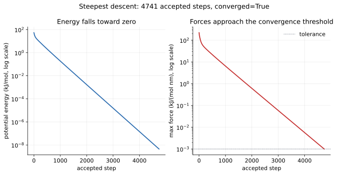

# 08 — Energy minimization

> **Where we are.** Tutorials 06 and 07 built an energy landscape with
> nonbonded and bonded terms. Dynamics would follow forces through time; before
> that, we often want the nearest stable structure. This tutorial introduces
> energy minimization.
>
> **What you should already know.** Potential energy, force as the negative
> gradient, bonded terms, and `System`.
>
> **What you will be able to do afterwards.** Explain steepest descent, choose a
> step size, interpret a minimization history, distinguish a local from a global
> minimum, and use `minimize_energy` correctly.

## 1. Learning objectives

**Core**

- Explain the difference between minimisation and dynamics.
- Write the steepest-descent update.
- Explain why the step size has units of nm²/(kJ/mol).
- Run `minimize_energy` and read its result.

**Deeper insight**

- Explain backtracking line search.
- Explain why minimisation finds a local minimum, not necessarily the global one.
- Interpret a log-scale energy and force history.
- Explain why minimisation is useful before MD.

**Looking ahead**

- Production workflows often combine minimisation, heating, and equilibration.
- Conjugate-gradient and quasi-Newton methods converge faster for large systems.

## 2. The running molecule

We reuse the distorted triatomic molecule from tutorial 07.

| Quantity | Before minimisation | After minimisation |
| --- | --- | --- |
| bond 0–1 | 1.2000 nm | 1.0000 nm |
| bond 1–2 | 1.2000 nm | 1.0000 nm |
| angle 0–1–2 | 90.00° | 60.00° |
| potential energy | 53.707784 kJ/mol | $\approx0$ |
| maximum force | 221.136005 kJ/(mol nm) | 0.000998 kJ/(mol nm) |
| accepted steps | — | 4741 |
| converged | — | yes |

The target geometry is exactly the minimum of the bonded model: both bonds at
$x_0=1.0$ nm and the angle at $\theta_0=60°$.



*Both the energy and the maximum force fall by many orders of magnitude. The
force crosses the convergence tolerance near the end.*

## 3. Physical intuition: letting the structure settle

Imagine a ball on a hilly surface. If you release it, it rolls downhill. Energy
minimisation does the same thing in many dimensions:

- compute the force on every atom;
- move each atom a small distance along its force;
- repeat until the forces are small.

This is not the same as molecular dynamics:

| Minimisation | Dynamics |
| --- | --- |
| Finds a low-energy structure | Samples motion at a temperature |
| Uses positions and forces | Uses positions, velocities, and forces |
| No timestep in ps | Timestep in ps |
| Converges to a minimum | Conserves or controls energy |
| Result depends on the starting structure | Result depends on the ensemble |

Minimisation ignores velocities. Two systems with the same positions but
different velocities minimise to the same structure.

**Model versus algorithm.** The potential energy is the physical model.
Steepest descent is a numerical algorithm that searches it. The algorithm does
not change the energy landscape.

## 4. Mathematical description

### 4.1 Steepest descent

At each step,

$$
\mathbf r_{\text{new}}
=
\mathbf r
+
\eta\mathbf F,
$$

where $\eta$ is the step size and $\mathbf F=-\nabla U$ is the force.

Why follow the force? Because the force points downhill. A small move along the
force lowers the energy.

### 4.2 Units of the step size

The force has units kJ/(mol nm). To get a position in nm,

$$
\eta\mathbf F
\longrightarrow
\eta\cdot\frac{\mathrm{kJ}}{\mathrm{mol\,nm}}
=
\mathrm{nm}.
$$

Therefore

$$
\eta\sim\frac{\mathrm{nm^2}}{\mathrm{kJ/mol}}.
$$

A typical value is $\eta=10^{-5}$ nm²/(kJ/mol). The exact value depends on the
stiffness of the system.

### 4.3 Backtracking

A fixed step can overshoot and raise the energy. The implementation therefore
tries a step and, if the energy increases, halves the step and tries again:

$$
\eta\leftarrow\frac{\eta}{2}
\quad\text{until}\quad
U(\mathbf r+\eta\mathbf F)<U(\mathbf r).
$$

This is a simple **line search**. It keeps the method stable for stiff bonded
terms.

### 4.4 Convergence

A minimum has zero net force:

$$
\mathbf F_i=0\quad\text{for every }i.
$$

The code stops when

$$
\max_i|\mathbf F_i|\le\text{force tolerance}.
$$

The default tolerance is $10^{-3}$ kJ/(mol nm). The user can change it.

### 4.5 Local versus global minima

Steepest descent follows the local downhill direction. It cannot cross a
barrier. The result is therefore a **local minimum** near the starting
structure.

A different starting conformation can relax to a different minimum with a
different energy. Minimisation is not a global optimisation method.

### 4.6 Why minimise before dynamics

Starting MD from a badly distorted structure can produce enormous forces:

- overlapping atoms create a repulsive wall;
- stretched bonds create large restoring forces;
- a large force with a finite timestep can blow up the trajectory.

Minimisation removes the worst strain before the integrator starts.

## 5. Units and dimensions

| Quantity | Unit |
| --- | --- |
| energy | kJ/mol |
| force | kJ/(mol nm) |
| position | nm |
| step size $\eta$ | nm²/(kJ/mol) |
| force tolerance | kJ/(mol nm) |
| coupling time in MD | ps |

If the step size is given in nm²/(kJ/mol), the product $\eta F$ is in nm and the
update is dimensionally consistent.

## 6. Worked example: the first step

The initial maximum force is 221.136005 kJ/(mol nm). With

$$
\eta=10^{-5}\ \mathrm{nm^2/(kJ/mol)},
$$

the largest displacement is roughly

$$
\eta F
=
10^{-5}\times221.136005
\approx2.21\times10^{-3}\ \mathrm{nm}.
$$

That is a small fraction of a bond length. The method takes many small steps
rather than one large jump.

The initial bonded energy is

$$
U_0
=
40+13.707784
=
53.707784\ \mathrm{kJ/mol}.
$$

After 4741 accepted steps, the energy is numerically zero and the maximum force
is about $9.98\times10^{-4}$ kJ/(mol nm), just below the default tolerance.

## 7. Python implementation

The minimiser is in
[`src/moleculab/minimization.py`](../../../src/moleculab/minimization.py):

```python
def steepest_descent_step(system, step_size):
    new_positions = system.positions + step_size * system.forces()
    return _with_positions(system, new_positions)
```

The full routine adds backtracking and convergence testing:

```python
def minimize_energy(
    system,
    step_size=1e-5,
    max_steps=1000,
    force_tolerance=1e-3,
):
    current = copy_of(system)
    energies = [current.potential_energy()]
    force_history = [max_force_magnitude(current)]

    while not converged:
        forces = current.forces()
        trial_step = step_size
        for _ in range(20):
            candidate = move(current, trial_step * forces)
            if candidate.potential_energy() < current.potential_energy():
                current = candidate
                break
            trial_step *= 0.5
        ...
```

### 7.1 The result object

`minimize_energy` returns a `MinimizationResult` with:

| Field | Meaning |
| --- | --- |
| `system` | final system |
| `energies` | energy after each accepted state |
| `max_forces` | maximum force after each accepted state |
| `step_sizes` | accepted step size for each move |
| `converged` | whether the force tolerance was reached |
| `steps` | number of accepted steps |

### 7.2 Preserving state

The rebuild path preserves every particle's mass, `atom_type`, `charge`, and
velocity, as well as the topology, box, interaction model, constraints, and
indexed pair potentials. Minimisation changes positions, not chemical identity.

### 7.3 Run the example

```bash
uv run python examples/minimization.py
```

Expected output includes:

```text
Before minimization
  bond 0-1: 1.2000 nm
  bond 1-2: 1.2000 nm
  angle: 90.00 degrees
  energy: 53.707784 kJ/mol
  maximum force: 221.136005 kJ/(mol nm)

After minimization
  bond 0-1: 1.0000 nm
  bond 1-2: 1.0000 nm
  angle: 60.00 degrees
  energy: 0.000000 kJ/mol
  maximum force: 0.000998 kJ/(mol nm)
  accepted steps: 4741
  converged: True
```

## 8. Tests and verification

Run:

```bash
uv run pytest tests/test_minimization.py -q
```

The tests check:

- one steepest-descent step moves along the force;
- the input system is not modified;
- backtracking never accepts an energy increase;
- a distorted harmonic system relaxes toward its minimum;
- the force decreases;
- the convergence flag is set correctly;
- state and interaction models are preserved;
- invalid step sizes, step counts, and tolerances are rejected.

A good physics check is that a one-dimensional harmonic oscillator minimises to
its equilibrium position and zero energy.

### 8.1 Physical and numerical checks

**Algorithm expectations**

- Every accepted minimisation step lowers or preserves the energy.
- The maximum force decreases toward the tolerance.
- Convergence is judged by force norm, not by a small energy change alone.

**Exact properties**

- Translating the system does not change its energy.
- Minimisation changes positions only; it preserves the model and chemical
  identity.

**Recurring question:** is the structure actually at a stationary point, or
did the energy merely stop changing quickly?

## 9. Experiments

### Experiment 1: step size

Run the minimiser with $\eta=10^{-6}$, $10^{-5}$, and $10^{-4}$. How do the
number of steps and the final force change? Does a larger step always help?

### Experiment 2: starting geometry

Start the triatomic from a different angle. Does it converge to the same
structure? Why or why not?

### Experiment 3: convergence tolerance

Set the tolerance to $10^{-1}$, $10^{-3}$, and $10^{-5}$. Compare the final
energies and step counts.

### Experiment 4: local minimum

Build a potential with two wells and start the minimiser on each side. Do you
reach the same minimum?

### Experiment 5: minimisation before dynamics

Take a badly overlapping pair of Lennard-Jones particles, minimise, then run
dynamics. Compare with running dynamics directly from the overlap.

## 10. Common misconceptions

1. **“Minimisation is molecular dynamics.”** It is not. It has no velocities and
   no temperature.
2. **“A lower energy is always the global minimum.”** It is a local minimum
   reachable from the starting structure.
3. **“A larger step converges faster.”** A large step can overshoot or become
   unstable; backtracking exists for a reason.
4. **“Minimisation conserves energy.”** It deliberately removes potential
   energy.
5. **“The final force is exactly zero.”** It is below a tolerance.
6. **“Minimisation changes atom types.”** It changes positions only.
7. **“The result is independent of the starting structure.”** Different basins
   can lead to different minima.

## 11. Connections and what comes next

- **Tutorial 09** adds velocities and temperature control.
- **Docking** often minimises or refines a pose.
- **Free energy** calculations usually start from a minimised structure.
- **Conjugate gradient** and **L-BFGS** are more efficient minimisers for large
  systems.
- **Normal-mode analysis** uses the Hessian at a minimum to study vibrations.

## 12. Self-check with answers

1. **What is the steepest-descent update?**
   $\mathbf r_{\text{new}}=\mathbf r+\eta\mathbf F$.

2. **What are the units of $\eta$?**
   nm²/(kJ/mol).

3. **Why does backtracking halve the step?**
   To avoid increasing the energy when a trial move overshoots.

4. **What force defines convergence?**
   The maximum per-atom force magnitude.

5. **Does minimisation change velocities?**
   No. It works with positions and forces.

6. **Why is the result a local minimum?**
   The method follows the local downhill direction and cannot cross barriers.

7. **Why minimise before MD?**
   To remove severe strain and avoid numerical blow-up.

## 13. Exercises

### Calculation

1. For $F=100$ kJ/(mol nm) and $\eta=10^{-5}$, what is the displacement?
2. For a harmonic bond with $k=1000$ and a 0.1 nm stretch, what is the force?
3. How many accepted steps does a tolerance of $10^{-3}$ require in the running
   example?
4. If the step is halved, by what factor does the displacement change?

### Reasoning

1. Why is minimisation not a substitute for MD?
2. Why can two starting structures minimise to different energies?
3. Why is a force tolerance more meaningful than an energy tolerance near a
   minimum?
4. Why does a stiff bond require a smaller step?
5. Why is the final energy not exactly zero in a real system?

### Implementation

1. Run the minimisation example and print the energy history.
2. Modify the step size and compare convergence.
3. Write a one-dimensional steepest-descent minimiser for a harmonic well.
4. Add a second well to the potential and test two starting points.
5. Plot `result.energies` and `result.max_forces` on log scales.

## 14. Summary

- Minimisation finds a nearby low-energy structure.
- Steepest descent moves along the force with step $\eta$.
- The step size has units of nm²/(kJ/mol).
- Backtracking prevents energy increases.
- Convergence is based on the maximum force.
- The result is a local minimum, not necessarily the global one.
- Minimisation changes positions only and preserves chemical identity.
- It is a standard preparation step before MD.

**Previous:** [07 — Bonds, angles, and torsions](07_bonded.md).

**Next:** [09 — Temperature and thermostats](09_thermostats.md).
