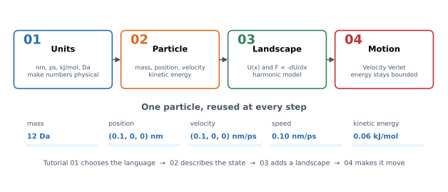
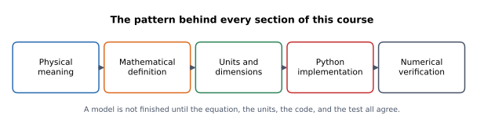

# Individual tutorials 1–4

These four tutorials expand the first four sections of
[`../tutorial.md`](../tutorial.md) into a slower, more visual path from units
to a working Velocity Verlet simulation.



## A consistent course structure

Every tutorial follows the same pattern:

| Stage | Question |
| --- | --- |
| Physical intuition | What is the phenomenon, without equations? |
| Mathematical description | What equation describes it? |
| Units and dimensions | Is the equation physically consistent? |
| Worked example | What does it predict for a concrete case? |
| Python implementation | How is it computed? |
| Tests and verification | How do we know it is right? |
| Experiments | What can the reader explore? |
| Misconceptions | What subtle errors should be avoided? |
| Connections | What comes next? |
| Exercises and summary | Can the reader use it independently? |



Material is labelled by importance:

- **Core** — required for the current tutorial.
- **Deeper insight** — useful context, safe to revisit later.
- **Looking ahead** — a preview developed in a later tutorial.

## The running particle

All four tutorials reuse one particle:

| Property | Value | Unit |
| --- | --- | --- |
| mass | 12 | Da |
| position | (0.1, 0, 0) | nm |
| velocity | (0.1, 0, 0) | nm/ps |
| speed | 0.10 | nm/ps |
| kinetic energy | 0.06 | kJ/mol |

It is an arithmetic example, not a typical room-temperature particle.
Tutorial 02 compares its speed with the thermal speed of a 12 Da particle.

## The four tutorials

| Tutorial | Physics | Code | Visuals |
| --- | --- | --- | --- |
| [01 — Units and scales](01_units.md) | dimensions, SI-to-simulation conversions, molar energy | `units.py` | scale chart, unit bridge, course map |
| [02 — Particles and kinetic energy](02_particle_energy.md) | position, velocity, speed, $K=\tfrac12mv^2$ | `Particle`, `kinetic_energy` | vector diagram, KE curves, stored/derived state, Maxwell distribution, motion GIF |
| [03 — Potential energy and force](03_potential_force.md) | energy landscapes, gradient, harmonic model | `HarmonicPotential`, `potential_energy`, `acceleration` | energy/force curves, 2D quiver, finite-difference figures |
| [04 — Velocity Verlet](04_velocity_verlet.md) | numerical integration, energy conservation, timesteps | `velocity_verlet_step`, `simulate_velocity_verlet` | algorithm flow, position/velocity, energy, phase space, oscillator GIF, drift plots |

## Recommended pace

Each tutorial assumes the previous one:

1. **Units** give every later number a physical meaning.
2. **Particle state and kinetic energy** turn motion into a measurable quantity.
3. **Potential energy and force** explain where motion comes from.
4. **Velocity Verlet** combines state, energy, and force into a trajectory.

Do not skip ahead to the integrator before the energy–force relationship feels
natural. The later molecular mechanics and MD layers reuse exactly these four
ideas.

1. Read one tutorial at a time.
2. Run the short code snippet before moving on.
3. Run the listed tests and explain what each one protects against.
4. Do the self-check questions without looking at the answers.
5. Do at least one calculation, one reasoning, and one implementation exercise
   before starting the next tutorial.

## Numerical validation

Tutorial 04 is backed by an independent analytic check, not only by energy
conservation. Run:

```bash
uv run python examples/harmonic_validation.py
```

The script compares the numerical trajectory with
$x(t)=x_0\cos(\omega t)+(v_0/\omega)\sin(\omega t)$ and reports the observed
convergence order. Halving the timestep reduces the position, velocity, and
energy errors by about four, as expected for a second-order method.

The permanent checks are in
[`tests/test_harmonic_validation.py`](../../../tests/test_harmonic_validation.py),
together with the state-preservation tests in
[`tests/test_state_preservation.py`](../../../tests/test_state_preservation.py).

## Visual conventions

Where a colour carries physical meaning, the figures use a consistent language:

| Colour | Typical meaning |
| --- | --- |
| blue | position, potential energy, or the current particle |
| orange | velocity or kinetic energy |
| green | total energy or a derived quantity |
| red | force, error, or danger |
| gray | reference lines, labels, and neutral annotations |

Categorical figures, such as the course map and the energy-scale chart, may use
additional colours to separate categories.

Static figures are SVG; animations are GIF. They are generated from the actual
library using:

```bash
uv run python docs/tutorials/individual/generate_visuals.py
```

The assets are in [`assets/`](assets/).
