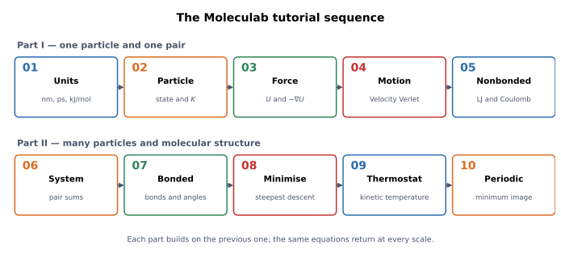

# Introduction: from physics to computational drug discovery

> **Who this is for.** A new computational drug discovery (CADD) user who wants
> to understand what molecular simulation and scoring software actually does
> before treating it as a black box.
>
> **What this is.** A guide to the Moleculab tutorial tracks: why the physics
> starts with units and one particle, how Track B describes the molecule, and
> how Track C turns both into molecular recognition.

## 1. Why learn the foundations?

CADD tools answer questions such as:

- Does this molecule bind to this protein?
- How strongly?
- Where does it bind?
- How long does it stay?
- Which chemical modification would improve it?
- How does the answer change with temperature, solvent, or protonation?

Software such as GROMACS, OpenMM, AutoDock, or ORCA can produce numbers for
these questions. The numbers are only meaningful if you know which physical
model produced them and which approximations were made.

Moleculab is a small engine built to make those models visible. Every important
equation has:

1. a physical explanation;
2. a mathematical definition;
3. a unit and dimensional check;
4. a Python implementation;
5. a unit test and a numerical experiment.

That is also the structure of the tutorial tracks.

## 2. What CADD actually relies on

CADD is not one method. It is a stack of physical and statistical models.

| Method | Question it answers | Physical foundation |
| --- | --- | --- |
| force field | What is the energy of a molecular configuration? | bonded and nonbonded interactions |
| molecular dynamics (MD) | How does the system move in time? | Newton's laws and statistical mechanics |
| docking | Where might a ligand bind, and how favourable is the interaction? | molecular recognition and interaction energies |
| free-energy perturbation (FEP) | How does binding change when a chemical group changes? | statistical mechanics and alchemical transformations |
| thermodynamic integration (TI) | What is the free-energy difference along a path? | ensemble averages and integration |
| MBAR | How do several sampled states combine into one free-energy estimate? | reweighting and maximum likelihood |
| QM/MM | How do electronic effects matter in a local region? | quantum chemistry plus classical environment |
| DFT | What is the electronic structure of a molecule? | quantum mechanics |

The tutorials build the lower layers first, because every later method depends
on them.

## 3. What Moleculab is and is not

Moleculab is:

- an educational molecular physics and simulation library;
- a coherent set of models, algorithms, and tests;
- a place to see how a force field, an integrator, a thermostat, a periodic
  box, a free-energy estimator, and a docking score are actually constructed.

Moleculab is not:

- a replacement for GROMACS, OpenMM, or ORCA;
- a production drug-discovery platform;
- a trained binding-affinity predictor;
- a real DFT or quantum-chemistry engine;
- a validated tool for prospective drug design.

The current implementation includes classical molecular mechanics, MD,
minimisation, thermostats, periodic boundaries, trajectory analysis, solvent
and water models, docking, Ewald electrostatics, pressure coupling, FEP/TI/MBAR,
alchemical soft-core models, a finite-difference QM/MM model, acid-base
protonation and tautomer population bookkeeping, and an optional PyTorch Ewald
backend.

The roadmap includes more realistic force fields, particle-mesh Ewald,
triclinic boxes, enhanced sampling, trained scoring functions, and real quantum
chemistry. Those are explicitly **not** part of the current tutorial's claims.

## 4. The three learning paths

Read the [tutorial map](README.md) for the quick entry points. This section
describes the longer curriculum. Track A is the core dependency chain; Tracks B
and C build on it and connect at the capstone.

The track sequences are deliberately cumulative. Each stage depends on the
previous one.

### Track A, part I — the physics of one particle

| Tutorial | What it builds |
| --- | --- |
| 01 Units | the language of molecular simulation |
| 02 Particle and kinetic energy | what a classical state is |
| 03 Potential and force | where motion comes from |
| 04 Velocity Verlet | how to move forward in time |
| Checkpoint 04 | one oscillator, end to end |
| 04b Chemical bridge | Lennard-Jones dissociation, rotamers, double wells |

**After Track A, part I and the bridge:** you can explain why a particle accelerates, why
kinetic and potential energy exchange, why energy is bounded, and why the
numerical trajectory differs slightly from the analytic one. You can also
explain why the harmonic oscillator is a validation instrument rather than a
chemical model, and read the dissociation, rotamer, and barrier landscapes that
come next.

### Track A, part II — molecular mechanics and many particles

| Tutorial | What it builds |
| --- | --- |
| 05 Nonbonded interactions | Lennard-Jones and Coulomb physics |
| 06 Many particles | pair sums, Newton's third law, `System` |
| 07 Bonds, angles, torsions | the molecular graph |
| 08 Minimisation | finding a nearby low-energy structure |
| 09 Temperature and thermostats | statistical temperature control |
| 10 Periodic boundaries | a bulk-like environment without walls |

**After Track A, part II:** you can read a force field, build a molecular system, explain
how interactions are summed, and run a basic MD or minimisation protocol.

### Track A, part III — simulation, environment, and recognition

| Main tutorial section | What it adds |
| --- | --- |
| 11 Trajectory analysis | MSD and RDF |
| 12 Explicit solvent | coarse-grained environment |
| 13 Free-energy perturbation | first free-energy estimator |
| 14 Atomistic water | typed water, charges, exclusions |
| 15 Rigid-ligand docking | receptor-ligand interaction scoring |
| 16 Ewald summation | long-range periodic electrostatics |
| 17 Pressure coupling | NPT and the barostat |

**After Track A, part III:** you can move from a gas-phase toy system to a solvated,
periodic, thermostatted system and score a ligand pose.

### Track A, part IV — free energy, alchemy, and quantum effects

| Main tutorial section | What it adds |
| --- | --- |
| 18 Thermodynamic integration | free energy along a coupling path |
| 19 MBAR | combining multiple sampled states |
| 20 Molecular FEP/TI/MBAR | soft-core alchemy |
| 21 Minimal QM/MM | a finite-difference Schrödinger model |
| 22 Multi-particle Monte Carlo alchemy | sampling and free energy |
| 23 Solvated-ligand free energy | ligand decoupling in Ewald water |
| 24 Flexible-receptor docking | side-chain flexibility and strain |

**After Track A, part IV:** you can explain the difference between an interaction energy
and a binding free energy, and you can read the structure of an alchemical
calculation.

### Track A, part V — performance and production awareness

| Main tutorial section | What it adds |
| --- | --- |
| 25 CPU and optional acceleration | backend selection and the Ewald kernel |

**After Track A, part V:** you know which parts of the engine are Python, which can use
PyTorch, and why production performance is a separate engineering problem.

Two Track A sections, 15 and 24, are shared with Track C: they apply Track A
physics to receptor-ligand scoring and side-chain flexibility.

### Track B — chemical structure and properties

Track B answers a different question: **what is the molecule, and what state is
it in?** Start with [Track B](chemistry/README.md) after Track A section 4b or
7. The modules are:

| Module | What it adds |
| --- | --- |
| 01 Chemical structure | functional groups, rings, stereochemistry, conformations |
| 02 Molecular representation | graphs, SMILES, aromaticity, conformers |
| 03 Molecular properties | descriptors, fingerprints, similarity |
| 04 Protonation and tautomerism | pKa, pH populations, microstates, tautomers |
| 05 Stereochemistry and molecular recognition | R/S, E/Z, enantiomers, diastereomers, meso compounds |
| 06 Molecular polarity and electronic properties | formal/partial charge, dipoles, electrostatics |
| 07 Hydrogen bonding and molecular recognition | donors/acceptors, geometry, solvent competition |

Track B supplies the chemical identity and state that the force field cannot
infer. It uses RDKit as an optional external toolkit for chemical perception;
the physics engine remains independent of it.

### Track C — structure-based drug discovery

Track C asks: **what does the physics mean for a drug?** Start with
[Track C](drug_discovery/README.md) after Track A sections 1–14 and Track B
modules 01–04. The track covers:

| Module | What it adds | Status |
| --- | --- | --- |
| [01 Protein structure fundamentals](drug_discovery/01_protein_structure.md) | chains, residues, coordinates, structure quality | available |
| [02 Binding sites and cavities](drug_discovery/02_binding_sites.md) | pocket geometry, waters, complementarity | available |
| [03 Protein–ligand interaction geometry](drug_discovery/03_protein_ligand_interactions.md) | hydrogen bonds, salt bridges, hydrophobic and aromatic contacts | available |
| [04 Interaction fingerprints](drug_discovery/04_interaction_fingerprints.md) | residue-level contacts and sampled-frame occupancy | available |
| [05 Docking foundations](drug_discovery/05_docking_fundamentals.md) | search, scoring, poses, limitations | available |
| [06 Comparing binding modes](drug_discovery/06_comparing_binding_modes.md) | pose clustering and interaction-pattern comparison | available |
| [07 Docking validation and benchmarking](drug_discovery/07_docking_validation.md) | redocking, cross-docking, pose recovery | available |
| [08 Trajectory contact analysis](drug_discovery/08_trajectory_contact_analysis.md) | contact matrices, occupancy, lifetimes | available |
| [09 Lead optimisation and SAR](drug_discovery/09_lead_optimisation_sar.md) | matched pairs, activity scales, ligand efficiency | available |
| [10 Structural observations to thermodynamics](drug_discovery/10_structural_observations_to_thermodynamics.md) | occupancy, ensembles, free energy | available |

The important distinction is that a geometric interaction is not an energy
contribution. Track C starts from geometry because a contact can be identified
without pretending it has an independently measurable binding energy.

### Integration

The [imatinib–BCR-ABL1 capstone](capstone_imatinib.md) is where the three tracks
meet. It uses the Track A engine, the Track B chemical state, and the Track C
recognition analysis to discuss one real drug-discovery problem.

## 5. How the pieces connect

The three tracks connect like this:

```text
Track A — the engine
units → particle state → energy and force → time integration
      → nonbonded interactions → many-particle systems → bonded graph
      → minimisation → temperature → periodic boundaries
      → environment → electrostatics → free energy

Track B — the molecule
chemical structure → representation → properties → protonation states

Track C — recognition
protein structure → binding site → interaction geometry
                 → interaction fingerprints → docking

                            ↓
                  imatinib–BCR-ABL1 capstone
```

Track A is also the dependency order of the library. Track B uses the engine
for coordinates, energies, and dynamics, but delegates chemical perception to a
toolkit. Track C uses both: the protein and ligand are chemical objects, and
their recognition is a physical calculation interpreted in a drug-discovery
context.

The software layers are described in [`../architecture.md`](../architecture.md).



The physics deep dives expand the first ten Track A stages. The main Track A
tutorial then continues into analysis, solvent, water, Ewald, pressure, free
energy, alchemy, QM/MM, docking, and flexible docking. Track B and Track C have
their own entry pages.

### 5.1 The capstone: imatinib and BCR-ABL1

The sequence is designed to end with a real case study, not a new API. The
[imatinib–BCR-ABL1 capstone](capstone_imatinib.md) walks through imatinib
(Gleevec) and the BCR-ABL1 fusion protein:

- chronic myeloid leukemia and the Philadelphia chromosome;
- the BCR-ABL1 fusion and its abnormal kinase activity;
- imatinib binding in the ATP-binding region and stabilising an inactive kinase
  conformation;
- crystal structures, protein preparation, docking, MD, and free-energy
  calculations;
- resistance mutations and why a structural explanation matters;
- the role of water in the binding pocket and in the thermodynamics of binding.

The capstone is where the tutorial pieces become one picture:

| Case-study concept | Tutorial foundation |
| --- | --- |
| protein and ligand coordinates | particles, `System`, topology |
| force-field energy | nonbonded and bonded interactions |
| MD equilibration | integrator, thermostat, barostat, periodic box |
| solvent environment | water and solvent models, Ewald electrostatics |
| binding pose | rigid and flexible docking |
| binding affinity | FEP, TI, MBAR, alchemical decoupling |
| electronic effects | QM/MM concepts |

The current library provides the components, not a turnkey imatinib pipeline.
The case study shows how the components fit together and what production
workflows add: protein preparation, force-field assignment, replicated
simulations, enhanced sampling, and experimental validation.

### 5.2 Water is not background

Water is not a passive medium that surrounds a protein and a ligand. It is an
active part of nearly every CADD calculation.

- It screens electrostatic interactions.
- It donates and accepts hydrogen bonds.
- It fills cavities and shapes binding pockets.
- It changes the entropy and enthalpy of binding when it is displaced.
- It affects protonation, conformation, and diffusion.

This is why the same water model appears in several places:

| Topic | Where it appears |
| --- | --- |
| solvent boxes | `applications/solvent.py` |
| atomistic water | `applications/water.py` |
| long-range electrostatics | `models/ewald.py` |
| ligand-water decoupling | `applications/solvated_alchemy.py`, `applications/fep.py` |
| binding thermodynamics | the imatinib case study |

A gas-phase docking score omits desolvation and water entropy. That is one
reason an interaction energy is not a binding free energy. The tutorials treat
water as part of the model, not as an optional extra.

## 6. How this prepares you for real CADD software

When you open a production tool, you will recognize the layers:

| Production concept | Moleculab foundation |
| --- | --- |
| topology and force-field parameters | `Topology`, `NonbondedModel`, atom types, charges |
| cutoff and neighbour list | `Box`, `composition/neighbour.py`, `models/nonbonded.py` |
| integrator and timestep | `algorithms/integrators.py` |
| thermostat and barostat | `protocols/thermostats.py`, `protocols/pressure.py` |
| periodic electrostatics | `models/ewald.py` |
| binding pose scoring | `applications/docking.py`, `applications/flexible_docking.py` |
| alchemical free energy | `applications/fep.py`, `applications/ti.py`, `applications/mbar.py`, alchemy modules |
| trajectory observables | `analysis/trajectory.py` |
| QM/MM coupling | `applications/qm_mm.py` |
| chemical perception and standardisation | Track B and the optional RDKit adapter |
| protonation and tautomer state | `applications/acid_base.py` |
| protein structure and interaction fingerprints | Track C (planned) |

You will also recognize the approximations: cutoffs, finite timesteps, local
minima, classical point charges, and the difference between an interaction
energy and a free energy.

## 7. What you will be able to do

By the end of Track A, you should be able to:

- read a molecular-mechanics equation and identify its units;
- explain why force is the negative energy gradient and test it numerically;
- explain why the harmonic oscillator is a validation tool and read
  Lennard-Jones dissociation, torsional rotamer, and double-well landscapes;
- build a `System` with nonbonded and bonded interactions;
- run and diagnose a Velocity Verlet trajectory;
- explain energy conservation, timestep error, and minimisation convergence;
- define kinetic temperature and describe what a thermostat does;
- apply periodic boundaries and explain the minimum-image convention;
- compute MSD and RDF from a trajectory;
- explain what a force field contains and what it omits;
- describe how docking scores relate to, and differ from, binding free energy;
- explain the idea of an alchemical free-energy path;
- explain why water is an active participant in binding, not a passive
  background;
- map the imatinib–BCR-ABL1 case study onto the models and modules;
- state the limitations of the current models without confusing them with
  validated drug-discovery predictions.

Track B adds molecular identity: formula, graph, SMILES, stereochemistry,
conformers, descriptors, similarity, and discrete protonation and tautomer
states. Track C adds recognition: protein structure, binding-site geometry,
interaction types, and the distinction between a geometric contact and an
energy contribution.

The three tracks together should let you explain both what a calculation does
and which chemical and structural assumptions it depends on.

## 8. How to use the materials

There are several entry points:

| Material | Use it for |
| --- | --- |
| [Tutorial map](README.md) | the three-track overview and quick start |
| [Learning tracks](tracks.md) | prerequisites, module tables, and study orders |
| [Track A main path](tutorial.md) | the guided physics and simulation sequence |
| [Track A physics deep dives](physics/README.md) | slower, visual deep dives for parts 1–10 |
| [Track B](chemistry/README.md) | chemical structure, representation, properties, and protonation |
| [Track C](drug_discovery/README.md) | protein structure, binding sites, interactions, and docking |
| [Track C units](drug_discovery/units.md) | Angstrom, nm, kcal/mol, affinity, and structural units |
| [Capstone](capstone_imatinib.md) | the imatinib–BCR-ABL1 cross-track integration |
| [Troubleshooting](troubleshooting.md) | symptom table and diagnostic recipes |
| [Visualization prompts](visualization_prompts.md) | notebook-sized plotting prompts |
| [Answer keys](answer_keys.md) | answer sketches and expected magnitudes |
| [Architecture](../architecture.md) | how the software is structured and why |
| [Validation](../validation.md) | how correctness is checked |

A practical pace is:

1. read one tutorial;
2. run its code or example;
3. run the listed tests;
4. do one calculation, one reasoning, and one implementation exercise;
5. only then move on.

Do not skip the energy-force relationship or the checkpoint. Everything later
depends on them.

## 9. Prerequisites

Helpful background:

- algebra, vectors, and basic calculus;
- the idea of a derivative and an integral;
- basic Python and NumPy;
- introductory chemistry: atoms, bonds, charges, conformations.

You do not need prior molecular-dynamics experience. The sequence introduces
each concept before using it. The mathematics is kept explicit, but it is not
avoided.

## 10. A note on scientific honesty

An educational library should be clear about what it does not do.

- A docking score is an interaction energy, not a binding free energy.
- A harmonic bond cannot describe bond breaking.
- A Berendsen thermostat controls temperature approximately; it does not
  sample the exact canonical ensemble.
- A plain Lennard-Jones cutoff is an approximation; shifted and switched forms
  are discussed but not the default.
- The QM/MM module is a one-dimensional finite-difference model, not a
  production electronic-structure method.
- The current scoring functions are not trained or experimentally validated.

Learning the foundations includes learning where the models stop.

## 11. Glossary

| Term | Meaning in this project |
| --- | --- |
| force field | the energy model: bonded terms plus nonbonded terms and parameters |
| ensemble | the statistical distribution of states, such as NVT or NPT |
| MD | molecular dynamics: numerical integration of the equations of motion |
| minimisation | finding a nearby low-energy structure |
| periodic boundary conditions | repeating a box to model a bulk environment |
| minimum image | the shortest separation between two particles and their images |
| Ewald summation | a method for long-range periodic electrostatics |
| docking | generating and scoring receptor-ligand poses |
| binding free energy | the free-energy difference between bound and unbound states |
| FEP | free-energy perturbation |
| TI | thermodynamic integration |
| MBAR | multistate Bennett acceptance ratio |
| QM/MM | quantum treatment of a region embedded in a classical environment |
| DFT | density functional theory, a quantum electronic-structure method |
| atom type | a force-field label that selects Lennard-Jones parameters |

## 12. Where to start

Start with the [tutorial map](README.md). From there, choose
[Track A](tutorial.md) for the physics engine, [Track B](chemistry/README.md)
for chemical structure and state, or [Track C](drug_discovery/README.md) for
protein-ligand recognition. If you want the slowest Track A path, start with
[01 — Units and scales](physics/01_units.md).

If you want the software context first, read
[the architecture](../architecture.md). If you want to know how correctness is
established, read [the validation plan](../validation.md).
