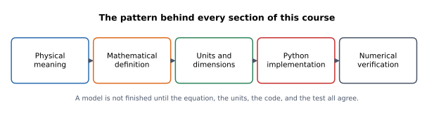
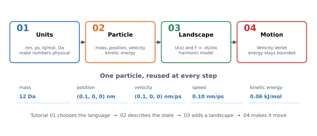
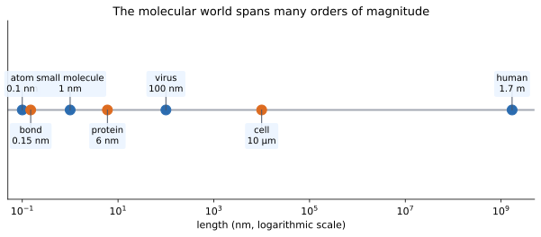
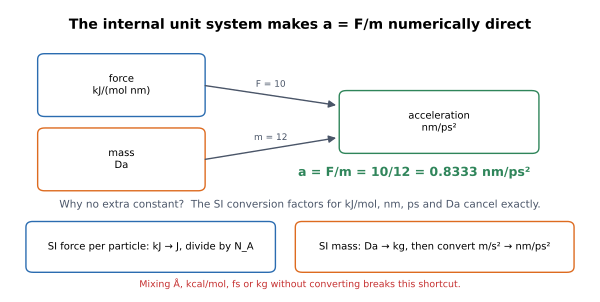
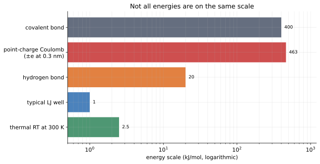

# 01 — Units, scales, and why $a=F/m$ just works

> **Where we are.** This is the first tutorial in the Moleculab sequence. We
> have not built a force field or run a simulation yet. We are agreeing on the
> physical language that every later equation will use.
>
> **What you should already know.** Basic algebra, vectors as arrows, and the
> idea that a physical quantity has both a number and a unit.
>
> **What you will be able to do afterwards.** Read any Moleculab equation and
> know what units every symbol has; convert between common molecular units;
> explain why $a=F/m$ needs no hidden constant; and catch unit errors before
> they become fake physics.

## 1. Learning objectives and how this tutorial is organised

**Core**

- Read the unit contract and say what unit every symbol carries.
- Convert between Å, nm, fs, ps, kcal/mol, and kJ/mol.
- Explain why $a=F/m$ needs no conversion constant in this system.
- Perform a dimensional check on an energy or force equation.

**Deeper insight**

- Distinguish the molar gas constant $R$ from the single-particle $k_B$.
- Explain why the units are chosen together rather than one at a time.
- Recognise that energy-scale tables are order-of-magnitude references.

**Looking ahead**

- Electrostatic screening, reaction fields, and Ewald summation are previewed
  but developed later.
- The running particle introduced here carries through tutorials 02–04.

These tutorials use a consistent pattern. Each major concept moves through five
stages:



*Physical meaning first, then the equation, then its units, then the code, then
a numerical check.*

The same pattern appears in the library itself:

| Stage | Question | Where it lives |
| --- | --- | --- |
| Physical meaning | What is the quantity? | prose in this tutorial |
| Mathematics | What equation describes it? | equations below |
| Units | What does each symbol carry? | this tutorial and `foundation/units.py` |
| Implementation | How is it computed? | `src/moleculab/` |
| Verification | How do we know it is right? | tests and experiments |

Within each tutorial, material is also labelled by how much you need it:

- **Core** — required to understand the current lesson.
- **Deeper insight** — useful context; revisit it later if it does not click yet.
- **Looking ahead** — a preview of a concept developed in a later tutorial.

You do not have to master every *deeper insight* on the first pass. The core
path through this tutorial is: units → conversion → the acceleration shortcut →
dimensional analysis.

## 2. The running example

The whole four-tutorial sequence follows one particle. We will call it **the
Moleculab particle**, or simply $P$.

| Property | Value | Unit |
| --- | --- | --- |
| mass $m$ | 12 | Da |
| position $\mathbf r$ | $(0.1, 0, 0)$ | nm |
| velocity $\mathbf v$ | $(0.1, 0, 0)$ | nm/ps |
| speed $\lvert\mathbf v\rvert$ | 0.10 | nm/ps |
| kinetic energy $K$ | 0.06 | kJ/mol |



*A single particle carries the story: units give it meaning, tutorial 02
describes its state, tutorial 03 puts it in a landscape, and tutorial 04 makes
it move.*

The values are chosen because the arithmetic is easy, not because they describe
a typical thermal particle. Tutorial 02 will show how far 0.1 nm/ps is from a
room-temperature speed. For now, $P$ is a concrete object we can use to check
every equation.

## 3. Physical intuition: a quantity is a number plus a unit

Computational drug discovery is built from questions such as:

- How strongly does a ligand bind to a protein?
- How long does a hydrogen bond survive?
- How much energy does it cost to move a drug into a binding pocket?
- How fast does a protein loop move?

Every answer is a physical quantity. “The distance is 2” is meaningless until
we know whether that means 2 Å, 2 nm, or 2 µm.

At molecular scales, SI units produce awkward numbers:

- a typical bond length is about $1.5\times10^{-10}$ m;
- a molecular dynamics timestep is about $2\times10^{-15}$ s;
- one mole contains $6.022\times10^{23}$ particles.

Writing those powers of ten in every equation makes code noisy and mistakes
easy. Moleculab therefore chooses an **internal unit system** designed for
molecular simulation.



*The same physical world spans many orders of magnitude. A simulation box is
usually nanometres across even when the biological system is micrometres
across.*

A useful mental map:

| Object | Approximate size |
| --- | --- |
| atom | 0.1 nm |
| chemical bond | 0.1–0.2 nm |
| small drug molecule | 1–2 nm |
| small protein | 3–10 nm |
| virus | about 100 nm |
| cell | about 10 µm |
| human | about 1.7 m |

A molecular simulation usually focuses on a small box: perhaps 5 nm on a side,
containing a protein fragment, a ligand, water, and ions. The box is tiny by
human standards but enormous by atomic standards.

## 4. Mathematical description: the seven quantities

Moleculab's internal system is:

| Quantity | Unit | Symbol |
| --- | --- | --- |
| distance | nanometre | nm |
| time | picosecond | ps |
| energy | kilojoule per mole | kJ/mol |
| mass | dalton | Da |
| force | kilojoule per mole per nanometre | kJ/(mol nm) |
| temperature | kelvin | K |
| charge | elementary charge | e |

Think of this table as a contract:

- if a function returns a force, the number is in kJ/(mol nm);
- if a position array is passed in, its components are in nm;
- if a velocity is updated, the result is in nm/ps.

The contract is implemented in
[`src/moleculab/foundation/units.py`](../../../src/moleculab/foundation/units.py):

```python
DISTANCE_UNIT = "nm"
TIME_UNIT = "ps"
ENERGY_UNIT = "kJ/mol"
MASS_UNIT = "Da"
FORCE_UNIT = "kJ/(mol nm)"
TEMPERATURE_UNIT = "K"
CHARGE_UNIT = "e"
```

### 4.1 The units are chosen together

The key idea is not that each unit is convenient in isolation. It is that the
units are **internally coherent**: derived units follow from the base choices
with no leftover numerical factor, apart from the roughly $10^{-9}$ difference
between the dalton and one gram per mole.

| Derived quantity | Relation | Unit that follows |
| --- | --- | --- |
| velocity | distance / time | nm/ps |
| force | energy / distance | kJ/(mol nm) |
| acceleration | force / mass | nm/ps² |
| kinetic energy | mass × velocity² | Da (nm/ps)² |

The last row is not obviously kJ/mol. The next two sections show why it is.
This is the whole reason the code can write `force / mass` and get an
acceleration without a conversion constant.

## 5. Units and dimensions: why $a=F/m$ needs no constant

Newton's second law is

$$ \mathbf F = m\mathbf a. $$

If force is in newtons and mass in kilograms, acceleration is in m/s². But
Moleculab stores force in **kJ/(mol nm)**, mass in **Da**, and acceleration in
**nm/ps²**. At first glance, those units look incompatible.

The conversion factors cancel to about one part in $10^9$. Let us verify this
carefully, because it is the foundation of the whole unit system.

### 5.1 Convert force to a per-particle force

A force of $1\ \mathrm{kJ/(mol\ nm)}$ means that moving one mole of particles
by one nanometre changes the energy by one kilojoule.

For a single particle, the energy change is divided by Avogadro's number, and
the distance is converted from nm to m:

$$ F_{\text{particle}} = F_{\text{molar}} \frac{1000}{N_A} \frac{1}{10^{-9}}\ \mathrm{N}. $$

### 5.2 Convert mass to kilograms

$$ m_{\mathrm{kg}} = m_{\mathrm{Da}} \times1.66054\times10^{-27}\ \mathrm{kg}. $$

### 5.3 Convert acceleration back to nm/ps²

One nm/ps² is

$$ \frac{10^{-9}\ \mathrm{m}}{(10^{-12}\ \mathrm{s})^2} = 10^{15}\ \mathrm{m/s^2}. $$

So

$$ a_{\mathrm{nm/ps^2}} = a_{\mathrm{m/s^2}}\times10^{-15}. $$

### 5.4 Put the factors together

The conversion factor between the numerical value of $F/m$ in internal units
and the numerical value of acceleration in nm/ps² is

$$ \frac{1000}{N_A} \frac{1}{10^{-9}} \frac{1}{1.66054\times10^{-27}} 10^{-15}. $$

Using $N_A=6.02214076\times10^{23}$, this factor is one to about one part in
$10^9$. The tiny residual comes from 1 Da being approximately, not exactly,
1 g/mol. For molecular simulation this is far below the precision of the
models. Therefore

$$ a_{\mathrm{nm/ps^2}} = \frac{F_{\mathrm{kJ/(mol\ nm)}}}{m_{\mathrm{Da}}} $$

numerically.



*The conversion factors for kJ/mol, nm, ps, and Da cancel. This is why the code
can write `force / mass` directly.*

### 5.5 The same cancellation for kinetic energy

The same principle explains why $K=\tfrac12mv^2$ needs no constant. Let

$$ m=1\ \mathrm{Da}, \qquad v=1\ \mathrm{nm/ps}. $$

Then

$$ \frac12mv^2 = 0.5\ \mathrm{Da\ (nm/ps)^2}. $$

Convert to SI:

$$ 0.5\times1.66054\times10^{-27}\ \mathrm{kg} \times\left(\frac{10^{-9}\ \mathrm{m}}{10^{-12}\ \mathrm{s}}\right)^2 = 8.3027\times10^{-22}\ \mathrm{J}. $$

Multiply by Avogadro's number:

$$ 8.3027\times10^{-22}\times6.02214\times10^{23} \approx500\ \mathrm{J/mol} = 0.5\ \mathrm{kJ/mol}. $$

So one $\mathrm{Da\ (nm/ps)^2}$ is one kJ/mol, and

$$ K_{\mathrm{kJ/mol}} = \frac12 m_{\mathrm{Da}}|\mathbf v|^2_{\mathrm{nm/ps}} $$

numerically.

**Core takeaway.** The numerical shortcuts work because the conversion factors
cancel. They are not permission to drop units. They are a consequence of
choosing the units together.

### 5.6 Worked example: the running particle

Take

$$ F=10\ \mathrm{kJ/(mol\ nm)}, \qquad m=12\ \mathrm{Da}. $$

The shortcut gives

$$ a=\frac{10}{12}=0.8333\ \mathrm{nm/ps^2}. $$

Check in SI. The force per particle is

$$ F_{\text{particle}} =10\frac{1000}{6.022\times10^{23}}\frac{1}{10^{-9}} \approx1.6605\times10^{-11}\ \mathrm{N}. $$

The mass is

$$ m=12\times1.66054\times10^{-27} \approx1.9926\times10^{-26}\ \mathrm{kg}. $$

Thus

$$ a=\frac{1.6605\times10^{-11}}{1.9926\times10^{-26}} \approx8.333\times10^{14}\ \mathrm{m/s^2}. $$

Convert:

$$ 8.333\times10^{14}\times10^{-15} =0.8333\ \mathrm{nm/ps^2}. $$

The two routes agree. The shortcut is not a rough approximation; it is a
consequence of the chosen units, accurate to about one part in $10^9$. The
small residual is the difference between the dalton and one gram per mole.

## 6. Energy scales you should internalize



*Order-of-magnitude reference values. Thermal energy at room temperature is a
few kJ/mol; covalent bonds and bare point-charge interactions are much larger.*

Approximate room-temperature scales:

| Interaction | Typical magnitude (kJ/mol) | Important caveat |
| --- | --- | --- |
| thermal energy $RT$ at 300 K | 2.5 | exact for the stated temperature |
| Lennard-Jones well | 0.1–2 | depends on the atom pair |
| hydrogen bond | 5–40 | strongly environment-dependent |
| covalent bond | 300–500 | depends on the bond |
| bare $\pm e$ Coulomb at 0.3 nm | about 463 | unscreened vacuum value |

Two qualifications matter:

1. **These are order-of-magnitude references, not universal constants.** A
   hydrogen bond in a protein interior is not the same as a hydrogen bond in
   water. The number depends on geometry, environment, and how the interaction
   is defined.
2. **The Coulomb value is a bare interaction.** It is the energy of two point
   charges in vacuum. In a molecular system, solvent and other charges screen
   the interaction, so the *effective* electrostatic energy is usually smaller.

Even with those caveats, the scale is useful: a force or energy of thousands of
kJ/mol is usually a sign of an atomic clash or a unit mistake, not normal
thermal motion.

## 7. Molar energy and the gas constant

Moleculab expresses energy per mole. The molar gas constant is

$$ R=0.008314462618\ \mathrm{kJ/(mol\ K)}. $$

At temperature $T$,

$$ RT = 0.008314462618\ T\ \mathrm{kJ/mol}. $$

At 300 K,

$$ RT=2.4943387854\ \mathrm{kJ/mol}. $$

The single-particle Boltzmann constant is

$$ k_B=1.380649\times10^{-23}\ \mathrm{J/K}. $$

The relation is

$$ R=N_Ak_B. $$

Use $R$ when your energy is per mole. Use $k_B$ when your energy is per
particle. Mixing them is a common source of factors of $N_A$.

### 7.1 A naming trap in the code

For historical reasons, the library calls the molar gas constant
`BOLTZMANN_CONSTANT`:

```python
# src/moleculab/foundation/units.py
BOLTZMANN_CONSTANT = 0.008314462618   # kJ/(mol K), despite the name
MOLAR_GAS_CONSTANT = BOLTZMANN_CONSTANT
```

The value is $R$, not $k_B$. The descriptive alias `MOLAR_GAS_CONSTANT` exists
so new code can say what it means. The historical name is kept so existing code
does not break. The true single-particle constant is stored separately as
`BOLTZMANN_CONSTANT_J_PER_K`.

**Core takeaway.** A variable name is not a unit. Read the comment and check the
value.

## 8. Charge and the Coulomb constant

Coulomb's law in SI is

$$ U(r)=\frac{1}{4\pi\epsilon_0}\frac{q_iq_j}{r}. $$

In Moleculab, charges are in units of the elementary charge $e$ and distance is
in nm. The conversion is collected into one constant:

$$ k_e = \frac{1}{4\pi\epsilon_0} e^2 \frac{1}{10^{-9}} \frac{N_A}{1000} \approx138.935456\ \mathrm{kJ\ nm/(mol\ e^2)}. $$

Then the internal-unit equation is simply

$$ U(r)=k_e\frac{q_iq_j}{r}. $$

For example, two unit charges at $r=1$ nm have

$$ U\approx138.935\ \mathrm{kJ/mol}. $$

At $r=0.3$ nm the interaction is roughly $463$ kJ/mol.

**Deeper insight.** That number is the *vacuum* interaction. Water has a large
relative permittivity, so the effective attraction between ions in water is much
weaker at the same separation. This is why molecular models use reaction-field
or Ewald electrostatics instead of bare $1/r$ sums. The constant is still the
right starting point; it is the surrounding model that changes.

## 9. Python implementation and verification

The unit constants are used by the rest of the library:

```python
from moleculab import units

print(units.DISTANCE_UNIT)               # nm
print(units.MOLAR_GAS_CONSTANT)          # 0.008314462618 kJ/(mol K)
print(units.BOLTZMANN_CONSTANT)          # same number; historical name
print(units.BOLTZMANN_CONSTANT_J_PER_K)  # 1.380649e-23 J/K
print(units.COULOMB_CONSTANT)            # 138.935... kJ nm/(mol e^2)
```

A numerical check:

```bash
uv run python - <<'PY'
from moleculab import units

print("R            =", units.MOLAR_GAS_CONSTANT)
print("R * 300 K    =", units.MOLAR_GAS_CONSTANT * 300)
print("k_B          =", units.BOLTZMANN_CONSTANT_J_PER_K)
print("N_A          =", units.AVOGADRO_CONSTANT)
print("Coulomb      =", units.COULOMB_CONSTANT)
PY
```

Expected:

```text
R            = 0.008314462618
R * 300 K    = 2.4943387854
k_B          = 1.380649e-23
N_A          = 6.02214076e+23
Coulomb      = 138.9354576444
```

Run the unit tests:

```bash
uv run pytest tests/foundation/test_units.py tests/foundation/test_particles.py -q
```

The particle tests belong here too, because they enforce the shape and unit
contract at the boundary of the system. A `Particle` refuses a position with two
components; a two-component position would silently break every later 3D force
calculation.

**Why this is tested.** A constant with the wrong units still produces a finite
number. Tests turn a silent unit error into a loud failure.

### 9.1 Physical invariants

A correct unit system must preserve these truths:

- every equation is dimensionally consistent;
- the acceleration conversion factor is one to about $3.5\times10^{-10}$;
- $R=N_Ak_B$ within the same precision;
- changing from Å to nm changes the number, not the predicted physics.

**Recurring question:** if the units change, does the physical prediction stay
the same? It must.

## 10. Experiments

### Experiment 1: thermal energy

Compute $RT$ for 300 K, 310 K, and 600 K. Notice that doubling the temperature
doubles $RT$, while molecular speeds only increase by $\sqrt{2}$.

### Experiment 2: unit conversion

Convert a bond length of 1.5 Å to nm, a timestep of 2 fs to ps, and an energy
of 5 kcal/mol to kJ/mol.

### Experiment 3: Coulomb scale

Compute the Coulomb energy of two unit charges at 0.3 nm, 0.5 nm, and 1.0 nm.
Compare each result with $RT$ at 300 K. Then explain why the effective
interaction in water can be much smaller.

### Experiment 4: dimensional analysis of kinetic energy

Start from $K=\tfrac12m|\mathbf v|^2$ with $m$ in Da and $\lvert\mathbf v\rvert$ in nm/ps.
Show by explicit SI conversion that the result is in kJ/mol. Do not look at
section 5.5 until you have tried it.

### Experiment 5: the running particle

Compute the kinetic energy of $P$ from its mass and speed. Confirm that you get
0.06 kJ/mol without inserting any conversion factor.

## 11. Common misconceptions

1. **“Units are just notation.”** A number without a unit is not a physical
   quantity. The unit system is part of the model.
2. **Using Å in a nm equation.** Convert by multiplying by 0.1.
3. **Using kcal/mol in a kJ/mol equation.** Multiply by 4.184.
4. **Using fs in a ps equation.** Multiply by 0.001.
5. **Using $k_B$ when the energy is per mole.** In Moleculab, use $R$. The
   historical variable name is misleading; check the units.
6. **Dropping $1/(4\pi\epsilon_0)$ in an SI Coulomb calculation.** In
   Moleculab, that factor is already inside `COULOMB_CONSTANT`.
7. **Assuming the acceleration shortcut is universal.** It holds for this
   particular unit system. Change the units and the factor returns.
8. **Treating reference energies as universal constants.** Hydrogen-bond and
   Coulomb values depend on the environment and on what is included in the
   model.

## 12. Connections and what comes next

Units are not an isolated preliminary. They appear in every later layer:

- **Particle energy:** kinetic energy uses Da and nm/ps.
- **Force:** the harmonic force uses kJ/(mol nm).
- **Time integration:** acceleration is nm/ps², so timesteps must be in ps.
- **Statistical mechanics:** temperature uses the molar gas constant.
- **Free energy:** energy differences are kJ/mol.
- **Docking:** interaction energies are kJ/mol, not arbitrary scores.
- **QM/MM:** quantum energies are converted to kJ/mol before mixing with MM.

**Looking ahead.** The next tutorial gives $P$ a state and computes its kinetic
energy. That calculation is only meaningful because of the unit contract
established here.

## 13. Self-check with answers

1. **How many nm are in 1 Å?**
   0.1 nm.

2. **How many ps are in 1 fs?**
   0.001 ps.

3. **Convert 2 kcal/mol to kJ/mol.**
   $2\times4.184=8.368$ kJ/mol.

4. **What is $RT$ at 310 K?**
   $0.008314462618\times310=2.577$ kJ/mol.

5. **A 4 Da particle experiences 24 kJ/(mol nm). What is its acceleration?**
   $a=24/4=6$ nm/ps².

6. **Why does $a=F/m$ not need a constant here?**
   Because the conversion factors for kJ/mol, nm, ps, and Da cancel to about
   one part in $10^9$.

7. **What is the value of `BOLTZMANN_CONSTANT`, and what is it really?**
   It is 0.008314462618, the molar gas constant $R$ in kJ/(mol K), not the
   single-particle Boltzmann constant.

8. **Why can a bare Coulomb energy overstate an interaction in water?**
   The bare $1/r$ value is unscreened. Solvent and other charges screen the
   interaction, so the effective energy is smaller.

9. **Why is a finite number not enough to trust a result?**
   A finite number can still have the wrong units or the wrong model.

## 14. Exercises

### Calculation

1. Convert 1.5 Å to nm, 2 fs to ps, and 5 kcal/mol to kJ/mol.
2. Compute $RT$ at 298 K and at 310 K.
3. Compute the Coulomb energy of $+1e$ and $-1e$ at 0.25 nm.
4. Compute the kinetic energy of a 4 Da particle at 0.2 nm/ps.

### Reasoning

1. Why does $a=F/m$ not need a constant in this unit system? Explain in terms
   of the conversion factors, not just “the units match.”
2. Why is it dangerous to compare a bare Coulomb energy with $RT$ and conclude
   that the interaction in a protein is always huge?
3. Why is a variable named `BOLTZMANN_CONSTANT` allowed to hold the molar gas
   constant? What should you check before using it?
4. A function returns an energy of $10^6$ kJ/mol for a normal molecular
   configuration. What are the two most likely explanations?

### Implementation

1. Write a Python function that converts Å to nm and kcal/mol to kJ/mol. Add a
   test for each conversion.
2. Derive the units of the harmonic stiffness $k$ from $U=\tfrac12kx^2$, then
   verify them in code with `foundation/units.py`.
3. Add a small script that prints the kinetic energy of $P$ and checks it
   against the analytic value.
4. Read `src/moleculab/foundation/units.py` and list every constant with its units. Mark
   which ones are conversion factors and which are physical constants.

## 15. Summary

- Moleculab uses nm, ps, kJ/mol, Da, kJ/(mol nm), K, and e.
- The units are chosen together, so derived units need no numerical factor.
- The acceleration equation is numerically $a=F/m$ in these units because
  the conversion factors cancel.
- Kinetic energy is numerically $K=\tfrac12m|\mathbf v|^2$ for the same reason.
- Energy is molar; use $R$, not $k_B$, unless you explicitly convert.
- `BOLTZMANN_CONSTANT` is a historical name for $R$; `MOLAR_GAS_CONSTANT` is the
  descriptive alias.
- Coulomb interactions use a single precomputed constant, but the bare value is
  not the effective interaction in a solvent.
- Energy-scale tables are order-of-magnitude guides, not universal constants.
- Dimensional analysis and unit tests catch errors before they contaminate a
  simulation.

**Next:** [02 — Particles, velocity, and kinetic energy](02_particle_energy.md).
