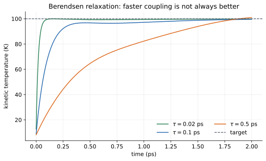

# 09 — Temperature and the Berendsen thermostat

> **Where we are.** Tutorial 08 found a low-energy structure. Dynamics needs
> velocities, and a simulation at a chosen temperature needs a way to control
> their statistical distribution. This tutorial defines kinetic temperature and
> introduces the Berendsen thermostat.
>
> **What you should already know.** Kinetic energy, degrees of freedom, force
> and velocity updates, and the molar gas constant.
>
> **What you will be able to do afterwards.** Compute an instantaneous kinetic
> temperature, explain why the centre-of-mass motion is removed, apply the
> Berendsen thermostat, interpret its coupling time, and state its limitations.

## 1. Learning objectives

**Core**

- Compute kinetic temperature from total kinetic energy.
- Count thermal degrees of freedom for a small system.
- Apply the Berendsen velocity-scaling formula.
- Explain the role of the coupling time $\tau$.

**Deeper insight**

- Explain why one particle has no thermodynamic temperature.
- Explain why constraints and centre-of-mass motion change the degree-of-freedom
  count.
- Explain why Berendsen is not an exact canonical thermostat.

**Looking ahead**

- Nosé–Hoover and Langevin thermostats sample the canonical ensemble more
  rigorously.
- Temperature control is separate from the physical potential.

## 2. The running system

We use the two-particle Lennard-Jones system from the library example.

| Property | Value | Unit |
| --- | --- | --- |
| particles | 2 | — |
| mass of each | 39.948 | Da |
| Lennard-Jones $\epsilon$ | 0.997 | kJ/mol |
| Lennard-Jones $\sigma$ | 0.34 | nm |
| equilibrium separation | $2^{1/6}\sigma\approx0.3816$ | nm |
| initial velocities | $(0,\pm0.05,0)$ | nm/ps |
| initial kinetic energy | 0.09987 | kJ/mol |
| initial kinetic temperature | 8.01 | K |
| target temperature | 100 | K |
| coupling time | 0.1 | ps |
| timestep | 0.001 | ps |
| steps | 2000 | — |
| final temperature | 99.59 | K |
| mean after warm-up | 98.63 | K |



*Smaller coupling times drive the temperature toward the target faster, but
strong coupling can distort the natural dynamics. The dashed line is the target.*

## 3. Physical intuition: temperature is a statistical property

A single particle has kinetic energy. It does not have a temperature in the
thermodynamic sense. Temperature is a property of an **ensemble** of degrees of
freedom: it describes the average kinetic energy per independent mode.

For a system in thermal equilibrium at temperature $T$, equipartition gives

$$ \left\langle\frac12m v_x^2\right\rangle = \frac12RT $$

per translational degree of freedom, with the molar convention used in
Moleculab. In three dimensions, the average kinetic energy per particle is
$\tfrac32RT$.

A thermostat is an algorithm that nudges the velocities toward a target
temperature. It is not part of the physical potential. It changes velocities,
not forces.

**Model versus protocol.** The thermostat is a simulation protocol. It does not
alter the energy function or the interparticle forces.

## 4. Mathematical description

### 4.1 Kinetic temperature

The instantaneous kinetic temperature is

$$ T=\frac{2K}{N_{\mathrm{dof}}R}, \qquad R=0.008314462618\ \mathrm{kJ/(mol\ K)}. $$

For an isolated system of $N>1$ particles without constraints, removing the
three centre-of-mass translation modes gives

$$ N_{\mathrm{dof}}=3N-3. $$

For $N=2$, this is 3 degrees of freedom.

### 4.2 Why remove the centre-of-mass motion?

The centre-of-mass velocity is

$$ \mathbf V_{\mathrm{CM}} = \frac{\sum_i m_i\mathbf v_i}{\sum_i m_i}. $$

If the whole system drifts, that bulk motion has kinetic energy but does not
represent internal thermal motion. Including it would make the temperature
depend on the observer's frame.

The library's `degrees_of_freedom(system, remove_com=True)` removes the three
translation modes for $N>1$.

### 4.3 Constraints

Distance constraints remove degrees of freedom. A rigid water molecule, for
example, has fewer internal modes than three independent atoms.

The current `kinetic_temperature` helper applies the centre-of-mass correction
but does not automatically subtract constraint degrees of freedom. For
constrained systems, treat the reported temperature as a diagnostic rather than
an exact thermodynamic temperature.

### 4.4 Berendsen thermostat

The Berendsen thermostat rescales velocities by

$$ \lambda = \sqrt{ 1+\frac{\Delta t}{\tau} \left(\frac{T_0}{T}-1\right) }, $$

where:

- $T_0$ is the target temperature;
- $T$ is the current kinetic temperature;
- $\Delta t$ is the timestep;
- $\tau$ is the coupling time.

Then

$$ \mathbf v_i\leftarrow\lambda\mathbf v_i. $$

The scaling changes kinetic energy by $\lambda^2$:

$$ K'=\lambda^2K. $$

If $T<T_0$, then $\lambda>1$ and the system heats. If $T>T_0$, then $\lambda<1$
and the system cools.

### 4.5 What the coupling time means

- Small $\tau$: strong coupling, fast relaxation, but the thermostat can
  interfere with natural dynamics.
- Large $\tau$: weak coupling, slow relaxation, but less perturbation.

A common rule of thumb is $\tau$ of order 0.1–1 ps for small molecular systems.
The “right” value depends on what you want to measure.

### 4.6 What Berendsen does and does not do

The Berendsen thermostat is best understood as a **simulation protocol**, not as
a physical model and not as an exact statistical-mechanics sampler.

| Property | Berendsen behaviour |
| --- | --- |
| Controls the mean temperature | approximately |
| Relaxes toward a target | yes |
| Useful for equilibration | yes |
| Produces exact canonical fluctuations | no |
| Suitable for fluctuation-based observables | generally no |
| Simple and stable | yes |

The velocity rescaling suppresses natural kinetic-energy fluctuations. That is
acceptable for preparation and equilibration, where the goal is to bring a
system near a target temperature. It is not acceptable when the scientific
question depends on the exact canonical distribution, such as a heat-capacity
or fluctuation-based estimate.

For exact canonical sampling, use a Langevin or Nosé–Hoover thermostat. Those
are not implemented in the current milestone. The honest summary is:

- Berendsen controls temperature approximately;
- it is useful for equilibration;
- it does not produce exact NVT sampling;
- more rigorous thermostats come later.

A common workflow is to equilibrate with Berendsen and then switch to a
rigorous thermostat for production statistics. Moleculab does not yet implement
that switch.

## 5. Units and dimensions

| Quantity | Unit |
| --- | --- |
| kinetic energy $K$ | kJ/mol |
| gas constant $R$ | kJ/(mol K) |
| temperature $T$ | K |
| timestep $\Delta t$ | ps |
| coupling time $\tau$ | ps |
| $\Delta t/\tau$ | dimensionless |
| scale factor $\lambda$ | dimensionless |

Check:

$$ \frac{K}{R} = \frac{\mathrm{kJ/mol}}{\mathrm{kJ/(mol\ K)}} = \mathrm{K}. $$

## 6. Worked example: the initial temperature

Each particle has velocity $(0,\pm0.05,0)$ nm/ps. The kinetic energy is

$$ K = 2\times\frac12(39.948)(0.05)^2 = 39.948(0.0025) = 0.09987\ \mathrm{kJ/mol}. $$

With $N_{\mathrm{dof}}=3$,

$$ T = \frac{2(0.09987)}{3(0.008314462618)} = \frac{0.19974}{0.024943387854} \approx8.01\ \mathrm{K}. $$

This is far below the target of 100 K, so the thermostat must heat the system.

### 6.1 One thermostat step

At $T=8.01$ K, $T_0=100$ K, $\Delta t=0.001$ ps, and $\tau=0.1$ ps,

$$ \frac{\Delta t}{\tau}=0.01, \qquad \frac{T_0}{T}\approx12.48. $$

Thus

$$ \lambda^2 = 1+0.01(12.48-1) \approx1.1148, $$

and

$$ \lambda\approx1.0558. $$

Velocities grow by about 5.6% in one step, so the kinetic energy grows by about
11.5%. Repeating this over many steps drives the temperature toward 100 K.

## 7. Python implementation

The thermostat is in
[`src/moleculab/protocols/thermostats.py`](../../../src/moleculab/protocols/thermostats.py):

```python
def kinetic_temperature(system, remove_com=True):
    dof = degrees_of_freedom(system, remove_com=remove_com)
    kinetic = system.kinetic_energy()
    return 2.0 * kinetic / (dof * BOLTZMANN_CONSTANT)


def berendsen_thermostat(system, temperature, coupling_time, dt, remove_com=True):
    current_temperature = kinetic_temperature(system, remove_com=remove_com)
    scale_squared = 1.0 + (dt / coupling_time) * (
        temperature / current_temperature - 1.0
    )
    scale = float(np.sqrt(max(0.0, scale_squared)))
    return _with_velocities(system, system.velocities * scale)
```

The `max(0.0, ...)` guards against a negative value under an extreme
temperature drop. The rebuild preserves masses, positions, atom types, charges,
topology, box, constraints, and interaction models.

### 7.1 The simulation loop

```python
for _ in range(steps):
    system = velocity_verlet_step_system(system, dt)
    system = berendsen_thermostat(
        system,
        temperature=target_temperature,
        coupling_time=coupling_time,
        dt=dt,
    )
    temperatures.append(kinetic_temperature(system))
```

Notice the order:

1. integrate the physical forces;
2. rescale velocities.

The thermostat does not change positions or forces directly.

### 7.2 Run the example

```bash
uv run python examples/physics/thermostat.py
```

Expected output:

```text
Berendsen thermostat
  target temperature: 100.0 K
  coupling time: 0.10 ps
  initial temperature: 8.01 K

  final temperature: 99.59 K
  mean after warm-up: 98.63 K
```

The final value is close to the target but not exactly equal. The instantaneous
temperature fluctuates as the particles move.

## 8. Tests and verification

Run:

```bash
uv run pytest tests/test_thermostats.py -q
```

The tests check:

- the kinetic-temperature formula;
- degrees of freedom for one and many particles;
- centre-of-mass removal;
- a target of zero sets velocities to zero;
- heating increases kinetic energy;
- cooling decreases kinetic energy;
- the input system is not modified;
- particle identity is preserved;
- invalid temperatures, coupling times, and timesteps are rejected.

A useful direct check is to compute $T$ by hand for a two-particle system and
compare with `kinetic_temperature`.

### 8.1 Physical and numerical checks

**Exact properties**

- Kinetic temperature is non-negative.
- Setting the target to zero sets all velocities to zero.
- With centre-of-mass removal, adding a uniform bulk velocity does not change
  the reported temperature.

**Numerical and protocol expectations**

- Heating increases kinetic energy; cooling decreases it.
- The mean temperature approaches the target for suitable coupling.
- Berendsen does not reproduce exact canonical fluctuations.

**Recurring question:** is the thermostat controlling the mean, or is it
sampling the correct ensemble? These are different claims.

## 9. Experiments

### Experiment 1: coupling time

Run the example with $\tau=0.02$, $0.1$, and $0.5$ ps. Which reaches 100 K
fastest? Which fluctuates most around the target?

### Experiment 2: initial temperature

Change the initial velocities. Does the final mean temperature depend on the
starting temperature after a long enough run?

### Experiment 3: degrees of freedom

Compute the temperature with and without centre-of-mass removal. Add a common
velocity to every particle and compare.

### Experiment 4: constraints

Compare a flexible triatomic with a rigid one. How does the degree-of-freedom
count change? Does the current helper account for it?

### Experiment 5: target zero

Set the target temperature to zero. What happens to the velocities? Does the
implementation handle it cleanly?

## 10. Common misconceptions

1. **“Temperature is the average speed.”** It is proportional to the average
   kinetic energy per degree of freedom, not the average speed.
2. **“One particle has a temperature.”** It has kinetic energy; temperature is
   statistical.
3. **“A thermostat changes forces.”** It rescales velocities only.
4. **“A thermostat is part of the potential.”** It is a sampling algorithm.
5. **“Berendsen samples the canonical ensemble exactly.”** It does not. It
   suppresses fluctuations.
6. **“Smaller $\tau$ is always better.”** Strong coupling can distort dynamics.
7. **“Centre-of-mass motion is thermal.”** It is bulk translation and is
   normally removed.
8. **“Constraints do not affect the temperature.”** They change the number of
   degrees of freedom.

## 11. Connections and what comes next

- **Tutorial 10** adds periodic boundaries to the dynamics.
- **Trajectory analysis** uses temperature-controlled trajectories for MSD and
  RDF.
- **Free energy** methods often require a well-defined ensemble.
- **Barostats** apply the same idea to pressure instead of temperature.

## 12. Self-check with answers

1. **What is the kinetic temperature formula?**
   $T=2K/(N_{\mathrm{dof}}R)$.

2. **How many degrees of freedom for two particles after removing COM?**
   $3(2)-3=3$.

3. **What does the Berendsen scale factor do?**
   It rescales velocities to move kinetic temperature toward the target.

4. **What happens if $T<T_0$?**
   $\lambda>1$ and the system heats.

5. **What happens if $T>T_0$?**
   $\lambda<1$ and the system cools.

6. **Does the thermostat change positions?**
   No.

7. **Does Berendsen give exact canonical fluctuations?**
   No.

8. **Why remove centre-of-mass motion?**
   Bulk translation is not internal thermal motion and is frame-dependent.

## 13. Exercises

### Calculation

1. Compute $T$ for $K=0.5$ kJ/mol and $N_{\mathrm{dof}}=6$.
2. Compute $\lambda$ for $T=50$ K, $T_0=100$ K, $\Delta t/\tau=0.01$.
3. Compute the kinetic energy change when $\lambda=1.1$.
4. Compute the initial temperature of the running system by hand.

### Reasoning

1. Why is temperature a statistical property?
2. Why does removing COM motion matter for a drifting system?
3. Why does Berendsen suppress fluctuations?
4. Why is a thermostat not part of the force field?
5. Why does a constrained system have fewer thermal degrees of freedom?

### Implementation

1. Run the thermostat example and plot temperature versus time.
2. Vary the coupling time and compare the curves.
3. Compute the temperature with and without COM removal.
4. Implement a simple velocity-rescaling thermostat that sets $T=T_0$ in one
   step and compare it with Berendsen.
5. Add a constraint to a small system and discuss how the DOF count should
   change.

## 14. Summary

- Kinetic temperature is $T=2K/(N_{\mathrm{dof}}R)$.
- Centre-of-mass motion is normally removed.
- The Berendsen thermostat rescales velocities with
  $\lambda=\sqrt{1+(\Delta t/\tau)(T_0/T-1)}$.
- The coupling time controls how strongly the thermostat acts.
- Berendsen is simple and stable but not an exact canonical thermostat.
- A thermostat changes velocities, not the physical potential.
- Constraints change the degree-of-freedom count.

**Previous:** [08 — Energy minimization](08_minimization.md).

**Next:** [10 — Periodic boundaries](10_periodic.md).
