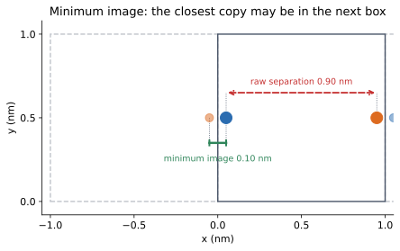

# 10 — Periodic boundaries and the minimum image

> **Where we are.** Tutorials 06–09 treated finite clusters. A small cluster has
> surfaces, and surface particles behave differently from bulk particles. This
> tutorial introduces periodic boundary conditions, the standard way to model a
> bulk-like system with a small box.
>
> **What you should already know.** Pair sums, `System`, nonbonded interactions,
> and vector arithmetic.
>
> **What you will be able to do afterwards.** Apply the minimum-image convention,
> wrap positions, choose a valid cutoff, explain why bonded terms use raw
> coordinates, and avoid common trajectory-analysis mistakes.

## 1. Learning objectives

**Core**

- Explain what periodic boundary conditions represent.
- Apply the minimum-image formula.
- Compute a minimum-image distance in an orthorhombic box.
- State the cutoff rule $R_c\le L/2$.

**Deeper insight**

- Explain why wrapping is bookkeeping, not a physical wall.
- Explain why bonded terms use raw coordinates.
- Explain why wrapped coordinates can bias mean-squared displacement.

**Looking ahead**

- Ewald summation needs periodic boundaries.
- Pressure coupling scales the box.
- Trajectory analysis must handle images correctly.

## 2. The running system

We use a 1 nm cubic box with two Lennard-Jones particles near opposite faces.

| Property | Value | Unit |
| --- | --- | --- |
| box lengths | $(1,1,1)$ | nm |
| box volume | 1 | nm³ |
| particle 0 position | $(0.05,0.5,0.5)$ | nm |
| particle 1 position | $(0.95,0.5,0.5)$ | nm |
| raw separation | 0.90 | nm |
| minimum-image separation | 0.10 | nm |
| Lennard-Jones $\epsilon$ | 1.0 | kJ/mol |
| Lennard-Jones $\sigma$ | 0.1 | nm |
| energy at $r=\sigma$ | 0 | kJ/mol |
| force magnitude | 240 | kJ/(mol nm) |



*Particle 1 has a periodic image just across the left face. The minimum-image
separation is 0.10 nm, not the raw 0.90 nm.*

## 3. Physical intuition: a box with no walls

A finite cluster has a surface. Molecules at the surface have fewer neighbours
than molecules in the interior, so surface effects can dominate a small
simulation.

Periodic boundary conditions remove the surface by repeating the box in every
direction:

- when a particle leaves through the right face, its image enters through the
  left face;
- every particle is surrounded by copies of the system;
- there is no physical wall.

The simulation still contains only $N$ particles. The images are a bookkeeping
device that makes the system behave as if it were part of a larger bulk.

**Convention versus force.** Periodic boundaries are a simulation convention,
not a force and not a new interaction. They change which separation is used for
a nonbonded pair.

### 3.1 The minimum-image convention

For two particles, there are infinitely many image separations. The
minimum-image convention chooses the shortest one:

$$ \mathbf d_{\min} = \mathbf d - \operatorname{round}(\mathbf d/\mathbf L)\odot\mathbf L, $$

where $\mathbf L=(L_x,L_y,L_z)$ and $\odot$ is element-wise multiplication.

For an orthorhombic box, each component is treated independently:

$$ d_{\min,\alpha} = d_\alpha - \operatorname{round}(d_\alpha/L_\alpha)L_\alpha. $$

### 3.2 Wrapping

Wrapping moves a position into the primary box:

$$ \mathbf r_{\mathrm{wrapped}} = \mathbf r - \lfloor\mathbf r/\mathbf L\rfloor\odot\mathbf L. $$

Wrapping changes the stored coordinates but not the physical configuration. A
particle at $x=1.05$ nm in a 1 nm box is equivalent to one at $x=0.05$ nm.

Wrapping, minimum imaging, and cutoffs are three distinct operations:

| Operation | Input | Output |
| --- | --- | --- |
| wrap | one position | position in the primary box |
| minimum image | one displacement | shortest periodic displacement |
| cutoff | one distance | include or exclude the pair |

A cutoff is applied **after** the minimum-image displacement has been computed.
Wrapping a position does not by itself compute a pair separation.

## 4. Mathematical description

### 4.1 Minimum-image distance

$$ r_{\min}=|\mathbf d_{\min}|. $$

For $\mathbf d=(0.9,0,0)$ and $L=1$,

$$ \frac{0.9}{1}=0.9, \qquad \operatorname{round}(0.9)=1, $$

so

$$ d_{\min}=0.9-1(1)=-0.1, \qquad r_{\min}=0.1\ \mathrm{nm}. $$

### 4.2 Cutoff rule

A nonbonded cutoff $R_c$ must satisfy

$$ R_c\le\frac{L_{\min}}{2}, \qquad L_{\min}=\min(L_x,L_y,L_z). $$

If the cutoff were larger, a particle could interact with two images of the same
neighbour, and the minimum-image choice would no longer be unique for all pairs.

For the running box, $L_{\min}=1$ nm, so $R_c\le0.5$ nm.

### 4.3 Bonded terms use raw coordinates

Periodic boundaries apply to **nonbonded** interactions. Bonded terms use the
stored coordinates directly:

- a bond should not wrap through the box;
- an angle should use the actual molecular geometry;
- a torsion should follow the molecular graph.

If a molecule is split across the boundary, its bonded terms would be wrong
unless the molecule is made whole or the coordinates are unwrapped. In
practice, bonded molecules are often kept whole or handled carefully.

### 4.4 Mean-squared displacement and wrapping

MSD compares positions at different times:

$$ \mathrm{MSD}(\tau) = \left\langle |\mathbf r_i(t+\tau)-\mathbf r_i(t)|^2 \right\rangle. $$

If coordinates are wrapped, a particle that crosses the boundary appears to
jump by nearly the box length. The MSD then saturates at the box size instead of
growing with time.

Two solutions:

- unwrap the trajectory before computing MSD;
- use the minimum-image displacement for short lag times.

The library supports a `box` argument for minimum-image MSD, but this is only
valid while the true displacement is less than half the box.

## 5. Units and dimensions

| Quantity | Unit |
| --- | --- |
| box lengths | nm |
| box volume | nm³ |
| displacement | nm |
| cutoff | nm |
| MSD | nm² |
| density | particles/nm³ |

The minimum-image formula is dimensionless inside `round`, because
$\mathbf d/\mathbf L$ is nm/nm.

## 6. Worked example: the two-particle box

The raw separation is

$$ |\mathbf r_0-\mathbf r_1| = |0.05-0.95| = 0.90\ \mathrm{nm}. $$

The minimum-image component is

$$ d_{\min,x} = 0.05-0.95-\operatorname{round}(-0.9)(1) = -0.9+1 = 0.1\ \mathrm{nm}. $$

So

$$ r_{\min}=0.1\ \mathrm{nm}. $$

The Lennard-Jones parameters are $\epsilon=1.0$ kJ/mol and $\sigma=0.1$ nm, so
the pair sits exactly at $r=\sigma$. Therefore

$$ U_{\mathrm{LJ}}=0. $$

The force magnitude at $r=\sigma$ is

$$ \frac{24\epsilon}{\sigma} = \frac{24(1.0)}{0.1} = 240\ \mathrm{kJ/(mol\ nm)}. $$

The forces on the two particles are equal and opposite, along the minimum-image
direction.

## 7. Python implementation

The box is in [`src/moleculab/foundation/box.py`](../../../src/moleculab/foundation/box.py):

```python
@dataclass
class Box:
    lengths: np.ndarray

    def minimum_image(self, displacement):
        return self.minimum_image_array(
            as_vector3(displacement, "displacement")
        )

    def minimum_image_array(self, displacements):
        vectors = np.asarray(displacements, dtype=float)
        return vectors - np.round(vectors / self.lengths) * self.lengths

    def wrap(self, position):
        vector = as_vector3(position, "position")
        return vector - np.floor(vector / self.lengths) * self.lengths
```

`minimum_image_array` accepts any leading shape, which makes it useful for
pair-distance matrices.

### 7.1 How `System` uses the box

`System.nonbonded_energy()` and `System.forces()` apply the minimum image to
each nonbonded displacement:

```python
displacement = self.particles[i].position - self.particles[j].position
if self.box is not None:
    displacement = self.box.minimum_image(displacement)
```

Bonded terms call `topology.energy(self.positions)` and
`topology.forces(self.positions)` with the raw positions.

### 7.2 Cutoff validation

When a `NonbondedModel` is attached, the `System` constructor checks

$$ R_c\le\frac{1}{2}\min(L_x,L_y,L_z). $$

If not, it raises an error. This catches a common and subtle modelling mistake.

### 7.3 Run the example

```bash
uv run python examples/periodic_box.py
```

Expected essentials:

```text
displacement [0.9, 0.0, 0.0] -> minimum image [-0.1  0.   0. ] distance 0.100 nm
Raw separation:     0.900 nm
Minimum-image:      0.100 nm
LJ energy:          -0.000000 kJ/mol
Forces: [[ 240.    0.    0.]
 [-240.    0.    0.]]
```

## 8. Tests and verification

Run:

```bash
uv run pytest tests/test_box.py -q
```

The tests check:

- a displacement of 0.9 in a unit box maps to $-0.1$;
- a displacement of $-0.9$ maps to $+0.1$;
- a displacement inside half the box is unchanged;
- wrapping puts a position in $[0,L)$;
- the minimum-image distance is the shortest separation;
- array inputs work;
- invalid box lengths are rejected;
- a cutoff larger than half the box is rejected.

A useful manual check is to draw the box and its neighbouring copies, then mark
the nearest image of each particle.

### 8.1 Physical invariants

- A wrapped and an unwrapped representation give the same interactions under
  the minimum image.
- Displacements that differ by a lattice vector are equivalent:
  $\mathbf d$ and $\mathbf d+n\mathbf L$ give the same minimum image.
- The cutoff is at most half the shortest box edge.
- Bonded terms use raw coordinates, not the minimum image.
- Long-lag MSD requires unwrapped coordinates.

**Recurring question:** does wrapping change the physics, or only the stored
numbers? It must change only the numbers.

## 9. Experiments

### Experiment 1: near the half-box boundary

Compute the minimum image for displacements of 0.49, 0.50, and 0.51 nm in a
1 nm box. What happens at exactly half the box?

### Experiment 2: cutoff

Build a `System` with a cutoff of 0.6 nm in a 1 nm box. What error does it
raise? Why?

### Experiment 3: wrapping

Wrap positions of 0.05, 1.05, and $-0.95$ nm. Which are equivalent?

### Experiment 4: MSD

Simulate a particle crossing the boundary. Compute MSD with and without the
minimum-image option. Which one saturates?

### Experiment 5: bonded molecule across a boundary

Place a bonded pair across the boundary. Compute the bond using raw coordinates
and using the minimum image. Which is correct? Why?

## 10. Common misconceptions

1. **“Periodic boundaries are walls.”** They are not. Particles cross freely;
   the images are copies.
2. **“The box is filled with copies of every particle.”** Conceptually yes, but
   only $N$ particles are stored and integrated.
3. **“Minimum image applies to bonded terms.”** It does not; bonded terms use
   raw coordinates.
4. **“Any cutoff is fine if the box is large enough.”** The cutoff must be at
   most half the shortest edge.
5. **“Wrapping changes the physics.”** It changes the stored coordinates, not
   the physical configuration.
6. **“Wrapped coordinates are fine for long-time MSD.”** They can saturate the
   MSD at the box size.
7. **“A larger box is always better.”** It reduces finite-size effects but
   increases cost.
8. **“Minimum image is exact for all pairs.”** It is exact only when the cutoff
   is at most half the box.

## 11. Connections and what comes next

- **Trajectory analysis** uses minimum-image displacements for short-lag MSD
  and RDF.
- **Ewald summation** requires a periodic box and handles long-range
  electrostatics.
- **Pressure coupling** scales the box and positions together.
- **Solvent boxes** use periodic boundaries to model bulk liquid.
- **Docking** usually uses a finite receptor region rather than PBC.

## 12. Self-check with answers

1. **What is the minimum-image displacement for 0.9 nm in a 1 nm box?**
   $-0.1$ nm, with distance 0.1 nm.

2. **What is the maximum valid cutoff for a 2 nm box?**
   1 nm.

3. **Does wrapping change the energy?**
   No, if the separation uses the minimum image.

4. **Do bonded terms use the minimum image?**
   No.

5. **Why can wrapped MSD saturate?**
   A boundary crossing appears as a jump of nearly one box length.

6. **What does `Box.wrap` do?**
   It maps a position into the primary box $[0,L)$.

7. **Why is a cutoff larger than $L/2$ ambiguous?**
   A particle could interact with more than one image of the same neighbour.

## 13. Exercises

### Calculation

1. Compute the minimum-image displacement for $d=0.7$ in a 1 nm box.
2. Compute the box volume for lengths $(2,2,3)$ nm.
3. Compute the minimum-image distance for $\mathbf d=(0.6,-0.7,0.2)$ in a
   $(1,1,1)$ box.
4. For the running pair, compute the force if $\sigma=0.2$ instead of 0.1.

### Reasoning

1. Why does a periodic box remove surface effects?
2. Why is the minimum image not a physical force?
3. Why must bonded molecules be handled carefully across boundaries?
4. Why does the cutoff rule exist?
5. Why can a small box bias diffusion coefficients?

### Implementation

1. Run the periodic-box example and reproduce the printed values.
2. Wrap a list of positions and verify they lie in $[0,L)$.
3. Build a `System` with an invalid cutoff and inspect the error.
4. Compute MSD with and without a box for a particle crossing the boundary.
5. Plot a two-dimensional box with several periodic images.

## 14. Summary

- Periodic boundaries model a bulk system without surfaces.
- The minimum-image convention selects the shortest separation.
- Wrapping is bookkeeping; it does not change the physical configuration.
- Nonbonded interactions use the minimum image; bonded terms use raw
  coordinates.
- The cutoff must not exceed half the shortest box edge.
- Wrapped coordinates can bias long-time MSD.
- Periodic boundaries are the foundation for Ewald summation, pressure
  coupling, and bulk solvent models.

**Previous:** [09 — Temperature and thermostats](09_thermostats.md).

**Return to the physics tutorial index:** [README](README.md).
